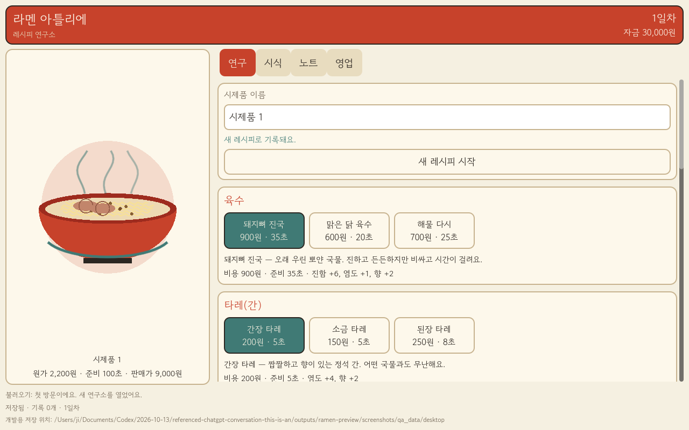

# Ramen Town — Codex × Claude 개발 하네스

라멘 메뉴 개발, 직원 육성, 단골 이야기와 골목 성장을 연결하는 게임을 준비합니다. **현재는 Mac에서 실행하는 첫 레시피 연구소 프로토타입 단계입니다.** 직원 육성·단골 서사·골목 건설은 후속 범위이며, iOS 빌드와 실기기 검증은 아직 하지 않았습니다.

## 첫 플레이 버전: 라멘 아틀리에

**디자인 재검토 중:** 사용자는 첫 UI가 원한 카이로소프트 계열 경영 게임과 크게 다르다고 평가했습니다. 이 버전은 기능 검증용으로 유지하며, [매장 중심 도트 화면 재설계 시안](game/DESIGN_DIRECTION.md)을 검토합니다. 시안의 기능은 아직 구현하지 않았습니다.

육수·타레·향미유·면·토핑·익힘을 조합해 라멘을 개발하고, 취향이 다른 단골 세 명의 피드백을 읽습니다. 레시피를 수정해 이전 버전과 비교하고, 가격·원가·준비 시간을 고려해 하루 영업을 정산합니다. 레시피 노트와 진행 상태는 로컬에 저장됩니다.



- [실행 방법과 게임 규칙](game/README.md) — Godot 4.7.2 안정 버전 사용. 다른 컴퓨터에서는 Godot 설치 후 game/project.godot를 가져와 실행합니다. 이 저장소에는 엔진 바이너리가 없습니다.
- [첫 구현의 검증 기록](game/VERIFICATION.md) — 도메인·저장 20개 테스트/446개 확인, UI 흐름·레이아웃 1,000개 확인 통과. 실제 렌더러 캡처 16장을 확인했습니다.
- [위임 실행과 사용량 기록](evidence/ramen-lab-runs.json) — 중단·인증 실패·수정 실행도 포함합니다. 서비스별 구독 사용률 절감이나 50:50 분배를 증명하지 않습니다.

첫 화면은 코드로 그린 라멘 그릇과 OFL 한국어 글꼴을 사용합니다. 상용 픽셀아트·애니메이션은 후속 작업입니다.

Codex가 요구사항과 독립 검증을 담당하고 Claude Code가 코드·테스트를 구현합니다. 초기 연결 테스트와 첫 게임 구현의 검증 기록을 구분해 남기며, 이 저장소의 기록은 상용 게임 완성도를 증명하는 벤치마크는 아닙니다.


## 이 저장소에서 확인할 수 있는 것

| 내용 | 파일 |
| --- | --- |
| 역할 분담, 수정 루프, 완료 판단 규칙 | [AGENTS.md](AGENTS.md), [CLAUDE.md](CLAUDE.md) |
| 구현 범위와 검증 방법을 명시한 작업 계약 | [테스트 계약](tasks/smoke.md), [계약 템플릿](tasks/template.md) |
| 인증·모델·턴 제한 실패 및 최종 통과 기록 | [VERIFICATION.md](VERIFICATION.md) |
| 세션 식별자를 제외한 실제 응답 필드 | [검증 증거](evidence/smoke-summary.json) |
| iPhone 우선 플랫폼 방향과 게임 기획 | [GAME_DESIGN.md](GAME_DESIGN.md) |

## 검증에서 배운 점

- 프로세스 종료 코드가 0이어도 작업이 완료됐다고 단정할 수 없습니다. 실제로 턴 제한 응답은 종료 코드 0과 `is_error=false`를 반환했습니다.
- 완료 판정은 종료 코드, 응답 유형, 오류 여부, 보고 내용, 파일 상태를 함께 확인합니다.
- Claude가 수정했다고 보고한 파일을 Codex가 기준 파일과 바이트 단위로 비교하고, 기존 파일들의 해시로 범위 밖 변경 여부를 확인했습니다.
- 기본 프로필은 파일 도구만 제공합니다. 검토된 테스트 프로필에서는 지정한 명령만 Claude가 실행하고, Codex도 완료 기준을 독립 검증합니다. 전체 무인 개발 파이프라인은 아닙니다.

## 사용량 분산을 위한 V0 운영

목표는 Claude에 구현 작업을 충분히 맡기면서 Codex의 중복 분석을 줄이는 것입니다. 사용률을 자동으로 50:50으로 맞추는 기능은 없습니다.

| Claude Code | Codex |
| --- | --- |
| 관련 코드 탐색과 상세 설계 | 요구사항·범위·완료 기준 정의 |
| 코드 및 테스트 작성 | 변경 부분과 필요한 주변 코드 리뷰 |
| 허용된 명령으로 자체 검증 | 완료 기준과 회귀 테스트 독립 실행 |
| 결함 수정과 짧은 결과 보고 | 재현 조건을 포함한 구체적인 수정 지시 |

초기 작업은 독립된 계약으로 실행합니다. 같은 작업의 수정은 필요한 경우 로컬에 보관된 해당 세션 ID로 `--resume`하되, 권한과 파일 상태를 다시 검토합니다. 전체 대화나 소스 코드를 반복 전달하지 않습니다. 기본 턴 상한은 연결 테스트 20, 작은 구현 작업 30, 수정 요청 10이며 토큰 상한은 아닙니다. 한도 도달 시 상태를 확인하고 작업을 나누거나 이어갑니다.

Claude의 실제 응답에 usage/modelUsage/total_cost_usd가 있으면 로컬 실행 기록에 보관하고, 없는 값은 미확인으로 둡니다. 비용 추정값은 구독 청구액이 아니며 토큰 수로 서비스별 사용률을 환산하지 않습니다. Codex 사용률도 확인 가능한 경우에만 작업 전후 관찰값으로 기록하고, 다른 작업이 동시에 사용했다면 이 작업만의 소비라고 단정하지 않습니다. 실제 게임 작업 몇 건 후 위임 범위를 조정합니다.

원본 실행 로그는 로컬에 보관하고 Git에서는 제외합니다. 공개 증거에는 검증에 필요한 필드만 포함합니다. 아래 통과 기록은 최초 Mac 환경에서 관찰한 결과이며, 다른 계정·모델·CLI 버전에서는 다시 검증해야 합니다.

Start Codex in this project root so AGENTS.md is discovered. Authenticate both CLIs before reproducing the test. The checked-in fixture represents the completed test: change only status=verified to status=pending before running it again.

## Invocation contract

Codex writes a concrete contract using tasks/template.md. Execute from this directory, with a fresh result filename for each attempt:

```sh
"$HOME/.local/bin/claude" -p \
  --model claude-sonnet-5-5 \
  --output-format json \
  --max-turns 20 \
  --restricted \
  --permission-mode dontAsk \
  --strict-mcp-config \
  --mcp-config '{"mcpServers":{}}' \
  --tools 'Read,Edit,Write,Glob,Grep' \
  --allowedTools 'Read,Edit,Write,Glob,Grep' \
  < tasks/smoke.md > smoke/result-next.json
```

This option set passed with native Claude Code 2.1.296 at /Users/ji/.local/bin/claude. The explicit model avoids the obsolete default model in the old CLI. Homebrew Claude was also upgraded from 1.0.120 to 2.1.287; the current shell resolves plain `claude` to /opt/homebrew/bin/claude. This harness explicitly selects the verified native installation without modifying the user's PATH. The successful test used smoke/result-updated.json and completed in six turns.

Use shell input redirection for the contract, not command substitution or eval. Never interpolate the user's task into a shell command. Keep the working directory explicit. Do not use --continue; initial contracts are self-contained. Only explicitly resume the same task for corrections as described above. Do not use --dangerously-skip-permissions, bypassPermissions or additional directories.

The empty strict MCP configuration prevents unrelated MCP connections. Only five file tools are exposed; dontAsk rejects unapproved operations, and restricted confines file tools to the working directory and ignores ordinary user/project/local settings. Bash is unavailable, so Claude cannot run tests through Bash in this V0 profile. Codex runs reviewed verification commands independently and returns their results to Claude for targeted corrections. These CLI permissions are not an operating-system sandbox; only use this in a trusted project and enforce editable paths through contracts and independent change review.

For normal implementation, replace the input with the reviewed task contract, choose a unique output path, and set an appropriate finite turn limit. Monitor the process; cancel a stalled invocation rather than retrying concurrently. Retain failed output for diagnosis. Do not broaden permissions to solve an authentication error.

### Reviewed-tests profile

**상태: 허용된 명령 실행 PASS.** 개별 네트워크·Claude 상태 디렉터리 쓰기 권한 요청 후 기존 구독 로그인을 읽을 수 있었고, Claude의 실제 Read → Read → Bash 비교 실행과 Codex의 독립 비교가 통과했습니다. 허용되지 않은 명령의 거부 경로는 별도 미검증입니다. [검증 기록](VERIFICATION.md), [선별 실행 증거](evidence/reviewed-tests-summary.json)

Codex 실행에서 인증 오류가 나면 같은 CLI의 `auth status`를 사용자의 일반 터미널과 비교합니다. 일반 터미널에서 로그인됐는데 Codex에서만 실패하면 재로그인이나 토큰 복사 전에 실행 권한을 점검합니다. 이번에는 `request_permissions`로 네트워크 및 `~/.claude`, `~/.claude.json` 쓰기 접근을 승인받은 뒤 정상화됐습니다. 권한은 이번 턴 범위였으므로 다음 실행에서는 다시 필요할 수 있습니다. 전체 접근이나 전역 권한 변경 없이 확인했으며, 필요한 경로는 실행 환경에 맞춰 최소 범위로 요청합니다.

이 프로필은 파일 도구에 Bash를 추가하지만, 자동 허용은 계약에서 검토한 정확한 명령으로 제한합니다. 실행할 스크립트가 있다면 그 내용과 부작용도 먼저 확인합니다. 넓은 `Bash` 허용, 인터프리터 와일드카드, 설치·네트워크·Git 변경·배포 명령은 허용하지 않습니다. 파일 권한은 위 기본 프로필과 같으며 계약의 편집 범위도 계속 검증합니다.

```sh
"$HOME/.local/bin/claude" -p \
  --model claude-sonnet-5-5 \
  --output-format json \
  --max-turns 20 \
  --restricted \
  --permission-mode dontAsk \
  --strict-mcp-config \
  --mcp-config '{"mcpServers":{}}' \
  --tools 'Read,Edit,Write,Glob,Grep,Bash' \
  --allowedTools 'Read,Edit,Write,Glob,Grep' 'Bash(cmp smoke/probe.txt smoke/probe.expected.txt)' \
  < tasks/reviewed-tests-smoke.md > smoke/result-reviewed-tests.json
```

게임 구현 시에는 이 비교 명령을 그대로 쓰지 말고, 실제 테스트 명령을 검토한 뒤 계약과 허용 목록을 함께 바꿉니다. 거부된 명령은 자동 재시도하거나 권한을 넓히지 않습니다. 거부 경로의 자동 테스트는 아직 구성하지 않았습니다.

## Independent acceptance

1. Record the process exit code. Require exit code 0 and valid JSON with subtype=success AND is_error=false AND a nonempty result. Neither flag alone is sufficient: the authentication failure had subtype=success; a turn-limit failure had is_error=false and exit code 0.
2. Inspect permission_denials and the actual changed files. New untracked files must also be reviewed; git diff alone does not include them.
3. For this fixture, require exactly two lines: `nonce=v0-20261013-7a91c4e2` and `status=verified`, with a final newline. Compare with smoke/probe.expected.txt. Require the report to include the original nonce as additional reading evidence.
4. Require no unexpected changes. On a later Git project, inspect status, staged/unstaged diff and untracked files, then run relevant tests independently.
5. On failure, send a targeted correction contract with the failing command/output and expected behavior. Stop after three failed correction attempts and report the blocker.

To repeat a successful connectivity test, Codex must first reset only the dedicated smoke fixture to status=pending, preserving its nonce. Never reset a whole repository for this purpose.

## Ready state

After user login and CLI updates, authenticated reading and editing passed independent acceptance. The fixture currently has status=verified. Before another smoke test, reset only its status to pending. The user can now supply game requirements; Codex will prepare the contract, Claude will implement, and Codex will independently verify. Game-specific build tools and tests will be selected when the requirements are known.

## References

- [Claude Code CLI reference](https://code.claude.com/docs/en/cli-reference): print invocation, JSON output and tool permissions. Installed CLI help was used to check version compatibility.
- [Claude model IDs](https://platform.claude.com/docs/en/models/overview): source for the explicit Sonnet model identifier; availability was also verified by an actual invocation.
- [Claude installation and updates](https://code.claude.com/docs/en/setup): native and Homebrew update paths.
