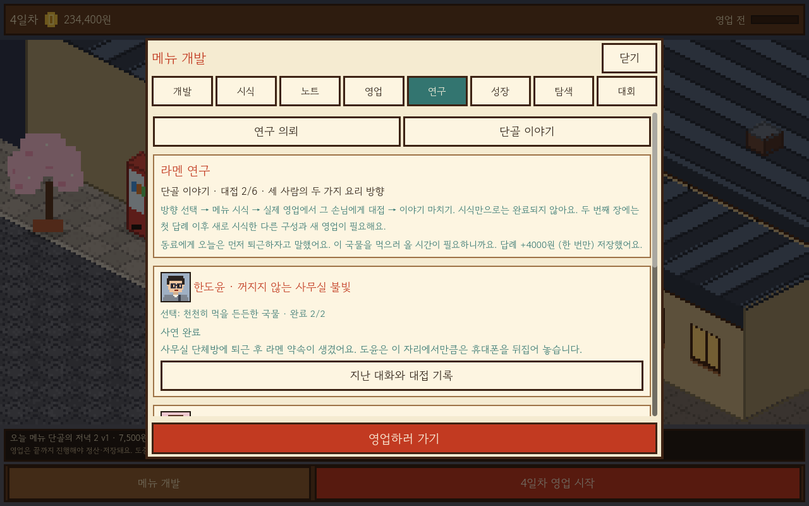
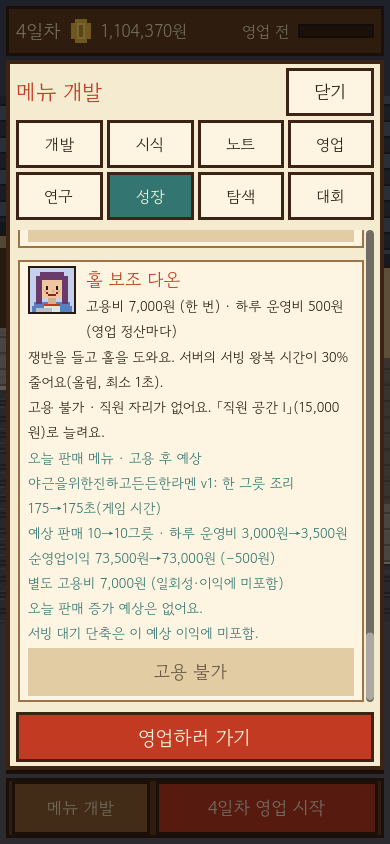
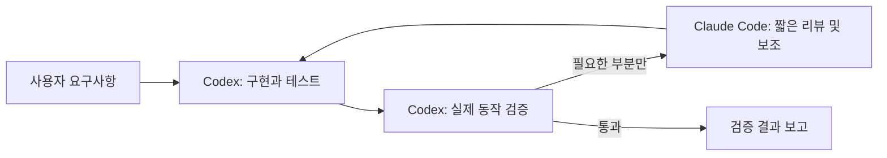

# Ramen Town — Codex × Claude 개발 하네스

**현재 작업 분담(2026-10-22):** 사용자가 다시 지시할 때까지 Claude 위임을 중지합니다. 구현·리뷰·검증은 Codex가 맡습니다. 아래 공동 구현 설명과 실행 템플릿은 이전 운영 기록이며 현재 호출 권한을 뜻하지 않습니다.

라멘 메뉴 개발, 직원 육성, 단골 이야기와 골목 성장을 연결하는 게임을 준비합니다. **현재는 Mac에서 실행하는 도트 라멘가게 프로토타입 단계입니다.** 장터 반복 채집·메뉴 실험부터 단골 이야기·노트·투자 안내까지 실제 Mac 화면 검증을 통과했습니다. iPhone 개발용 앱도 설치·실행했으며, 사용자가 지적한 손가락 스크롤을 수정했습니다. 수정본의 화면 전체 스크롤·탭은 사용자가 실기기에서 정상 확인했습니다. 골목 건설은 아직 완료하지 않았습니다.

## 현재 버전: 라멘 아틀리에 (매장 중심)

**개발 중 — 그릇에서 시작하는 메뉴 실험:** 현재 그릇을 크게 보고, 작업 메뉴와 긴 재료 영수증은 아이콘/화살표로 펼칩니다. 유자 맑은탕·참깨 진국·정어리 가리비탕의 열린 조건과 실제 시식 기록을 연결하고, 제작 단계별 짧은 소리와 이번 실행의 음소거를 추가했습니다. 정답 레시피3개나 영구 수집 보상을 추가한 것은 아닙니다. 새 패키지1,896확인과 기존 도메인/터치/실험/항구 회귀, 두 화면 전체 배치19,496확인이 통과했습니다. **현재 실제 화면 검사는 새 QA 앱 실행 승인 대기이며 아직 수락·main 병합하지 않았습니다.** [조작과 검증 범위](game/docs/DISCOVERY_WORKBENCH_V1.md).

**항구 재료 채집:** 등급 2에서 항구 공급처 두 곳을 찾으면 구운 정어리 육수·가리비 고명을 반복 채집합니다. 출발비와 손질 비용/수량을 확인해 수령하고, 초안을 바꾸지 않는 이동으로 메뉴 개발을 이어갑니다. 같은 가리비 여러 분량을 포함해 시제품에 넣은 수만큼만 연구 재료를 쓰며 기존 메뉴 판매는 재고 0에서도 가능합니다. Codex 단독 구현입니다. 실제 Mac OpenGL962확인·실패0·종료0·엔진 오류0과 새 화면28장 전체 검토를 통과했습니다. 첫 화면 검토에서 발견한 수령·재료 이동·줄바꿈 문제도 수정하고 같은 상태의 전후 화면으로 확인했습니다. iPhone 설치는 연기한 상태입니다. [현재 화면과 전후 비교](game/docs/harbor-screenshots). [플레이 흐름·저장](game/docs/HARBOR_FORAGING_V1.md), [현재 검증 상태](evidence/harbor-foraging-v1.json).

**한 가지 바꾸는 메뉴 실험:** 개발·시식용 그릇을48×32 도트로 확장해 재료·공법·익힘·반복 고명의 차이를 표현합니다. 실제 시식 뒤 향·식감·준비 시간의 서로 다른 실험 카드를 펼쳐 전후 그릇과 실제 맛·원가·시간 차이를 봅니다. 카드 이동은 현재 초안·돈·기록을 바꾸지 않고 기존 선택 화면을 엽니다. 이번 단계는 사용자 요청에 따라 Codex 단독이며 Claude 호출0회입니다. 순수1764/통합3550/실제 패키지3550/터치70/전체 배치18948 및 도메인126시험58238확인을 통과했습니다. 같은123소스의 실제 Mac OpenGL3,646확인·실패0·종료0·엔진 오류0과 원본32장을 확인했고 신규8장과 회귀8장을 직접 검토했습니다. [현재 화면](game/docs/expression-screenshots). iPhone 설치·실제 사용감 수용은 별도입니다. [조작·범위](game/docs/RECIPE_EXPRESSION_V1.md), [검증 증거](evidence/recipe-expression-v1.json).

**요약 → 상세, 모든 버튼의 클릭 반응:** 재료·공법·맛 정보와 연구 조건을 아이콘/화살표가 있는 펼침 카드로 나눴습니다. 기본 화면에는 현재 선택을 남기고 카드 전체를 눌러 상세를 봅니다. 탭·상세·목표 선택 등 동적 버튼에도 공통 눌림/확정 링을 연결하고 기존 재료·시식의 큰 연출을 유지합니다. 스와이프 취소에는 클릭 효과가 없습니다. Claude는 펼침 카드·저널·컴포넌트 시험, Codex는 게임 연결·전체 버튼 효과·입력 검증을 맡았습니다. [조작·디자인 규칙](game/docs/UI_DEPTH_FEEDBACK_V1.md). 같은117소스의 실제 Mac OpenGL 검사3,222개가 실패0·종료0·엔진 오류0으로 끝났고 가로·세로24장을 직접 검토했습니다. [현재 화면과 해시](game/docs/ui-depth-screenshots). iPhone 설치·실제 사용감 수용은 별도입니다.

**메뉴 실험 1차 심화:** 이번 목표를 고르고 재료 단서를 따라 탐색한 뒤, 실제 시식 노트에서 연구 방향을 확인합니다. 현재 조합의 라멘 특징과 기존 시제품 대비 맛·원가·시간 변화를 보여주고, 하단 고정 버튼으로 바로 시식합니다. Claude가 판정·시험·목표/지도 화면을, Codex가 게임 연결·비교/시식 UX·독립 검증을 맡았습니다. iPhone 설치는 사용자 요청으로 연기했으며 기존 설치본은 이번 개선본이 아닙니다. [플레이 흐름과 분담](game/docs/RECIPE_DISCOVERY_V1.md).

**토핑 분량·개발 연출(v12 기반, 이전 검증):** 사용자가 선택한 등급별2→3→4칸에서 혼합·동종 중복 토핑을 담고, 칸을 선택해 교체하거나 한 몫씩 뺍니다. 분량마다 맛·원가·시간·채집 샘플을 반영합니다. 실제 맛 막대와 궁합 반응, 재료 투입 효과·제조 단계·완성 그릇/손님 카드 연출을 추가했습니다. 도메인126시험/58,238확인, 전체 두 크기 배치18,256확인과 실제 터치 경로70확인을 통과했습니다. 당시 iPhone 서명 빌드는 통과했지만 설치하지 않았습니다. 현재는 연구 지도로 확장했으며 이전 v4 시험 앱/서명 빌드는 이번 개선본이 아닙니다. 기기 설치는 사용자 요청으로 연기했습니다. [조작·규칙](game/docs/DEVELOPMENT_FEEL_V1.md), [검증](game/VERIFICATION.md).

**iPhone 터치 수정:** iPhone15Pro/iOS26.6.2에서 개발자 신뢰 후 실행·실제 화면을 확인했습니다. 카드·일반/재료 버튼·그림·이름 입력란에서 시작하는 스와이프가 화면을 움직이도록 수정하고, 드래그의 오작동 클릭과 미세 떨림을 검사했습니다. 수정본을 같은 앱에 설치·실행했고 교체 전후 저장과 백업 파일은 바이트 일치합니다. 사용자가 수정된 실기기에서 화면 어디서 밀어도 스크롤되고 탭도 정상이라고 확인했습니다. 가상 키보드·백그라운드 복귀 수용은 별도로 남아 있습니다. [원인·검증·현재 상태](game/docs/IOS_DEVICE_PREPARATION.md#손가락-스크롤-수정-2026-10-21).

**1차 완성판 범위:** 사용자가 라멘집1곳과 주변 고정 부지형 골목, 본편6~10시간 목표와 엔딩 후 자유 운영을 선택했습니다. 특히 재료 파밍과 다양한 결과물 발견을 포함한 메뉴 개발이 핵심입니다. [범위 문서](game/docs/RELEASE_SCOPE_V1.md)에 확정한 큰 방향과 세부 콘텐츠 수량·파밍/연구 방식 제안·완료 조건을 구분합니다. 제작 일정·모든 수량·스토어 제출의 일괄 승인은 아닙니다.

**v11 장터 채집:** 반복 채집으로 볶은 참깨유·유자 껍질을 얻고, 시제품마다 샘플을 써서 서로 다른 맛·시간·원가·도트의 메뉴를 개발합니다. 등록 메뉴는 샘플0개여도 통상 원가로 판매합니다. 기존 탐색과 하루 출발을 공유하고 저장v11로 이어집니다. 전체125테스트/58,220확인·두 크기 배치17,758확인·실제 구v10 저장17종의 보존 검사를 통과했습니다. 실제 OpenGL18,214확인/실패0/종료0/오류0, 새228캡처와 신규22장 검토를 완료했습니다. 같은 PCK의 새 로컬 플레이 앱도 준비했습니다. [플레이 규칙](game/README.md#장터-반복-채집과-메뉴-실험-v11-로컬-구현), [현재 화면](game/docs/foraging-screenshots), [검증](evidence/market-foraging-v1.json).

**이전 단골·노트·투자 안내 검증(2026-10-20):** 수정 v2 앱의 OpenGL 검사17,612개·실패0·종료0·엔진 오류0, 가로1280×800/세로390×844 총206장입니다. 당시 새 화면40장을 직접 검토했습니다. [해당 화면](game/docs/investment-screenshots), [실행 증거](evidence/investment-native-v2-20261020.json). 사용자 플레이 감·최종 아트·iPhone 검증과 구분합니다.

**2026-10-19 직원 장기 진단:** 18개 시험 게임×35일의 실제 영업630회와 매일 저장/재시작을 확인했습니다. 전문화는19~24일에 열렸고, 느린 메뉴에서는 속도 전문의 대기·반응과 절약 전문의 일당 사이에 차이가 있었습니다. 게임 수치 변경 없이 육성 개선의 근거를 남겼습니다. [결과와 재현](game/docs/STAFF_GROWTH_AUDIT.md). 이 진단은 iPhone·재미 검증을 대신하지 않습니다.

**투자 안내 개선:** 미고용 직원 카드에서 현재 판매 메뉴의 고용 전후 조리 시간·예상 판매·운영비·순영업이익을 비교합니다. 일회성 고용비를 분리하고 판매 증가가 없는 경우도 보여줍니다. 시설을 산 뒤 새 칸을 활용할 행동과 예측의 한계도 안내합니다. 기존 수치·저장 스키마는 바꾸지 않습니다. [사용 규칙](game/README.md#고용-전-투자-비교-로컬-개발), [작업 계약](tasks/investment-guide-v1.md).

**2026-10-19 개발 진단:** 새 시험 저장12개로14일 연속 영업168회·매일 저장/재시작과 투자별 자금 원장을 확인했습니다. 느린 메뉴에서는 조리 보조가 유효하고 빠른 메뉴에서는 추가 판매 없이 일당만 늘었습니다. 경제·육성의 다음 판단을 위한 진단이며 게임 수치 변경이나 실제 화면 검증은 아닙니다. [결과와 재실행 도구](game/docs/CAMPAIGN_AUDIT.md). 이후 실제 화면 검증은 위2026-10-20 기록으로 확인합니다.

**v10 노트 개선:** 등록 메뉴 종류6/12/30종과 개정 이력300개를 분리했습니다. 같은 메뉴의 개정은 등록 자리를 더 쓰지 않고, 노트는20개씩 표시합니다. 기록 삭제 후에도 최고 시식 증빙을 보관해 승급에 사용합니다. 이전1~9 저장을 보존합니다. [노트 규칙](game/README.md#메뉴-등록과-실험-이력), [작업 계약](tasks/recipe-notebook-v1.md).

**v9 단골 이야기:** 한도윤·서하영·윤마루의 사연에서 두 가지 요리 방향을 골라 두 장과 고유 결말을 진행합니다. 시식 조건에 더해 실제 해당 단골이 해당 메뉴를 먹은 완료 영업을 요구하고, 다음 장은 새 메뉴·새 영업으로 이어집니다. Codex가 구현·통합·검증했으며 Claude의 좁은 도움 호출은 인증 실패로 파일 변경 없이 끝났습니다. [이야기 규칙](game/README.md#단골-이야기), [기능·저장 이력](evidence/regular-stories-runs.json), [현재 실제 화면 검증](evidence/investment-native-v2-20261020.json).

기본 화면은 코드로 그린 작은 도트 가게(주방·카운터·테이블·입구·골목 줄)입니다. 영업을 시작하면 손님이 줄을 서고 자리에 앉아 주문하고, 요리사가 만들고 서버가 나르며 손님이 먹고 반응한 뒤 떠납니다. 먹기를 마친 주문만 매출로 정산되며, 영업을 끝까지 마쳐야 저장됩니다(도중에 끄면 영업 전 상태로 돌아옴). 메뉴 개발(재료 선택, 세 단골의 시식 피드백, 개정·비교, 노트)은 하단 버튼으로 여는 보조 서랍입니다. 기본 요리사·서버에 조리/홀 보조를 추가 채용할 수 있습니다. 보조 직원 육성과 실제 매장 증축·두 메뉴 판매·단골 분기 이야기를 연결했으며 자유 배치 편집은 후속입니다. [상세와 한계](game/README.md)

**연구 의뢰(feature/ramen-research):** 메뉴 개발 서랍의 `연구` 탭에서 입문 3개·심화 3개를 진행합니다. 입문 두 개를 마치면 심화가 열리고, 실제 시식 기록을 제출하면 점수·자금을 한 번만 받습니다. 저장 v2는 기존 v1을 보존해 읽습니다. Codex 독립 검사 42개 테스트·41,034개 확인, 두 크기 UI 2,646개 확인이 통과했으며 연구 화면까지 Codex가 자동으로 앱을 실행해 2,698개 확인·실패 0, 새 PNG 26장과 종료 0을 확인했습니다. [검증 증거](evidence/ramen-research-runs.json). [상세](game/README.md#라멘-연구)

**자동 화면 검증:** Claude가 자체 포함 로컬 QA 앱 제작 도구를 작성하고 Codex가 검토·실행·수정을 검증했습니다. 사용자에게 매번 터미널 실행을 넘기던 흐름을 앱 준비 → Codex 실행 → 새 캡처·종료·오류 확인으로 바꿨습니다. [자동화 증거](evidence/automatic-native-qa.json), [사용 규칙](game/README.md#자체-포함-qa-앱-자동-그래픽-qa용-로컬-개발-전용).

**플레이 피드백 1차:** 글자 대신 그릇 문양 간판, 약 4초의 국물·면·시식 진행 연출, 단골별 작은 초상, 자동·수동 저장 안내를 추가했습니다. [작업 계약](tasks/feedback-play-feel.md), [실행 증거](evidence/feedback-play-feel-runs.json).

**이전 성장 버전(v3):** 등급 심사로 가게 랭크 3단계를 올리고, 조리대·직원 공간을 구매해 토핑 1→2→3개, 메뉴 개정 기록 6→12→30칸, 직원 2→3→4명을 열 수 있습니다. 직원은 별도 채용하며 실제 조리·서빙 시간과 일당이 영업에 반영됩니다. 기존 단일 토핑 점수·원가·시식평과 v1/v2 저장은 보존합니다. Claude가 코드·테스트를 작성하고 Codex가 60개 테스트/48,272개 확인, 배치 7,056개, 실제 OpenGL 화면 7,168개·56장·종료 0·엔진 오류 없음을 확인했습니다. [계약](tasks/shop-growth-v1.md), [독립 검증과 중단·재개 기록](evidence/shop-growth-runs.json), [성장 규칙](game/README.md#가게-성장). 콘테스트·잡지 소개 같은 작은 이벤트는 후속입니다.

**이전 탐색 버전(v4):** 장터·항구·산골에서 두 번의 선택형 만남을 거쳐 새 재료 6종의 공급처를 영구 해금합니다. 가게 랭크별 지역·출발 비용, 하루 한 번 출발, 유료 선택과 포기, 진행 중 저장·재시작을 연결했습니다. 이동은 약 1.2초의 연출이며 보상은 명시적으로 수령합니다. Claude가 도메인을 구현했고, 한도 중단 후 사용자의 승인으로 Codex가 화면·그림·테스트를 마무리했습니다. 전체 79개 테스트/49,814개 확인, 두 크기 배치 8,766개, 실제 렌더링 8,934개·84장·실패 0·종료 0·엔진 오류 없음. [탐색 규칙](game/README.md#재료-탐험), [검증 증거](evidence/ingredient-exploration-runs.json).

**이전 콘테스트 버전(v5):** 맑은 국물·진한 국물·지역 식재료의 대회 3개에 시식 메뉴로 출품하고, 주제별 심사 힌트를 보고 메뉴를 고쳐 재도전합니다. 하루 한 번 출품료를 내며 메달이 개선될 때만 상금 차액을 받고 금메달 대회는 완료됩니다. 은메달 이상 메뉴에는 잡지 소개 제안이 와서 수락하면 실제 메뉴 이야기와 한 번의 협조비를 받습니다. Claude는 작은 채점 모듈·시험과 짧은 저장 리뷰를, Codex는 거래·저장·화면·그림·통합 검증을 맡았습니다. [규칙](game/README.md#콘테스트와-잡지-소개), [작업 계약](tasks/ramen-contests-v1.md), [실행과 검토 증거](evidence/ramen-contests-runs.json).

**육수·면 제조 공법(v8):** 육수3공법과 면3반죽의9조합을 맛·원가·영업 조리시간에 연결했습니다. 공법만 바꿔 개정/시식하고 제조 진행을 확인하며 고급 공법은 등급2부터 선택합니다. Codex가 통합·검증을, Claude가 작은 순수 공법 카탈로그와 전용 시험을 담당했습니다. [규칙](game/README.md#육수-공법과-면-반죽), [작업 계약](tasks/recipe-process-v1.md). 전체112개 테스트/56,595개 확인·순수 공법118개·두 크기 배치14,510개가 실패0/종료0으로 통과했습니다. 실제OpenGL14,842개·166장도 실패0/종료0/엔진오류0으로 통과했고 새20장을 직접 검토했습니다. [분담·실행 증거](evidence/recipe-process-runs.json).

**이전 매장 증축·복수 메뉴(v7):** 등급2부터 60,000원으로 홀을 넓혀 8→12석과 판매 1→2종을 엽니다. 두 메뉴는 같은 손님·주방 시간을 나누며, 시식 메뉴와 판매 목록을 따로 고정하고 메뉴별 판매량·재료비 차감 이익·실제 대기를 비교합니다. [규칙](game/README.md#매장-증축과-판매-메뉴), [작업 계약](tasks/shop-expansion-menus-v1.md). 전체105개 테스트/56,283개 확인·순수 계산1,638개·배치13,158개·실제OpenGL13,450개와146장이 실패0/종료0/엔진오류0으로 통과했습니다. [분담·실행 증거](evidence/shop-expansion-menus-runs.json).

**이전 직원 육성 버전(v6):** 고용 뒤 완료한 영업의 그릇/실무일을 쌓아 숙련 훈련을 받고, 속도 전문과 절약 전문 중 하나를 선택합니다. 비용·가게 등급·실무 조건이 함께 필요하며 맛 점수는 올려주지 않습니다. Claude는 한 직원의 순수 육성 규칙과 전용 시험, Codex는 영업 정산·저장·화면·통합 검증을 담당합니다. [계약](tasks/staff-training-v1.md), [규칙](game/README.md#직원-육성). 전체97개 테스트/50,982개 확인, 육성 규칙96개, 배치12,096개, 실제 OpenGL12,344개·124장·실패0·종료0·엔진오류0을 확인했습니다. [분담·검토·실행 증거](evidence/staff-training-runs.json).

**방향 수용 ≠ 최종 승인:** 수용한 [시안](game/DESIGN_DIRECTION.md)은 등각 투영(아이소메트릭)입니다. 현재 코드는 시안을 베끼지 않고 직접 짠 도트 규칙으로 등각 컷어웨이 가게(마름모 바닥 타일, 입체 카운터/테이블/의자, 세운 벽·주방·선반, 파사드와 인도 줄, 이웃 건물·소품)를 그리도록 바뀌었습니다(세로 176×264 / 가로 320×152 논리 픽셀). 다만 이 그림은 시안보다 단순한 프로토타입이며 최종 사용자 화면 승인은 대기합니다. 시안은 방향 검토용 AI 생성 이미지일 뿐 구현 화면이 아닙니다.

추가 등각 투영 그림 보완은 Claude의 서버 인증 오류(`OAuth token revoked`)로 중단됐지만, 2026-10-14 재로그인 후 실제 모델 요청이 `AUTH_OK`로 성공해 복구했습니다([복구 확인](evidence/auth-recovery-20261014.json)). 등각 그림·조각 좌표·퇴장 경로와 모바일 표시를 보완했고, Codex 독립 검사 30개 테스트/40,404개 확인 및 두 크기 UI 1,548개 확인이 통과했습니다. 실제 캡처에서 표시 오류를 발견해 수정한 뒤 다시 실행했고, 렌더링 QA 1,588개 확인·실패 0과 [현재 화면 20장](game/docs/isometric-screenshots)을 확인했습니다. 최종 사용자 화면 승인과 플레이 감은 대기합니다.

아래는 현재 단골 이야기·고용 비교의 실제 화면입니다. [새40장과 전체206장 해시](game/docs/investment-screenshots)를 남깁니다. 이전 제조 공법 화면은 [과거 갤러리](game/docs/process-screenshots)로 보관합니다.




- [실행 방법과 게임 규칙](game/README.md) — Godot 4.7.2 안정 버전 사용. 다른 컴퓨터에서는 Godot 설치 후 game/project.godot를 가져와 실행합니다. 이 저장소에는 엔진 바이너리가 없습니다.
- [검증 기록](game/VERIFICATION.md) — 최신 기능124개 테스트/58,045개 확인, 전체 배치17,200개 및 실제 렌더링17,612개·206장·실패0·종료0·엔진 오류0. 사용자 플레이 감·iPhone은 별도 확인 범위입니다.
- [매장 재설계 위임 기록](evidence/shop-playable-runs.json) — 턴 제한 실패, 결함 수정, 실제 응답 필드와 Codex 독립 검사 결과를 구분합니다.
- [위임 실행과 사용량 기록](evidence/ramen-lab-runs.json) — 중단·인증 실패·수정 실행도 포함합니다. 서비스별 구독 사용률 절감이나 50:50 분배를 증명하지 않습니다.

장면의 도트(사람·가구·말풍선·그릇)는 외부 에셋 없이 코드로 찍었고 글꼴만 OFL 한국어 글꼴입니다. 상용 수준의 도트 아트·애니메이션은 후속 작업입니다.

지금까지 Codex가 요구사항과 독립 검증을 담당하고 Claude Code가 코드·테스트를 구현했습니다. 사용자의 2026-10-15 요청으로, 진행 중인 식재료 탐색의 남은 화면 작업부터 Codex가 구현·테스트까지 주로 맡고 Claude는 작은 컴포넌트 구현이나 짧은 독립 리뷰에 사용하며 남은 한도와 작업 범위에 맞춰 조정합니다. 초기 연결 테스트와 각 게임 구현의 실제 역할·검증 기록을 구분합니다. 이 기록은 상용 게임 완성도를 증명하는 벤치마크는 아닙니다.



## 이 저장소에서 확인할 수 있는 것

| 내용 | 파일 |
| --- | --- |
| 역할 분담, 수정 루프, 완료 판단 규칙 | [AGENTS.md](AGENTS.md), [CLAUDE.md](CLAUDE.md) |
| 구현 범위와 검증 방법을 명시한 작업 계약 | [테스트 계약](tasks/smoke.md), [계약 템플릿](tasks/template.md) |
| 인증·모델·턴 제한 실패 및 최종 통과 기록 | [VERIFICATION.md](VERIFICATION.md) |
| 세션 식별자를 제외한 실제 응답 필드 | [검증 증거](evidence/smoke-summary.json) |
| iPhone 우선 플랫폼 방향과 게임 기획 | [GAME_DESIGN.md](GAME_DESIGN.md) |

## 검증에서 배운 점

- 프로세스 종료 코드가 0이어도 작업이 완료됐다고 단정할 수 없습니다. 실제로 턴 제한 응답은 종료 코드 0과 `is_error=false`를 반환했습니다.
- 완료 판정은 종료 코드, 응답 유형, 오류 여부, 보고 내용, 파일 상태를 함께 확인합니다.
- Claude가 수정했다고 보고한 파일을 Codex가 기준 파일과 바이트 단위로 비교하고, 기존 파일들의 해시로 범위 밖 변경 여부를 확인했습니다.
- 기본 프로필은 파일 도구만 제공합니다. 검토된 테스트 프로필에서는 지정한 명령만 Claude가 실행하고, Codex도 완료 기준을 독립 검증합니다. 전체 무인 개발 파이프라인은 아닙니다.

## 사용량 분산을 위한 V0 운영

사용자의 최신 요청은 Claude 비중을 지나치게 낮추지 않는 실질적인 공동 구현입니다. Claude가 도메인과 실제 화면 컴포넌트 같은 의미 있는 묶음을 맡고, Codex가 요구사항·기존 게임 연결·인접 UX와 독립 검증을 맡습니다. 이번 연구 지도는 Claude가 판정 로직·순수 시험·목표/지도 화면을 작성하고 Codex가 시식·노트·채집 연결과 화면/입력 회귀를 검증합니다. 사용률을 자동으로50:50으로 맞추는 기능은 없습니다.

| Claude Code | Codex |
| --- | --- |
| 명시적으로 소유한 도메인·화면 컴포넌트 구현과 관련 시험 | 요구사항·분담·기존 게임 통합과 인접 UX 구현 |
| 해당 범위의 설계·구현과 검증 실패의 표적 수정 | 실제 파일·동작·회귀의 독립 검증 |
| 근거 있는 발견 사항과 간결한 보고 | 호출 범위·사용량 관찰과 최종 완료 판단 |

Claude 호출은 독립된 계약과 파일 소유권을 정한 뒤 실행합니다. 같은 작업의 수정·이어지는 소유 컴포넌트는 필요한 경우 해당 로컬 세션 ID로 `--resume`하되 권한과 파일 상태를 다시 검토합니다. 전체 대화나 소스 코드를 반복 전달하지 않습니다. 연결 시험20, 선택적 리뷰8, 범위가 정해진 구현30, 표적 수정10턴이 기본이며 토큰 상한은 아닙니다. 리뷰 전용은 Read/Glob/Grep만 제공합니다. 동시에 같은 저장소를 쓰는 구현자를 실행하지 않습니다.

Claude의 실제 응답에 usage/modelUsage/total_cost_usd가 있으면 로컬 실행 기록에 보관하고, 없는 값은 미확인으로 둡니다. 비용 추정값은 구독 청구액이 아니며 토큰 수로 서비스별 사용률을 환산하지 않습니다. Codex 사용률도 확인 가능한 경우에만 작업 전후 관찰값으로 기록하고, 다른 작업이 동시에 사용했다면 이 작업만의 소비라고 단정하지 않습니다. 실제 게임 작업 몇 건 후 위임 범위를 조정합니다.

원본 실행 로그는 로컬에 보관하고 Git에서는 제외합니다. 공개 증거에는 검증에 필요한 필드만 포함합니다. 아래 통과 기록은 최초 Mac 환경에서 관찰한 결과이며, 다른 계정·모델·CLI 버전에서는 다시 검증해야 합니다.

Start Codex in this project root so AGENTS.md is discovered. Authenticate both CLIs before reproducing the test. The checked-in fixture represents the completed test: change only status=verified to status=pending before running it again.

## Invocation contract

Codex가 총괄·게임 통합과 독립 검증을 맡고 Claude가 명시한 도메인·화면 컴포넌트를 구현합니다. 아래 다섯 파일 도구의 구현 프로필은 Claude에 맡긴 실제 구현 작업용입니다. 짧은 리뷰가 필요하면 [리뷰 계약 템플릿](tasks/review-template.md)의 빈칸을 실제 변경과 정확한 파일 경로로 채우고, 같은 제한 옵션에서 `--max-turns 8`, `--tools 'Read,Glob,Grep'`, `--allowedTools 'Read,Glob,Grep'`를 사용합니다. 리뷰에는 Edit/Write/Bash를 제공하지 않습니다.

Codex writes a concrete contract using tasks/template.md. Execute from this directory, with a fresh result filename for each attempt:

```sh
"$HOME/.local/bin/claude" -p \
  --model claude-sonnet-5-5 \
  --output-format json \
  --max-turns 20 \
  --restricted \
  --permission-mode dontAsk \
  --strict-mcp-config \
  --mcp-config '{"mcpServers":{}}' \
  --tools 'Read,Edit,Write,Glob,Grep' \
  --allowedTools 'Read,Edit,Write,Glob,Grep' \
  < tasks/smoke.md > smoke/result-next.json
```

This option set passed with native Claude Code 2.1.296 at /Users/ji/.local/bin/claude. The explicit model avoids the obsolete default model in the old CLI. Homebrew Claude was also upgraded from 1.0.120 to 2.1.287; the current shell resolves plain `claude` to /opt/homebrew/bin/claude. This harness explicitly selects the verified native installation without modifying the user's PATH. The successful test used smoke/result-updated.json and completed in six turns.

Use shell input redirection for the contract, not command substitution or eval. Never interpolate the user's task into a shell command. Keep the working directory explicit. Do not use --continue; initial contracts are self-contained. Only explicitly resume the same task for corrections as described above. Do not use --dangerously-skip-permissions, bypassPermissions or additional directories.

The empty strict MCP configuration prevents unrelated MCP connections. Only five file tools are exposed; dontAsk rejects unapproved operations, and restricted confines file tools to the working directory and ignores ordinary user/project/local settings. Bash is unavailable, so Claude cannot run tests through Bash in this V0 profile. Codex runs reviewed verification commands independently and returns their results to Claude for targeted corrections. These CLI permissions are not an operating-system sandbox; only use this in a trusted project and enforce editable paths through contracts and independent change review.

For normal implementation, replace the input with the reviewed task contract, choose a unique output path, and set an appropriate finite turn limit. Monitor the process; cancel a stalled invocation rather than retrying concurrently. Retain failed output for diagnosis. Do not broaden permissions to solve an authentication error.

### Reviewed-tests profile

**상태: 허용된 명령 실행 PASS.** 개별 네트워크·Claude 상태 디렉터리 쓰기 권한 요청 후 기존 구독 로그인을 읽을 수 있었고, Claude의 실제 Read → Read → Bash 비교 실행과 Codex의 독립 비교가 통과했습니다. 허용되지 않은 명령의 거부 경로는 별도 미검증입니다. [검증 기록](VERIFICATION.md), [선별 실행 증거](evidence/reviewed-tests-summary.json)

Codex 실행에서 인증 오류가 나면 같은 CLI의 `auth status`를 사용자의 일반 터미널과 비교합니다. 일반 터미널에서 로그인됐는데 Codex에서만 실패하면 재로그인이나 토큰 복사 전에 실행 권한을 점검합니다. 이번에는 `request_permissions`로 네트워크 및 `~/.claude`, `~/.claude.json` 쓰기 접근을 승인받은 뒤 정상화됐습니다. 권한은 이번 턴 범위였으므로 다음 실행에서는 다시 필요할 수 있습니다. 전체 접근이나 전역 권한 변경 없이 확인했으며, 필요한 경로는 실행 환경에 맞춰 최소 범위로 요청합니다.

이 프로필은 파일 도구에 Bash를 추가하지만, 자동 허용은 계약에서 검토한 정확한 명령으로 제한합니다. 실행할 스크립트가 있다면 그 내용과 부작용도 먼저 확인합니다. 넓은 `Bash` 허용, 인터프리터 와일드카드, 설치·네트워크·Git 변경·배포 명령은 허용하지 않습니다. 파일 권한은 위 기본 프로필과 같으며 계약의 편집 범위도 계속 검증합니다.

```sh
"$HOME/.local/bin/claude" -p \
  --model claude-sonnet-5-5 \
  --output-format json \
  --max-turns 20 \
  --restricted \
  --permission-mode dontAsk \
  --strict-mcp-config \
  --mcp-config '{"mcpServers":{}}' \
  --tools 'Read,Edit,Write,Glob,Grep,Bash' \
  --allowedTools 'Read,Edit,Write,Glob,Grep' 'Bash(cmp smoke/probe.txt smoke/probe.expected.txt)' \
  < tasks/reviewed-tests-smoke.md > smoke/result-reviewed-tests.json
```

게임 구현 시에는 이 비교 명령을 그대로 쓰지 말고, 실제 테스트 명령을 검토한 뒤 계약과 허용 목록을 함께 바꿉니다. 거부된 명령은 자동 재시도하거나 권한을 넓히지 않습니다. 거부 경로의 자동 테스트는 아직 구성하지 않았습니다.

## Independent acceptance

1. Record the process exit code. Require exit code 0 and valid JSON with subtype=success AND is_error=false AND a nonempty result. Neither flag alone is sufficient: the authentication failure had subtype=success; a turn-limit failure had is_error=false and exit code 0.
2. Inspect permission_denials and the actual changed files. New untracked files must also be reviewed; git diff alone does not include them.
3. For this fixture, require exactly two lines: `nonce=v0-20261013-7a91c4e2` and `status=verified`, with a final newline. Compare with smoke/probe.expected.txt. Require the report to include the original nonce as additional reading evidence.
4. Require no unexpected changes. On a later Git project, inspect status, staged/unstaged diff and untracked files, then run relevant tests independently.
5. On failure, send a targeted correction contract with the failing command/output and expected behavior. Stop after three failed correction attempts and report the blocker.

To repeat a successful connectivity test, Codex must first reset only the dedicated smoke fixture to status=pending, preserving its nonce. Never reset a whole repository for this purpose.

## Ready state

After user login and CLI updates, authenticated reading and editing passed independent acceptance. The fixture currently has status=verified. Before another smoke test, reset only its status to pending. The user can now supply game requirements; Codex will prepare the contract, Claude will implement, and Codex will independently verify. Game-specific build tools and tests will be selected when the requirements are known.

## References

- [Claude Code CLI reference](https://code.claude.com/docs/en/cli-reference): print invocation, JSON output and tool permissions. Installed CLI help was used to check version compatibility.
- [Claude model IDs](https://platform.claude.com/docs/en/models/overview): source for the explicit Sonnet model identifier; availability was also verified by an actual invocation.
- [Claude installation and updates](https://code.claude.com/docs/en/setup): native and Homebrew update paths.
