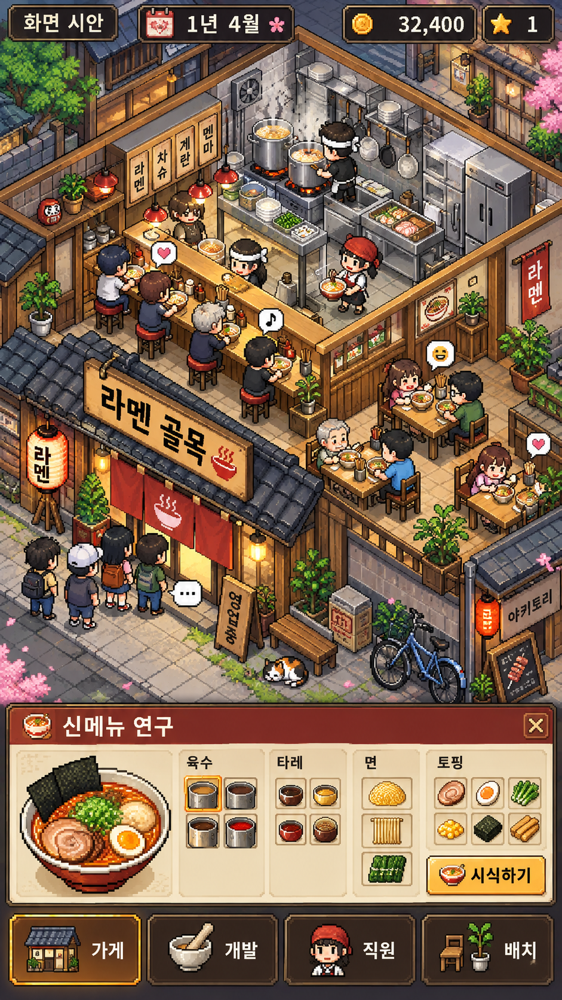

# 매장 중심 화면 재설계 — 검토용 시안

## 사용자 피드백

첫 프로토타입은 기능·계산·저장 검증을 통과했지만, 사용자가 원하는 카이로소프트 경영 게임과 시각적 구성 및 플레이 경험이 크게 다르다는 피드백을 받았습니다. 테스트 통과는 레퍼런스 충족이나 재미 검증을 의미하지 않습니다. 현재 프로토타입을 디자인 완성본으로 취급하지 않습니다.

## 수정 방향

- 메인 화면은 작은 도트 매장과 골목입니다. 주방·카운터·좌석·입구·행렬·직원·손님이 화면의 중심을 차지합니다.
- 사람과 공간이 실제 영업 상태를 표현해야 합니다. 입장 → 자리 찾기 → 주문 → 조리 → 서빙 → 식사·평가 → 퇴장으로 연결하고, 완료된 주문과 매출 표시가 일치해야 합니다. 장면 위에 돈이 오르는 효과만 붙인 장식적 영업은 완료 기준을 만족하지 않습니다.
- 메뉴 개발은 가게에서 여는 보조 화면입니다. 재료 아이콘과 라멘 변화를 중심으로 보여주고, 긴 설명은 선택한 항목의 상세 화면으로 보냅니다.
- 잘 만든 메뉴는 줄 길이, 손님 표정, 재방문, 매출 등 매장 안에서 결과를 드러냅니다. 직원 성장과 좌석·주방 개선도 장기적으로 공간 변화와 연결합니다.
- 기존 레시피 평가·영업 계산·저장 코드는 재사용 대상으로 검토합니다. 큰 양식 패널과 라멘 그림을 중심으로 한 첫 UI는 목표 화면이 아닙니다.

## 생성한 시안

이 이미지는 AI로 생성한 **검토용 콘셉트**입니다. 실행 화면이나 구현된 기능의 증거가 아니며, 보이는 직원·행렬·배치 UI·시설을 현재 게임이 제공한다고 주장하지 않습니다. 시안의 구성과 도트 밀도에 대한 사용자 피드백을 반영한 뒤 실제 타일·스프라이트·애니메이션과 조작 가능한 장면으로 구현합니다. 이미지를 통째로 배경에 붙여 플레이 가능한 게임이라고 처리하지 않습니다.

## 레퍼런스 적용

[카이로소프트 라멘가게 공식 소개](https://kairosoft.net/game/appli/noodle.html)는 라멘 개발, 늘어나는 행렬, 직원 성장과 매장 확장을 연결합니다. 이 연결을 우리 게임의 방향으로 해석하되, 공식 이미지나 캐릭터를 게임 에셋으로 사용하지 않습니다. 이번 시안은 독자적인 매장·캐릭터·UI를 생성했습니다.

## 구현 현황 (2026-10-13, 기능 검증 통과·실제 화면 검토 대기)

Claude가 매장 중심 화면과 영업 런타임을 작성하고 Codex가 독립 실행했습니다. 30개 테스트·1,593개 확인, 두 해상도 UI 검사 1,464개가 통과했습니다. CPU 에셋 조합 이미지는 검토했지만 전체 게임의 실제 렌더링·플레이 감은 미검증입니다. [검증 기록](VERIFICATION.md)

- 기본 화면: 도트 가게 장면(주방·카운터 4석·테이블 4석·입구 노렌·골목 줄)과 작은 HUD·하단 바. 시안 이미지는 배경으로 쓰지 않고, 타일·가구·사람·말풍선·그릇을 코드의 도트 규칙으로 직접 그립니다(외부/참조 에셋 없음).
- 영업: 줄 → 자리 이동 → 주문 → 요리사 조리 → 서버 서빙 → 식사·반응 → 퇴장이 하나의 상태기계로 움직이고, 화면의 사람 위치는 그 상태에서만 계산합니다. 완료된 주문과 정산 금액이 같은 목록에서 나옵니다.
- 메뉴 개발: 하단 버튼으로 여는 서랍(재료 아이콘, 그릇 도트 미리보기, 시식·노트·영업 정보 탭). 영업 중에는 편집이 잠깁니다.
- 아직 없는 것(버튼도 두지 않음): 직원 성장·고용, 가구 배치 편집, 단골 이야기, 줄·평판이 다음 날 방문에 미치는 영향, 골목 확장, 시안에 있는 배경 디테일(자전거·고양이·벚꽃 나무 등)의 대부분.
- 시안과의 차이: 시안은 등각 투영(아이소메트릭)이고 구현은 정면 단면도입니다. 인구 밀도와 소품 수도 시안보다 적습니다. 이 차이가 허용 범위인지는 사용자가 실행 화면으로 판단해야 합니다.

등각 투영과 소품 밀도를 보완하는 추가 구현을 시작했으나 Claude의 `OAuth token revoked` 오류와 새 호출의 동일 오류로 중단됐습니다. 해당 화면을 구현했다고 주장하지 않습니다. 재로그인 후 [그림 보완 계약](../tasks/shop-art-isometric.md)에서 이어가며, 지금 프로젝트는 기능 검증을 통과한 정면 매장 버전입니다.

## 이후 구현의 완료 기준

1. 첫 화면에서 양식 입력 도구가 아니라 라멘가게 경영 게임으로 읽혀야 합니다.
2. 실제 손님·직원 동작과 주문 상태, 영업 결과가 연결돼야 합니다.
3. 메뉴 개발을 열고 닫아도 매장 중심의 플레이 흐름이 유지돼야 합니다.
4. iPhone을 고려한 세로 화면에서 작은 글자와 과밀한 버튼을 피하고 실제 조작성을 검증해야 합니다.
5. 기존 도메인·저장 테스트뿐 아니라 시각 레퍼런스 적합성과 플레이 경험을 사용자 검토로 확인해야 합니다.
