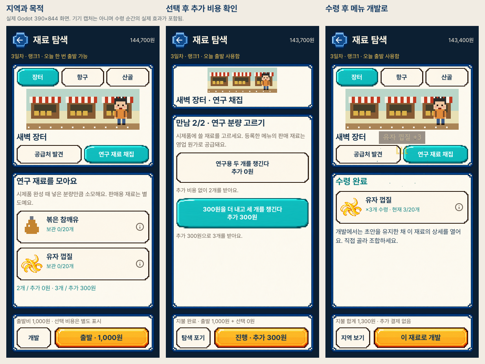
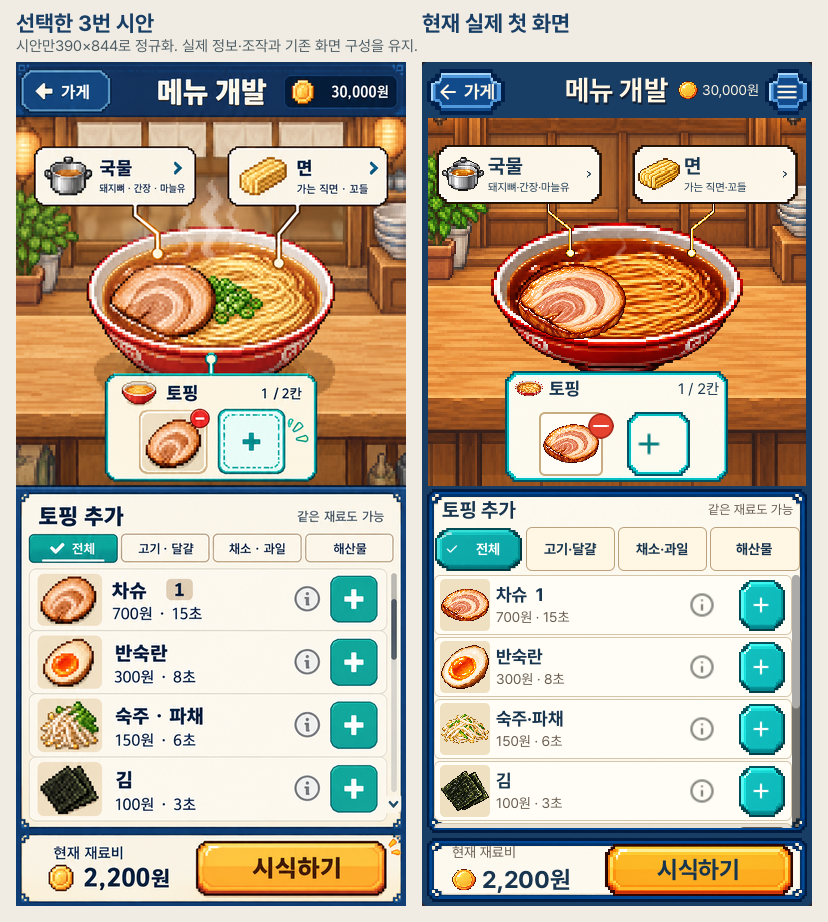
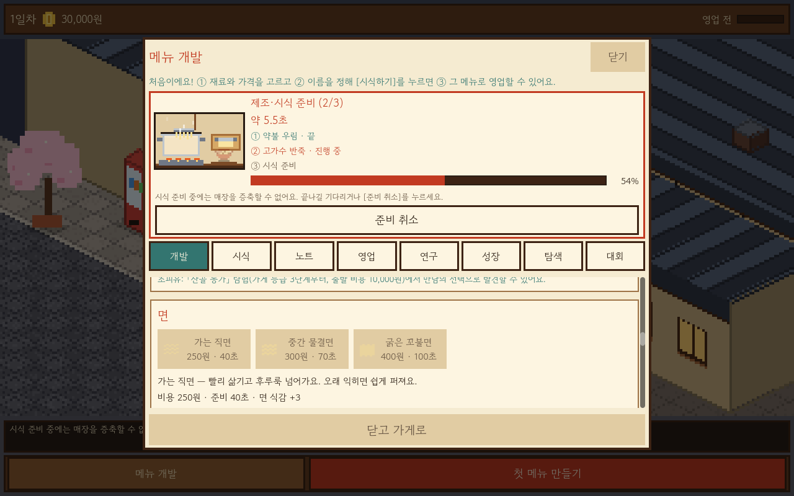
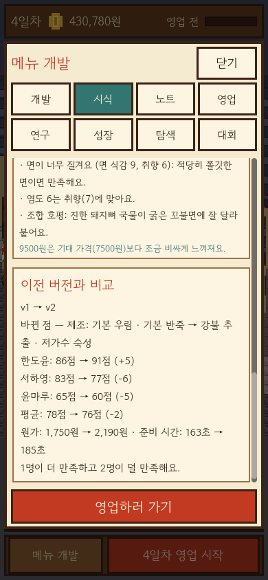

# 라멘 아틀리에 — 도트 라멘가게 프로토타입

## 재료 탐색과 획득

탐색도 메뉴 개발과 같은 프레임·글꼴·선택 버튼으로 이어집니다. 지역과 목적을
고른 뒤 사건을 선택하고, 고정 버튼에서 추가 비용을 확인해 확정합니다.
재료는 직접 수령하며 작성하던 초안을 유지한 채 실제 개발의 재료 상세로 갑니다.



[조작과 기존 규칙](docs/EXPLORATION_WORKBENCH_V1.md) · [현재 화면·전후 비교](docs/uiux-reset/exploration-workbench-v1/)

## 최신 메뉴 개발 화면

[현재 실제 게임 화면](docs/uiux-reset/ingredient-flow-v1/)

사용자가 고른 3번 시안을 기준으로 메뉴 개발 화면을 다시 구현했습니다.
국물·면 그림과 연결선, 얕고 큰 그릇, 작은 청록 토핑 패널, 네 줄 재료 목록,
장식 프레임과 금색 시식 버튼을 반영했습니다. 글자는 읽기 편한 실제 글꼴을 씁니다.



재료 상세의 고정 버튼에서 바로 추가·교체하고, 가득 차면 바꿀 칸을 고릅니다.
국물·면은 항목별 탭으로 나누며 상세 복귀와 탭별 스크롤을 유지합니다.

큰 그릇을 보면서 국물·면과 토핑을 고르는 네이티브 편집 화면입니다. 토핑은
전체/고기·달걀/채소·과일/해산물로 분류하고 같은 재료도 랭크에 따른 각 칸에
추가·교체·삭제합니다. 목록만 스크롤하며 분류·재료 정보와 시식 버튼은 유지합니다.
시식 뒤에는 손님 얼굴·대표 평가를 먼저 보고, 자세히 눌러 추가 평가 이유·가격
반응·수치·이전 버전 비교를 확인합니다. 기존 비용·재고·저장 규칙을 그대로 씁니다.

[구현과 실제 검증 범위](docs/BOWL_EDITOR_NATIVE.md), [선택한 디자인](docs/BOWL_EDITOR_CATEGORIES.md), [최신 화면 검토](../design-qa.md).

iPhone 설치는 사용자의 최신 요청에 따라 제외했습니다. 아래 기능별 화면·기기 기록은 이전 단계의 이력이며 최신 수락 범위는 위 문서를 기준으로 합니다.

## 한 가지 바꿔보는 메뉴 실험

개발·시식용 상세 그릇은 재료·공법·익힘·반복 고명을 표현합니다. 실제 시식 결과에서 손님 반응 아래의 실험 카드를 펼쳐 한 가지 선택을 바꾼 전후 그릇과 맛·원가·준비 시간 차이를 봅니다. 선택 화면 이동은 현재 초안을 유지하며, 새 결과는 직접 재료를 고르고 유료 시식을 완료해야 기록됩니다. [플레이 규칙과 검증 경계](docs/RECIPE_EXPRESSION_V1.md). 실제 Mac OpenGL3,646확인·실패0·종료0·엔진 오류0, 가로·세로32장과 새 기능8장/회귀8장 검토를 완료했습니다. [원본 화면과 검토 구분](docs/expression-screenshots). iPhone 설치는 연기 상태입니다.

## 요약 카드를 눌러 상세 보기

육수·타레·향미유·면·토핑·익힘 카드에는 현재 선택과 재료 아이콘, 펼침 화살표를 표시합니다. 카드 전체를 눌러 선택/설명과 관련 공법을 열고, 맛 실험대에서 전체 맛·궁합·기준 메뉴와의 차이를 봅니다. 지도 역시 짧은 카드에서 조건·출처·목표 선택으로 들어갑니다. 막히는 재료/샘플 경고는 접힌 바깥에 남깁니다.

누르고 있는 상태는 색·테두리로, 확정한 탭/상세/목표/기존 버튼 입력은 작은 링으로 확인합니다. 기존 재료 투입·완성 연출은 더 크게 남깁니다. 새로 생기거나 자기 자신을 없애는 버튼도 원래 누른 위치에서 반응하며, 스와이프로 취소하거나 비활성인 입력은 클릭 효과를 내지 않습니다. [상세 규칙과 분담](docs/UI_DEPTH_FEEDBACK_V1.md), [현재 검증](VERIFICATION.md).

실제 Mac OpenGL3,222확인·실패0·종료0·엔진 오류0과 두 크기 원본24장 검토를 완료했습니다. [현재 화면](docs/ui-depth-screenshots). iPhone 설치와 새 버전의 실기기 사용감은 아직 검증하지 않았습니다.

## 이번 목표를 정하는 메뉴 실험

개발 화면의 `이번 실험`에서 부족한 조건을 읽고 `연구 지도`에서 여덟 가지 연구 방향을 고릅니다. 기본 진국·향·면·반복 토핑부터 항구 조개/산골 표고, 장터 유자/참깨까지 기존 재료와 공법을 다른 목적으로 사용합니다. 정해진 전체 레시피 한 개를 복사하는 방식은 아니며 한 메뉴가 여러 방향을 만족할 수도 있습니다.

현재 라멘의 특징·토핑 분량을 표시하고, 시식한 기준 메뉴 대비 실제 맛·원가·준비 시간·판매가 변화를 보여줍니다. 재료나 샘플이 없으면 기존 탐색 화면으로 이동하며 자동 출발·결제는 하지 않습니다. 개발 하단의 고정 `시식 · 비용`으로 긴 재료 목록 어디서든 시작하고, 거부 사유도 그 옆에서 확인합니다. 시식이 실제로 완료돼야 연구가 노트에 수록됩니다.

연구 지도는 보관 중인 시식 기록을 정리하므로 가격만 바꾸거나 초안만 맞췄다고 새 연구를 주지 않습니다. 마지막 맞는 기록을 지우면 수록 표시도 사라지고 다른 맞는 기록이 있으면 유지합니다. 저장v12와 기존 영업·점수·자금·채집 소비는 바꾸지 않았습니다. Claude가 판정·순수 시험·연구 지도/목표 화면을 작성하고 Codex가 게임 연결·비교/고정 시식·독립 검증을 담당했습니다. [흐름과 범위](docs/RECIPE_DISCOVERY_V1.md), [검증](VERIFICATION.md). iPhone 설치는 사용자 요청으로 연기했습니다.

## 토핑 분량·메뉴 개발 연출 (v12)

시작2칸 → 가게 등급2에서3칸 → 등급3에서4칸입니다. 같은 토핑도 여러 칸에 담고, 가득 차면 칸을 먼저 고른 뒤 교체하며 `−`로 한 몫을 뺍니다. 토핑 칸은 등급만으로 열리고 조리대는 등록 메뉴 종류를 늘립니다. 원가·준비 시간·맛·채집 샘플은 분량대로 반영하고 동일 궁합을 중복 보너스로 적립하지 않습니다.

맛 실험대에 실제 프로필을 표시하고 재료 투입·버튼·제조 단계·시식 완성에 입력을 방해하지 않는 반응을 붙였습니다. 완성 그릇과 손님 카드는 실제 시식 탭에서 공개하며 반복 시식도 맨 위에서 시작합니다. [자세한 조작·저장v12](docs/DEVELOPMENT_FEEL_V1.md). 연구 지도 적용 전의126도메인 시험/58,238확인, 전체 두 크기 배치18,256확인, 집중1,496확인과 터치70확인은 통과했습니다. 당시 iPhone 서명 빌드도 완료했지만 설치하지 않았습니다. 그 빌드와 실행하지 않은 v4 시험 앱은 연구 지도 적용 전 이력이며 현재 화면 검증이나 기기 설치본으로 사용하지 않습니다.

아래 v11과 이전 버전의 수치는 각 당시의 검증 이력입니다.

> **이전 검증판: 장터 반복 채집·메뉴 실험 v11** — 2026-10-20 실제 Mac OpenGL 검사18,214개/실패0/종료0/엔진 오류0, 가로·세로228장과 새22장 직접 검토를 완료했습니다. [현재 채집 화면](docs/foraging-screenshots), [실행 증거](../evidence/market-foraging-v1.json). 아래 버전별 수치는 당시 검증 이력이며, iPhone·사용자 플레이 감·최종 아트 승인은 별도입니다.

## 장터 반복 채집과 메뉴 실험 (v11 로컬 구현)

iPhone용 준비는 별도 [iOS 기록](docs/IOS_DEVICE_PREPARATION.md#손가락-스크롤-수정-2026-10-21)을 따릅니다. iPhone15Pro/iOS26.6.2의 신뢰 후 실제 실행·화면을 확인했고, 사용자가 지적한 화면 전체 스와이프를 수정한 앱으로 교체·실행했습니다. 교체 전후 저장·백업 파일은 동일합니다. 사용자가 수정된 기기에서 화면 전체 스와이프와 탭이 정상이라고 확인했습니다. 가상 키보드·중단 복귀 수용은 남아 있습니다.

메뉴 개발의 **탐색** 탭에서 새벽 장터의 기존 공급처 두 곳을 모두 발견하면 `연구 재료 채집`이 열립니다. 출발1,000원이며 기존 탐색과 합쳐 하루 한 번입니다. 볶음 양념 노점/유자 수레를 고르고 연구 재료2개를 받거나300원을 더 내고3개를 고릅니다. 결과 수령 전에는 재고가 늘지 않고, 포기해도 비용과 당일 출발 기회는 돌아오지 않습니다. 각 재료의 보관 한도는20개이며 초과하는 선택은 결제 전에 막습니다.

**볶은 참깨유**는 고소한 향과 묵직함을 더하고 **유자 껍질**은 향긋하고 가벼운 방향을 만듭니다. 맛 축·원가·준비시간·육수 궁합·그릇 도트가 다릅니다. 처음 수령하면 개발 목록에 나타나고, 해당 재료를 넣은 시제품이 완성될 때 각각1개를 씁니다. 준비 취소·중복 시식·재료 부족 등 거부는 돈·재고·기록을 바꾸지 않습니다.

연구 재료는 **실험에 쓰는 샘플**입니다. 이미 시식해 등록한 메뉴는 샘플 재고가0이어도 기존 영업 원가를 내며 판매할 수 있습니다. 기본 재료와 이전 공급처 발견 재료는 계속 영구 공급합니다. 새 실험을 더 하고 싶으면 다음 날 다시 채집합니다. 이번 작업은 두 재료로 연결을 검증하는 첫 묶음이며, 전체 파밍 분량·품질/산지·무작위 결과물·본편 완성은 아닙니다.

저장v11은 채집 선택/수령·재고·획득/사용 합계·최초 획득일·최근12개 영수증을 보존합니다. 이전1~10은 기존 값을 보존하고 빈 채집 상태로만 이행하며 첫 새 저장 전에 원본 버전을 영구 백업합니다. 보관/날짜/선택 경로/소비·남은 메뉴 증빙을 검사한 뒤 한 번에 불러옵니다. 저장 실패 시 미저장 안내를 유지하고 수동 저장으로 복구합니다.

로컬 전체125테스트/58,220확인·두 크기 배치17,758확인, 실제 구v10 저장17종 이행, 기존 영업64경우/CPU 도트4종 비교를 통과했습니다. 새 실제 OpenGL18,214확인·실패0·종료0·오류0과228장/신규22장 직접 검토도 완료했습니다. [작업 계약](../tasks/market-foraging-v1.md), [현재 화면](docs/foraging-screenshots), [검증 증거](../evidence/market-foraging-v1.json).

이 Mac의 새 실행 파일은 작업 공간의 `outputs/ramen-play-market-foraging-v1/Ramen Atelier.app`입니다. 기존 플레이 앱은 보존했습니다. 새 앱은 검증한 동일 PCK와 영속 Application Support의 공식 엔진을 사용하며, 같은 기존 개발 저장 경로를 열도록 준비했습니다. 사용자 저장은 이번 검증에서 읽거나 열지 않았고, 새 앱의 별도 시험 저장소로 메인60프레임만 헤드리스 확인했습니다. 처음 직접 실행하면 지원 이전 저장을v11로 읽고 첫 새 저장 전 원본 버전을 백업합니다.

## 고용 전 투자 비교 (로컬 개발)

성장 탭의 미고용 직원 카드에서 **현재 판매할 메뉴**를 기준으로 고용 전후의 한 그릇 조리 시간·오늘 예상 판매량·하루 운영비·순영업이익을 비교합니다. 고용비는 한 번 내는 비용으로 따로 표시하며 이익 비교에서 제외합니다. 초안을 편집하는 것과 판매 메뉴를 바꾸는 것은 별개이고, 판매 목록을 고정했다면 그 목록을 계속 비교합니다. 두 메뉴를 팔 때는 같은 손님과 주방 시간을 공유하는 기존 계산을 사용합니다.

판매 증가가 없는 경우도 그대로 알립니다. 홀 보조의 서빙 왕복 단축으로 대기가 얼마나 개선되는지는 판매 예측 금액만으로 알 수 없으며 실제 영업 결과에서 확인해야 합니다. 같은 메뉴·가격·날짜의 조건부 비교이고, 미래 이익이나 투자 회수 기간을 보장하지 않습니다. 직원 공간·자금이 부족해도 조건을 충족했을 때의 비교를 읽을 수 있지만 고용 버튼의 기존 제한은 유지합니다. 판매할 시식 기록이 없으면 기록 선택 안내를 표시합니다.

조리대·직원 공간·증축 카드에는 새 토핑/메뉴 개발, 별도 고용, 두 메뉴 판매 목록 등 열린 용량을 활용할 행동을 안내합니다. 수요는 방문 의향의 예상값이고 결과 화면의 `매장 앞에서 돌아간 손님`과 구분합니다. 조회는 고용/지출/경험/영업 진행/저장 내용을 바꾸지 않습니다. 기존 비용·효과·저장 스키마10은 유지합니다. [계약과 검증](../tasks/investment-guide-v1.md), [현재 실제 화면](docs/investment-screenshots).

## 메뉴 등록과 실험 이력

- 메뉴 종류는 같은 `lineage_id`의 개정본들을 한 종으로 셉니다. 조리대에 따라6/12/30종이며 동시 판매1/2종과 별개입니다. 같은 메뉴를 여러 번 개정해도 종류 자리를 더 쓰지 않습니다.
- 개정 이력은 시설과 별도로 최대300개를 보관합니다.20개씩 최신 순으로 보고 이전 쪽의 개정본도 선택·비교·삭제할 수 있습니다. 새 시식은 최신 쪽에 표시합니다. 이력이 가득 차면 직접 정리해야 하며 자동 삭제하지 않습니다.
- 한 메뉴의 마지막 개정본을 정리할 때만 등록 자리가 비워집니다. 판매 중인 개정본은 판매 목록에서 먼저 빼야 삭제할 수 있습니다.
- 이미 달성한 단골별 최고 시식 성적은 불변 증빙으로 따로 보관합니다. 노트 기록을 지워도 승급 심사에 사용하며, 돈이나 맛 보너스를 추가하지 않습니다.
- 이전 저장에 기본 용량보다 많은 메뉴가 있으면 모두 보존합니다. 기존 메뉴 개정과 영업은 계속 가능하고 새 종류 등록만 제한합니다.
- schema10은 이전1~9의 모든 기존 값을 보존하고 남아 있는 시식 기록에서만 최고 성적 증빙을 도출합니다. 과거에 이미 지운 기록의 성적은 추측해 복구하지 않습니다. 첫 새 저장 전에 이전 버전의 원본 파일을 영구 백업합니다. 이전1~9의30개 기록 제한은 해당 버전 검사에서 계속 적용됩니다.
- 호환을 위해 과거 영업 스냅샷의 `record_capacity` 키와6/12/30 값은 유지합니다. 현재 코드에서 이 값은 등록 메뉴 종류 용량이고, 실제 이력 한도는 `record_history_capacity()`입니다.

[구현·검증 계약](../tasks/recipe-notebook-v1.md). 노트의 가로·세로 실제 화면과 페이지/개정/삭제 흐름은 [현재 검증](../evidence/investment-native-v2-20261020.json)에 포함합니다.

Godot 4.7(타입 지정 GDScript) 프로젝트입니다. 기본 화면은 작은 도트 라멘가게이고, 메뉴 개발은 아래 버튼으로 여는 보조 서랍입니다. 레시피를 만들고 단골 세 분의 시식 반응을 읽은 뒤, 영업을 시작하면 손님이 줄을 서고 자리에 앉아 주문하면 요리사가 만들고 서버가 나르며 손님이 먹고 평가하고 떠납니다. 먹기를 마친 주문만 매출로 정산됩니다. Mac 데스크톱(1280x800)과 세로(390x844) 레이아웃을 지원합니다. iOS 내보내기와 실제 기기 검증은 아직 하지 않았습니다.

> **단골 이야기 v9 포함** — 세 단골의 두 가지 요리 방향과 각 두 장의 사연을 구현했습니다. 당시 기능119개/57,027확인·순수189개·집중 배치462개·전체 두 크기 배치14,990개가 통과했고, 현재 v10/투자 안내와 함께 새 실제 렌더링 검증도 마쳤습니다. [이야기 규칙](#단골-이야기), [기능·저장 이력](../evidence/regular-stories-runs.json), [현재 실제 화면](docs/investment-screenshots).

## 단골 이야기

메뉴 개발 서랍의 **연구 → 단골 이야기**에서 진행합니다. 연구 의뢰가 기본 화면이며 기존 연구 점수·승급 조건은 변하지 않습니다. 한 번 영업을 마치면 세 단골의 사연을 들을 수 있습니다. 초상과 첫 대화를 읽고 요리 방향을 두 번 눌러 확정합니다. 선택은 무료이며 이번 사연의 방향은 바꿀 수 없습니다.

| 단골 | 두 가지 요리 방향 | 사연 |
| --- | --- | --- |
| 한도윤 | 든든한 국물 / 빠른 저녁 | 야근 뒤 자신의 퇴근 시간을 찾기 |
| 서하영 | 향긋한 점심 / 가벼운 점심 | 바쁜 교사의 점심시간 되찾기 |
| 윤마루 | 얼큰한 응원 / 가성비 메뉴 | 논문과 식비 사이에서 한 끼 챙기기 |

각 방향은 두 장의 연결된 요청과 고유 결말을 가집니다(세 사연·여섯 분기). 시식 기록을 고르면 점수·맛 축·가격·원가·준비시간 조건과 현재 값을 보여 줍니다. 준비시간/원가는 직원 보정 전 레시피 값입니다. 메뉴를 개발한 뒤 **수락 이후 실제 영업에서 그 단골이 그 메뉴를 먹기까지 완료**해야 합니다. 시식만, 영업 시작/중단, 다른 메뉴의 매출, 다른 손님의 주문은 인정하지 않습니다. 증축 후에는 정확한 판매 메뉴별 완료 수량을 사용합니다. 판매 목록을 고정했다면 새 메뉴도 목록에 넣어 주세요.

영업 후 연구 탭에서 해당 시식 기록을 골라 `대접 결과로 이야기 마치기`를 눌러야 진행하며, 자동 완료나 소급 보상은 없습니다. 첫 장 답례2,000원, 두 번째 장4,000원이며 각 한 번·세 사연 합계18,000원입니다. 두 번째 장에는 첫 답례를 받은 날 이후 새로 시식한 다른 구성과 새 영업이 필요합니다. 가격 변경도 구성 변경에 포함되지만 더 높은 맛 조건은 별도로 충족해야 합니다. 같은 기록/보고를 재사용해 보상을 받을 수 없습니다. 메뉴를 삭제해도 완료한 사연과 과거 대접 기록은 남고 `지난 대화와 대접 기록`에서 다시 읽을 수 있습니다.

저장v9은 `stories.arcs`에 방향·시작일·두 장의 메뉴/대접 영수증을 추가합니다. 이전1~8 진행은 빈 사연만 더해 모든 기존 값을 유지하며 최초 새 저장 전 원본 버전을 영구 백업합니다(v8은 `.v8.bak`). 알려진 선택·장 순서·날짜·재료/공법 해금·메뉴 재계산 조건·남아 있는 기록과의 일치·최근 실제 보고 수량을 검증한 뒤 전체를 반영합니다. 답례 날짜는 해당 완료 영업 바로 다음 일차이며, 보고가 없는 고아 영수증이나 보고보다 미래의 대접도 거부합니다. 로컬 저장을 암호학적으로 인증하지는 않습니다.

선택/답례는 즉시 자동 저장하며 실패 시 원본을 보존하고 미저장 안내를 표시합니다. 메모리의 답례를 다시 지급해 저장 오류를 복구하지 않습니다. 경로 문제가 해결되면 수동 저장 후 닫아 주세요. 영업·탐색·제조·훈련/심사 진행 중에는 거래할 수 없습니다. 손님 수요/맛 버프, 새 손님·시설·도시·새 탭은 이번 범위에 없습니다. [작업 계약](../tasks/regular-stories-v1.md).

> **이전 성장 버전(v3)**: 가게 등급·유료 확장·토핑 1~3개·노트 6/12/30칸·직원 2~4명을 연결했습니다. Claude 구현 후 Codex 독립 검사 60개 테스트·48,272개 확인, 배치 7,056개 확인, 실제 OpenGL 화면 7,168개 확인·56장·종료 0·엔진 오류 없음입니다. [성장 규칙](#가게-성장), [현재 화면](docs/growth-screenshots), [검증 기록](VERIFICATION.md), [위임 증거](../evidence/shop-growth-runs.json). 사용자 플레이 감·iPhone은 별도 확인 범위입니다. 아래 이전 검증 수치는 각 단계의 역사적 기록입니다.

> **연구 기능 검증 상태**: 6개 연구 의뢰와 저장 v2를 포함한 42개 테스트·41,034개 확인, 두 크기 UI 2,646개 확인이 통과했습니다. 기존 v1 저장 호환성도 독립 확인했습니다. 연구 탭은 자동 네이티브 캡처(26장, 2,698개 확인·실패 0, 종료 0)에서 렌더링이 확인됐습니다.
>
> **피드백 1차(시식 준비·초상·글자 없는 간판·수동 저장) 상태**: Claude가 구현·테스트를 작성하고 Codex가 독립 검증했습니다. 45개 테스트·41,101개 확인, 두 크기 배치 3,784개 확인, 실제 OpenGL 화면 3,852개 확인·34장·종료 0·엔진 오류 없음입니다. [현재 화면](docs/feedback-screenshots), [검증 범위](VERIFICATION.md), [위임 기록](../evidence/feedback-play-feel-runs.json). 실제 플레이 감과 iPhone 검증은 별도입니다.
>
> **검증 상태(연구 이전)**: Codex 독립 실행으로 30개 테스트·40,404개 확인 및 두 해상도 UI 검사 1,548개가 통과했습니다. 최종 실제 캡처 20장과 렌더링 QA 1,588개 확인·실패 0을 확인했습니다. 최종 화면 승인·플레이 감과 iPhone은 미검증입니다. [검증 범위와 수정 이력](VERIFICATION.md)

> **이전 탐색 버전(v4)**: 장터·항구·산골과 새 재료 6종, 선택형 만남·약 1.2초 이동 연출·저장 이어하기를 연결했습니다. 전체 79개 테스트/49,814개 확인, 배치 8,766개, 실제 화면 8,934개·84장·실패 0·종료 0·엔진 오류 없음. Claude 도메인 구현 후 사용자가 승인한 Codex 화면·그림·QA 구현입니다. [현재 화면](docs/exploration-screenshots), [선별 증거](../evidence/ingredient-exploration-runs.json). iPhone과 새 버전의 사용자 플레이 감은 미검증입니다.

> **이전 콘테스트 버전(v5)**: 대회 3개·재도전·상금 개선분과 수상 메뉴의 잡지 소개 3편을 연결했습니다. 전체 88개 테스트/50,092개 확인, 채점 100개, 두 크기 배치 10,122개, 실제 OpenGL 10,330개·104장·실패 0·종료 0·엔진 오류 없음. [새 화면20장](docs/contest-screenshots), [검증 증거](../evidence/ramen-contests-runs.json). 과거 단계 수치는 역사적 기록입니다.

> **이전 직원 육성 버전(v6)**: 보조 직원의 실제 완료 영업 경험과 숙련/속도·절약 전문화를 연결했습니다. 전체97개 테스트/50,982개 확인, 육성96개, 배치12,096개, 실제OpenGL12,344개·124장·실패0·종료0·엔진오류0. [육성 규칙](#직원-육성), [새 화면20장](docs/staff-training-screenshots), [증거](../evidence/staff-training-runs.json). 사용자 플레이 감·iPhone은 미검증입니다.

> **이전 증축·복수 메뉴 버전(v7)**: 8→12석의 실제 홀과 판매1→2종, 공유 손님/주방 및 메뉴별 실제 이익/대기 보고를 추가했습니다. 전체105개 테스트/56,283개 확인·공유 계산1,638개·배치13,158개·실제OpenGL13,450개/146장·실패0·종료0·엔진오류0. [새 화면22장](docs/expansion-screenshots), [선별 증거](../evidence/shop-expansion-menus-runs.json).

## 플레이 흐름
1. **가게(기본 화면)**: 위쪽 HUD(일차·자금·시각·진행률), 가운데 도트 가게(주방·카운터·테이블·입구·골목 줄), 아래 상태 줄과 하단 바(`메뉴 개발` / `영업 시작` / 영업 중 `속도`)로 구성됩니다.
2. **처음 시작**: 시식한 메뉴가 없으면 시작 버튼이 `첫 메뉴 만들기`로 바뀌어 개발 서랍을 엽니다(비활성 버튼 없음). 서랍에서 재료·가격을 고르고 이름을 정해 **시식**하면 그 메뉴가 영업 메뉴가 되고, 서랍 아래 `영업하러 가기`로 바로 영업을 시작할 수 있습니다.
3. **메뉴 개발 서랍** `개발`(재료 아이콘·그릇 도트 미리보기·가격) · `시식`(손님 세 분의 점수와 이유) · `노트`(불러오기=개정/영업 메뉴 선택, 삭제) · `영업`(오늘 메뉴·예상·지난 결과).
   다섯째 `연구`와 여섯째 `성장` 탭에서 연구 의뢰와 승급·시설 확장·직원 채용을 진행합니다. 기존 네 탭의 순서는 그대로입니다.
4. **영업**: 아래 [영업 런타임](#영업-런타임) 참조. 끝나면 결과 창에서 판매·매출·재료비·운영비·순이익이 정산됩니다.

보조 직원 육성을 추가했으며, 기본 요리사·서버 육성·배치 편집·단골 분기 이야기는 아직 없습니다. 시작 직원은 요리사 1명·서버 1명이고, 직원 공간을 확장하면 조리 보조와 홀 보조를 별도로 고용해 총 4명이 됩니다. 기본 자리는 8석(카운터4, 테이블4)이며 매장 증축으로 12석이 됩니다.

## 육수 공법과 면 반죽

개발 탭의 육수/면 재료 아래에서 각각 공법을 하나씩 고릅니다. **육수3 × 면3 = 9가지 제조 조합**이며, 기본 공법은 이전 메뉴와 평가·원가·시간·그릇이 같습니다. 공법만 바꾸어 시식해도 같은 메뉴의 새 개정이 되고 시식/노트에 실제 제조법이 표시됩니다. 판매 목록을 고정한 경우 기존 판매는 유지되므로 새 개정을 팔려면 영업 탭에서 바꿔주세요.

| 구분 | 공법 | 필요 등급 | 맛 변화 | 그릇당 추가 원가 | 영업 조리 증감 | 시제품 연출 추가 |
| --- | --- | --- | --- | --- | --- | --- |
| 육수 | 기본 우림 | 1 | 없음 | 0원 | 0초 | 0초 |
| 육수 | 약불 우림 | 1 | 진함−1, 향+2 | 180원 | +8초 | +1초 |
| 육수 | 강불 추출 | 2 | 진함+2, 향−1 | 300원 | +12초 | +1.5초 |
| 면 | 기본 반죽 | 1 | 없음 | 0원 | 0초 | 0초 |
| 면 | 고가수 반죽 | 1 | 면 식감−2 | 80원 | −8초 | +0.5초 |
| 면 | 저가수 숙성 | 2 | 면 식감+2, 향−1 | 140원 | +10초 | +2초 |

맛 변화는 재료 합에 한 번 적용한 뒤0~10 범위로 제한합니다. 향·진함·식감에 대한 손님 취향이 달라 점수가 오르기도 내려가기도 합니다. 추가 원가와 영업 조리시간은 시제품/실제 영업의 계산에 반영되며, 직원 시간율은 공법까지 더한 뒤 적용됩니다. 공법을 고르는 것 자체는 무료입니다.

시식 버튼을 누르면 선택한 공법의 제조·조리를 진행합니다. 국물 불꽃/색, 반죽 작업판·움직이는 밀대와 숙성 시계 문양, 그릇 색을 기존 도트로 표현합니다. 연출은 기본4초에 공법 시간을 더해 최대7.5초이며, 영업 조리초와 별개입니다. 시작/취소/제조 중 종료는 재료비·기록을 만들지 않습니다. 끝날 때 시제품 전체 원가를 한 번 내고 기록/자동 저장을 처리합니다. 제조 중 편집·다른 거래·중간 저장은 막습니다. 실제 쓰기 실패는 안내하고 기존 파일을 보존하며 수동 저장 복구 후 재시작으로 확인합니다.

저장v8은 비기본 조합에만 `config.process: {broth, noodle}`를 추가합니다. 두 기본 공법은 이 키를 생략해 기존 구성/중복 판정을 유지합니다. 이전1~7의 모든 값은 그대로 읽고 최초 새 저장 전 원본을 영구 버전 백업합니다(v7는 `.v7.bak`). 시식 점수는 구성으로 다시 계산하며 미지/누락/잘못된 형식/미해금 공법과 이전 버전에 섞인 공법을 전체 상태 변경 없이 거부합니다. 개정 비교, 확장 영업 보고, 대회·잡지의 자체 스냅샷에도 제조법이 보존됩니다.

배치 재고·반복 재료 생산·오프라인 숙성·영구 기술 연구·별도 제조 시설은 구현하지 않았습니다. 이번 범위는 비용과 시간에 영향을 주는 레시피 제조 선택과 시제품 진행입니다. 기능112개/56,595개 확인·순수 공법118개·이전 실제v7 합성 저장12종 이행72개+전체값12건·기존 경제/그림 골든260건과 집중 화면1256개가 통과했습니다. 두 크기 전체 배치14,510개도 실패0/종료0으로 통과했습니다. 실제OpenGL14,842개/166장도 실패0/종료0/엔진오류0으로 통과했고 새20장을 직접 검토했습니다. [새 화면과 전체 해시](docs/process-screenshots), [실행 증거](../evidence/recipe-process-runs.json). iPhone 실기기는 미검증입니다. [작업 계약](../tasks/recipe-process-v1.md).

## 매장 증축과 판매 메뉴

성장 탭의 `가게 증축`은 등급2부터 **60,000원·한 번 구매·환불 없음**입니다. 버튼을6초 안에 두 번 눌러 확정하며 바닥과 테이블2개/좌석4개가 실제로 늘어12석이 됩니다. 판매 메뉴도1→2종으로 늘고 새 좌석의 입장/서빙/퇴장 경로를 사용합니다. 주방과 기본 직원 수는 늘리지 않습니다. 추가 자리만으로 매출이 두 배가 되지는 않습니다.

영업 탭에서 시식한 기록을 `판매 목록에 추가`하거나 `판매에서 빼기`로 관리합니다. 고정 목록은 새 메뉴 개발·시식·노트 불러오기와 독립입니다. 목록을 모두 빼거나 `선택 기록 자동 판매로 돌아가기`를 누르면 기존처럼 현재 선택한 시식 기록 하나를 팝니다. 개정 기록은 별도 메뉴이므로 새 개정을 팔려면 목록도 바꿔주세요. 판매 중인 기록은 목록에서 뺀 뒤 삭제할 수 있습니다. 영업/시식 준비/탐색/훈련/심사 중에는 변경할 수 없습니다.

두 메뉴는 **손님과 조리2,400초를 공유**합니다. 각 손님 그룹의 방문은 두 메뉴의 개별 수요 중 큰 값을 한 번만 취하고 맛·가격·조리시간에 따른 상대 수요로 선택을 나눕니다. 같은 손님을 두 번 세지 않습니다. 한 주방은 주문별 실제 조리시간을 사용하고, 해당 메뉴의 실제 가격/재료비/그릇이 영업에 반영됩니다. 결과에서 `메뉴 이익`은 매출−재료비인 공헌이익입니다. 공통 운영비(기본3,000원+고용자 일당)는 전체에 하루 한 번만 차감합니다. 평균 대기는 그 메뉴를 실제로 먹은 손님의 대기 합계/완료 그릇 수입니다. 보조 직원 경험도 전체 완료 주문을 한 번만 반영합니다.

저장v7는 `shop: {expanded, menu_ids}`와 확장 영업의 메뉴별 스냅샷을 추가합니다. 과거1~6 저장의 모든 값은 유지하고 미확장/자동 선택으로 읽습니다. 이전 영업/훈련을 소급 보상하지 않습니다. 처음 새 저장 전에 이전 버전 원본을 영구 백업하며 v6는 `.v6.bak`입니다. 판매 목록·역사적 보고는 엄격히 검증한 뒤 원자적으로 불러옵니다. 과거 판매 기록을 삭제해도 당시 구성/가격/직원/보고가 남습니다. 실제 쓰기 실패는 화면에 표시하고 메모리 변화만 남으므로 복구 후 수동 저장하세요. 영업 도중 저장/중단 정책은 같습니다.

현재 기능105개 테스트/56,283개 확인, 순수 공유 계산1,638개, 실제 구v6 사례10개의 이행/백업60개+전체값10건, 기존 단일 영업56사례와 화면2개226건이 통과했습니다. 두 크기 배치13,158개와 실제OpenGL13,450개·146장·종료0·엔진오류0도 통과했습니다. 새22장을 직접 검토했고73개 번들 소스가 현재 코드와 바이트 단위로 일치합니다. [갤러리와 전체 해시](docs/expansion-screenshots), [실행 기록](../evidence/shop-expansion-menus-runs.json). 자유 가구 배치·다른 점포·도시 건설·면/육수 별도 생산·단골 분기는 이번 작업에 없습니다. iPhone은 미검증입니다.

## 직원 육성

성장 탭에서 고용한 조리 보조 시온과 홀 보조 다온을 육성합니다. 완료한 영업에서 판매한 그릇을 두 보조가 각각 경험으로 얻고, 판매가 있으면 실무 1일을 얻습니다. 영업 예측·시작·중단·탭 갱신·불러오기·연출에서는 경험을 주지 않습니다. 기존 저장을 처음 읽을 때도 고용 전/기능 추가 전 영업을 소급하지 않습니다.

| 훈련 | 필요 경험/실무 | 가게 등급 | 훈련비 | 기본 시간율 대비 | 기본 일당 대비 |
| --- | --- | --- | --- | --- | --- |
| 숙련 | 40그릇 / 2일 | 2 | 4,000원 | 10%p 감소 | +150원 |
| 속도 전문 | 160그릇 / 5일, 숙련 완료 | 3 | 12,000원 | 25%p 감소 | +400원 |
| 절약 전문 | 160그릇 / 5일, 숙련 완료 | 3 | 12,000원 | 15%p 감소 | -100원 |

실무 일수와 판매 그릇은 별도 조건이므로 판매량에 따라 훈련까지 더 많은 영업이 필요합니다. 경험은 훈련에 소비하지 않습니다. 기본 시간율은 시온 조리80%, 다온 서빙70%, 일당은 각각600/500원입니다. 효과는 누적 덧셈이 아니라 현재 자격에서 계산합니다. 예를 들어 속도 전문 시온은 조리55%/일당1,000원, 절약 전문 다온은 서빙55%/일당400원입니다. 조리/서빙 시간은 초 단위 올림이며 최소1초입니다. 맛 점수는 변하지 않고 기본 요리사·서버는 이번 육성 대상이 아닙니다.

같은 버튼을6초 안에 두 번 눌러 확정합니다. 다른 전문화를 누르면 확인이 새로 시작됩니다. 확정할 때 비용/자격을 함께 반영하고 자동 저장하며, 이어지는2초 반복 연습/결과 정리 연출은 추가 보상이나 경험을 주지 않습니다. 같은 직원은 하루1회만 훈련하며 두 번째 단계의 전문화는 영구 선택입니다. 환불/재선택은 없습니다. 훈련 연출 동안 다른 거래는 막고, 확정 결과의 수동 저장과 종료는 허용합니다. 저장 실패 시 실제 실패를 알리고 메모리의 변화만 유지합니다. 정상 경로를 회복해 수동 저장하면 재시작해도 자격/경험이 보존됩니다.

저장v6는 고용자별 경험/실무/마지막 영업일과 최대2개 훈련 영수증을 보존합니다. 기존v1~5는 기존 자금·기록·영업 보고·연구·성장·탐색·대회·잡지를 유지하며 새 경험0/자격없음으로 이행합니다. 처음 새 저장 전 기존 원본의 영구 버전 백업을 보존합니다. 로더는 정확한 키/타입/범위와 날짜/경험/영수증 순서를 검증한 뒤 전체를 반영합니다. 로컬 JSON의 진위를 암호학적으로 인증하지는 않습니다.

최종 검증: 전체97개 테스트/50,982개 확인, 순수 육성96개, 두 크기 배치12,096개, 실제OpenGL12,344개·124장·실패0·종료0·엔진오류0. 번들67개 소스가 검증 스냅샷과 일치합니다. [현재 화면20장](docs/staff-training-screenshots), [실행 증거](../evidence/staff-training-runs.json). 사용자의 플레이 저장은 시험하지 않습니다. [전체 계약](../tasks/staff-training-v1.md), [한 직원 규칙 위임](../tasks/staff-training-core-v1.md).

## 영업 런타임
- 한 번 = 점심 피크 2,400 게임초(40분) = 하루. 정상 속도는 1초에 36게임초(약 1분+마감 정리), `속도 ×2`는 72게임초(약 30초대)입니다. 시간은 정수 틱이고 난수는 시드 고정이라 같은 계획은 항상 같은 하루가 됩니다.
- 손님 흐름: 도착(골목 끝에서 걸어옴) → 줄 → 빈 자리 중 가장 앞 번호로 이동 → 주문 → 요리사가 준비 시간만큼 조리 → 서버가 자리까지 서빙 → 식사 → 반응 말풍선 → 퇴장. 줄이 길어 돌아가는 손님(수요 − 판매 가능)도 보입니다.
- **주문은 식사가 끝나는 순간에만 완료**로 기록됩니다. 매출·재료비·손님별 수량은 이 완료 목록에서만 계산하고, 화면의 `미정산 매출`도 같은 목록입니다.
- 수요·맛 점수·준비 시간·가격은 영업 시작 때 복사한 선택 레시피 스냅샷에서만 옵니다(기존 판매 시뮬레이션이 판매 가능 수량을 정하고, 런타임이 그 손님들을 실제로 응대). 맛이 좋으면 하트·음표, 나쁘면 화난 얼굴이 나오고, 오래 기다린 손님은 만족도가 한 단계 내려갑니다.
- 정산은 세션이 끝난 뒤 한 번만(`GameState.settle_service`). 검증을 모두 통과해야 자금·일차·보고가 한꺼번에 바뀌고, 실패하면 아무것도 바뀌지 않습니다. 정산하면 세션이 사라지고 일차가 올라 같은 날 두 번 정산할 수 없습니다.
- **미완료 영업은 저장되지 않습니다.** 영업 중에는 자금·일차·기록이 그대로이고, 중단(두 번 눌러야 함)하거나 앱을 닫으면 아무 정산도 없이 영업 전 상태로 돌아옵니다. 다시 열면 처음부터 영업합니다. 부분 정산·진행 상황 저장은 없습니다.
- 정산 직후 저장에 실패하거나 저장이 꺼져 있으면(손상 파일 보호 등) 결과 창과 가게 위쪽 배너에 "저장하지 못했어요"를 표시하며 저장했다고 말하지 않습니다. 정산은 실행 중인 게임 안에만 반영된 상태이므로 닫으면 사라질 수 있습니다.
- 영업 중에는 레시피 편집·선택·삭제·시식이 모두 거부되어 캡처한 레시피와 어긋날 수 없습니다(개발 버튼은 이유를 안내).

## 라멘 연구
> **상태**: Claude 구현 후 Codex가 테스트·저장 호환·UI 배치를 독립 검증했습니다. 아래 증인 조합과 수치는 실제 평가기로 확인했습니다. 연구 탭까지 Codex 자동 실행으로 실제 렌더링을 확인했습니다: 2,698개 확인·실패 0, PNG 26장, 종료 0, 엔진 오류 없음.

단골 세 분(한도윤·서하영·윤마루)이 입문 의뢰 1개 + 심화 의뢰 1개씩, 모두 6개의 고정 의뢰를 줍니다. 짧은 대사와 실용 힌트만 있고 분기 이야기는 없습니다. 데이터·판정·해금·보상은 [`ramen_research.gd`](scripts/domain/ramen_research.gd)가, 상태 변경은 `GameState.submit_research()`가 맡고 화면은 표시와 입력만 합니다.

| 의뢰 | 조건 (모두 충족) | 증인 조합(예) |
|---|---|---|
| 도윤 입문 | 도윤 점수 ≥80, 원가 ≤2,000원 | 돼지뼈 진국·간장·마늘유·굵은 꼬불면·김·보통, 9,500원 (원가 1,750) |
| 하영 입문 | 하영 점수 ≥80, 준비 ≤100초 | 해물 다시·소금·파기름·가는 직면·김·꼬들, 9,000원 (준비 78초) |
| 마루 입문 | 마루 점수 ≥75, 판매가 ≤8,500원 | 닭 육수·된장·고추기름·가는 직면·김·꼬들, 8,000원 |
| 도윤 심화 | 도윤 점수 ≥88, 진함 ≥8, 준비 ≤180초 | 돼지뼈 진국·간장·마늘유·굵은 꼬불면·차슈·보통, 11,000원 (준비 175초) |
| 하영 심화 | 하영 점수 ≥90, 준비 ≤90초, 판매가 ≥8,500원 | 해물 다시·소금·파기름·가는 직면·반숙란·꼬들, 9,000원 (준비 83초) |
| 마루 심화 | 마루 점수 ≥84, 준비 ≤90초, 원가 ≤1,500원, 판매가 ≤7,500원 | 닭 육수·된장·고추기름·가는 직면·김·꼬들, 7,500원 (원가 1,380, 준비 76초) |

- **달성 가능성**: 위 조합은 서로 다른 구성이고 `run_tests.gd`가 평가기로 조건 충족을 재확인합니다(`test_research_catalog_and_feasibility`). 또 재료 972가지 × 가격 표본(500원 단위)을 훑어 각 의뢰의 달성 조합이 존재하고 한 레시피가 여섯 개(또는 심화 세 개)를 동시에 만족하지 못함을 확인합니다(`test_research_sweep_no_single_recipe`). 하영 심화(판매가 ≥8,500)와 마루 심화(≤7,500)는 가격만으로도 양립할 수 없습니다. 독립 실행으로 확인한 점수: 도윤 입문 86, 하영 입문 증인 93, 마루 증인 86, 도윤 심화 91, 하영 심화 증인 95.
- **해금**: 입문 의뢰 중 아무 2개를 완료하면 심화 3개가 열립니다. 잠긴 의뢰도 카드에 보이고 이유(`입문 연구를 2개 완료하면 열려요 (지금 n/2)`)를 표시합니다.
- **제출**: 연구 탭의 `이 기록으로 연구 제출`만이 보상을 줍니다. 제출 대상은 영업 메뉴로 선택된 시식 기록(노트의 불변 기록)이며 탭 위에 `제출 대상: 이름 vN`으로 표시합니다. 개발 탭의 편집 중인 초안은 대상이 아니라 시식하지 않은 초안은 진행을 만들 수 없습니다. 각 조건에는 기록의 현재 값(`[달성]/[부족] … — 지금 …`)이, 부족한 조건에는 사람이 읽는 힌트가 표시됩니다. 조건 미충족 제출은 도메인이 거부해 이유를 보여 줍니다.
- **보상(고정)**: 입문 연구 점수 +2·자금 +2,000원, 심화 연구 점수 +5·자금 +5,000원. 여섯 개를 모두 마치면 점수 21·자금 21,000원이 상한이고 카드 위에 과정 완료가 표시되며 새 의뢰는 생기지 않습니다. 칭호는 점수로 정합니다: 0 견습 연구생 · 4 라멘 연구원 · 9 선임 연구원 · 21 라멘 연구 박사.
- **거부(상태 불변)**: 잠긴 의뢰, 조건 미충족, 알 수 없는 의뢰, 이미 완료, 없는 기록, 자금 한도 초과, 영업 중. 불러오기·시식·기록 선택/삭제·탭 열기·그리기는 보상을 주지 않습니다.
- **저장 스키마 v2**: 최상위에 `research: {completed: [...]}`만 추가했습니다. 항목은 제출 영수증(`request_id, record_id, recipe_name, version, day, points, cash`)이고, 총점·칭호·해금은 이 목록에서 계산하므로 저장하지 않습니다(고칠 수 있는 중복 합계 없음). 불러올 때 알 수 없거나 중복된 의뢰, 해금 전 심화(완료 순서가 곧 해금 순서), 의뢰와 맞지 않는 보상 값, 발급된 적 없는 기록 번호, 미래/역순 완료일, 7개 이상, 키 누락·추가, 노트에 남은 기록과 다른 이름/버전·조건 미충족 완료를 거부합니다. 심사 점수는 실제 평가기로 다시 확인하고 저장 점수 불일치도 거부합니다. 제출한 기록이 나중에 삭제돼도 영수증은 유효합니다(기록 번호는 "발급된 범위"만 확인). 영수증으로 자금 잔액의 일치까지는 검증할 수 없습니다(저장 파일을 직접 고쳐 자금을 올리는 것은 막지 않음; 로컬 프로토타입 한계).
- **v1 이행**: `schema_version` 1(연구 도입 전)은 `research` 키가 없어야 정상이며 빈 연구 진행으로 읽습니다(자금·일차·노트·개정·선택·초안·보고 보존). v1에 `research`가 있거나 v2에 없으면 손상으로 거부합니다. 불러오기만으로는 파일을 바꾸지 않고, 첫 저장부터 v2로 쓰며 그때 기존 v1 파일이 `.bak`으로 보존됩니다. 손상/미지원 파일은 기존대로 건드리지 않습니다.

## 규칙 요약
- 손님마다 취향 수치와 궁합 민감도, 기대 가격이 달라 모두에게 최고인 레시피는 없습니다(테스트가 972개 조합 전수로 확인).
- 노트 용량은 조리대 확장으로 정해지며(기본 6, 확장 후 12, 최대 30) 같은 구성·가격·익힘(토핑은 순서와 무관한 종류별 분량)은 중복 기록되지 않습니다. 자세한 내용은 아래 "가게 성장" 절. 기록은 불변 스냅샷이고, 삭제는 두 번 눌러야 합니다.
- 가격은 1,000~30,000원(100원 단위). 비싸면 수요가 줄고, 준비 시간이 길면 점심 피크(40분)에 만들 수 있는 양이 줄어듭니다.

## 저장
- 일반 실행은 `user://ramen_lab_save.json`(+ `.bak`, 쓰기용 `.tmp`)을 씁니다. 임시 파일에 쓰고 내용을 확인한 뒤 교체합니다.
- 저장이 없으면 첫 방문으로 시작합니다. 손상되었거나 지원하지 않는 버전이면 화면에 알리고 파일을 건드리지 않으며(자동 저장 중지), 사용자가 버튼을 눌러야 파일을 따로 보관하고 새로 시작합니다.
- 개발/QA용: `-- --dev-data-dir=<절대 경로>` 를 주면 그 폴더에 저장하고 개발 서랍의 영업 탭에 저장 위치가 표시됩니다. 잘못된 경로는 `user://`로 대체하지 않고 오류를 보여 줍니다.

## 피드백 1차: 시식 준비 · 초상 · 글자 없는 간판 · 저장 UI
- **시식 준비(약 4초)**: `시식하기`는 즉시 기록하지 않고 국물(0~45%) → 면(45~80%) → 시식(80~100%) 준비 작업을 시작합니다. 서랍 맨 위 카드에 솥(국물이 차오르고 거품·불꽃)·면 건지개·그릇으로 옮겨지는 면·김 도트 연출, 단계 이름, 진행 막대와 퍼센트, `준비 취소` 버튼이 보입니다. 실제 화면 시간으로만 진행하며(프레임당 최대 0.1초 반영) 시간을 건너뛰거나 돈으로 줄이는 기능은 없습니다.
- **정산 시점**: 도메인 `taste()`(맛 평가·재료비·기록·자동 저장)는 완료 때 정확히 한 번만 호출됩니다. 시작 때 초안을 스냅샷하고, 시작 전에 저장 복제본에서 같은 시식을 미리 해 보아(이름·중복 구성·자금·상태 복제 실패 등) 거부 사유를 바로 알립니다. 완료 때 초안·자금·일차·기록 수가 스냅샷과 다르면 완료하지 않고 취소합니다.
- **준비 중 차단**: 모든 변경 핸들러가 맨 앞에서 거부합니다(버튼 비활성은 보조): 재료·가격·이름·새 레시피·노트 불러오기/삭제·연구 제출·영업 시작·서랍 닫기·손상 파일 정리·중복 시작·수동 저장. 탭 이동은 허용하되 자동 저장은 하지 않습니다.
- **취소/종료**: `준비 취소`는 자금·기록·보상·저장 파일을 바꾸지 않고 조작을 복구합니다. 창을 닫으면 진행 중 준비는 버리고 확정된 준비 전 상태만 저장합니다(진행률·미완료 기록·재료비 차감은 저장하지 않음). 앱이 잠시 멈추는(pause) 경우는 작업을 버리지 않고 확정된 상태만 저장합니다.
- **초상**: 단골 세 분(도윤·하영·마루)마다 24×24 도트 초상(장면 속 사람과 같은 머리·옷 색)이 시식 카드 윗줄 왼쪽에 48×48로 붙고, 이름·별·점수는 그 옆, 본문은 카드 전체 폭을 씁니다. 연구 카드에는 넣지 않았습니다.
- **글자 없는 장면**: 간판·영업 표시·대기 인원 글자를 없앴습니다. 정확한 글(영업 상태, 줄 N)은 아래 상태 띠의 일반 라벨이 담당합니다. `shop_layout.gd`는 수정 범위 밖이라 그 안의 간판 글씨 주석은 낡았습니다.
- **저장 UI**: 서랍 `영업` 탭 하단에 자동 저장 안내(언제 저장되는지), 마지막 저장 상태(`자동`/`직접` 저장됨 + 시각, 실패 시 오류), 44px `지금 저장` 버튼과 결과 줄이 있습니다. 자동 저장은 기존처럼 시식 완료·연구 제출·노트 정리·영업 정산·서랍 닫기·탭 이동 때 실제 원자적 저장입니다. 수동 저장은 영업 중/시식 준비 중이면 이유를 보여 주며 거부하고, 저장 꺼짐(손상 파일 보호)이면 파일을 건드리지 않고 거부를 보고하며, 실패는 배너와 결과 줄에 그대로 표시합니다. 스키마 변경은 없습니다(v2, v1 호환 유지).
- **1차 당시의 범위**: 1차는 진행·초상·간판·저장 UI만 다뤘습니다. 현재는 아래 성장 단계에서 등급·확장·수용량·복수 토핑을 구현했습니다. 탐험(4), 대회·소식지(10·11)는 후속이며 준비 시간은 고정 약 4초입니다.
- **독립 실행 완료(Claude는 파일 도구만 사용)**: Codex가 아래 검사와 새 네이티브 캡처를 실행했습니다. 새 시나리오는 QA의 `_run_tasting_work`, `_run_manual_save`와 `run_tests`의 `test_tasting_work_*`, `test_portraits_and_glyph_free_art`입니다. 취소·중복 실행·완료 한 번·실제 프레임 진행·수동 저장·재시작·강제 실패 후 복구·손상 저장 보호를 검사합니다.

```sh
"$RAMEN_GODOT" --headless --path game --editor --import --quit
"$RAMEN_GODOT" --headless --path game --script res://tests/run_tests.gd -- --test-data-dir=/절대/경로/test-data
"$RAMEN_GODOT" --headless --path game --script res://tests/qa_capture.gd -- --layout-only --qa-out=/절대/경로/layout-only
```
네이티브 캡처는 `tools/build_qa_app.py`로 새 앱을 만들어 Codex가 실행했습니다(README의 자체 포함 QA 앱 절). 1280×800 / 390×844 각 17장과 실제 내용을 확인했습니다. 실제 플레이 감과 iPhone은 미확인입니다.

## 가게 성장: 등급 · 유료 확장 · 보조 직원 · 다중 토핑 (피드백 3·7·8·9)
> **상태**: Claude가 구현하고(파일 도구만 사용, 직접 실행 없음) Codex가 독립 실행했습니다. 전체 테스트 60개·48,272개 확인, 두 크기 배치 QA 7,056개 확인, 실제 OpenGL QA 7,168개 확인·PNG 56장이 모두 실패 0·종료 0·엔진 오류 없음으로 통과했습니다. 주요 가로·세로 PNG 내용도 검토했습니다. 직접 플레이 감과 iPhone은 별도 확인 범위입니다. 탐험·인벤토리·직원 훈련/성격/해고·대회·이벤트·도시 확장·추가 좌석은 이 변경에 없습니다.

### 가게 등급 3단계 (연구 칭호와 별개)
1단계 골목 가게(시작) → 2단계 동네 맛집 → 3단계 이름난 라멘집. 승급은 서랍 `성장` 탭의 `등급 심사 신청`(두 번 눌러 확정)으로만 일어나고 금전 보상은 없습니다. 불러오기·시식·탭 이동·갱신으로는 오르지 않습니다. 심사는 신청 순간의 노트 시식 기록을 평가기로 다시 계산해 판정합니다(기록을 지우면 신청 전에는 다시 부족해질 수 있고, 오른 등급은 내려가지 않음).

| 승급 | 영업 마친 날 | 연구 의뢰 완료 | 노트 기록 점수 |
|---|---|---|---|
| 1→2 | 3일 | 1건 | 단골 2명 이상에게 75점 이상 |
| 2→3 | 10일 | 4건 | 단골 3명 모두에게 80점 이상(기록은 달라도 됨) |

달성 가능성: 연구 입문 증인(도윤/하영 입문)이 2단계 점수를, 여섯 연구 증인 기록이 3단계 점수를 채웁니다(테스트가 평가기로 확인). 높은 등급이 맛 점수를 자동으로 올리지는 않습니다.

### 유료 확장 (레시피 작업 공간 / 직원 공간)
한 번만 살 수 있고 환불은 없습니다. 영업 중·시식 준비 중에는 살 수 없습니다. 성공 메시지는 구매 **전**의 현재→새 용량(예: "등록 메뉴 6→12종 · 토핑 칸은 등급으로 해금")과 실제 저장 결과를 알립니다.

| 확장 | 가격 | 필요 | 효과 |
|---|---|---|---|
| 조리대 확장 I | 12,000원 | 등급 2 | 등록 메뉴 6→12종, 토핑 칸은 등급으로 해금 |
| 조리대 확장 II | 30,000원 | 등급 3 + 조리대 I | 등록 메뉴 12→30종, 토핑 칸은 등급으로 해금 |
| 직원 공간 I | 15,000원 | 등급 2 | 직원 2→3명까지 |
| 직원 공간 II | 36,000원 | 등급 3 + 직원 공간 I | 직원 3→4명까지 |

용량은 저장하지 않고 등급/구매 목록에서 매번 계산합니다. 토핑 슬롯 = min(등급, 1 + 조리대 단계). 승급만으로는 용량이 늘지 않습니다. 이 조리대·직원 공간 구매는 좌석을 늘리지 않습니다. 별도 매장 증축으로 8→12석을 엽니다.

### 보조 직원 (고용은 확장과 별개, 자동 고용 없음)
시작 직원은 요리사와 서버 둘입니다. 직원 공간을 넓힌 뒤 `성장` 탭에서 한 명씩 직접 고용합니다(각 한 번, 해고 없음). 초상·역할·고용비·하루 운영비가 카드에 보입니다.

| 직원 | 고용비 | 하루 운영비 | 효과(맛 점수에는 영향 없음) |
|---|---|---|---|
| 조리 보조 시온 | 8,000원 | 600원 | 한 그릇 조리 시간 80%(올림, 예: 73초→59초). 만들 수 있는 양·이탈에 반영 |
| 홀 보조 다온 | 7,000원 | 500원 | 서버의 서빙/복귀 시간 70%(올림, 최소 1초). 기다림이 줄어듦 |

영업을 시작할 때 직원 구성이 세션에 복사되어(불변 스냅샷) 영업 중 고용/구매가 막혀 있고 바뀌지 않습니다. 하루 운영비는 기본 3,000원에 보조 운영비를 더해 **끝까지 마친 영업의 정산에서 정확히 한 번** 빠집니다(시작만 하고 중단하면 청구 없음). 고용 전 영업 시간/수익은 예전과 같습니다. 고용한 직원은 가게에서 일하는 모습으로 보입니다: 조리 보조는 주방(요리사 옆, 조리 중 손을 같이 움직임), 홀 보조는 문 안쪽 홀(서버가 서빙 중일 때 쟁반을 듦). 주문/조리/서빙 일정은 요리사와 서버 그대로입니다.

### 다중 토핑
육수·타레·향미유·면·익힘은 하나씩, 토핑은 등급1/2/3에서2/3/4칸까지 담습니다. 서로 다른 종류와 같은 종류의 여러 몫을 모두 허용합니다. 재료 버튼은 한 몫 추가, 칸 선택 후 재료 버튼은 교체, `−`는 해당 칸 제거입니다(최소1개). 가득 차면 안내하고 기존 토핑은 유지합니다. 분량은 원가·준비 시간·맛 프로필·그릇·시식 기록·피드백·노트·개정 비교·영업에 반영되며 같은 궁합 규칙의 보너스를 분량만큼 중복 적립하지 않습니다. 순서만 다르고 종류별 분량이 같으면 같은 레시피이고, 분량이 다르면 다른 레시피입니다. 기존 메뉴의 점수·원가·시간·그릇 픽셀은 유지합니다. [조작과 연출](docs/DEVELOPMENT_FEEL_V1.md).

### 노트 용량과 예전 기록
조리대의6/12/30은 **등록 메뉴 종류** 용량이고 같은 종류의 개정본은 자리를 더 쓰지 않습니다. 실험 이력은 별도300개 한도입니다. 판매 메뉴 칸도 별개로 증축 전1종, 증축 후2종입니다. 이전 저장에서 현재 등록 한도를 넘긴 메뉴도 보존하고 기존 메뉴의 개정·영업은 계속하며 새 종류 추가만 제한합니다. 기록을 정리해도 이미 획득한 최고 시식 증빙은 보존합니다.

### 안전한 거래와 저장
- 승급/구매/고용 핸들러는 시식 준비 중이면 아무것도 바꾸기 전에 거부하고(버튼 비활성은 보조), 영업 중에는 도메인이 거부합니다. 거부된 행동은 상태를 바꾸지 않습니다.
- 성공하면 메모리가 이미 바뀐 것이므로 저장을 시도하고 실제 결과를 보여 줍니다. 저장 실패/잠김이면 "저장하지 못했어요" 경고와 배너가 뜨고 거짓 성공을 말하지 않습니다. 문제를 치우고 다음 행동을 하면 함께 저장됩니다. 손상 저장 보호는 그대로입니다.

### 이전 저장 스키마 v3와 이행
이 문단은 이전v3 파일 규칙입니다. 현재v12의 중복 분량·랭크 용량과 원본 보존 방식은 [최신 설명](docs/DEVELOPMENT_FEEL_V1.md#저장과-검증-범위)을 따릅니다.

v3는 최상위 `growth`(등급, 산 확장 id 순서, 고용 직원 id 순서)를 추가하고 모든 구성의 토핑을 `toppings` 배열(카탈로그 순서)로 저장합니다. 섞인 순서·중복·4개 이상·모르는 id·옛 `topping` 키(v3)·파생 사실과 모순되는 승급/확장/고용(예: 영업 일수/연구 없이 등급 2)·직원 공간보다 많은 고용·슬롯보다 많은 토핑은 파싱 단계에서 거부되며 거부된 불러오기는 상태/파일을 바꾸지 않습니다. v1/v2는 등급 1·확장/고용 없음·토핑 하나짜리 배열로 읽습니다(자금/일차/기록/점수/보고/연구 영수증 그대로). 불러오기만으로 파일은 바뀌지 않고, 첫 v3 저장 때 원본이 일반 `.bak`와 영구 보관본 `ramen_lab_save.json.v1.bak` / `.v2.bak`에 복사됩니다(보관본은 다시 덮어쓰지 않음).

### 파일/테스트/QA
- 도메인: `ingredient_catalog.gd`, `data_check.gd`, `recipe_evaluator.gd`, `shop_growth.gd`, `shop_staffing.gd`, `sales_simulator.gd`, `service_session.gd`, `game_state.gd`, `services/save_service.gd`.
- UI/그림: `ui/main.gd`(성장 탭, 다중 토핑, 노트 설명), `ui/pixel_art.gd`(다중 토핑 그릇, 보조 직원 외형 12/13과 초상), `ui/shop_layout.gd`(직원 자리), `ui/shop_scene.gd`, `ui/shop_view.gd`(직원 그리기), `ui/bowl_view.gd`.
- 테스트: `tests/run_tests.gd`(성장 도메인 13개 + 그림/직원 장면 2개), `tests/qa_capture.gd`(`_run_growth`, `_run_growth_failure`).
- 새 QA 스크린샷(크기별): `17_growth_locked`, `18_growth_eligible`, `19_growth_purchased`, `20_shop_staffed`, `21_multi_topping_lab`, `22_multi_topping_feedback`, `23_staffed_service`, `24_growth_reloaded`, `25_growth_save_failed`, `26_growth_full`, `27_full_service` = 11장. 기존 17장에 더해 크기별 28장·총 56장이 실제 생성됐고, [해상도·해시 목록](docs/growth-screenshots/manifest.json)을 보관합니다. 초기 54장 추정은 마지막 `27_full_service`를 빠뜨렸으며 실행 결과로 정정했습니다.
- 알려진 한계: 시설 모티프(작업 공간 그림)는 만들지 않았습니다. 탭이 여섯 개가 되어 세로 화면에서 탭 줄이 빠듯할 수 있어 실제 렌더 확인이 필요합니다. 스크린샷/네이티브 결과는 실행 전까지 주장하지 않습니다.

## 재료 탐험

메뉴 개발 서랍의 일곱 번째 `탐색` 탭에서 지역을 고르고 출발합니다. 가로는 탭 7개 한 줄, 세로는 4+3 두 줄입니다. 출발 → 약 1.2초 이동 → 첫 만남 → 분기된 두 번째 만남 → 명시적 재료 수령입니다. 그림과 진행률은 연출만 담당하며 재화·발견 상태를 바꾸지 않습니다. 탐색 중 영업·시식·성장·연구 거래는 잠기고 저장과 창 닫기는 가능합니다. 재시작하면 지불한 비용과 선택 단계를 유지합니다. 새 재료는 공급처의 영구 발견이며 소모형 재고가 아닙니다. 미발견 재료는 메뉴 선택창에서 지역·랭크 안내와 함께 잠깁니다. 저장 실패는 메모리 상태만 변경됐다고 명시하며 성공을 가장하지 않습니다.
tasks/ingredient-exploration-v1.md의 도메인 단계입니다. 화면(일곱 번째 탭), 지역 그림, 이동 연출, QA 캡처는 다음 UI 단계 몫이라 **지금은 플레이할 수 없고** 렌더러/네이티브 검증도 주장하지 않습니다. 아래 시험 결과도 실행 전까지 NOT RUN입니다.

### 규칙
- 지역 3곳이 가게 등급 1/2/3으로 열립니다. **출발 비용은 출발 때 한 번**, 선택에 붙은 **추가 비용은 그 선택을 누를 때 한 번** 냅니다(선택지 설명에 금액이 미리 적혀 있습니다). 포기해도 환불은 없습니다.
- **영업을 마친 하루(일차)에 출발은 한 번뿐**(지역 무관). 완료·포기해도 그날의 출발권은 돌아오지 않고, 탐험은 일차를 올리지 않습니다(영업 정산만 올립니다).
- 만남 2번: 첫 만남의 선택이 둘째 만남(갈래)을 정하고, 둘째 선택이 발견 재료를 정해 **결과 단계**에서 멈춥니다. 결과 단계에서 `finish_expedition()`을 해야 재료가 열리며 그 호출이 진행 중 탐험을 지우므로 보상은 정확히 한 번입니다. 만남 단계에서만 포기할 수 있고, 결과 단계에서는 수령만 가능합니다.
- 보상은 **재료 영구 개방뿐**입니다. 자금/등급/연구 점수 보상, 소모품 재고, 그릇당 재고, 직원 원정은 없습니다. 이미 아는 재료로 이어지는 선택은 "새 발견 없음"이 미리 표시되고 비용은 그대로 듭니다. 한 지역 재료를 모두 발견하면 그 지역은 출발이 거부되어 의미 없는 반복 비용을 받지 않습니다.
- 탐험 중에는 메뉴 편집/시식/영업/연구/성장이 도메인에서 거부되고(저장은 가능), 영업 중에는 출발/선택/수령/포기가 거부됩니다. 화면의 "시식 준비 중" 잠금은 UI 단계에서 추가로 겁니다.

### 지역 · 비용 · 경로 (총 12가지, 지역마다 재료 2개에 각각 두 경로)
| 지역 | 등급 | 출발 비용 | 첫 선택(추가) → 둘째 선택(추가) → 재료 |
|---|---|---|---|
| 새벽 장터 `market` | 1 | 3,000 | `m_ask`(0)→`m_buy_pickle`(300)→절임 무 / `m_hear_recipe`(0)→매실 타레 · `m_browse`(200)→`m_buy_plum`(500)→매실 타레 / `m_taste_pickle`(0)→절임 무 |
| 아침 항구 `harbor` | 2 | 6,000 | `h_auction`(500)→`h_bid_clam`(800)→조개 맑은탕 / `h_ask_shrimp`(0)→새우유 · `h_boat`(0)→`h_share_soup`(0)→조개 맑은탕 / `h_rent_tools`(400)→새우유 |
| 산골 농가 `mountain` | 3 | 10,000 | `t_grove`(0)→`g_dry_pepper`(0)→초피유 / `g_learn_mushroom`(600)→표고 조림 · `t_farm`(400)→`f_learn`(1000)→표고 조림 / `f_pepper`(0)→초피유 |

### 발견 재료 6개 (`Catalog.DISCOVERY_ITEMS`, 면/익힘 없음)
`tare_plum` 매실 타레(260원·8초, 시장) · `topping_pickle` 절임 무(120원·4초, 시장) · `broth_clam` 조개 맑은탕(800원·28초, 항구) · `oil_shrimp` 새우유(220원·7초, 항구) · `oil_pepper` 초피유(200원·6초, 산골) · `topping_mushroom` 표고 조림(350원·10초, 산골). 모두 장단이 있어(예: 절임 무는 느끼함을 걷지만 진함이 줄고, 초피유는 향/매운맛이 오르지만 맑은 국물과 충돌) 보편 상위호환이 아니며, 궁합 규칙(좋은 짝/나쁜 짝)이 `recipe_evaluator.gd`의 `COMPAT` 뒤쪽(`LEGACY_COMPAT_COUNT=33` 이후)에 붙어 있습니다. 모든 새 규칙이 발견 재료를 포함하므로 **예전 재료만 쓴 구성의 평가는 그대로**입니다. `Catalog.items(slot)`은 예전 재료만 돌려줘 기존 972가지 열거가 늘어나지 않고, `all_items(slot)`/`find`/`is_valid`는 발견 재료까지 압니다. 발견 전에는 선택·시식·불러오기가 모두 거부됩니다.

### 계산되는 가용성(`GameState.exploration_regions()` / `exploration_region(id)`)
`status`: `active_here` · `active_other` · `locked_rank` · `complete` · `used_today` · `no_funds` · `available`(이 순서로 판정, `can_start`는 `available`일 때만 참)과 `reason`(한국어 안내)을 돌려줍니다. 잠긴 재료는 `ingredient_lock_info(id)`가 지역·필요 등급·출발 비용을 안내합니다.

### 공개 도메인 API (`game_state.gd`)
변경(모두 `{ok, message, ...}`): `start_expedition(region_id)`(`fee`), `advance_expedition(choice_id)`(`extra`, `stage`), `finish_expedition()`(`ingredient`, `new`, `receipt`), `retire_expedition()`(`receipt`).
조회(항상 복사본): `exploration_regions()`, `exploration_region(id)`, `expedition()`(`region`, `stage`=`choice_1|choice_2|result`, `day`, `fee`, `extra`, `path`, `can_retire`, `event{id,step,title,text,choices[{id,label,desc,cost,affordable,leads_to|ingredient_id,ingredient_name,known}]}`, `result{ingredient_id,ingredient_name,new,message}`), `exploration_progress()`, `exploration_history()`, `exploration_stats()`, `departed_today()`, `exploration_active()`, `discovered_ingredients()`, `discovery_records()`, `is_discovered(id)`, `ingredient_unlocked(id)`, `ingredient_lock_info(id)`, `available_items(slot)`, `locked_items(slot)`.

### 저장 스키마 v4와 이행
v4는 최상위 `exploration`을 추가합니다: `discovered[{id,region,day}]`(발견 순서), `last_departure_day`, `completed`/`retired`(누적, 잘리지 않음), `active`(없으면 `{}`; `region`,`day`,`stage`,`fee`,`extra`,`path`), `history`(영수증 최근 **12개**, 오래된 것부터 잘림; `day`,`region`,`outcome`=`finished|retired`,`fee`,`extra`,`path`,`ingredient`,`new`). 진행 중 탐험은 모든 만남·결과 단계에서 그대로 저장되며 만남은 카탈로그와 경로로만 정해져 불러올 때 새로 뽑지 않습니다. 검증은 카탈로그 기반 엄격 검증이고 전체를 통과해야 한 번에 반영됩니다: 알려진 지역/선택/재료 id, 지역 일치·중복 없음·엄격히 늘어나는 날짜, 현재 등급 이하 지역, `completed+retired+활성 ≤ last_departure_day`(하루 1번; 기록이 잘려도 누적 횟수로 계속 적용, 출발 사이 빈 날은 허용), 진행 중 탐험의 출발일 == 현재 일차(탐험 중에는 일차가 오르지 않으므로 어제 출발한 활성 탐험은 도달 불가), 이미 모두 발견한 지역의 활성 탐험 거부(과거 완료 영수증은 유효), `last_departure_day`와 활성/마지막 영수증 날짜 일치, 경로가 갈래를 따르고 `fee`/`extra`가 카탈로그와 일치, 영수증 결과↔발견 목록 일치, 기록 길이 `== min(12, 누적)`, 발견 ≤ 완료, 그리고 기록/비교/초안에 **발견하지 못한 재료가 있으면 거부**. v1~v3는 `exploration` 키가 없는 것이 정상이고 빈 탐험 상태로 읽습니다(아무것도 새로 주지 않음). 첫 v4 저장 때 원본이 `.bak`와 영구 보관본 `ramen_lab_save.json.v1.bak`/`.v2.bak`/`.v3.bak`에 한 번만 복사됩니다. 이 검증은 로컬 파일 변조를 막지 못합니다: 저장은 암호학적으로 인증되지 않아 플레이어가 자기 파일을 일관되게 고치는 것은 막을 수 없고, 손상·불일치만 거부합니다. 카탈로그의 지역 출발 비용을 나중에 바꾸면 그 비용으로 저장된 기록은 거부되므로 비용 변경에는 이행이 필요합니다.

### 독립 검증 완료 (2026-10-15)

도메인 시험 17개와 이동/그림 시험 2개를 추가하여 총 79개 테스트/49,814개 확인이 통과했습니다. 예전 재료 972조합의 평가 1,944건과 그림 1,963건은 기준 버전과 동일했습니다. schema3 이행·백업 37건, 불가능한 저장 상태 61건, 실제 schema2 플레이 저장의 별도 복사본 11건도 통과했으며 정상 플레이 파일에는 테스트 쓰기가 없습니다. UI 핸들러·재시작·하루 제한·포기·유료 선택·6종 수령·실제 저장 실패/회복을 두 크기에서 검증했고 새 캡처는 각 42장입니다. 이전 단계 NOT RUN 기록은 그 단계의 이력이며 현재 완료 상태가 아닙니다.

## 콘테스트와 잡지 소개

메뉴 개발의 `대회` 탭(8번째, 이전 탭 번호 유지)에서 **현재 선택한 시식 메뉴**로 출품합니다. 하루 한 번 출품할 수 있으며 다음 기회는 영업을 마친 뒤입니다. 국물 주제에 맞게 메뉴를 개발하고 결과의 다섯 축 힌트를 보고 고쳐 재도전합니다.

| 대회 | 필요 등급/일차 | 출품료 | 주제 목표 진함/염도/향/면식감/매운맛 | 잡지 협조비 |
| --- | --- | --- | --- | --- |
| 맑은 한 그릇 | 1 / 3일차 | 2,000원 | 2/6/7/5/0 | 3,000원 |
| 진한 한 그릇 | 2 / 6일차 | 4,000원 | 8/4/5/7/0 | 5,000원 |
| 지역 식재료 | 3 / 11일차 | 6,000원 | 3/6/8/5/3; 발견 재료 1개 이상 | 8,000원 |

점수는 주제 적합 70% + 실제 세 단골의 평균 평가 30%입니다. 주제 적합은 다섯 맛 축의 목표와 차이가 커질수록 낮아지며, 가격·등급·직원이 점수를 올리지 않습니다. 단계마다 정해진 반올림으로 재현됩니다. 동메달 55점/누적 4,000원, 은메달 70점/누적 10,000원, 금메달 85점/누적 18,000원입니다. 처음 수상하거나 메달을 올릴 때만 **상금 차액**을 지급합니다. 동→은은 6,000원, 은→금은 8,000원이고 재출품료는 별도입니다. 같은 메달 재도전은 비용만 들며 금메달 대회는 재출품하지 않습니다. 최고 메달 기록은 메달이 개선될 때만 바뀌며 같은 메달에서 점수만 높은 메뉴로 교체하지 않습니다.

출품 거래와 저장은 한 번 확정한 뒤 약 1.5초의 결과 정리 연출을 보여 줍니다. 연출 중 다른 출품·개발·영업·탐색을 막습니다. 닫거나 재시작해도 이미 확정한 비용·결과를 다시 적용하지 않습니다. 저장 실패면 지금 실행의 메모리에만 반영됐음을 표시하며 수동 저장으로 회복할 수 있습니다.

은메달 이상이면 잡지 `골목 한 그릇`의 소개 제안이 도착합니다. 직접 수락하면 당시 최고 수상 메뉴의 이름과 이야기를 보존하고 협조비를 한 번 받습니다. 대회당 기사 1편, 총 3편입니다. 과거 은상 메뉴 기사는 나중 금상을 받아도 남지만, 금상 이후 수락하면 새 최고 메뉴가 소개됩니다. 맛 점수·가게 랭크·영업 수요가 자동으로 증가하지 않으며 다른 잡지/축제/무작위 이벤트는 후속입니다. 모든 메달·잡지 그림은 코드로 만든 원본이고 저해상도 그림에 한글을 그리지 않습니다.

### 저장 v5와 검증 경계

v1~v4의 모든 진행과 진행 중 탐색 단계를 보존하고 대회·기사는 빈 상태로 이행합니다. 처음 v5로 저장할 때 이전 파일을 `.v4.bak` 등 원래 버전의 영구 백업에 보존합니다. 출품 최근 12회, 대회별 최고 메달 3개, 잡지 영수증 3개를 저장합니다. 노트에서 메뉴를 지워도 영수증의 원래 구성·이름·버전·점수와 기사 내용은 남습니다. 로더는 실제 구성을 재채점하고 날짜/등급/발견 시점/슬롯/비용/개선 상금과 기사 출처·수락 시점을 원자적으로 검사합니다. 로컬 저장은 암호학적으로 인증되지 않으며 잘린 역사적 횟수의 진위까지 증명하지 않습니다. 나중에 채점 밸런스를 바꿀 경우 명시적 이행이 필요합니다.

Claude가 새 채점 카탈로그·독립 채점 시험을 작성(11턴)하고 짧은 읽기 전용 저장 검토(6턴)를 수행했습니다. Codex가 거래·저장·UI·그림·통합 시험·수정·검증을 담당합니다. 초기 인증 갱신 실패와 실제 리뷰 발견/재현도 기록합니다. 전체 88개 테스트/50,092개 확인, 채점 100개, 두 크기 배치 10,122개와 실제 OpenGL 10,330개 확인·104장·실패 0·종료 0·엔진 오류 없음이 통과했습니다. 실제 이전 v4 코드가 만든 6개 저장의 백업/왕복 36개 검사와 전체 값 비교 6건도 통과했습니다. [검증 기록](VERIFICATION.md).

## 실행과 검증
Godot 4.7.2에서 `game/project.godot`를 가져오고 프로젝트 실행(F5)을 사용합니다. 다른 컴퓨터에서는 Godot을 별도로 설치해야 합니다. 엔진 바이너리는 Git에 포함하지 않습니다.

현재 Mac에서는 검증된 동일 PCK를 담은 새 로컬 `outputs/ramen-play-investment-v2/Ramen Atelier.app`을 사용합니다. 기존 게임 창을 닫고 실행하면 이전 `work/player-save`를 읽으며 첫 v10 저장 전 원본 버전 백업을 남깁니다. 이전 앱과 출처 불명 복사본은 보존합니다. 새 앱의 엔진은 엄격 서명을 유지한 별도 `~/Library/Application Support/RamenAtelier/local-player-20261020-v1/runtime/Godot.app`으로, 임시 QA 폴더에 의존하지 않습니다. 엔진 보관 폴더는 함께 유지하세요. iTerm에서도 아래 한 명령으로 같은 PCK를 실행할 수 있습니다.

```sh
'/Users/ji/Library/Application Support/RamenAtelier/local-player-20261020-v1/runtime/Godot.app/Contents/MacOS/Godot' --main-pack '/Users/ji/Documents/Codex/2026-10-13/referenced-chatgpt-conversation-this-is-an/outputs/ramen-play-investment-v2/Ramen Atelier.app/Contents/Resources/ramen-play.pck' -- --dev-data-dir=/Users/ji/Documents/Codex/2026-10-13/referenced-chatgpt-conversation-this-is-an/work/player-save
```

검증용 예시는 저장소 루트에서 실행하며, 먼저 아래 변수를 설정합니다. 다른 컴퓨터에서는 자신의 실행 파일 경로로 바꿉니다.

```sh
RAMEN_GODOT=/Users/ji/Documents/Codex/2026-10-13/referenced-chatgpt-conversation-this-is-an/work/tools/godot-4.7.2/Godot.app/Contents/MacOS/Godot
```

```sh
# 최초 임포트(글꼴 등)
"$RAMEN_GODOT" --headless --path game --editor --import --quit

# 실행 (개발용 저장 폴더 지정)
"$RAMEN_GODOT" --path game -- --dev-data-dir=/절대/경로/dev-save

# 헤드리스 테스트: 실패하면 종료 코드 1 (인자 오류 2)
"$RAMEN_GODOT" --headless --path game --script res://tests/run_tests.gd -- --test-data-dir=/절대/경로/test-data

# 실제 렌더러 QA 캡처(--headless 금지): 데스크톱 1280x800, 세로 390x844
"$RAMEN_GODOT" --path game --script res://tests/qa_capture.gd -- --qa-out=/절대/경로/shots

# 레이아웃/핸들러 전용 QA(헤드리스): 스크린샷을 만들지 않음. 시각 렌더링·iPhone 검증이 아님
"$RAMEN_GODOT" --headless --path game --script res://tests/qa_capture.gd -- --layout-only --qa-out=/절대/경로/layout-only
```

`--layout-only`는 이미지 추출과 `frame_post_draw` 대기만 건너뛰고, 실제 메인 씬을 두 해상도 SubViewport에 띄워 빈 가게 → 개발 서랍 → 선택·시식·개정·노트 → 영업 시작·진행·잠금 → 정산·결과 → 중단 → 도중 종료 후 재시작 복원과 장면 배율·HUD/장면 겹침·도달성·가로 넘침·터치 크기(44px) 검사를 그대로 실행합니다. 영업 시간은 세션 API로 앞당깁니다. 자동으로 켜지지 않으며 실행하면 "LAYOUT ONLY: no screenshots or visual rendering verified"를 출력합니다. 캡처 모드는 기존 가게 화면 10개, 연구 화면 3개, 그리고 피드백 1차의 시식 준비 중(`_14_tasting_work`)·초상 피드백(`_14b_feedback_portraits`)·수동 저장 성공(`_15_manual_save`)·수동 저장 실패(`_16_manual_save_failed`) 4개를 각 크기에서 생성하도록 코드가 작성돼 있습니다(코드상 크기별 17장, 합계 34장 예상 — 실제 장수는 실행으로 확인하며 이전 26장 수치를 가정하지 않습니다). 연구 전 캡처와 현재 검사 결과는 검증 기록에서 구분합니다.

로그 파일을 따로 두려면 `--log-file <경로>` 를 추가하세요(기본 파일 로그는 꺼져 있습니다).

## 로컬 macOS 런처 앱 (개발 편의용)

현재 런처: `outputs/ramen-play-investment-v2/Ramen Atelier.app`(저장소 밖 로컬 작업 공간). 기존 게임 창을 닫은 뒤 실행합니다. 실제 렌더링을 통과한 동일 PCK SHA256 `30e48ae438d2624a65c3032b57edbcce0c837f8de7ffb00fb4ab4f1649c0b730`를 사용하고 `work/player-save`를 유지합니다. v10 첫 기록 전에 이전 버전의 영구 백업을 보존합니다. 사용자 저장은 읽거나 자동 시험하지 않았고, 새 플레이 앱 GUI도 자동 실행하지 않았습니다. 같은 새 PCK의 메인 씬60프레임은 별도 시험 저장소에서 종료0·엔진 오류0으로 통과했습니다. Documents 아래 엔진 복사 시도의 FinderInfo 서명 실패는 보존했고, 앱 전용 보관 폴더의 새 복사본은 엄격 서명이 실행 전후 통과했습니다. iOS 배포물이 아닌 Mac 개발용 앱입니다.
`tools/build_local_apps.py`(표준 라이브러리만 사용)가 `Ramen Atelier.app`(게임)과 `Ramen QA.app`(`tests/qa_capture.gd`)을 `--output-dir`에 만듭니다. 각 앱은 `Info.plist`와 셸 런처만 가진 얇은 번들로, 지정한 Godot 실행 파일을 프로젝트 경로·`--log-file`(output-dir 안)·`--dev-data-dir`와 함께 `exec` 합니다. QA 앱은 `--qa-out`에 스크린샷을 저장하고 저장 폴더는 `<data-dir>/qa`를 씁니다. 스크립트는 파일만 쓰며 Godot를 실행하지 않고, 이미 있는 `.app`이 있으면 덮어쓰거나 지우지 않고 중단합니다.

```sh
python3 game/tools/build_local_apps.py --godot /절대/경로/Godot --project /절대/경로/game \
  --output-dir /절대/경로/apps --data-dir /절대/경로/dev-save --qa-out /절대/경로/shots
```

엔진을 복사하지 않고 서명도 하지 않은 로컬 전용 번들입니다. 독립 실행 가능한 Godot 내보내기 빌드와 iOS 빌드(Xcode, 서명, 실기기 검증)는 아직 하지 않았으며 이후 작업입니다.

얇은 게임 플레이 런처의 정상 실행은 아직 미검증입니다. 그래픽 QA는 아래 자체 포함 QA 앱으로 Codex가 자동 실행·검증했습니다. [구체적인 검증 범위](VERIFICATION.md)

## 자체 포함 QA 앱 (자동 그래픽 QA용, 로컬 개발 전용)
> **상태**: Codex가 실제 앱 준비와 Computer Use 실행을 검증했습니다. 테스트 17개, 실제 렌더링 확인 2,698개·실패 0, 새 PNG 26장, 종료 0, 엔진 오류 0입니다. 서명·배포·iOS 빌드가 아닙니다. [검증 증거](../evidence/automatic-native-qa.json).

위의 얇은 `Ramen QA.app`은 외부 프로젝트 폴더를 읽어야 해서 앱 실행 환경에서 `res://tests/qa_capture.gd`를 열지 못했습니다. `tools/build_qa_app.py`(표준 라이브러리만 사용)는 이를 피하려고 게임 리소스를 앱 안에 넣은 `Ramen QA.app`을 `--output-dir`에 만듭니다. 설치된 공식 Godot를 쓰며 다운로드·네트워크·전역 설정 변경·git·권한 상승·`HOME` 변경은 없습니다.

**준비** (`--output-dir`은 아직 없는 새 절대 경로여야 하며, 이미 있으면 아무것도 쓰지 않고 거부합니다):
```sh
python3 game/tools/build_qa_app.py \
  --godot /절대/경로/Godot.app/Contents/MacOS/Godot \
  --project /절대/경로/game \
  --output-dir /절대/경로/새-폴더
```
1. 엔진 확인: macOS 앱 번들 안 Mach-O 바이너리인지, `--version`이 프로젝트의 `config/features`(4.7)와 같은 계열인지 봅니다. 다르면 오류로 멈춥니다.
2. `project.godot`, `scenes/`, `scripts/`, `assets/`, `tests/`만 담은 임시 스냅샷(`<output-dir>/prep/project`)을 만들고(Git, docs, tools, evidence, tasks, 숨김 파일, 자격 증명처럼 보이는 파일 제외; 심볼릭 링크는 거부), 거기서 `--headless --import` 후 `--export-pack`으로 PCK를 만듭니다. 원본 프로젝트는 읽기만 합니다. 프로젝트 폴더나 `project.godot`가 심볼릭 링크면 내용을 복사·읽기 전에 거부합니다.
3. 엔진 설정: `HOME`·`home`·`CODEX_HOME`은 바꾸지 않습니다. 공식 `Godot.app`을 `<output-dir>/runtime/Godot.app`으로 복사하고 그 옆 `runtime/_sc_`로 캐시를 격리합니다. macOS 기본 `ditto`로 ACL과 보안 속성을 보존합니다. 과거 개발 실행이 추가한 번들 내부의 빈 `_sc_`와 복사본의 `com.apple.FinderInfo` 표시 정보만 제외하며 원본·quarantine·provenance는 수정하지 않습니다. 공급자 서명이 있으면 **엔진을 실행하기 전에 엄격 검증**하고 실패 시 중단합니다. 버전/import/export와 실행 모두 복사본을 쓰며 `TMPDIR`/`XDG_*` 준비 경로는 `prep` 안입니다.
4. 공급자 엔진의 `Info.plist`·실행 파일·서명은 그대로 두고, 별도 얇은 `Ramen QA.app`에 PCK와 셸 런처를 넣습니다. 이 런처가 위 런타임을 참조합니다. 공급자 번들의 실행 파일 설정을 바꾸거나 재서명하지 않습니다.
5. 진단 기록이 실패하면(`FAILED.txt`를 쓰지 못함) 그 오류도 최종 오류 메시지에 명시합니다.
6. 준비 로그와 `build-manifest.json`(포함/제외 파일, 해시)은 `<output-dir>/prep/`에 남고, 실패하면 `prep/FAILED.txt`와 단계별 로그(`godot-version.log`, `import.log`, `export.log`)가 보존됩니다. 준비 성공만으로는 그래픽 성공이 아닙니다.

Documents의 파일 제공자 경로는 복사본에 Finder 정보를 다시 붙여 엄격 서명을 거부할 수 있습니다. 이번 제조 검사는 별도 `/private/tmp/ramen-process-qa-20261016-v1`에서 준비했습니다. 실패한 출력은 보존하고 새 경로에서 다시 준비하며, 서명 검증을 생략하거나 OS 보안을 낮추지 않습니다. 임시 경로의 앱/엔진은 정리 후 다시 준비해야 하며 저장소에는 엔진을 게시하지 않습니다.

**도구 테스트** (엔진·GUI를 실행하지 않는 가짜 runner와 가짜 엔진 셸 스크립트 사용):
```sh
python3 -m unittest discover -s game/tools -p 'test_build_qa_app.py' -v
```

**지원되는 앱 실행**: 터미널에서 직접 실행하지 않고 Computer Use 앱 실행기로 `cua.getApp("<output-dir>/Ramen QA.app")`처럼 절대 경로를 지정해 엽니다. 실행할 때마다 런처가 새 폴더 `<output-dir>/runs/<UTC시각>-<pid>/`를 만들고(기존 폴더는 재사용하지 않음) 실제 렌더러로(`--headless`·`--layout-only` 자동 전환 없음) `tests/qa_capture.gd`를 실행합니다. 그 폴더에 `captures/`(PNG), `qa-data/`(격리된 저장 데이터), `godot.log`, `console.log`, `started.txt`, `exit-status.txt`(엔진의 실제 종료 코드)가 남습니다. 가장 최근 폴더는 `<output-dir>/latest-run.txt`가 가리키며, 실행 폴더를 만들기 전에 실패하면 `<output-dir>/launcher-errors.log`에 이유가 남습니다. `qa_capture.gd`는 수정하지 않고 그대로 쓰며 `user://`는 쓰지 않습니다.

**작업 폴더 설정**: 런처는 번들 Godot를 작업 폴더 `/`(읽기 전용의 안정적인 시스템 폴더)에서 실행합니다. 앱 실행 환경에서는 `<output-dir>/runs/...`를 작업 폴더로 두면 `getcwd`를 해석하지 못했고, Godot의 `DirAccessUnix`는 절대 경로 작업 전에 `getcwd`를 호출하기 때문입니다. 일반적인 프로세스 설정이며 권한·TCC·보안 설정은 바꾸지 않습니다. 엔진/PCK/로그/QA 출력/데이터/tmp 경로는 모두 `<output-dir>` 안의 절대 경로이고 `/` 아래에는 쓰지 않습니다. `/`로 옮기지 못하거나 `pwd -P`가 `/`가 아니면 `launcher-errors.log`에 이유를 남기고 엔진을 실행하지 않은 채 종료 코드 70/76으로 끝납니다. 실제 작업 폴더는 `started.txt`의 `launch_cwd=`에 기록됩니다.

**검증 결과**: 최초 자동 v4는 26장·2,698개/0·종료 0이었지만 작업 폴더와 셰이더 캐시 오류가 남았습니다. 런처 작업 폴더를 고친 뒤 새 v5 앱으로 재실행해 같은 검사와 26장을 통과했고, `getcwd`·셰이더 캐시·스크립트·엔진 오류가 모두 사라졌습니다. 로그 억제나 보안 설정 변경은 하지 않았습니다. 앱 실행 도구의 시작 대기에는 수 분이 걸릴 수 있습니다. 이후 게임 코드가 바뀌면 새 폴더에서 다시 패키징한 뒤 Codex가 직접 실행하고 결과를 확인합니다.

**독립 완료 확인** (모두 만족해야 그래픽 QA 성공):
- `exit-status.txt`가 `exit_status=0`(134 같은 값은 실패이고 그대로 보고)
- `console.log`/`godot.log`에 `QA mode=capture`와 `failures=0`이 있고 `LAYOUT ONLY`·엔진/스크립트 오류가 없음
- `captures/`에 이번 실행이 만든 PNG 26장(크기별 13장): 데스크톱 1280x800 13장, 세로 390x844 13장. 파일 시간과 크기를 확인
- 이미지를 직접 열어 화면 내용(가게, 서랍, 시식, 영업, 결과, 저장 실패, 연구 3장)이 맞는지 확인
- OS나 도구가 접근을 거부하면(예: output-dir 쓰기) 우회하지 말고 실제 막힌 지점을 보고

## 화면 미리보기

현재 제조 공법과 등각 매장의 실제 Godot 렌더링 캡처입니다. 검사 전용 메뉴와 저장 경로로 실행했습니다. [최신20장과 전체166장 해시](docs/process-screenshots)와 [검증 기록](VERIFICATION.md)을 확인할 수 있습니다. [AI 생성 콘셉트](docs/concepts/shop-main-v1.png)는 방향 검토용 이미지이며 구현 화면이나 에셋이 아닙니다.





교체 전 연구소 UI는 [이전 비교 화면](docs/screenshots/desktop-comparison.png)과 [이전 시식 화면](docs/screenshots/portrait-feedback.png)에 역사적 기록으로 보존합니다.

## 구조
- `scripts/domain/` 재료·손님 데이터, 평가기, 판매 시뮬레이션, **영업 런타임 `service_session.gd`**, 게임 상태(시작·취소·정산 포함, UI와 분리)
- `scripts/services/` 저장 서비스, 저장 위치 결정
- `scripts/ui/` `main.gd`(HUD·하단 바·개발 서랍·결과 창), `shop_view.gd`(장면 그리기), `shop_layout.gd`(투영·격자 좌표·경로·가구 발자국), `shop_painter.gd`(바탕과 가구 조각 도트), `shop_scene.gd`(사람/그릇 항목과 검사용 CPU 합성 `compose_for`), `pixel_art.gd`(사람·말풍선·그릇·아이콘 도트), `star_meter.gd`. `bowl_view.gd`(이전 벡터 그릇)는 더 이상 쓰지 않는 잔여 파일입니다.
- `tests/` 헤드리스 테스트(영업 런타임·정산·잠금·취소 포함), QA 캡처 스크립트

도트 규칙: 장면은 등각(2:1 마름모 타일) 투영의 논리 픽셀 좌표(세로 176×264, 가로 320×152)를 정수 배율(390×844 세로 2배 = 352×528, 1280×800 데스크톱 4배 = 1280×608)로 최근접 확대합니다. 장면보다 남는 화면은 이웃 지붕/차도색과 가장자리 열로 채웁니다. 투영 근거와 깊이 규칙은 `shop_layout.gd`/`shop_painter.gd` 머리말에 있습니다(바닥 격자 gx,gy → x=(gx−gy)·8, y=(gx+gy)·4−높이; 깊이=gx+gy; 긴 가구는 6px 조각으로 잘라 조각별 깊이). 사람 14×18, 말풍선 13×11, 그릇 12×7, 재료 아이콘 12×12를 코드로 찍습니다. 외부 이미지·참조 게임 에셋을 쓰지 않았습니다. 장면 캔버스에는 글자를 그리지 않습니다(간판은 김 나는 붉은 그릇·인장 문양, 영업 여부는 도트 등, 대기 인원은 점). 글꼴은 일반 UI 라벨에만 쓰입니다.
- `assets/fonts/` 고운돋움(OFL, 라이선스 동봉)
