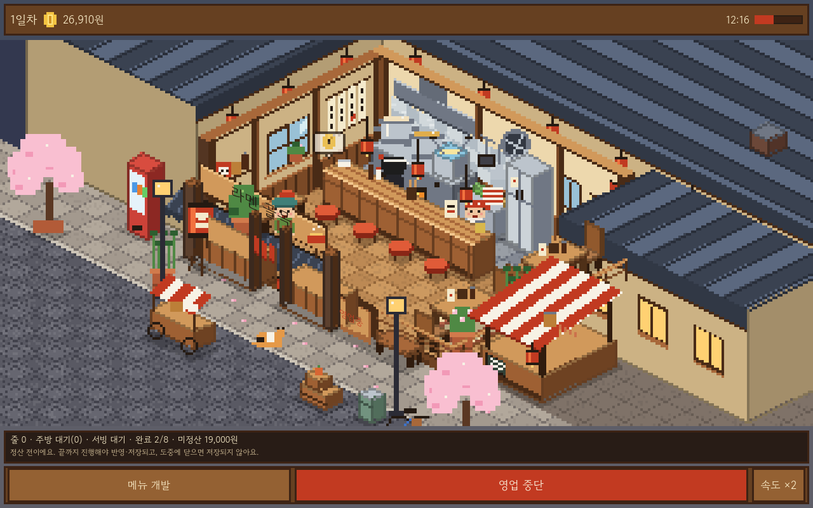
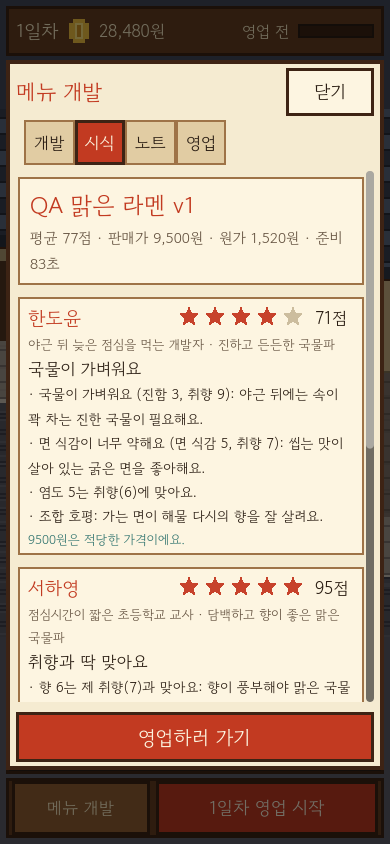

# 라멘 아틀리에 — 도트 라멘가게 프로토타입

Godot 4.7(타입 지정 GDScript) 프로젝트입니다. 기본 화면은 작은 도트 라멘가게이고, 메뉴 개발은 아래 버튼으로 여는 보조 서랍입니다. 레시피를 만들고 단골 세 분의 시식 반응을 읽은 뒤, 영업을 시작하면 손님이 줄을 서고 자리에 앉아 주문하면 요리사가 만들고 서버가 나르며 손님이 먹고 평가하고 떠납니다. 먹기를 마친 주문만 매출로 정산됩니다. Mac 데스크톱(1280x800)과 세로(390x844) 레이아웃을 지원합니다. iOS 내보내기와 실제 기기 검증은 아직 하지 않았습니다.

> **연구 기능 검증 상태**: 6개 연구 의뢰와 저장 v2를 포함한 42개 테스트·41,034개 확인, 두 크기 UI 2,646개 확인이 통과했습니다. 기존 v1 저장 호환성도 독립 확인했습니다. 연구 탭은 자동 네이티브 캡처(26장, 2,698개 확인·실패 0, 종료 0)에서 렌더링이 확인됐습니다.
>
> **피드백 1차(시식 준비·초상·글자 없는 간판·수동 저장) 상태**: Claude가 구현·테스트를 작성하고 Codex가 독립 검증했습니다. 45개 테스트·41,101개 확인, 두 크기 배치 3,784개 확인, 실제 OpenGL 화면 3,852개 확인·34장·종료 0·엔진 오류 없음입니다. [현재 화면](docs/feedback-screenshots), [검증 범위](VERIFICATION.md), [위임 기록](../evidence/feedback-play-feel-runs.json). 실제 플레이 감과 iPhone 검증은 별도입니다.
>
> **검증 상태(연구 이전)**: Codex 독립 실행으로 30개 테스트·40,404개 확인 및 두 해상도 UI 검사 1,548개가 통과했습니다. 최종 실제 캡처 20장과 렌더링 QA 1,588개 확인·실패 0을 확인했습니다. 최종 화면 승인·플레이 감과 iPhone은 미검증입니다. [검증 범위와 수정 이력](VERIFICATION.md)

## 플레이 흐름
1. **가게(기본 화면)**: 위쪽 HUD(일차·자금·시각·진행률), 가운데 도트 가게(주방·카운터·테이블·입구·골목 줄), 아래 상태 줄과 하단 바(`메뉴 개발` / `영업 시작` / 영업 중 `속도`)로 구성됩니다.
2. **처음 시작**: 시식한 메뉴가 없으면 시작 버튼이 `첫 메뉴 만들기`로 바뀌어 개발 서랍을 엽니다(비활성 버튼 없음). 서랍에서 재료·가격을 고르고 이름을 정해 **시식**하면 그 메뉴가 영업 메뉴가 되고, 서랍 아래 `영업하러 가기`로 바로 영업을 시작할 수 있습니다.
3. **메뉴 개발 서랍** `개발`(재료 아이콘·그릇 도트 미리보기·가격) · `시식`(손님 세 분의 점수와 이유) · `노트`(불러오기=개정/영업 메뉴 선택, 삭제) · `영업`(오늘 메뉴·예상·지난 결과).
   서랍에는 다섯째 탭 `연구`가 추가됐습니다([라멘 연구](#라멘-연구) 참조; 기존 네 탭의 순서·동작은 그대로).
4. **영업**: 아래 [영업 런타임](#영업-런타임) 참조. 끝나면 결과 창에서 판매·매출·재료비·운영비·순이익이 정산됩니다.

직원 육성·배치 편집·단골 이야기 버튼은 구현하지 않았기 때문에 화면에 두지 않았습니다. 이 프로토타입의 직원은 요리사 1명·서버 1명(고정)이고 자리는 8석(카운터 4, 테이블 4)입니다.

## 영업 런타임
- 한 번 = 점심 피크 2,400 게임초(40분) = 하루. 정상 속도는 1초에 36게임초(약 1분+마감 정리), `속도 ×2`는 72게임초(약 30초대)입니다. 시간은 정수 틱이고 난수는 시드 고정이라 같은 계획은 항상 같은 하루가 됩니다.
- 손님 흐름: 도착(골목 끝에서 걸어옴) → 줄 → 빈 자리 중 가장 앞 번호로 이동 → 주문 → 요리사가 준비 시간만큼 조리 → 서버가 자리까지 서빙 → 식사 → 반응 말풍선 → 퇴장. 줄이 길어 돌아가는 손님(수요 − 판매 가능)도 보입니다.
- **주문은 식사가 끝나는 순간에만 완료**로 기록됩니다. 매출·재료비·손님별 수량은 이 완료 목록에서만 계산하고, 화면의 `미정산 매출`도 같은 목록입니다.
- 수요·맛 점수·준비 시간·가격은 영업 시작 때 복사한 선택 레시피 스냅샷에서만 옵니다(기존 판매 시뮬레이션이 판매 가능 수량을 정하고, 런타임이 그 손님들을 실제로 응대). 맛이 좋으면 하트·음표, 나쁘면 화난 얼굴이 나오고, 오래 기다린 손님은 만족도가 한 단계 내려갑니다.
- 정산은 세션이 끝난 뒤 한 번만(`GameState.settle_service`). 검증을 모두 통과해야 자금·일차·보고가 한꺼번에 바뀌고, 실패하면 아무것도 바뀌지 않습니다. 정산하면 세션이 사라지고 일차가 올라 같은 날 두 번 정산할 수 없습니다.
- **미완료 영업은 저장되지 않습니다.** 영업 중에는 자금·일차·기록이 그대로이고, 중단(두 번 눌러야 함)하거나 앱을 닫으면 아무 정산도 없이 영업 전 상태로 돌아옵니다. 다시 열면 처음부터 영업합니다. 부분 정산·진행 상황 저장은 없습니다.
- 정산 직후 저장에 실패하거나 저장이 꺼져 있으면(손상 파일 보호 등) 결과 창과 가게 위쪽 배너에 "저장하지 못했어요"를 표시하며 저장했다고 말하지 않습니다. 정산은 실행 중인 게임 안에만 반영된 상태이므로 닫으면 사라질 수 있습니다.
- 영업 중에는 레시피 편집·선택·삭제·시식이 모두 거부되어 캡처한 레시피와 어긋날 수 없습니다(개발 버튼은 이유를 안내).

## 라멘 연구
> **상태**: Claude 구현 후 Codex가 테스트·저장 호환·UI 배치를 독립 검증했습니다. 아래 증인 조합과 수치는 실제 평가기로 확인했습니다. 연구 탭까지 Codex 자동 실행으로 실제 렌더링을 확인했습니다: 2,698개 확인·실패 0, PNG 26장, 종료 0, 엔진 오류 없음.

단골 세 분(한도윤·서하영·윤마루)이 입문 의뢰 1개 + 심화 의뢰 1개씩, 모두 6개의 고정 의뢰를 줍니다. 짧은 대사와 실용 힌트만 있고 분기 이야기는 없습니다. 데이터·판정·해금·보상은 [`ramen_research.gd`](scripts/domain/ramen_research.gd)가, 상태 변경은 `GameState.submit_research()`가 맡고 화면은 표시와 입력만 합니다.

| 의뢰 | 조건 (모두 충족) | 증인 조합(예) |
|---|---|---|
| 도윤 입문 | 도윤 점수 ≥80, 원가 ≤2,000원 | 돼지뼈 진국·간장·마늘유·굵은 꼬불면·김·보통, 9,500원 (원가 1,750) |
| 하영 입문 | 하영 점수 ≥80, 준비 ≤100초 | 해물 다시·소금·파기름·가는 직면·김·꼬들, 9,000원 (준비 78초) |
| 마루 입문 | 마루 점수 ≥75, 판매가 ≤8,500원 | 닭 육수·된장·고추기름·가는 직면·김·꼬들, 8,000원 |
| 도윤 심화 | 도윤 점수 ≥88, 진함 ≥8, 준비 ≤180초 | 돼지뼈 진국·간장·마늘유·굵은 꼬불면·차슈·보통, 11,000원 (준비 175초) |
| 하영 심화 | 하영 점수 ≥90, 준비 ≤90초, 판매가 ≥8,500원 | 해물 다시·소금·파기름·가는 직면·반숙란·꼬들, 9,000원 (준비 83초) |
| 마루 심화 | 마루 점수 ≥84, 준비 ≤90초, 원가 ≤1,500원, 판매가 ≤7,500원 | 닭 육수·된장·고추기름·가는 직면·김·꼬들, 7,500원 (원가 1,380, 준비 76초) |

- **달성 가능성**: 위 조합은 서로 다른 구성이고 `run_tests.gd`가 평가기로 조건 충족을 재확인합니다(`test_research_catalog_and_feasibility`). 또 재료 972가지 × 가격 표본(500원 단위)을 훑어 각 의뢰의 달성 조합이 존재하고 한 레시피가 여섯 개(또는 심화 세 개)를 동시에 만족하지 못함을 확인합니다(`test_research_sweep_no_single_recipe`). 하영 심화(판매가 ≥8,500)와 마루 심화(≤7,500)는 가격만으로도 양립할 수 없습니다. 독립 실행으로 확인한 점수: 도윤 입문 86, 하영 입문 증인 93, 마루 증인 86, 도윤 심화 91, 하영 심화 증인 95.
- **해금**: 입문 의뢰 중 아무 2개를 완료하면 심화 3개가 열립니다. 잠긴 의뢰도 카드에 보이고 이유(`입문 연구를 2개 완료하면 열려요 (지금 n/2)`)를 표시합니다.
- **제출**: 연구 탭의 `이 기록으로 연구 제출`만이 보상을 줍니다. 제출 대상은 영업 메뉴로 선택된 시식 기록(노트의 불변 기록)이며 탭 위에 `제출 대상: 이름 vN`으로 표시합니다. 개발 탭의 편집 중인 초안은 대상이 아니라 시식하지 않은 초안은 진행을 만들 수 없습니다. 각 조건에는 기록의 현재 값(`[달성]/[부족] … — 지금 …`)이, 부족한 조건에는 사람이 읽는 힌트가 표시됩니다. 조건 미충족 제출은 도메인이 거부해 이유를 보여 줍니다.
- **보상(고정)**: 입문 연구 점수 +2·자금 +2,000원, 심화 연구 점수 +5·자금 +5,000원. 여섯 개를 모두 마치면 점수 21·자금 21,000원이 상한이고 카드 위에 과정 완료가 표시되며 새 의뢰는 생기지 않습니다. 칭호는 점수로 정합니다: 0 견습 연구생 · 4 라멘 연구원 · 9 선임 연구원 · 21 라멘 연구 박사.
- **거부(상태 불변)**: 잠긴 의뢰, 조건 미충족, 알 수 없는 의뢰, 이미 완료, 없는 기록, 자금 한도 초과, 영업 중. 불러오기·시식·기록 선택/삭제·탭 열기·그리기는 보상을 주지 않습니다.
- **저장 스키마 v2**: 최상위에 `research: {completed: [...]}`만 추가했습니다. 항목은 제출 영수증(`request_id, record_id, recipe_name, version, day, points, cash`)이고, 총점·칭호·해금은 이 목록에서 계산하므로 저장하지 않습니다(고칠 수 있는 중복 합계 없음). 불러올 때 알 수 없거나 중복된 의뢰, 해금 전 심화(완료 순서가 곧 해금 순서), 의뢰와 맞지 않는 보상 값, 발급된 적 없는 기록 번호, 미래/역순 완료일, 7개 이상, 키 누락·추가, 노트에 남은 기록과 다른 이름/버전·조건 미충족 완료를 거부합니다. 심사 점수는 실제 평가기로 다시 확인하고 저장 점수 불일치도 거부합니다. 제출한 기록이 나중에 삭제돼도 영수증은 유효합니다(기록 번호는 "발급된 범위"만 확인). 영수증으로 자금 잔액의 일치까지는 검증할 수 없습니다(저장 파일을 직접 고쳐 자금을 올리는 것은 막지 않음; 로컬 프로토타입 한계).
- **v1 이행**: `schema_version` 1(연구 도입 전)은 `research` 키가 없어야 정상이며 빈 연구 진행으로 읽습니다(자금·일차·노트·개정·선택·초안·보고 보존). v1에 `research`가 있거나 v2에 없으면 손상으로 거부합니다. 불러오기만으로는 파일을 바꾸지 않고, 첫 저장부터 v2로 쓰며 그때 기존 v1 파일이 `.bak`으로 보존됩니다. 손상/미지원 파일은 기존대로 건드리지 않습니다.

## 규칙 요약
- 손님마다 취향 수치와 궁합 민감도, 기대 가격이 달라 모두에게 최고인 레시피는 없습니다(테스트가 972개 조합 전수로 확인).
- 노트는 최대 30개이며 같은 구성·가격·익힘은 중복 기록되지 않습니다. 기록은 불변 스냅샷이고, 삭제는 두 번 눌러야 합니다.
- 가격은 1,000~30,000원(100원 단위). 비싸면 수요가 줄고, 준비 시간이 길면 점심 피크(40분)에 만들 수 있는 양이 줄어듭니다.

## 저장
- 일반 실행은 `user://ramen_lab_save.json`(+ `.bak`, 쓰기용 `.tmp`)을 씁니다. 임시 파일에 쓰고 내용을 확인한 뒤 교체합니다.
- 저장이 없으면 첫 방문으로 시작합니다. 손상되었거나 지원하지 않는 버전이면 화면에 알리고 파일을 건드리지 않으며(자동 저장 중지), 사용자가 버튼을 눌러야 파일을 따로 보관하고 새로 시작합니다.
- 개발/QA용: `-- --dev-data-dir=<절대 경로>` 를 주면 그 폴더에 저장하고 개발 서랍의 영업 탭에 저장 위치가 표시됩니다. 잘못된 경로는 `user://`로 대체하지 않고 오류를 보여 줍니다.

## 피드백 1차: 시식 준비 · 초상 · 글자 없는 간판 · 저장 UI
- **시식 준비(약 4초)**: `시식하기`는 즉시 기록하지 않고 국물(0~45%) → 면(45~80%) → 시식(80~100%) 준비 작업을 시작합니다. 서랍 맨 위 카드에 솥(국물이 차오르고 거품·불꽃)·면 건지개·그릇으로 옮겨지는 면·김 도트 연출, 단계 이름, 진행 막대와 퍼센트, `준비 취소` 버튼이 보입니다. 실제 화면 시간으로만 진행하며(프레임당 최대 0.1초 반영) 시간을 건너뛰거나 돈으로 줄이는 기능은 없습니다.
- **정산 시점**: 도메인 `taste()`(맛 평가·재료비·기록·자동 저장)는 완료 때 정확히 한 번만 호출됩니다. 시작 때 초안을 스냅샷하고, 시작 전에 저장 복제본에서 같은 시식을 미리 해 보아(이름·중복 구성·자금·상태 복제 실패 등) 거부 사유를 바로 알립니다. 완료 때 초안·자금·일차·기록 수가 스냅샷과 다르면 완료하지 않고 취소합니다.
- **준비 중 차단**: 모든 변경 핸들러가 맨 앞에서 거부합니다(버튼 비활성은 보조): 재료·가격·이름·새 레시피·노트 불러오기/삭제·연구 제출·영업 시작·서랍 닫기·손상 파일 정리·중복 시작·수동 저장. 탭 이동은 허용하되 자동 저장은 하지 않습니다.
- **취소/종료**: `준비 취소`는 자금·기록·보상·저장 파일을 바꾸지 않고 조작을 복구합니다. 창을 닫으면 진행 중 준비는 버리고 확정된 준비 전 상태만 저장합니다(진행률·미완료 기록·재료비 차감은 저장하지 않음). 앱이 잠시 멈추는(pause) 경우는 작업을 버리지 않고 확정된 상태만 저장합니다.
- **초상**: 단골 세 분(도윤·하영·마루)마다 24×24 도트 초상(장면 속 사람과 같은 머리·옷 색)이 시식 카드 윗줄 왼쪽에 48×48로 붙고, 이름·별·점수는 그 옆, 본문은 카드 전체 폭을 씁니다. 연구 카드에는 넣지 않았습니다.
- **글자 없는 장면**: 간판·영업 표시·대기 인원 글자를 없앴습니다. 정확한 글(영업 상태, 줄 N)은 아래 상태 띠의 일반 라벨이 담당합니다. `shop_layout.gd`는 수정 범위 밖이라 그 안의 간판 글씨 주석은 낡았습니다.
- **저장 UI**: 서랍 `영업` 탭 하단에 자동 저장 안내(언제 저장되는지), 마지막 저장 상태(`자동`/`직접` 저장됨 + 시각, 실패 시 오류), 44px `지금 저장` 버튼과 결과 줄이 있습니다. 자동 저장은 기존처럼 시식 완료·연구 제출·노트 정리·영업 정산·서랍 닫기·탭 이동 때 실제 원자적 저장입니다. 수동 저장은 영업 중/시식 준비 중이면 이유를 보여 주며 거부하고, 저장 꺼짐(손상 파일 보호)이면 파일을 건드리지 않고 거부를 보고하며, 실패는 배너와 결과 줄에 그대로 표시합니다. 스키마 변경은 없습니다(v2, v1 호환 유지).
- **한계와 로드맵 경계**: 계급·자금·수용량·복수 토핑(3·7·8·9), 탐험(4), 대회·소식지(10·11)는 아직 없으며 이 변경은 그것을 주장하지 않습니다. 준비 시간은 레시피와 무관한 고정 4초입니다.
- **독립 실행 완료(Claude는 파일 도구만 사용)**: Codex가 아래 검사와 새 네이티브 캡처를 실행했습니다. 새 시나리오는 QA의 `_run_tasting_work`, `_run_manual_save`와 `run_tests`의 `test_tasting_work_*`, `test_portraits_and_glyph_free_art`입니다. 취소·중복 실행·완료 한 번·실제 프레임 진행·수동 저장·재시작·강제 실패 후 복구·손상 저장 보호를 검사합니다.

```sh
"$RAMEN_GODOT" --headless --path game --editor --import --quit
"$RAMEN_GODOT" --headless --path game --script res://tests/run_tests.gd -- --test-data-dir=/절대/경로/test-data
"$RAMEN_GODOT" --headless --path game --script res://tests/qa_capture.gd -- --layout-only --qa-out=/절대/경로/layout-only
```
네이티브 캡처는 `tools/build_qa_app.py`로 새 앱을 만들어 Codex가 실행했습니다(README의 자체 포함 QA 앱 절). 1280×800 / 390×844 각 17장과 실제 내용을 확인했습니다. 실제 플레이 감과 iPhone은 미확인입니다.

## 실행과 검증
Godot 4.7.2에서 `game/project.godot`를 가져오고 프로젝트 실행(F5)을 사용합니다. 다른 컴퓨터에서는 Godot을 별도로 설치해야 합니다. 엔진 바이너리는 Git에 포함하지 않습니다.

현재 Mac의 iTerm에서는 아래 **한 명령**으로 개발 저장 위치를 분리해 게임을 시작할 수 있습니다. 어느 폴더에서 실행해도 됩니다.

```sh
/Users/ji/Documents/Codex/2026-10-13/referenced-chatgpt-conversation-this-is-an/work/tools/godot-4.7.2/Godot.app/Contents/MacOS/Godot --path /Users/ji/Documents/Codex/2026-10-13/referenced-chatgpt-conversation-this-is-an/outputs/v0-harness/game -- --dev-data-dir=/Users/ji/Documents/Codex/2026-10-13/referenced-chatgpt-conversation-this-is-an/work/player-save
```

검증용 예시는 저장소 루트에서 실행하며, 먼저 아래 변수를 설정합니다. 다른 컴퓨터에서는 자신의 실행 파일 경로로 바꿉니다.

```sh
RAMEN_GODOT=../../work/tools/godot-4.7.2/Godot.app/Contents/MacOS/Godot
```

```sh
# 최초 임포트(글꼴 등)
"$RAMEN_GODOT" --headless --path game --editor --import --quit

# 실행 (개발용 저장 폴더 지정)
"$RAMEN_GODOT" --path game -- --dev-data-dir=/절대/경로/dev-save

# 헤드리스 테스트: 실패하면 종료 코드 1 (인자 오류 2)
"$RAMEN_GODOT" --headless --path game --script res://tests/run_tests.gd -- --test-data-dir=/절대/경로/test-data

# 실제 렌더러 QA 캡처(--headless 금지): 데스크톱 1280x800, 세로 390x844
"$RAMEN_GODOT" --path game --script res://tests/qa_capture.gd -- --qa-out=/절대/경로/shots

# 레이아웃/핸들러 전용 QA(헤드리스): 스크린샷을 만들지 않음. 시각 렌더링·iPhone 검증이 아님
"$RAMEN_GODOT" --headless --path game --script res://tests/qa_capture.gd -- --layout-only --qa-out=/절대/경로/layout-only
```

`--layout-only`는 이미지 추출과 `frame_post_draw` 대기만 건너뛰고, 실제 메인 씬을 두 해상도 SubViewport에 띄워 빈 가게 → 개발 서랍 → 선택·시식·개정·노트 → 영업 시작·진행·잠금 → 정산·결과 → 중단 → 도중 종료 후 재시작 복원과 장면 배율·HUD/장면 겹침·도달성·가로 넘침·터치 크기(44px) 검사를 그대로 실행합니다. 영업 시간은 세션 API로 앞당깁니다. 자동으로 켜지지 않으며 실행하면 "LAYOUT ONLY: no screenshots or visual rendering verified"를 출력합니다. 캡처 모드는 기존 가게 화면 10개, 연구 화면 3개, 그리고 피드백 1차의 시식 준비 중(`_14_tasting_work`)·초상 피드백(`_14b_feedback_portraits`)·수동 저장 성공(`_15_manual_save`)·수동 저장 실패(`_16_manual_save_failed`) 4개를 각 크기에서 생성하도록 코드가 작성돼 있습니다(코드상 크기별 17장, 합계 34장 예상 — 실제 장수는 실행으로 확인하며 이전 26장 수치를 가정하지 않습니다). 연구 전 캡처와 현재 검사 결과는 검증 기록에서 구분합니다.

로그 파일을 따로 두려면 `--log-file <경로>` 를 추가하세요(기본 파일 로그는 꺼져 있습니다).

## 로컬 macOS 런처 앱 (개발 편의용)
`tools/build_local_apps.py`(표준 라이브러리만 사용)가 `Ramen Atelier.app`(게임)과 `Ramen QA.app`(`tests/qa_capture.gd`)을 `--output-dir`에 만듭니다. 각 앱은 `Info.plist`와 셸 런처만 가진 얇은 번들로, 지정한 Godot 실행 파일을 프로젝트 경로·`--log-file`(output-dir 안)·`--dev-data-dir`와 함께 `exec` 합니다. QA 앱은 `--qa-out`에 스크린샷을 저장하고 저장 폴더는 `<data-dir>/qa`를 씁니다. 스크립트는 파일만 쓰며 Godot를 실행하지 않고, 이미 있는 `.app`이 있으면 덮어쓰거나 지우지 않고 중단합니다.

```sh
python3 game/tools/build_local_apps.py --godot /절대/경로/Godot --project /절대/경로/game \
  --output-dir /절대/경로/apps --data-dir /절대/경로/dev-save --qa-out /절대/경로/shots
```

엔진을 복사하지 않고 서명도 하지 않은 로컬 전용 번들입니다. 독립 실행 가능한 Godot 내보내기 빌드와 iOS 빌드(Xcode, 서명, 실기기 검증)는 아직 하지 않았으며 이후 작업입니다.

얇은 게임 플레이 런처의 정상 실행은 아직 미검증입니다. 그래픽 QA는 아래 자체 포함 QA 앱으로 Codex가 자동 실행·검증했습니다. [구체적인 검증 범위](VERIFICATION.md)

## 자체 포함 QA 앱 (자동 그래픽 QA용, 로컬 개발 전용)
> **상태**: Codex가 실제 앱 준비와 Computer Use 실행을 검증했습니다. 테스트 17개, 실제 렌더링 확인 2,698개·실패 0, 새 PNG 26장, 종료 0, 엔진 오류 0입니다. 서명·배포·iOS 빌드가 아닙니다. [검증 증거](../evidence/automatic-native-qa.json).

위의 얇은 `Ramen QA.app`은 외부 프로젝트 폴더를 읽어야 해서 앱 실행 환경에서 `res://tests/qa_capture.gd`를 열지 못했습니다. `tools/build_qa_app.py`(표준 라이브러리만 사용)는 이를 피하려고 게임 리소스를 앱 안에 넣은 `Ramen QA.app`을 `--output-dir`에 만듭니다. 설치된 공식 Godot를 쓰며 다운로드·네트워크·전역 설정 변경·git·권한 상승·`HOME` 변경은 없습니다.

**준비** (`--output-dir`은 아직 없는 새 절대 경로여야 하며, 이미 있으면 아무것도 쓰지 않고 거부합니다):
```sh
python3 game/tools/build_qa_app.py \
  --godot /절대/경로/Godot.app/Contents/MacOS/Godot \
  --project /절대/경로/game \
  --output-dir /절대/경로/새-폴더
```
1. 엔진 확인: macOS 앱 번들 안 Mach-O 바이너리인지, `--version`이 프로젝트의 `config/features`(4.7)와 같은 계열인지 봅니다. 다르면 오류로 멈춥니다.
2. `project.godot`, `scenes/`, `scripts/`, `assets/`, `tests/`만 담은 임시 스냅샷(`<output-dir>/prep/project`)을 만들고(Git, docs, tools, evidence, tasks, 숨김 파일, 자격 증명처럼 보이는 파일 제외; 심볼릭 링크는 거부), 거기서 `--headless --import` 후 `--export-pack`으로 PCK를 만듭니다. 원본 프로젝트는 읽기만 합니다. 프로젝트 폴더나 `project.godot`가 심볼릭 링크면 내용을 복사·읽기 전에 거부합니다.
3. 엔진 설정: `HOME`·`home`·`CODEX_HOME`은 바꾸지 않습니다(호출자의 `HOME`이 있으면 그대로 전달). 대신 검증한 `Godot.app`을 먼저 `<output-dir>/Ramen QA.app`으로 통째로 복사하고 그 옆에 Godot 포터블 마커 `<output-dir>/_sc_`를 만듭니다. 버전 확인·import·export와 실행 모두 이 복사본으로 하므로 `editor_data` 등 캐시가 `<output-dir>` 안에 생기고, 원본 엔진(과 그 옆 포터블 설정)은 실행하지 않습니다. `TMPDIR`/`XDG_*` 스크래치만 `<output-dir>/prep` 안으로 돌립니다.
4. 복사본에 PCK와 런처를 넣고 런처가 쓰도록 복사본의 `Info.plist`만 고칩니다(재서명하지 않음).
5. 진단 기록이 실패하면(`FAILED.txt`를 쓰지 못함) 그 오류도 최종 오류 메시지에 명시합니다.
6. 준비 로그와 `build-manifest.json`(포함/제외 파일, 해시)은 `<output-dir>/prep/`에 남고, 실패하면 `prep/FAILED.txt`와 단계별 로그(`godot-version.log`, `import.log`, `export.log`)가 보존됩니다. 준비 성공만으로는 그래픽 성공이 아닙니다.

**도구 테스트** (엔진·GUI를 실행하지 않는 가짜 runner와 가짜 엔진 셸 스크립트 사용):
```sh
python3 -m unittest discover -s game/tools -p 'test_build_qa_app.py' -v
```

**지원되는 앱 실행**: 터미널에서 직접 실행하지 않고 Computer Use 앱 실행기로 `cua.getApp("<output-dir>/Ramen QA.app")`처럼 절대 경로를 지정해 엽니다. 실행할 때마다 런처가 새 폴더 `<output-dir>/runs/<UTC시각>-<pid>/`를 만들고(기존 폴더는 재사용하지 않음) 실제 렌더러로(`--headless`·`--layout-only` 자동 전환 없음) `tests/qa_capture.gd`를 실행합니다. 그 폴더에 `captures/`(PNG), `qa-data/`(격리된 저장 데이터), `godot.log`, `console.log`, `started.txt`, `exit-status.txt`(엔진의 실제 종료 코드)가 남습니다. 가장 최근 폴더는 `<output-dir>/latest-run.txt`가 가리키며, 실행 폴더를 만들기 전에 실패하면 `<output-dir>/launcher-errors.log`에 이유가 남습니다. `qa_capture.gd`는 수정하지 않고 그대로 쓰며 `user://`는 쓰지 않습니다.

**작업 폴더 설정**: 런처는 번들 Godot를 작업 폴더 `/`(읽기 전용의 안정적인 시스템 폴더)에서 실행합니다. 앱 실행 환경에서는 `<output-dir>/runs/...`를 작업 폴더로 두면 `getcwd`를 해석하지 못했고, Godot의 `DirAccessUnix`는 절대 경로 작업 전에 `getcwd`를 호출하기 때문입니다. 일반적인 프로세스 설정이며 권한·TCC·보안 설정은 바꾸지 않습니다. 엔진/PCK/로그/QA 출력/데이터/tmp 경로는 모두 `<output-dir>` 안의 절대 경로이고 `/` 아래에는 쓰지 않습니다. `/`로 옮기지 못하거나 `pwd -P`가 `/`가 아니면 `launcher-errors.log`에 이유를 남기고 엔진을 실행하지 않은 채 종료 코드 70/76으로 끝납니다. 실제 작업 폴더는 `started.txt`의 `launch_cwd=`에 기록됩니다.

**검증 결과**: 최초 자동 v4는 26장·2,698개/0·종료 0이었지만 작업 폴더와 셰이더 캐시 오류가 남았습니다. 런처 작업 폴더를 고친 뒤 새 v5 앱으로 재실행해 같은 검사와 26장을 통과했고, `getcwd`·셰이더 캐시·스크립트·엔진 오류가 모두 사라졌습니다. 로그 억제나 보안 설정 변경은 하지 않았습니다. 앱 실행 도구의 시작 대기에는 수 분이 걸릴 수 있습니다. 이후 게임 코드가 바뀌면 새 폴더에서 다시 패키징한 뒤 Codex가 직접 실행하고 결과를 확인합니다.

**독립 완료 확인** (모두 만족해야 그래픽 QA 성공):
- `exit-status.txt`가 `exit_status=0`(134 같은 값은 실패이고 그대로 보고)
- `console.log`/`godot.log`에 `QA mode=capture`와 `failures=0`이 있고 `LAYOUT ONLY`·엔진/스크립트 오류가 없음
- `captures/`에 이번 실행이 만든 PNG 26장(크기별 13장): 데스크톱 1280x800 13장, 세로 390x844 13장. 파일 시간과 크기를 확인
- 이미지를 직접 열어 화면 내용(가게, 서랍, 시식, 영업, 결과, 저장 실패, 연구 3장)이 맞는지 확인
- OS나 도구가 접근을 거부하면(예: output-dir 쓰기) 우회하지 말고 실제 막힌 지점을 보고

## 화면 미리보기

현재 등각 매장의 실제 Godot 렌더링 캡처입니다. 검사 전용 메뉴와 저장 경로로 실행했습니다. [최신 26장 전체](docs/research-screenshots)와 [검증 기록](VERIFICATION.md)을 확인할 수 있습니다. [AI 생성 콘셉트](docs/concepts/shop-main-v1.png)는 방향 검토용 이미지이며 구현 화면이나 에셋이 아닙니다.





교체 전 연구소 UI는 [이전 비교 화면](docs/screenshots/desktop-comparison.png)과 [이전 시식 화면](docs/screenshots/portrait-feedback.png)에 역사적 기록으로 보존합니다.

## 구조
- `scripts/domain/` 재료·손님 데이터, 평가기, 판매 시뮬레이션, **영업 런타임 `service_session.gd`**, 게임 상태(시작·취소·정산 포함, UI와 분리)
- `scripts/services/` 저장 서비스, 저장 위치 결정
- `scripts/ui/` `main.gd`(HUD·하단 바·개발 서랍·결과 창), `shop_view.gd`(장면 그리기), `shop_layout.gd`(투영·격자 좌표·경로·가구 발자국), `shop_painter.gd`(바탕과 가구 조각 도트), `shop_scene.gd`(사람/그릇 항목과 검사용 CPU 합성 `compose_for`), `pixel_art.gd`(사람·말풍선·그릇·아이콘 도트), `star_meter.gd`. `bowl_view.gd`(이전 벡터 그릇)는 더 이상 쓰지 않는 잔여 파일입니다.
- `tests/` 헤드리스 테스트(영업 런타임·정산·잠금·취소 포함), QA 캡처 스크립트

도트 규칙: 장면은 등각(2:1 마름모 타일) 투영의 논리 픽셀 좌표(세로 176×264, 가로 320×152)를 정수 배율(390×844 세로 2배 = 352×528, 1280×800 데스크톱 4배 = 1280×608)로 최근접 확대합니다. 장면보다 남는 화면은 이웃 지붕/차도색과 가장자리 열로 채웁니다. 투영 근거와 깊이 규칙은 `shop_layout.gd`/`shop_painter.gd` 머리말에 있습니다(바닥 격자 gx,gy → x=(gx−gy)·8, y=(gx+gy)·4−높이; 깊이=gx+gy; 긴 가구는 6px 조각으로 잘라 조각별 깊이). 사람 14×18, 말풍선 13×11, 그릇 12×7, 재료 아이콘 12×12를 코드로 찍습니다. 외부 이미지·참조 게임 에셋을 쓰지 않았습니다. 장면 캔버스에는 글자를 그리지 않습니다(간판은 김 나는 붉은 그릇·인장 문양, 영업 여부는 도트 등, 대기 인원은 점). 글꼴은 일반 UI 라벨에만 쓰입니다.
- `assets/fonts/` 고운돋움(OFL, 라이선스 동봉)
