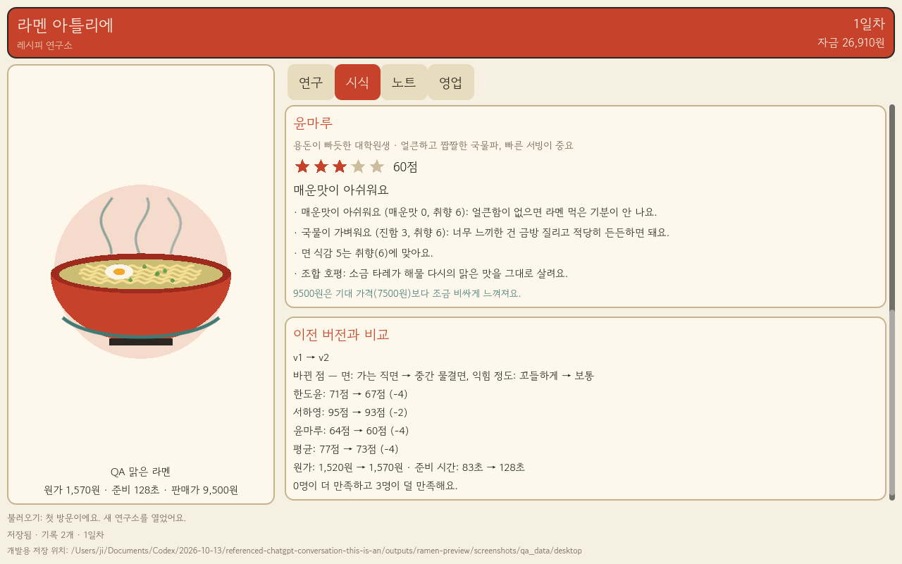
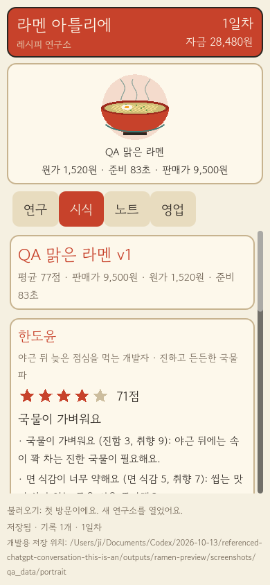

# 라멘 아틀리에 — 도트 라멘가게 프로토타입

Godot 4.7(타입 지정 GDScript) 프로젝트입니다. 기본 화면은 작은 도트 라멘가게이고, 메뉴 개발은 아래 버튼으로 여는 보조 서랍입니다. 레시피를 만들고 단골 세 분의 시식 반응을 읽은 뒤, 영업을 시작하면 손님이 줄을 서고 자리에 앉아 주문하면 요리사가 만들고 서버가 나르며 손님이 먹고 평가하고 떠납니다. 먹기를 마친 주문만 매출로 정산됩니다. Mac 데스크톱(1280x800)과 세로(390x844) 레이아웃을 지원합니다. iOS 내보내기와 실제 기기 검증은 아직 하지 않았습니다.

> **검증 상태**: Codex 독립 실행으로 30개 테스트·1,593개 확인 및 두 해상도 UI 검사 1,464개가 통과했습니다. 실제 렌더링·플레이 감과 iPhone은 미검증입니다. [검증 범위와 수정 이력](VERIFICATION.md)

## 플레이 흐름
1. **가게(기본 화면)**: 위쪽 HUD(일차·자금·시각·진행률), 가운데 도트 가게(주방·카운터·테이블·입구·골목 줄), 아래 상태 줄과 하단 바(`메뉴 개발` / `영업 시작` / 영업 중 `속도`)로 구성됩니다.
2. **처음 시작**: 시식한 메뉴가 없으면 시작 버튼이 `첫 메뉴 만들기`로 바뀌어 개발 서랍을 엽니다(비활성 버튼 없음). 서랍에서 재료·가격을 고르고 이름을 정해 **시식**하면 그 메뉴가 영업 메뉴가 되고, 서랍 아래 `영업하러 가기`로 바로 영업을 시작할 수 있습니다.
3. **메뉴 개발 서랍** `개발`(재료 아이콘·그릇 도트 미리보기·가격) · `시식`(손님 세 분의 점수와 이유) · `노트`(불러오기=개정/영업 메뉴 선택, 삭제) · `영업`(오늘 메뉴·예상·지난 결과).
4. **영업**: 아래 [영업 런타임](#영업-런타임) 참조. 끝나면 결과 창에서 판매·매출·재료비·운영비·순이익이 정산됩니다.

직원 육성·배치 편집·단골 이야기 버튼은 구현하지 않았기 때문에 화면에 두지 않았습니다. 이 프로토타입의 직원은 요리사 1명·서버 1명(고정)이고 자리는 8석(카운터 4, 테이블 4)입니다.

## 영업 런타임
- 한 번 = 점심 피크 2,400 게임초(40분) = 하루. 정상 속도는 1초에 36게임초(약 1분+마감 정리), `속도 ×2`는 72게임초(약 30초대)입니다. 시간은 정수 틱이고 난수는 시드 고정이라 같은 계획은 항상 같은 하루가 됩니다.
- 손님 흐름: 도착(골목 끝에서 걸어옴) → 줄 → 빈 자리 중 가장 앞 번호로 이동 → 주문 → 요리사가 준비 시간만큼 조리 → 서버가 자리까지 서빙 → 식사 → 반응 말풍선 → 퇴장. 줄이 길어 돌아가는 손님(수요 − 판매 가능)도 보입니다.
- **주문은 식사가 끝나는 순간에만 완료**로 기록됩니다. 매출·재료비·손님별 수량은 이 완료 목록에서만 계산하고, 화면의 `미정산 매출`도 같은 목록입니다.
- 수요·맛 점수·준비 시간·가격은 영업 시작 때 복사한 선택 레시피 스냅샷에서만 옵니다(기존 판매 시뮬레이션이 판매 가능 수량을 정하고, 런타임이 그 손님들을 실제로 응대). 맛이 좋으면 하트·음표, 나쁘면 화난 얼굴이 나오고, 오래 기다린 손님은 만족도가 한 단계 내려갑니다.
- 정산은 세션이 끝난 뒤 한 번만(`GameState.settle_service`). 검증을 모두 통과해야 자금·일차·보고가 한꺼번에 바뀌고, 실패하면 아무것도 바뀌지 않습니다. 정산하면 세션이 사라지고 일차가 올라 같은 날 두 번 정산할 수 없습니다.
- **미완료 영업은 저장되지 않습니다.** 영업 중에는 자금·일차·기록이 그대로이고, 중단(두 번 눌러야 함)하거나 앱을 닫으면 아무 정산도 없이 영업 전 상태로 돌아옵니다. 다시 열면 처음부터 영업합니다. 부분 정산·진행 상황 저장은 없습니다.
- 정산 직후 저장에 실패하거나 저장이 꺼져 있으면(손상 파일 보호 등) 결과 창과 가게 위쪽 배너에 "저장하지 못했어요"를 표시하며 저장했다고 말하지 않습니다. 정산은 실행 중인 게임 안에만 반영된 상태이므로 닫으면 사라질 수 있습니다.
- 영업 중에는 레시피 편집·선택·삭제·시식이 모두 거부되어 캡처한 레시피와 어긋날 수 없습니다(개발 버튼은 이유를 안내).

## 규칙 요약
- 손님마다 취향 수치와 궁합 민감도, 기대 가격이 달라 모두에게 최고인 레시피는 없습니다(테스트가 972개 조합 전수로 확인).
- 노트는 최대 30개이며 같은 구성·가격·익힘은 중복 기록되지 않습니다. 기록은 불변 스냅샷이고, 삭제는 두 번 눌러야 합니다.
- 가격은 1,000~30,000원(100원 단위). 비싸면 수요가 줄고, 준비 시간이 길면 점심 피크(40분)에 만들 수 있는 양이 줄어듭니다.

## 저장
- 일반 실행은 `user://ramen_lab_save.json`(+ `.bak`, 쓰기용 `.tmp`)을 씁니다. 임시 파일에 쓰고 내용을 확인한 뒤 교체합니다.
- 저장이 없으면 첫 방문으로 시작합니다. 손상되었거나 지원하지 않는 버전이면 화면에 알리고 파일을 건드리지 않으며(자동 저장 중지), 사용자가 버튼을 눌러야 파일을 따로 보관하고 새로 시작합니다.
- 개발/QA용: `-- --dev-data-dir=<절대 경로>` 를 주면 그 폴더에 저장하고 개발 서랍의 영업 탭에 저장 위치가 표시됩니다. 잘못된 경로는 `user://`로 대체하지 않고 오류를 보여 줍니다.

## 실행과 검증
Godot 4.7.2에서 `game/project.godot`를 가져오고 프로젝트 실행(F5)을 사용합니다. 다른 컴퓨터에서는 Godot을 별도로 설치해야 합니다. 엔진 바이너리는 Git에 포함하지 않습니다.

현재 Mac의 iTerm에서는 아래 **한 명령**으로 개발 저장 위치를 분리해 게임을 시작할 수 있습니다. 어느 폴더에서 실행해도 됩니다.

```sh
/Users/ji/Documents/Codex/2026-10-13/referenced-chatgpt-conversation-this-is-an/work/tools/godot-4.7.2/Godot.app/Contents/MacOS/Godot --path /Users/ji/Documents/Codex/2026-10-13/referenced-chatgpt-conversation-this-is-an/outputs/v0-harness/game -- --dev-data-dir=/Users/ji/Documents/Codex/2026-10-13/referenced-chatgpt-conversation-this-is-an/work/player-save
```

검증용 예시는 저장소 루트에서 실행하며, 먼저 아래 변수를 설정합니다. 다른 컴퓨터에서는 자신의 실행 파일 경로로 바꿉니다.

```sh
RAMEN_GODOT=../../work/tools/godot-4.7.2/Godot.app/Contents/MacOS/Godot
```

```sh
# 최초 임포트(글꼴 등)
"$RAMEN_GODOT" --headless --path game --editor --import --quit

# 실행 (개발용 저장 폴더 지정)
"$RAMEN_GODOT" --path game -- --dev-data-dir=/절대/경로/dev-save

# 헤드리스 테스트: 실패하면 종료 코드 1 (인자 오류 2)
"$RAMEN_GODOT" --headless --path game --script res://tests/run_tests.gd -- --test-data-dir=/절대/경로/test-data

# 실제 렌더러 QA 캡처(--headless 금지): 데스크톱 1280x800, 세로 390x844
"$RAMEN_GODOT" --path game --script res://tests/qa_capture.gd -- --qa-out=/절대/경로/shots

# 레이아웃/핸들러 전용 QA(헤드리스): 스크린샷을 만들지 않음. 시각 렌더링·iPhone 검증이 아님
"$RAMEN_GODOT" --headless --path game --script res://tests/qa_capture.gd -- --layout-only --qa-out=/절대/경로/layout-only
```

`--layout-only`는 이미지 추출과 `frame_post_draw` 대기만 건너뛰고, 실제 메인 씬을 두 해상도 SubViewport에 띄워 빈 가게 → 개발 서랍 → 선택·시식·개정·노트 → 영업 시작·진행·잠금 → 정산·결과 → 중단 → 도중 종료 후 재시작 복원과 장면 배율·HUD/장면 겹침·도달성·가로 넘침·터치 크기(44px) 검사를 그대로 실행합니다. 영업 시간은 세션 API로 앞당깁니다. 자동으로 켜지지 않으며 실행하면 "LAYOUT ONLY: no screenshots or visual rendering verified"를 출력합니다. 캡처 모드의 새 화면(`*_1_shop_closed.png` … `*_10_save_failed.png`)은 아직 생성하지 않았습니다.

로그 파일을 따로 두려면 `--log-file <경로>` 를 추가하세요(기본 파일 로그는 꺼져 있습니다).

## 로컬 macOS 런처 앱 (개발 편의용)
`tools/build_local_apps.py`(표준 라이브러리만 사용)가 `Ramen Atelier.app`(게임)과 `Ramen QA.app`(`tests/qa_capture.gd`)을 `--output-dir`에 만듭니다. 각 앱은 `Info.plist`와 셸 런처만 가진 얇은 번들로, 지정한 Godot 실행 파일을 프로젝트 경로·`--log-file`(output-dir 안)·`--dev-data-dir`와 함께 `exec` 합니다. QA 앱은 `--qa-out`에 스크린샷을 저장하고 저장 폴더는 `<data-dir>/qa`를 씁니다. 스크립트는 파일만 쓰며 Godot를 실행하지 않고, 이미 있는 `.app`이 있으면 덮어쓰거나 지우지 않고 중단합니다.

```sh
python3 game/tools/build_local_apps.py --godot /절대/경로/Godot --project /절대/경로/game \
  --output-dir /절대/경로/apps --data-dir /절대/경로/dev-save --qa-out /절대/경로/shots
```

엔진을 복사하지 않고 서명도 하지 않은 로컬 전용 번들입니다. 독립 실행 가능한 Godot 내보내기 빌드와 iOS 빌드(Xcode, 서명, 실기기 검증)는 아직 하지 않았으며 이후 작업입니다.

현재 도구 환경에서 생성 앱의 정상 플레이 실행은 검증하지 못했습니다. 이전 연구소 UI의 렌더링 캡처는 사용자가 iTerm에서 Godot를 직접 실행해 만들었으며 현재 매장 버전의 캡처는 아직 없습니다. 우선 직접 실행 방법을 사용합니다. [구체적인 검증 범위](VERIFICATION.md)

## 화면 미리보기

아래 두 장은 **교체되기 전의 연구소 UI**(폼 중심 첫 프로토타입) 캡처이며 현재 매장 화면이 아닙니다. 새 매장 화면의 캡처는 아직 없습니다. [AI 생성 콘셉트](docs/concepts/shop-main-v1.png)는 방향 검토용 이미지일 뿐 구현 화면이나 에셋이 아닙니다.





## 구조
- `scripts/domain/` 재료·손님 데이터, 평가기, 판매 시뮬레이션, **영업 런타임 `service_session.gd`**, 게임 상태(시작·취소·정산 포함, UI와 분리)
- `scripts/services/` 저장 서비스, 저장 위치 결정
- `scripts/ui/` `main.gd`(HUD·하단 바·개발 서랍·결과 창), `shop_view.gd`(장면 그리기), `shop_layout.gd`(좌표·경로), `shop_painter.gd`(배경 도트), `pixel_art.gd`(사람·말풍선·그릇·아이콘 도트), `star_meter.gd`. `bowl_view.gd`(이전 벡터 그릇)는 더 이상 쓰지 않는 잔여 파일입니다.
- `tests/` 헤드리스 테스트(영업 런타임·정산·잠금·취소 포함), QA 캡처 스크립트

도트 규칙: 장면은 논리 픽셀 좌표(세로 128×208, 가로 320×148)를 정수 배율(세로 3배·데스크톱 4배)로 최근접 확대합니다. 사람 14×18, 말풍선 13×11, 그릇 12×7, 재료 아이콘 12×12를 코드로 찍습니다. 외부 이미지·참조 게임 에셋을 쓰지 않았습니다(간판·입간판 글씨만 동봉 글꼴로 씁니다).
- `assets/fonts/` 고운돋움(OFL, 라이선스 동봉)
