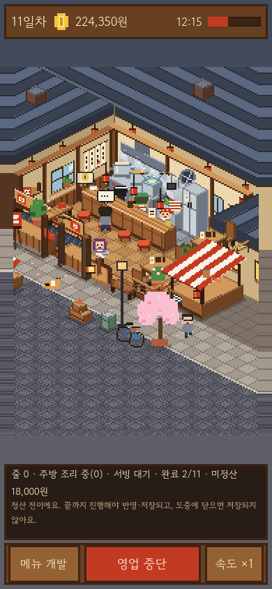
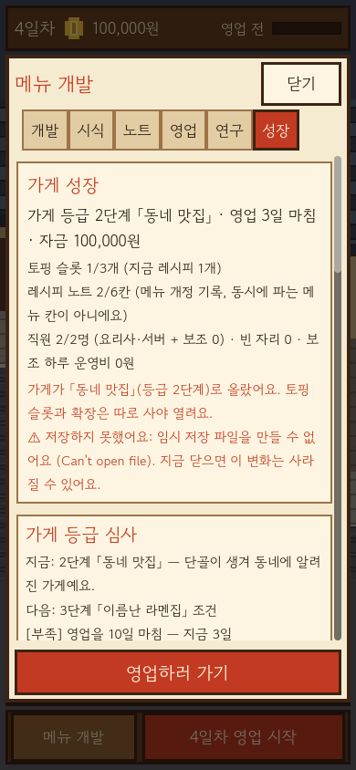
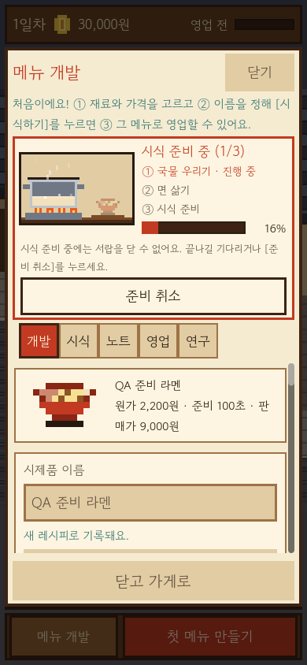
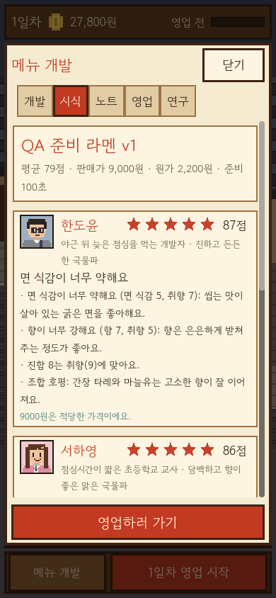
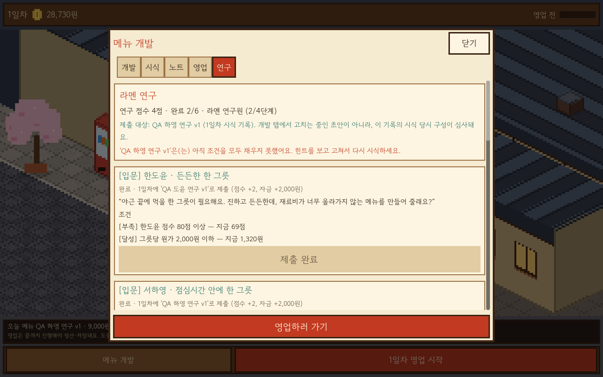

# 라멘 아틀리에 검증 기록

## 요약·상세와 전체 버튼 피드백 (2026-10-21)

Claude가 펼침 카드·연구 지도 상세 구조·컴포넌트 시험을 작성했습니다. 실제 제한 호출은20턴·종료0·success·오류false·권한 거부0입니다. Codex가 재료/공법/맛 화면 연결과 전체 동적 버튼 관찰·입력 검증을 맡았습니다. 저장/도메인/서비스46파일은 직전 버전과 바이트 동일합니다.

- 컴포넌트167확인/실패0/종료0/엔진 오류0:300/600px 폭, 그린 화살표, 클릭 가능한 전체 머리줄, 접힘/펼침/재갱신, 경고의 가시성, 이름 중복 방지, busy 강제 호출 거부.
- 두 크기 실제 씬3,150확인/실패0/종료0/엔진 오류0: 누르는 동안의 DRAW_PRESSED와 고정 터치 영역, 화살표 탭, 헤더 스와이프 취소, 동적 버튼의 중복 없는 효과, 네이티브 터치 후 자기 자신을 비활성화/삭제하는 버튼의 원래 위치 보존, 연구/시식/취소/디스크 재시작/저장 실패를 검사했습니다. 숫자는 수용 범위의 자동 확인 개수이며 재미 검증이 아닙니다.
- 실제 패키지 내부 PCK도 동일한3,150확인/실패0/종료0/엔진 오류0입니다. 기존 실제 터치 경로70확인과 전체 두 크기 배치18,638확인도 실패0/종료0/엔진 오류0입니다. 헤드리스 검사와 소스 일치를 실제 렌더링 수용으로 계산하지 않습니다.
- 초기 기본 개발 화면의 배치 높이: 폭390에서5,130→1,742px, 폭1280에서3,703→1,652px. 현재 목표는337→187px입니다. 동일한 빈 노트/초기 구성을 비교한 배치 진단이며 모든 플레이 상태나 실제 iPhone 성능의 수치가 아닙니다. 상세 내용은 접힌 안쪽에 유지합니다.
- 최종117소스 일치·공식 엔진 엄격 서명·PCK 해시를 확인한 새 상세 카드 QA 앱은 실행 시점 승인 대기입니다. 아직 실제 PNG나 수동 화면 수용은 없으며 이전 연구 지도 앱/이미지는 현재 증거로 쓰지 않습니다. iPhone 설치는 사용자 요청으로 연기했습니다.

초기 실패도 보존했습니다. 첫 컴포넌트144확인 중1실패는 정상적인 이름 없는 Godot 장식 노드의 `@` 이름을 모두 중복으로 취급한 시험 문제였습니다. 실제 공개 컨트롤24개의 유일성을 검사하도록 강화했습니다. 초기 씬은 종료0/확인 실패0이어도 미등록 메타데이터 조회 오류가 있어 거부했고 `has_meta`로 확인한 뒤 오류0을 검증했습니다. 실제 배치 조사로 진행도 숫자가 막대 옆에서 세로로 쌓이는 문제를 찾아 한 줄 폭을 보장하고 회귀 검사를 추가했습니다.

[조작·디자인 규칙](docs/UI_DEPTH_FEEDBACK_V1.md), [범위와 분담](../tasks/ui-depth-feedback-v1.md), [선별 증거](../evidence/ui-depth-feedback-v1.json).

## 이전 메뉴 실험·연구 지도 심화 검증 (2026-10-21, 상세 카드 적용 전)

사용자가 현재 깊이를 거부하고 iPhone 설치를 연기한 뒤, 메뉴 개발 자체를 우선 보완했습니다. Claude가 순수 특징/연구 판정·관련 시험과 실제 목표/지도 화면을 작성했고 Codex가 게임 연결·고정 시식/비교 화면·캐시·독립 검증을 맡았습니다. 실제 제한 프로필 호출2회는 각각18/17턴·종료0·success·오류false·권한 거부0입니다. Claude는 시험을 실행하지 않았으며 아래 결과는 Codex가 별도 실행했습니다.

- 순수 연구 판정277확인/실패0/종료0/엔진 오류0. 여덟 방향의 증인·부분 충족·반복 분량·대체 조합·공법·가격/순서 독립성과 삭제/겹치는 기록을 검사했습니다.
- 두 크기 실제 씬1,694확인/실패0/종료0/엔진 오류0. 실제 Viewport의 지도 버튼 드래그/탭, 목표 선택·재료 화면 이동의 무지출/구성 보존, 실제 유료 시식 후 수록, 고정 버튼, 가격만 바꾼 시식의 새 발견 없음, 취소·디스크 재시작·마지막 증빙 삭제와 캐시 갱신, 기존 제조 취소/재시작/저장 실패를 검사했습니다.
- 기존 도메인126시험/58,238확인, 기존 실제 터치 경로70확인, 전체 두 크기 배치18,576확인도 실패0/종료0/엔진 오류0입니다. 배치 검사는 렌더링 증거가 아닙니다.
- 새로 만든 실제 PCK도 헤드리스 씬1,694확인/실패0/종료0/엔진 오류0을 통과했습니다. 공식 엔진 엄격 서명과 최종111소스 일치를 확인한 새로운 QA 앱은 **실행 시점 승인 대기**이며 아직 실제 렌더링/이미지 수용은 없습니다. 이전 v4 앱과 이전 캡처를 새 코드의 증거로 쓰지 않습니다.
- 연구 지도 적용 직전103소스 중102개는 바이트 동일하고 기존 파일의 변경은 UI main.gd뿐입니다. 새 순수 판정·화면·시험과 UID8개를 추가했습니다. 기존 저장v12·평가·영업/샘플 회계는 변경하지 않았습니다. Mac 플레이 PCK와 실제 Mac 저장은 그대로 보존합니다.

실패 이력도 보존했습니다. 첫 순수 시험272확인 중1실패는 삭제 후 남긴 다른 기록도 같은 조건을 충족하는 잘못된 기대값이었습니다. 독립적인 증인과 겹치는 증인 양쪽을 검사하도록 고쳤고 생산 판정은 약화하지 않았습니다. 확대한 씬 시험의 동적 호출에 일반 배열을 넘겨 타입 오류2건이 났던 실행은 종료0이어도 거부했고 명시적 Array[String]으로 고친 뒤 오류0을 확인했습니다.

**기기 상태:** 사용자 요청으로 iPhone 설치를 연기했습니다. 기존 설치본과 이전 서명 빌드는 이번 연구 지도 적용본이 아닙니다. 실제 재미·최종 아트·기기 사용감을 자동 확인 개수로 수용 처리하지 않습니다. [플레이 흐름](docs/RECIPE_DISCOVERY_V1.md), [계약](../tasks/recipe-discovery-v1.md), [선별 증거](../evidence/recipe-discovery-v1.json).

## 이전 토핑 분량·메뉴 개발 연출 점검 (2026-10-21, 연구 지도 확장 전)

사용자가 시작2/등급2에서3/등급3에서4칸을 선택했습니다. 같은 토핑 분량, 명시적 칸 교체/제거, 분량별 맛·원가·시간·샘플 소비, 실제 맛 막대와 입력을 막지 않는 효과를 구현했습니다. Codex가 구현·검증했으며 이번 작업에서 Claude 호출은 없습니다.

- 전체126도메인 시험/58,238확인·실패0/종료0. 전체 두 크기 배치18,256확인·실패0/종료0. 실제 Viewport/ScreenTouch 경로70확인·실패0/종료0. 취소된 스와이프의 클릭 효과도0입니다.
- 이전 코드가 만든 저장8종/304확인, 새 이행24확인과 Python8종 전체 값 보존·원본v11 백업 바이트 일치 확인. 실제 아이폰 저장의 로컬 복사본도 기존 모든 값을 보존해 이행했고 기기의 파일은 쓰지 않았습니다.
- 이전974메뉴의 평가·그릇 픽셀은 동일합니다. 신규 혼합/중복 분량·샘플 부족의 원자적 실패·보관 소비 증빙·현재 JSON 왕복을 검사했습니다.
- 첫 네이티브v1은 종료0/14PNG였지만 실제 이미지가 검정이라 거부했습니다. 시험 SubViewport의 갱신 누락을 고치고 빈 이미지 실패 검사도 추가했습니다. v2 실제 OpenGL654확인/실패0/종료0/14PNG는 내용까지 확인했으며 제조 단계 문구가 결과에 겹치는 문제를 발견해 정리했습니다.
- 복구 전 제한 환경에서 마지막 정리 후 개발 화면·기존 제조 취소/재시작/저장 실패1,496확인·스크립트 실패0/종료0, 터치70확인·스크립트 실패0/종료0을 확인했습니다. 당시 macOS CA 인증서 조회 오류가 별도로 발생했으므로 엔진 오류0으로 수용하지 않았습니다. 공식 엔진의 이전/새 복사본80파일이 동일했지만 엄격 서명 검사가 둘 다 실패해 최종 앱 준비를 중단했습니다. 검사를 생략하거나 서명을 바꾸지 않았습니다.

**실행 환경 복구 후:** 공식 엔진의 엄격 서명 검사가 변경 없이 통과했습니다. 최종103소스와 일치하는 v4 시험 앱을 준비했으며 실행 시점 승인을 기다립니다. 가져오기를 완료한 격리 복사본에서 개발 화면·제조 취소/재시작/저장 실패1,496확인과 터치70확인은 모두 실패0/종료0/엔진 오류0입니다. 최초 복구 재검사의 원본 복사본에는 폰트 가져오기 파일이 없어 오류가 발생했으므로 해당 실행은 수용하지 않고 별도 보존했습니다.

최종v4의 실제 팀 iOS 내보내기와 서명 빌드는 종료0/BUILD SUCCEEDED입니다. 기존 템플릿 경고6건을 보존했습니다. 엄격 앱 서명, 등록 기기·팀·앱 프로필 일치, APNS 없음, iPhone 전용, 내장 PCK와 내보낸 PCK의 바이트 일치를 확인했습니다. 서명 자료는 Git 밖의 비공개 영속 폴더에도 보존했습니다. 현재 기기 연결이 끊겨 있어 직전 저장 백업·앱 교체·실행은 아직 수행하지 않았습니다. 최종 실제 렌더링과 실기기 플레이 수용도 남아 있습니다. [규칙과 조작](docs/DEVELOPMENT_FEEL_V1.md), [계약](../tasks/development-feel-v1.md), [선별 증거](../evidence/development-feel-v1.json).

## iPhone 내용 영역 스와이프 수정 (2026-10-21)

사용자의 개발자 앱 신뢰 후 실제 실행·연구 화면을 확인했으나 손가락 스크롤은 사용자에게 거부됐습니다. 기본 STOP 필터가 카드/버튼/그림 위에서 부모 스크롤을 막는 문제를 재현했습니다. UI의 일반/재료 버튼·카드를 PASS, 장식 그림·별점을 IGNORE로 바꾸고 드래그 허용 거리10을 설정했습니다. LineEdit에는 세로 드래그 전달을 추가했습니다.

같은 두 크기 입력 시험66확인: 원본32실패/종료1, 수정본0실패/종료0/엔진 오류0. 실제 Viewport와 ScreenTouch/ScreenDrag 변환으로 스와이프·단일 탭·오작동 클릭/토글 방지·이름 입력·역방향·관성 중지·휠을 검사했습니다. 기존 도메인125시험/58,220확인도 실패0/종료0/엔진 오류0입니다. 전체 두 크기 배치17,758확인도 실패0/종료0/엔진 오류0입니다(헤드리스, 렌더링 수용 아님).

새99소스 내보내기/실제 팀 서명 빌드/엄격 서명/프로필 일치/내장 PCK 일치가 통과했습니다. 같은 번들로 설치·실행(각 종료0/JSONsuccess)하고 실제1179×2556 화면을 확인했습니다. 이 앱의 Documents 저장과 백업만 직전 별도 보존했으며 교체 직후 두 파일 모두 바이트 일치합니다. 기존95소스 중 UI main.gd 외94개, Mac 앱/PCK·실제 Mac 저장은 보존했습니다.

**사용자 실기기 수용:** 수정본에서 화면 어디서 밀어도 스크롤되고 탭도 정상이라는 직접 확인을 받았습니다. **수용 대기:** iOS 가상 키보드/한글 입력·중단 복귀. 이름 입력란에서 시작하는 드래그는 별도 관성 없이 움직이며 일반 내용은 엔진 관성을 사용합니다. 자동 시험·화면·설치 후 파일 보존으로 플레이 감이나 실제 저장/중단 복귀의 전체 수용을 대신하지 않습니다. [원인·재현·기기 상태](docs/IOS_DEVICE_PREPARATION.md#손가락-스크롤-수정-2026-10-21), [선별 증거](../evidence/ios-touch-scroll-v1.json).

## 최초 실제 iPhone 설치 (2026-10-20, 신뢰 전 기록)

iPhone15Pro/iPhone16,1/iOS26.6.2의 실제 wired/paired/개발자 모드 활성화를 확인했습니다. 빈 push 옵션이 APNS 권한을 생성한 첫 서명 종료65를 보존하고 정확한 Disabled enum과 실제 권한 파일 검사를 추가했습니다. 전체 도구31시험/실패0, 새 내보내기/서명 빌드/엄격 서명/기기·팀·앱 프로필 일치/실제 설치 모두 통과했습니다. 프로필 유효기간은2026-10-27T14:45:57Z입니다. 최초 실행은 기기 보안의 일반적인 서명/권한/프로필 미신뢰 오류로 거부되어 본인 개발자 앱 신뢰 확인을 사용자에게 요청했습니다. 실행·실제 화면·터치·저장·수명 주기는 아직 통과하지 않았습니다.

새 iOS PCK는 재생성된 main.scn 인코딩 때문에 이전 미서명 PCK와 바이트가 다릅니다. 전체75항목 중74파일 해시는 같고 해당 장면을 디코드한 노드/속성/연결 및 전체 ProjectSettings는 일치합니다. 실제 설치한 앱의 PCK는 이번 내보낸 PCK와 동일합니다. 원본95소스/Mac PCK와 실제 Mac 저장은 보존했습니다. 개인 계정/기기 식별자/서명 자료/원로그는 Git에 넣지 않습니다. [기기 선별 증거](../evidence/ios-device-validation-v1.json).

## iOS 개발 준비 (2026-10-20, 앱 빌드 전)

공식 Godot4.7.2 표준 내보내기 TPZ의 배포 SHA256와 별도 공식 SHA512를 모두 확인했고, SHA512 목록 파일 자체도 GitHub 공식 배포 digest와 일치했습니다. 추출한 iOS ZIP은202,976,946바이트/76항목이며 디버그·릴리스 실제 iOS arm64 라이브러리를 확인했습니다. 원본 게임95개를 바꾸지 않는 `prepare_ios.py`로 새 격리 복사본을 만들고 세로390×844 논리 기준/터치/프로젝트 전용 내보내기를 설정했습니다. 엄격 공급자 서명 전후0, 실제 엔진 임포트 종료0/오류0, Godot 설정12확인/실패0, 도구 안전성9테스트/실패0입니다. 실제 CLI에서도 기존 출력 재실행과 실제 서명 팀 없는 내보내기를 종료2로 거부하고 기존 상태를 보존했습니다.

현재 Mac에 호환 Xcode26.6/17F113을 별도 설치했고 Apple 패키지 서명/앱 엄격 서명/Gatekeeper와 사용자 약관 동의 후 첫 실행/SDK26.5 조회가 통과했습니다. 사용자가 Xcode에도 로그인했고 실제 Personal Team을 로컬 환경에만 전달해 게임 iOS 프로젝트 내보내기를 완료했습니다. 템플릿 기본 경로·편집기의 runtime override 무시·모바일 텍스처 임포트·미지정 아이콘으로 실패한 네 시도는 보존했습니다. 최종 도구는 복사본 project.godot만 병합하고 원본95개/나머지 복사본94개/변경한 복사본 설정의 별도 해시를 확인합니다. 최종29도구 시험과 실제 내보낸 PCK13설정/제외 검사가 실패0/종료0이며 스킴 조회도 종료0입니다.

첫 서명 없는 기기 빌드 종료70은 공식 iOS26.5.1/시뮬레이터 묶음 설치 후 해결됐습니다. 두 번째 generic iOS 빌드 종료0/BUILD SUCCEEDED이며 실제 arm64 실행 파일·최소iOS17·iPhone 전용/세로·내장 PCK 일치를 확인했습니다. 실제 미서명 상태이며 앱12파일은 outputs/ramen-ios-device-build-v1에 바이트 일치로 보존했습니다. 생성 템플릿 pragma once/미사용 빈 개인정보 권한 설명/AppIntents 미사용 경고는 기록했고 배포 전 정리 대상입니다. 서명·설치·실기기 검증은 아직 미완료입니다. devicectl은 종료0/기기0대였고 사용자 연결/신뢰를 요청했습니다. 후보 iPhone15Pro의 정확한 모델/iOS도 아직 확인하지 않았습니다. Mac PCK·게임95개 소스·기존 앱을 보존하고 실제 사용자 저장은 읽지 않았습니다. [준비 상태/재현](docs/IOS_DEVICE_PREPARATION.md), [선별 증거](../evidence/ios-device-preparation-v1.json).

## 장터 반복 채집 v11 (2026-10-20, 로컬)

Codex가 구현·통합 검증했으며 이번 작업은 Claude를 호출하지 않았습니다. 전체125테스트/58,220확인·집중 도메인163확인·집중 두 크기 배치492확인·전체 배치17,758확인, 실패0/종료0/엔진·스크립트 오류0입니다. 공개 거래로 기존 장터 발견→반복 채집→시제품 소비→샘플0개 실제 판매를 확인하고, 진행 세 단계의 디스크 재시작·하루 공유·재고 한도·포기·중복·저장 실패/회복·손상16종·잘린 영수증 이력·삭제된 노트의 남은 증빙을 검사했습니다. 새 재료로 연구 제출/승급/확장/두 메뉴 실제 영업/콘테스트 후 저장 복귀도 통과했습니다.

실제 기존v10 소스87개로17종 시험 저장을 생성했습니다(180확인/0). 새v11 이행138확인/0과 별도 Python 검산으로 기존 모든 값 보존·새 재고0·원본 `.v10.bak` 바이트 일치를 확인했습니다. 같은 기존 메뉴의 영업64경우와 CPU 도트4종은 구v10/새v11 전체 결과가 일치했습니다. 사용자 실제 저장은 읽지 않았고 합성 저장의 자금/일차를 재미나 초보자 진행 속도의 증거로 사용하지 않습니다.

초기 전체124테스트/58,052확인/42실패는 구버전 시험에 새 키가 남은 문제와 재료 목록 기대값 변경으로 수정했습니다. 첫 집중127확인/29실패와 스크립트 오류는 시험 폴더 미생성에서 이어진 실패였고 명시적 생성/실패 중단을 고쳤습니다. 첫 구v10 생성기의 상대 `--script` 경로는 엔진 오류에도 종료0이어서 거부했고 절대 경로 실행으로 다시 생성했습니다. 원자료를 모두 보존하며 실패를 성공 로그로 덮어쓰지 않습니다.

새 QA 앱은 공식 공급자 엄격 서명0, 번들 소스95개 일치, 준비 오류0과 PCK를 확인했습니다. 테스트 UID3개는 임포트가 만든 동일 파일을 소스에도 보존했습니다. 정확한 앱을 사용자가 승인한 뒤 CUA로 실행했습니다. 런처 관찰은35초 시간 초과였지만 새 run `20261020T065402Z-13457`과 실제 OpenGL 창을 독립 확인하고 정확한 복사 엔진 창을 Raise했습니다. **실제 Mac capture18,214확인·실패0·종료0·엔진/스크립트 오류0, 두 크기 각114장/총228장**입니다. 시나리오 이름·크기·해시를 확인했고 새103~113의22장 모두 직접 읽었습니다. 채집 선택/수령·저장 경고·시제품 준비/취소·재고 부족·샘플0개 판매·재방문/복귀 표시에서 진행을 막는 시각 문제를 발견하지 못했습니다.

전체 실행248파일은 영속 작업 공간에 바이트 일치로 보존했습니다. 실행 뒤95개 게임 소스/PCK와 공식 공급자 엄격 서명도 그대로입니다. 동일 PCK의 새 `outputs/ramen-play-market-foraging-v1/Ramen Atelier.app`을 준비했고, 별도 저장소에서 메인60프레임 헤드리스 종료0/오류0/엄격 서명 전후0을 확인했습니다. 이전 플레이 앱은 보존하고 새 앱 GUI나 사용자 실제 저장은 열지 않았습니다. 실제 iPhone·터치·본편 분량·사람의 재미/최종 아트 승인은 별도입니다. [계약](../tasks/market-foraging-v1.md), [현재22장](docs/foraging-screenshots), [선별 증거](../evidence/market-foraging-v1.json).

## 단골·노트·투자 안내 실제 화면 수락 (2026-10-20)

사용자가 수정된 정확한 v2 앱 실행을 승인한 뒤 소스87개/PCK·엄격 공급자 서명을 다시 확인하고 CUA로 실행했습니다. 런처 관찰은35초 시간 초과였지만 실제 새 run `20261020T052202Z-96454`가 시작됐고 정확한 복사 엔진 창을 선택/Raise했습니다. 실제 OpenGL capture17,612확인·실패0·종료0·엔진/스크립트 오류0, 가로1280×800/세로390×844 각103장·총206장입니다. 기존14b를 포함한 정확한 시나리오 이름·PNG 해시/크기를 확인했으며 새83~102의40장 모두 직접 읽었습니다. 수정한 세로 글 넘침은 재발하지 않았고 단골 선택/결말/저장 실패/복구·노트 페이지/개정·고용 비교 표시를 확인했습니다.

전체 새 실행 폴더를 영속 작업 공간에 바이트 일치로 보존하고 [새40장과 전체206장 해시](docs/investment-screenshots)를 남깁니다. 실행 뒤에도87개 게임 소스/PCK는 같고 공급자 서명이 유효합니다. 동일 PCK의 새 `outputs/ramen-play-investment-v2/Ramen Atelier.app`을 준비했으며 별도 시험 저장소의 메인60프레임은 종료0·엔진 오류0/엄격 서명 전후0입니다. Documents 엔진 복사본의 FinderInfo 실패는 원자료로 보존했고, 새 앱 전용 Application Support 경로에서 공식 엔진을 그대로 사용합니다. 이전 앱/사용자 저장은 변경하지 않았고 사용자 저장이나 새 플레이 앱 GUI를 자동 실행하지 않았습니다. [선별 증거](../evidence/investment-native-v2-20261020.json), [현재 계약](../tasks/investment-native-v2-20261020.md).

이 기록으로 아래 과거 v9/v10/투자 안내의 실제 Mac 화면 미완료 상태는 해소됐습니다. 각 과거 실패·당시 수치는 보존합니다. 실제 iPhone·터치·중단 복귀·장기 플레이 재미·최종 사용자 아트 승인은 별도 미검증입니다.

## 직원 전문화35일 진단 (2026-10-19)

18개 새 게임×35일 실제 영업630회·매일 저장/새 인스턴스 복귀·원장·직전 백업을 확인했습니다. 게임 측10,770확인/독립 Python -O42,454확인, 실패0·종료0입니다. 변조6종은 종료1, 기존 출력 등4종은 종료2로 거부했습니다. 기존 기본14일은3,446확인/강화한 검산4,176확인으로 통과했고 원자료193파일 모두 동일합니다. 주문 관찰 추가 전후 저장666파일과 전체 거래도 같습니다. 현재87개 게임 소스/PCK·규칙·저장 스키마는 그대로이며, 사용자 저장·GUI 실행·공개/병합은 수행하지 않았습니다. [결과와 한계](docs/STAFF_GROWTH_AUDIT.md), [선별 증거](../evidence/staff-specialization-audit-v1.json).

## 고용 전 투자 안내 (2026-10-19, 로컬 구현)

현재 판매 메뉴의 고용 전후 조리 시간·예상 판매·하루 운영비·순영업이익을 비교하고 일회성 고용비를 분리했습니다. 시설의 열린 용량 활용과 방문 의향/매장 앞에서 돌아간 손님/완료 주문 정산을 구분하는 안내도 추가했습니다. Codex가 구현·독립 검증했고 Claude 호출은 하지 않았습니다. 저장 스키마10과 기존 거래·수요·가격·직원 효과는 그대로입니다. 새 읽기 조회 함수만 제거하면 기존 GameState와 바이트가 같고, UI 입력 콜백38개와 저장 메서드도 바뀌지 않았습니다.

전체124테스트/58,045확인·실패0·종료0, 가로/세로 집중1,270확인·실패0·종료0, 같은 검사의 실제 PCK 실행1,270확인·실패0·종료0, 최종 전체 두 크기 배치17,200확인·실패0·종료0입니다. 최종 정상 로그에 스크립트/엔진 오류가 없습니다. 긴 메뉴 이름 두 개·전체 직원 카드·예측 글의 실제 스크롤 영역 도달·고용 전 조회 불변·실제 고용 뒤 예측 일치·훈련된 동료 유지·판매 목록 변경·저장 실패/회복/재시작을 확인했습니다. 모두 별도 시험 저장소를 사용했습니다.

첫 단위 검사는 시험의 느린 메뉴 가격/없는 status 메서드 사용으로124테스트/57,977확인/2실패였고 시험만 수정했습니다. 첫 집중 검사는1,190/0/종료0이어도 글꼴 임포트 캐시 누락으로 엔진 오류12건이 있어 수락하지 않았습니다. 소스를 바꾸지 않는 새 격리 프로젝트에서 글꼴을 임포트한 뒤1,190/0/오류0을 확인했습니다. 첫 전체 배치17,084/4는 실제 세로 넘침이었습니다(직원 카드517/492px·예측537px > 스크롤472px). 중복 문구를 공통 안내로 옮기고 짧게 정리했으며 글꼴/터치 크기·전체 카드 검사를 유지한 채 집중 회귀 검사를 강화해 최종 결과를 확인했습니다. 실패 원자료는 보존합니다.

**실제 화면은 아직 미검증입니다.** 새 QA v2 준비는 공식 엔진 엄격 서명/87개 번들 소스 일치/PCK 검사까지 통과했습니다. 수정 전 v1 앱은 이전 준비 기록으로 보존하고 실행하지 않았으며 이전 실행 질문도 사용하지 않습니다. 수정된 `/private/tmp/ramen-investment-qa-20261019-v2/Ramen QA.app`의 실행 시점 확인을 요청했으며 현재 응답을 기다립니다. v9/v10/투자 안내의 실제 캡처·새 플레이 앱·공개/병합·iPhone·재미 검증은 이 배치 결과로 대체하지 않습니다. [계약](../tasks/investment-guide-v1.md), [선별 증거](../evidence/investment-guide-v1.json).

## 14일 연속 캠페인 진단 (2026-10-19)

두 고정 메뉴×여섯 투자 정책의 실제 영업168회·매일 전체 디스크 저장/새 인스턴스 복귀를 확인했습니다. 게임 측3,446확인/별도 Python4,002확인, 실패0·종료0입니다. 자금·판매·스냅샷 변조3종은 검산 종료1로 거부했고 기존 출력 재실행은 종료2/193파일 보존을 확인했습니다. 게임 규칙·수치·사용자 저장은 변경하지 않았습니다. [결과와 해석](docs/CAMPAIGN_AUDIT.md), [선별 증거](../evidence/campaign-progression-v1.json).

현재 권한 실행에서 새 private/tmp QA 준비는 엄격 엔진 서명과85개 번들 소스/PCK 일치를 통과했습니다. 앱은 아직 실행하지 않았습니다. 따라서 이후에 적힌 과거 서명 차단은 준비 단계에 한해 해소됐고, v9/v10의 실제 렌더링·새 플레이 앱·공개 수락은 계속 미완료입니다. [준비 증거](../evidence/native-preparation-20261019-v2.json).

## 노트·시식 성적 v10 로컬 검증 (2026-10-17)

등록 종류6/12/30종과 개정 이력300개를 분리하고20개씩 표시합니다. 기록을 지워도 최고 시식 증빙은 승급에 남습니다. Codex가 구현·독립 검증했으며 새 Claude 호출은 하지 않았습니다. 기능122개/57,669확인·실패0·종료0, 최종 경계 집중793개/0/종료0, 두 크기 새 화면 집중778개/0/종료0, 전체 두 크기 배치15,768개/0/종료0입니다. 기존 사용자 저장은 사용하지 않았습니다.

300개 이력의 실제 파일 저장/재시작, 기본·12·30종 한도, 초과 보관 중 개정, 이전 쪽 선택/삭제, 새 시식 최신 쪽 복귀, 성적 증빙의 방어적 복사·전체 삭제 후 승급·손상 저장 원자 거부를 포함합니다. 기존 전체 QA의 저장 실패/거래 잠금과 단골 사연도 그대로 통과했습니다. 새 화면 시나리오94~96은 두 크기 모두 배치·핸들러 검사만 수행했으며 PNG를 생성하지 않았습니다.

실제 이전v9 코드85파일을 고정한17개 합성 저장(진행 중 탐색·훈련·확장·제조·사연 선택/첫 장/결말/삭제된 메뉴 포함)을180개 확인으로 생성했습니다. 이행/영구 원본 백업/왕복102개와 별도 Python17건 전체값·증빙·백업 바이트 비교가 통과했습니다. 첫 이행 검사102/34는 시험 도구가v8 백업 이름을 조회한 오류였고v9로 바로잡아 새 시험 폴더에서102/0을 확인했습니다. 기존64개 영업 사례와4개 CPU 그림 비교260개도 모두 같습니다.

**제한:** headless 실행에 macOS 시스템 CA 조회 오류가 별도로 있으며 스크립트 오류는 없습니다. 실제 렌더링·새PCK·플레이 앱·iPhone·공개/병합은 아직 검증/수행하지 않았습니다. 이전v9의 실행 환경 차단을 우회하지 않고 로컬 소스와 결과만 보존합니다. [계약](../tasks/recipe-notebook-v1.md), [선별 증거](../evidence/recipe-notebook-runs.json).

## 단골 이야기 v9 (2026-10-17, 실제 화면/게시 전)

Codex가 세 단골의 선택별 대사·조건 카탈로그, 상태/거래/스키마9·화면·시험을 구현했습니다. Claude의 두 파일 도움 호출은 세션 인증 만료로1턴/종료1/오류true/파일 변경0으로 끝났으며 재시도나 권한 확대를 하지 않았습니다. Claude 구현이나 검토 완료를 주장하지 않습니다. [분담·실행 기록](../evidence/regular-stories-runs.json).

전체119개 테스트/57,027개 확인·실패0·종료0, 순수 카탈로그189개·실패0·종료0, 집중 두 크기 UI462개·실패0·종료0과 최종 전체 두 크기 배치14,990개·실패0·종료0을 확인했습니다. 배치 검사는 렌더링 증거가 아닙니다. 모든12단계에 실제 기존 재료/평가기 증인이 있습니다. 처음 제안한 매운맛6은 현재 재료의 최대5로 달성할 수 없어, 기존 평가기를 바꾸지 않고 매운맛5와 더 높은 만족도80·새 메뉴·새 영업으로 조건을 바로잡았습니다. 실제 구v8 코드로 합성 저장13종을 생성(150확인)해 이행/영구 원본 백업/왕복78개와 독립 전체값13건을 확인했습니다. 이전 단일·복수 영업64사례와CPU 그림4개260건도 같습니다. 사용자 플레이 저장은 읽거나 자동 실행하지 않았습니다.

첫 새 테스트의 void 메서드 오용은 테스트 헬퍼를 수정했습니다(엔진 종료0이어도 스크립트 파싱 실패를 성공으로 인정하지 않음). 첫 집중UI232/38실패/미완료2흐름은 검사기가 정산 처리 프레임을 멈춘 문제였고, 실제 영업을 처리하는 프레임만 복원해 조건을 유지했습니다. 다음460/4실패는 중복 거부 후 재구성한 컨테이너의 배치 프레임을 기다리도록 고쳤습니다. 저장 파서의 고아/미래 보고/뒤늦은 답례3종은 독립 검토로 보완하고 원자 거부 시험을 추가했습니다. 이후 실제 미저장 안내가 중복 거부에 가려지는 문제를462/2로 재현해 수정하고 같은 검사462/0을 확인했습니다. 세 단골 교차 진행·삭제된 여섯 메뉴의 사연 왕복·답례 총18000원, 실제0그릇 영업, 탐색 중 잠금도 추가 확인했습니다.

현재 헤드리스 로그에는 도메인/스크립트 실패와 별도로 macOS 시스템CA 인증서 조회 오류가 기록돼 엔진 오류0으로 주장하지 않습니다. 새 QA 앱 준비도 엄격 공급자 서명 검증에서 중단했습니다. 원본/기존 복사본의 바이너리 SHA256과Info.plist는 이전 검증본과 동일하며 서명 검사를 생략하거나 보안 설정을 바꾸지 않았습니다. 샌드박스 밖 읽기 검증 요청은 현재 세션 정책이 자동 거절했고 추가 권한 요청 도구도 없습니다. 실제 렌더링·새PCK 플레이 앱·게시/병합은 아직 하지 않았습니다. 추가 비교에서 공식 보관 ZIP의80개 파일이 새 엔진 복사본과 모두 같고 추가 파일도0개임을 확인했습니다. Git fetch는 정상이며 현재 남은 차단은 OS 서명 검증 실행 환경입니다. iPhone 실기기와 장기 플레이 감은 미검증입니다.

## 육수·면 제조 공법 v8 (2026-10-16, 기능·저장·실제 화면 통과)

Codex가 공법의 상태·저장·평가·화면·도트 연출·통합 시험을 구현했고 Claude는 순수 공법 카탈로그와 전용 시험 두 파일을 맡았습니다. Claude의 첫 로그인 갱신 실패 뒤 같은 범위 호출은5/14턴·종료0·오류false·권한 거부 없이 완료됐습니다. 선택적 읽기 검토는 자동 승인 검토가 소스 전송 권한을 이유로 실행 전에 차단했으므로 취소했고, 응답/사용량/종료 코드를 주장하지 않습니다. Codex가 직접 코드를 검토하고 검증합니다. [실행 기록](../evidence/recipe-process-runs.json).

전체112개 테스트/56,595개 확인, 순수 공법118개, 집중 UI1,256개, 두 크기 전체 배치14,510개가 실패0/종료0으로 통과했습니다. 실제 구v7 코드로 합성 저장12종을 생성(148개 확인)해 이행/영구 백업/왕복72개와 독립 전체값12건을 확인했습니다. 기존 단일·복수 메뉴 영업64사례와 CPU 그림4개도260건 모두 동일합니다. 새 PCK의 메인60프레임은 격리 저장에서 종료0/엔진오류0입니다. 기본 공법 경제·그림, 취소/중복 완료/고급 공법 등급, 변조 저장 원자 거부와 삭제된 메뉴 보고·대회 스냅샷을 포함합니다.

첫 실제 QA 앱은 캡처0/종료137로 실패했습니다. 공급자 Info.plist를 변경하던 제작기를 별도 런처/원본 서명 보존 구조로 고쳤습니다. Documents 출력의 엄격 서명 검사는 재부착되는 Finder 표시 정보로 실패했고 진단을 보존했습니다. Python의 xattr 미지원으로 복사 속성이 누락되는 회귀도 테스트로 발견해 macOS ditto로 ACL/보안 속성을 보존합니다. 제작기20개 시험이 모두 통과하며 새 임시 경로의 공식 엔진 복사본은 실행 전 엄격 서명 검사를 통과했습니다.77개 번들 소스는 현재 코드와 바이트 단위로 같습니다. 사용자가 새 정확한 앱 실행을 승인한 뒤 CUA로 실행했습니다. 런처 관찰은37초 시간 초과였지만 실제 엔진이 실행되어 정확한 복사본 창을 선택/Raise했습니다. 실제OpenGL 런20261016T062322Z-75245는14,842개 확인/실패0/종료0/엔진오류0,166PNG(1280×800·390×844 각83장)로 완료했습니다. 새20장 전체의 잠금·효과·제조 국물/반죽·시식·개정·복수메뉴 보고·재시작·저장 실패/회복 내용을 직접 검토했고 전체166장 크기/해시를 기록했습니다. 실행 후에도 공급자 서명이 엄격 검증을 통과했습니다. [갤러리](docs/process-screenshots). 플레이 앱은 같은PCK SHA256 `3eb423c0fc770edd2950e2f259e7f142f505327bfdaa5aefea6107ac4c8ee6d3`를 사용합니다. 정상 플레이 저장은 자동 실행/시험하지 않았으며 iPhone과 장기 플레이 감은 미검증입니다.

## 매장 증축·복수 메뉴 v7 (2026-10-16)

Codex가 거래·저장·런타임·도면·화면·통합 검증을 구현하고, Claude는 순수 공유 손님/주방 계산과 전용 시험 및 읽기 전용 검토를 맡았습니다. 전체105개 테스트/56,283개 확인·실패0·종료0, 순수 계산1,638개/0/종료0, 두 크기 화면 배치13,158개/0/종료0입니다. 이전 실제v6 코드를 고정해 만든10개 합성 저장의 이행/영구백업/왕복60개와 Python 전체값10건 비교가 통과했습니다. 실제 구버전 영업56사례의 예측/계획/런타임/정산과 기본 CPU 그림2개도226건 모두 같습니다. [계약](../tasks/shop-expansion-menus-v1.md), [선별 실행 기록](../evidence/shop-expansion-menus-runs.json).

첫 UI13120/36 실패는 가득 찬 노트에 새 기록을 넣은 QA 준비 오류였습니다. 실제 조리대 구매 후 집중 검사870/4에서 판매 기록 삭제 거절 안내 누락과 세로 보고537px/스크롤472px를 재현했습니다. 거래 실패 전달/확인 상태를 고치고 수량·금액·대기 정보를 보존하면서 반복 단위와 빈 줄을 줄였습니다. 단언을 유지해 집중870/0, 전체13,158/0을 확인했습니다. 새 좌석의 실제12명 착석·전 경로/가구 충돌·메뉴별 그릇·주방2400초·운영비/경험 한번·중단/재정산·0판매·삭제된 역사적 메뉴 보고·변조 저장 원자 거부를 포함합니다.

Claude의 첫 인증 갱신 실패는 같은 범위의 기존 로그인 갱신으로 복구했습니다. 성공 구현은 요청18/관측23턴, 읽기 전용 검토는 요청8/관측14턴으로, max-turns를 확정 토큰/구독 한도라고 주장하지 않습니다. 검토에서 정상 상태로 재현 가능한 결함은 발견되지 않았습니다. 둘째 메뉴의 잠긴 구성 후보는 시식/저장 전체 기록 검증과 단조 증가하는 해금 조건을 확인해 정상 경로에서 도달하지 못함을 확인했습니다. 실행은 Codex가 독립적으로 담당했습니다.

공식 엔진을 사용한 새 QA 앱의73개 소스가 현재 코드와 바이트 단위로 같습니다. 새 앱의 첫 CUA 실행은 자동 검토가 정확한 앱의 실행 시점 승인 필요로 차단했습니다. 사용자가 해당 경로 실행을 승인한 뒤 지원되는 CUA로 실행/Raise했습니다. 실제OpenGL 실행20261016T050549Z-59816은13,450개 확인/실패0/종료0/엔진오류0,146PNG(1280×800·390×844 각73장)입니다. 전체 크기/해시와 공개22장을 기록하고 실제 가로·세로 증축 확인·네 테이블·판매 목록·예측·결과·평균 대기 보고·저장 실패/회복을 직접 검토했습니다. [갤러리와 전체 이미지 해시](docs/expansion-screenshots). 별도 저장에서 같은PCK 메인60프레임은 종료0/엔진오류0이며 플레이 앱도 동일PCK SHA256 `dc863f61a8abcf6f2b61a16dcdde50edbd5e3b8ad9a2111aac5b4949843c9f11`을 사용합니다. 정상 플레이 저장에는 자동 시험/실행을 하지 않았습니다. iPhone 실기기와 장기 플레이 감은 미검증입니다.

## 직원 육성 v6 — 독립 검증 완료 (2026-10-15)

Codex 주 구현/통합과 Claude의 한 직원 순수 규칙 구현·짧은 읽기전용 검토를 분담했습니다. 전체97개 테스트/50,982개 확인·실패0·종료0, 순수 육성96개/0/종료0, 두 화면 크기 최종 배치12,096개/0/종료0을 확인했습니다. 원본v5 코드를 고정해 만든8개 합성 사례(생성124개 확인)를 새 버전에서48개 저장/영구백업/왕복 검사와 Python 전체 값 비교8개로 확인했습니다. 시작/중단/0판매/재정산/전문화/혼합 자격/임금·시간/저장 실패·재시작/잘못된 JSON을 포함합니다. 실제 판매0인 영업 뒤 경험 변화 없는 전문화가 로드되지 않는 Claude 발견을 Codex가 재현하고 수정해 회귀 시험으로 보존했습니다.

첫 실제 OpenGL 실행은12,288개/0/종료0/124PNG/엔진오류0이었습니다. 화면 검토에서 환불·전문화 변경 불가 안내가 선택 버튼에서 멀다는 것을 발견해 카드에도 안내를 추가했습니다. 첫 캡처는 이전 반복으로 구분하며 최종 소스의 증거로 재사용하지 않습니다. 새 QA 앱 준비 종료0, 별도 저장에서 새PCK 메인60프레임 시작 종료0/엔진오류0을 확인했습니다. 최종 새 OpenGL 실행은12,344개 확인/실패0/종료0/엔진오류0,124PNG(각크기62장)입니다. 전체 이미지 크기·해시와 공개20장을 기록하고 실제 데스크톱/세로 선택·연습·완료·저장 실패·회복 화면을 검토했습니다. 번들67개 소스는 현재 코드와 바이트 단위로 같고 공식 엔진/QA 복사본 해시도 같습니다. 플레이 앱은 검증된 같은PCK `2d8b6afb94f875da996bd0da9d80a5c09d1ed5e1bc3431ff49177f2ce90da28c`를 사용합니다. [새 갤러리](docs/staff-training-screenshots). 이후 아래 기록은 각 이전 단계 당시의 범위입니다. 사용자는 밖에 있어 새 기능 플레이 감은 미확인이고, iPhone 실기기/iOS도 미검증입니다. 사용자 플레이 저장과 원본47개 복사본은 건드리지 않았습니다. [작업 범위](../tasks/staff-training-v1.md), [선별 실행 기록](../evidence/staff-training-runs.json).

## 콘테스트·잡지 소개 (2026-10-15) — 기능·저장·실제 화면 검증 통과

Claude가 작은 채점 카탈로그와 시험을 구현(11/16턴)하고 저장 검토를 읽기 전용으로 수행(6/8턴)했습니다. Codex가 거래·저장·UI·그림·통합 시험과 실제 실행·수정을 담당했습니다. [선별 응답·사용량·실패 이력](../evidence/ramen-contests-runs.json). 전체 기능을 다시 Claude에 넘기지 않고 독립된 두 부분으로 사용했습니다. 서비스별 한도 사용률을50:50으로 보장하지 않습니다.

| 검증 | 실제 결과 |
| --- | --- |
| 순수 채점/정의/금메달 증인/복사 안전성 | 100개 확인 / 실패0 / 종료0 |
| 전체 기존+신규 도메인·거래·저장·그림 회귀 | 88개 테스트 / 50,092개 확인 / 실패0 / 종료0 / 엔진 오류 없음 |
| 두 크기 실제 UI 흐름·조건·제출·잡지·저장 실패/회복 | 10,122개 확인 / 실패0 / 종료0 |
| 최종 실제 OpenGL 렌더링 | 10,330개 확인 / 실패0 / 종료0 / 엔진 오류 없음;1280×800·390×844 각52장, 총104장 |
| 실제 이전 v4 코드로 생성한 합성 저장 | 6종 생성109개 확인, 이행/원본 백업/왕복36개 확인 + 전체 값6건 비교 모두 통과 |
| 최종 패키지 메인 씬 시작 | 60프레임 / 종료0 / 엔진 오류 없음 / 별도 저장 경로 |

이전 v4 저장은 새 상태에서 버전만 낮춘 예제가 아니라, 앞선 검증으로 고정한 실제 v4 코드로 생성했습니다. 초기/성장/첫 만남/둘째 만남/수령 전 결과/재료6종 발견을 포함합니다. 새 대회 보상을 주지 않고 모든 기존 값·진행·재료·노트·보고를 보존하며 첫 쓰기에서 영구v4 원본 백업을 만들고 재쓰기에도 보존했습니다. 정상 플레이 저장에는 시험 쓰기를 하지 않았습니다.

첫 Claude 호출의 세션 갱신 실패는 기존 인증 갱신 경로·서버 접근을 승인받아 복구했고 새 인증 값을 입력하거나 노출하지 않았습니다. 정적 리뷰에서 잡지의 최고 메뉴 수락 시점·영수증 출처와 가지치기된 최고 기록 불일치를 발견했습니다. Codex가5개 변조를 실제 로더로 재현(10개 단언 실패)하고 원자적 거부 회귀 시험을 유지해 수정했습니다. 첫 배치40개 실패는 QA가 자신의 처리 프레임을 멈춰 영업 종료를 처리하지 못한 문제였고 실제 영업 코드 변경 없이 QA 시계 제어를 바로잡았습니다.

첫 네이티브 실행10,328개/104장/실패0 뒤 시각 검토에서 심사 중 입력 거부 안내가 직전 거래의 저장 안내를 가리는 문제를 발견했습니다. 상태·상금은 정상이어도 메시지는 보완이 필요했습니다. 일시적인 거부는 저장 안내를 덮지 않도록 수정하고 실제 쓰기 실패 상태에서 중복 입력 회귀를 추가했습니다. 새 앱으로 다시 자동 실행하여 최종10,330개/104장/실패0과 안내 보존을 확인했습니다. 첫 앱 준비의 상대 경로 입력은 제작기가 거부했고 올바른 절대 경로로 다시 준비했습니다. 실패/준비 성공을 게임 검증 성공으로 세지 않습니다.

최종 런2026-10-14T23:35:44Z~23:39:38Z의 종료 파일·console/Godot 로그·104개 PNG 크기/해시를 확인했습니다. 새20장만 [현재 갤러리](docs/contest-screenshots)에 게시하고 [전체104장 해시](docs/contest-screenshots/manifest.json)를 기록합니다. 메달 결과/재개발 힌트, 세 대회·잡지 소개, 실제 저장 실패/회복 화면을 확인했습니다. 사용자별 장기 플레이 감과 iPhone 실기기는 미검증입니다.

63개 런타임 소스 파일이 검증 스냅샷과 바이트 단위로 같습니다. 플레이 앱도 동일 PCK SHA256 `b457a143035eb449d44c3293c60f827a07a4aaea55dd9b350b232f6cb17008cd`를 사용합니다. 원본 공식 엔진과 QA의 복사본 엔진 해시도 같습니다. 로컬 사용자 저장의 잘린 과거 횟수는 암호학적으로 인증되지 않으며 나중 채점 밸런스 변경은 별도 이행이 필요합니다. 기사는 대회별 고정3편이고 직원 육성·다른 축제/무작위 사건·iOS 배포는 후속입니다.

## 식재료 탐색 (2026-10-15) — 기능·저장·실제 화면 검증 통과

Claude가 도메인·저장·17개 회귀 시험을 구현했습니다. UI 호출은 한도로 중단되어 파일 수정 없이 끝났고 사용자의 명시적 승인으로 Codex가 화면·원본 도트 그림·QA와 이동/그림 시험 2개를 완성했습니다. 앞으로 Codex가 기본 구현자이며 Claude는 필요한 부분의 짧은 리뷰·보조로 사용합니다. [선별 응답 및 실패 이력](../evidence/ingredient-exploration-runs.json).

| 검증 | 실제 결과 |
| --- | --- |
| 전체 도메인·저장·그림·이동 시험 | 79개 테스트 / 49,814개 확인 / 실패 0 / 종료 0 |
| 두 크기 UI·핸들러·저장 실패/회복 | 8,766개 확인 / 실패 0 / 종료 0 |
| 실제 OpenGL 렌더링 | 8,934개 확인 / 실패 0 / 종료 0 / 엔진 오류 0; 1280×800·390×844 각 42장, 총 84장 |
| 기존 평가·그림 보존 | 1,944개 평가 / 1,963개 픽셀 비교 모두 동일 |
| schema3 합성 저장 이행·백업 | 37개 확인 / 실패 0 / 종료 0 |
| 불가능한 진행 상태 원자적 거부 | 61개 확인 / 실패 0 / 종료 0 |
| 실제 schema2 플레이 저장의 복사본 | 11개 확인 / 실패 0 / 종료 0; 정상 플레이 파일에는 쓰기 없음 |

네이티브 실행은 사용자 승인 후 Codex가 자동으로 시작했고 2026-10-14T17:57:34Z에 종료했습니다. 실제 종료 파일·console·Godot 로그·84개 PNG의 크기와 해시를 확인했습니다. 최종 57개 패키징 소스가 검증 스냅샷과 바이트 단위로 일치합니다. [캡처와 해시](docs/exploration-screenshots/manifest.json). 장터·항구·산골, 선택지/진행 복구, 저장 실패 안내, 여섯 새 재료를 섞은 레시피·초상 시식 화면을 직접 확인했습니다.

초기 도메인은 턴 제한으로 중단됐고, 독립 시험에서 JSON 숫자 픽스처 문제와 불가능한 저장 상태 3종을 발견해 제한된 수정과 회귀 시험으로 해결했습니다. 첫 배치 QA의 10개 실패는 사전의 삽입 순서 비교·중복 시식 호출이라는 QA 결함과 저장 경고를 가리는 기존 스크롤 위치에서 발생했습니다. 값을 보존하는 비교·호출 보정과 실제 화면의 스크롤 초기화로 해결했으며 단언을 삭제하지 않았습니다. 개인 이행 프로브의 생성/비교 오류도 수정한 최종 실행만 인정했습니다.

플레이 앱은 위 검증과 동일한 SHA256 `48a12559fa2f6db6ee98eb3a0674c0363a17070d5e0d1ebdc11b967016715af3` PCK를 사용합니다. 새 런처의 별도 메인 씬 스모크, 정상 저장 대상 자동 실행, 사용자 플레이 감, iPhone 실기기는 미검증입니다. 지역 공급처는 영구 해금이며 재고 소모가 아닙니다. 콘테스트·잡지 사건·직원 육성·단골 분기 서사는 후속입니다.

## 가게 성장 (2026-10-15) — 기능·저장·실제 화면 검증 통과

피드백 3·7·8·9를 가게 등급 3단계, 유료 조리대/직원 공간, 복수 토핑, 노트·직원 수용량과 별도 보조 직원 채용으로 연결했습니다. Claude가 코드·테스트를 작성하고 Codex가 변경 검토·독립 실행·수정 요청을 수행했습니다. 실제 호출의 성공과 게임 검증을 구분합니다. [선별 실행 기록](../evidence/shop-growth-runs.json).

| 항목 | 독립 결과 |
| --- | --- |
| 성장 상태·영업·저장·기존 기능 | 58개 테스트 / 47,554개 확인 / 실패 0 / 종료 0 |
| 최종 전체·복수 토핑 및 직원 그림 | 60개 테스트 / 48,272개 확인 / 실패 0 / 종료 0 / 엔진 오류 없음 |
| 가로·세로 UI 흐름/배치 | 1280×800,390×844; 7,056개 확인 / 실패 0 / 종료 0 |
| 실제 OpenGL 렌더링 | 7,168개 확인 / 실패 0 / 종료 0 / 엔진 오류 없음; 각 28장, 총 56장 |
| 플레이 패키지 시작 | 실제 렌더링 검증과 동일한 PCK로 메인 씬 60프레임 / 종료 0 / 엔진 오류 없음. 별도 테스트 저장 경로 사용 |
| 기존 단일 토핑 평가 | 예전 코드의 972개 전체 평가 결과를 옛/새 구성으로 각각 비교: 1,944건 모두 동일. 해당 평가기 소스 해시는 최종 버전에서도 동일 |
| 실제 schema2 복사본 및 합성 역사 저장 | 2/7개 개정·연구 영수증·완료된 영업 보고를 기존 코드로 생성; 값 보존·v3 왕복·실패 로드 불변·영구 원본 백업 등 48개 확인 / 실패 0 / 종료 0. 실제 플레이 저장에는 테스트 쓰기 없음 |
| 시각 검토 | 성장 조건/한도/저장 실패, 세로 탭·시식평·복수 토핑 미리보기, 고용된 보조 직원과 실제 영업을 확인 |
| 사용자 플레이 감·iPhone | 별도 확인 범위. 재료 탐색·대회·이벤트·직원 훈련·단골 분기 이야기는 후속 |

첫 30턴 요청은 한도로 멈췄고, 도메인 연속 호출은 계정 사용 한도로 중단됐습니다. 새 테스트 이름만 등록된 당시에는 파싱 오류가 났으며 종료 코드 0이어도 테스트가 실행되지 않아 실패로 취급했습니다. 한도 초기화 후 동일 작업을 재개해 누락된 본문을 완성했습니다(종료 0, success, is_error=false, 관찰 6턴, 권한 거부 없음). UI 호출도 30턴 요청 후 관찰 31턴에 중단됐지만, 작성된 코드의 독립 테스트·배치는 통과했습니다. 문서만 수정하는 제한된 완료 호출이 종료 0·관찰 6턴으로 끝났으며 그동안 네이티브 준비에 사용하는 코드는 변경하지 않았습니다.

구매 완료 문구가 구매 후 수용량으로 다시 계산돼 `1→2` 대신 `2→2`를 표시하는 결함을 실제 승급·구매로 재현했습니다. 구매 전 심사 결과를 사용하도록 수정하고 조리대·직원 공간의 비용·효과·재구매 거부를 함께 회귀 검사했습니다. 별도 Codex 저장 검사에서 잘못된 `load_state` 호출을 썼던 첫 실행도 오류로 취급했으며, `load_into`와 각 사례 완료 표식으로 수정한 최종 검사만 통과 기록에 포함했습니다.

예약은 시각이 지난 뒤 갱신됐고 새 Claude 실행이 없었습니다. 등록 내용만 확인한 판단 오류를 알린 뒤 예약을 중지하고 직접 Claude를 재개했습니다. 최초 예약 성공을 실제 작업 실행 증거로 사용하지 않습니다. 원본 체크아웃의 47개 동일 복사본은 사용자 승인대로 보존·별도 백업했고 깨끗한 Git 작업 폴더에서 구현과 패키징을 했습니다. 생성 주체는 확정하지 못했습니다.

식당 좌석은 8석 그대로입니다. 노트 6/12/30칸은 메뉴 개정 기록 수이며 동시에 판매하는 메뉴 수가 아닙니다. 직원 공간 구매는 자동 채용이 아니고, 실제 보조 인력의 고용비와 완료 영업당 일당이 별도로 들며 취소한 영업은 비용을 정산하지 않습니다. v1/v2 저장의 단일 토핑은 점수·원가·준비 시간을 보존한 canonical 배열로 이행하며 원본은 `.v1.bak`/`.v2.bak`으로 보존합니다. 로컬 저장을 암호학적으로 인증하는 구조는 아닙니다.

[실제 화면 56장과 해상도·해시](docs/growth-screenshots/manifest.json). `27_full_service`가 포함돼 초기 54장 추정보다 두 장 많으며, 최종 수치와 사진은 실제 실행에서 확인한 것입니다. 바이너리·원본 로그·세션·인증·플레이 저장은 공개하지 않습니다.

## 플레이 피드백 1차 (2026-10-14) — 기능·저장·실제 화면 검증 통과

사용자가 실제 게임을 플레이한 뒤 전달한 11개 피드백 중 1·2·5·6을 먼저 구현했습니다. Claude가 UI·그림·테스트를 작성하고 Codex가 diff·파일 상태와 실행 결과를 독립 확인했습니다. 최초 호출은 30턴 요청 후 턴 한도로 중단(관찰 31, 종료 1)했고, bounded continuation은 요청 20·관찰 33·종료 0으로 구현을 마쳤습니다. 수정 호출은 인증 실패 후 사용자의 재로그인으로 같은 계약을 재개해 요청 10·관찰 9·종료 0·success·is_error=false·권한 거부 없음으로 완료했습니다. Claude는 파일 도구만 사용했으며 검사는 Codex가 실행했습니다.

| 항목 | 독립 검증 결과 |
| --- | --- |
| 도메인·저장·영업·연구·새 진행 상태·초상 | 45개 테스트 / 41,101개 확인 / 실패 0 / 종료 0 |
| 두 크기 실제 UI 핸들러·배치 | 1280×800 / 390×844, layout-only 3,784개 확인 / 실패 0 / 종료 0 |
| 실제 OpenGL 렌더링 | 같은 크기에서 3,852개 확인 / 실패 0 / 종료 0 / 엔진 오류 없음, 새 PNG 34장(각 17장) |
| 진행 작업 | 실제 프레임 진행과 김·솥 연출, 중복·변경 거부, 취소 시 비용·기록 불변, 완료 비용·기록 한 번, 닫기·재시작 확인 |
| 자동·수동 저장 | 실제 파일 반영·재로드, 작업/영업 중 거부, 임시 경로 충돌 시 실패 표시·기존 파일 보호, 복구 후 성공, 손상 파일 보호 |
| 기존 schema2 플레이 저장 | 별도 복사본 로드·값 보존 확인 / 종료 0. 실제 플레이 파일에는 테스트 쓰기 없음 |
| 시각 검토 | 두 크기 진행 카드·단골 초상·저장 성공/실패·글자 없는 간판과 가게 화면 확인 |
| 새 기능 플레이 감·iPhone | 미검증. 가게 랭크·확장·복수 토핑·탐색·대회·작은 이벤트는 미구현 |

첫 테스트는 RGBA8 픽셀을 원래 부동소수점 색과 직접 비교해 초상 테두리 3건이 실패했습니다. QA는 잘못된 정적 FileAccess 호출로 파싱 실패했으며 프로세스 종료 0이어도 QA가 실행되지 않아 실패로 취급했습니다. Claude가 정확한 RGBA8 기대값과 인스턴스 파일 읽기로 수정했고, 진행 QA는 실제 프레임 진행을 확인한 뒤 해당 테스트 인스턴스만 일시 고정해 긴 잠금 검사가 4초 완료와 경쟁하지 않도록 했습니다. 기존 단언과 실제 시간 진행 검사를 유지했습니다. 수정 후 위 결과가 통과했습니다.

미완료 시식은 저장되지 않습니다. 창 닫기에서는 작업을 취소하고 확정된 준비 전 상태를 저장하므로 파일 쓰기가 전혀 없다고 해석하면 안 됩니다. 준비는 고정 약 4초이며 별도 재료 생산 시스템은 없습니다. 도메인·평가기·저장 스키마·영업 런타임은 변경하지 않았습니다.

자동 캡처는 약 16분 소요됐고 중간에 긴 정지가 관찰됐습니다. 지원되는 창 앞으로 표시 동작 후 진행이 재개됐지만 정지 원인은 확정하지 못했습니다. 최종 판정은 도구의 창 표시 성공이 아니라 실제 새 캡처·로그·종료 상태로 했습니다. 예상하지 못한 동일한 씬 복사본과 빈 폴더는 사용자 확인 후 조사했고, 생성 주체는 불명입니다. 삭제하지 않고 공개 변경사항에서 제외합니다.

[선별 호출·검사 기록](../evidence/feedback-play-feel-runs.json), [새 화면 34장과 해시](docs/feedback-screenshots/manifest.json). 원본 세션·계정·플레이 저장·네이티브 바이너리는 공개하지 않습니다.

## 라멘 연구 6개 의뢰 (2026-10-14) — 기능·저장·배치 검증 통과

Claude가 코드와 테스트를 작성하고 Codex가 실제 diff와 실행 결과를 독립 검증했습니다. 최초 호출과 targeted correction 모두 종료 0, `subtype=success`, `is_error=false`, 완료 보고 있음, 권한 거부 없음입니다. Claude는 파일 도구만 사용했고 테스트를 실행하지 않았습니다. 요청한 턴 제한과 응답의 `num_turns`는 별도로 기록했습니다(최초 호출: 요청 30, 관찰 64). 이를 구독 사용량이나 엄격한 토큰 한도로 해석하지 않습니다.

| 항목 | 독립 검증 결과 |
| --- | --- |
| Godot 임포트 | 종료 0, 오류 없음 |
| 최종 도메인·저장·영업·연구·배치 | 42개 테스트 / 41,034개 확인 / 실패 0 / 종료 0 |
| 두 크기 실제 UI 핸들러·레이아웃 | 1280×800 / 390×844, 2,646개 확인 / 실패 0 / 종료 0; 의뢰 카드 전체·버튼·조건·힌트 도달성 포함 |
| 여섯 의뢰 달성 가능성 | 각 증인 조합을 실제 평가기로 검증, 재료 972가지 × 500원 단위 가격 표본 검사; 하나의 메뉴로 여섯 또는 심화 셋 동시 달성 불가 |
| 진행·보상 | 입문 두 개 완료 후 심화 해금, 명시적 제출만 일회성 지급, 재제출·영업 잠금·자금 한도·실패 시 상태 불변 통과 |
| 기존 실제 v1 저장 | 기능 추가 전 코드로 생성한 합성 저장(메뉴 2개, 2일차, 88,300원)의 모든 기존 값 보존, 불러오기 시 파일 미수정, v2 저장·재로드 동일 확인 |
| 추가 일관성 검사 | 저장 점수 불일치와 조건 미달 기록에 연결된 완료 항목을 독립 재현한 뒤 수정; 최종 실패 0 / 종료 0 |
| main scene | headless 60프레임, 종료 0, 오류 없음 |
| 새 연구 탭 실제 렌더링 | Codex 자동 앱 실행: OpenGL, 2,698개 확인 / 실패 0 / 종료 0 / 엔진 오류 0, 새 PNG 26장. 두 해상도의 실제 화면 시각 검토 |
| 수동 플레이 감·최종 사용자 승인·iPhone | 미검증 |

첫 도메인 실행은 40개 테스트 / 41,007개 확인 / 실패 0, 첫 UI 검사는 2,574개 확인 / 실패 0이었습니다. 별도 검토에서 저장된 점수 99를 넣으면 실제 평가와 달라도 의뢰를 달성하고, 조건 미달인 기록에 정상 모양의 완료 영수증을 연결해도 로드가 통과하는 두 결함을 재현했습니다. Claude가 실제 평가를 점수 기준으로 사용하고 저장 점수 불일치를 거부했으며, 노트에 남은 제출 기록의 실제 조건 충족도 검증하도록 수정했습니다. 해당 기록을 나중에 삭제한 정상 진행은 계속 보존합니다. 전체 의뢰 카드 도달성 단언도 추가했으며 기존 단언을 약화하지 않았습니다.

보상은 입문 점수 2·2,000원, 심화 점수 5·5,000원이며 총 21점·21,000원으로 유한합니다. 총점·칭호·해금은 완료 목록에서 계산합니다. v1에 연구 필드가 있거나 v2에 없으면 거부하고, 알 수 없는/중복 의뢰·해금 순서·보상·일차·키 구조·노트와 불일치하는 완료를 검사합니다. 삭제된 기록의 영수증은 필드·순서·보상 검증으로 보존하며, 로컬 저장을 암호학적으로 인증하는 구조는 아닙니다.

[선별 호출·검사 증거](../evidence/ramen-research-runs.json)와 [기능 도입 전 합성 v1 저장](../evidence/research-v1-synthetic-save.json)에 재현 가능한 데이터를 남깁니다. 원본 로그·계정·세션은 공개하지 않습니다. 기존 저장 비교는 JSON의 정수/실수 표현을 같은 방식으로 정규화해 값의 보존을 확인했습니다. 새 PNG의 Godot 문서용 임포트 메타데이터는 재생성되므로 Git에서 제외합니다.

현재 연구 화면은 [실제 캡처 26장](docs/research-screenshots)에 보관합니다. 완료 항목의 제출 영수증은 당시 기록을 표시하고, 조건의 현재 값은 화면 위에서 선택한 제출 대상 메뉴를 표시합니다. 최종 사용자 플레이 승인은 별도입니다.

## 자동 그래픽 QA (2026-10-14)

Claude가 작성한 앱 제작 도구와 테스트를 Codex가 검토하고 두 차례 수정 요청했습니다. Python 테스트 17개와 새 앱의 실제 import/export-pack 준비가 종료 0으로 통과했습니다. Computer Use가 자체 포함 앱을 실행하며 원본 프로젝트 대신 앱 안의 PCK를 읽고, 새 실행 폴더에 QA 저장·로그·캡처·실제 종료 상태를 남깁니다. 최초 자동 v4는 검사·26장·종료 0이었지만 `getcwd`·캐시 오류가 남았습니다. 런처 작업 폴더를 `/`로 수정한 뒤 fresh v5는 2,698개 확인·실패 0·종료 0·엔진 오류 0과 정확한 해상도의 새 PNG 26장을 만들었습니다. 저장 실패 화면은 의도적으로 실패를 유도한 QA 시나리오이며 엔진 오류와 구분됩니다. [자동화 증거](../evidence/automatic-native-qa.json).

사용자가 실행한 첫 연구 캡처도 2,698개/0이었지만 종료 코드를 따로 수집하지 않았습니다. 공개 캡처와 최종 증거는 Codex가 직접 실행한 v5 결과입니다. 앱 시작 도구에 수 분 대기가 관찰됐으며 예약·상주 작업이나 실행 시간 보장은 설정하지 않았습니다. 플레이용 서명 앱이나 iOS 빌드가 아닙니다.

## 등각 매장 최종 기능 검사 (2026-10-14)

Codex 독립 실행: 도메인·저장·영업·투영·가구 겹침·실제 퇴장 경로 30개 테스트 / 40,404개 확인 / 실패 0 / 종료 0. 실제 씬의 두 화면 크기(1280×800, 390×844) layout-only 검사는 점수 한 줄·글자 폭·상태 안내 글 전체 높이·하단 바 비겹침 단언을 추가해 1,548개 확인 / 실패 0 / 종료 0입니다. 매장 면적 55% 이상, 데스크톱 배율 4·세로 배율 2, 전체 카드 도달성과 44px 입력 기준을 유지했습니다. 임포트 및 headless main scene 60프레임도 종료 0입니다.

사용자 iTerm에서 실제 OpenGL 렌더링 캡처를 실행해 20개 PNG와 `capture checks=1504 failures=0` 기록을 확인했습니다. 별도의 프로세스 종료 코드는 수집하지 않았습니다. Codex는 이 화면에서 세로 시식 점수 줄바꿈과 하단 안내 잘림을 발견해 Claude에게 수정 요청했습니다. 수정 후 독립 layout-only 검사를 통과했고, 사용자 재실행에서 `capture checks=1588 failures=0`과 새 PNG 20장을 확인했습니다. 주요 세로·데스크톱 캡처에서 점수 한 줄 표시와 하단 안내 전체 표시를 시각 검토했습니다. 최종 캡처는 [docs/isometric-screenshots](docs/isometric-screenshots)에 보관합니다. 최초 표시 수정은 데스크톱 배율·면적 기준 6건을 깨뜨렸고, 여분 높이 계산을 조정한 뒤 같은 단언을 유지하며 통과했습니다.

긴 가구 조각의 전역 좌표 상실 8건을 수정한 뒤, 화면 밖 파사드의 예상 경계를 잘못 검사한 1건도 재현했습니다. 조각 그림은 이미지 경계에서 정상적으로 잘리므로 예상 범위를 이미지 안으로 교차시키고 기존 오차 한도를 유지했습니다. 그릇·사람·서버와 가구의 깊이 관계 및 퇴장 검사 전체를 통과했습니다. 선별 호출·검사 증거는 [evidence/shop-isometric-runs.json](../evidence/shop-isometric-runs.json)에 있습니다. Claude는 파일 도구만 사용했고 검사는 Codex 또는 사용자 iTerm에서 실행했습니다.

현재 그림은 승인한 시안보다 단순한 원본 코드 기반 프로토타입이며, 최종 사용자 시각·플레이 승인은 대기합니다. iPhone 실기기·iOS 빌드·직원 육성·단골 서사는 미구현/미검증 범위입니다. 원본 로그·계정·세션 식별자는 공개하지 않습니다.

## 매장 중심 재설계 (2026-10-13) — 기능 검증 통과, 화면 검토 대기

Claude Code가 코드와 테스트를 작성하고 Codex가 변경 검토·독립 실행·수정 요청을 수행했습니다. Claude 호출은 파일 도구만 사용했으며 자체 테스트는 실행하지 않았습니다. 첫 구현과 첫 수정 호출은 턴 한도로 종료했고, 두 번째 수정 호출은 종료 0·`subtype=success`·`is_error=false`·완료 보고·권한 거부 없음으로 끝났습니다. 호출 성공과 게임 검증은 별도로 판단했습니다.

| 항목 | Codex 독립 실행 결과 |
| --- | --- |
| Godot 4.7.2 임포트 | 종료 0, 오류 없음; 새 스크립트 UID 및 이미지 임포트 메타데이터 생성 |
| 기존 도메인·저장 및 신규 영업·배치 | 30개 테스트 / 1,593개 확인 / 실패 0 / 종료 0 |
| 실제 main scene | headless 60프레임 실행, 종료 0, 오류 없음 |
| 실제 씬 UI·레이아웃 | 1280×800 / 390×844, 1,464개 확인 / 실패 0 / 종료 0 |
| 영업 | 도착·주문·조리·서빙·식사 완료 순서, 줄·좌석 재사용, 주문 금액 합계, 잠금·단일 정산·중단·재시작 검사 통과 |
| 저장 실패 UI | QA 전용 폴더에서 임시 저장 경로 충돌 유도: 결과 창과 배너에 실패 표시, 거짓 저장 성공 문구 없음, 기존 파일 미반영 검사 통과 |
| 가구·이동 경로 | 그릇이 카운터·테이블 위에 위치하고 손님·서버가 접근 가능한지, 화분이 이동 경로를 막지 않는지 관계 단언 통과 |
| 에셋 검토 | 실제 생성 코드·영업 상태로 CPU 에셋 조합 이미지 2장 생성 및 시각 검토. 전체 게임 화면 캡처가 아님 |
| 실제 렌더링·플레이 감 | 미검증. 이번 화면 제어 시도는 Mac 잠금으로 차단됨. 이전 UI의 캡처는 현재 화면의 증거가 아님 |
| iPhone 실기기·iOS 빌드 | 미검증 |

최초 독립 실행은 `WHITE` 상수 누락으로 30개 테스트 / 1,148개 확인 / 실패 1이었습니다. Claude 수정 후 도메인·영업 검사는 통과했지만 첫 새 UI 검사에서 1,488개 중 피드백 카드 도달성 2건이 실패했습니다. Claude가 저장 상태 정보를 영업 탭으로 옮기고 카드를 압축한 뒤, 전체 카드의 스크롤 영역 포함 단언을 유지한 채 최종 UI 검사 1,464개가 통과했습니다. 숫자 감소는 항상 표시하던 컨트롤이 탭 안으로 이동한 결과이며 실패 단언을 삭제하지 않았습니다.

테스트 데이터는 프로젝트 밖 `work/shop-tests-independent-v2`, `work/shop-main-independent-v2`, `work/shop-layout-independent-v3`에서 분리했습니다. 정상 사용자 저장과 인증 파일을 테스트하지 않았습니다. 실행 명령은 game/README.md에 있습니다. 선별 Claude 응답 및 독립 검사 결과는 [evidence/shop-playable-runs.json](../evidence/shop-playable-runs.json)에 기록합니다.

layout-only는 렌더링 검증을 대신하지 않습니다. 현재 구현은 등각 컷어웨이로 다시 그렸지만(아래 "등각 그림 보완") 승인한 시안보다 단순하며, 직원 육성·단골 서사·골목 확장도 아직 없습니다. 방향에 대한 동의는 최종 시각·플레이 승인으로 취급하지 않고 PR을 초안으로 유지합니다.

### 추가 그림 보완의 인증 차단

등각 투영 구도로 보완하는 별도 계약을 실행했지만, Claude가 `OAuth token revoked`로 중단했습니다(종료 1, `subtype=success`여도 `is_error=true`). 새 프로세스의 도구 없는 짧은 호출에서도 같은 오류가 재현됐습니다. `auth status`는 `loggedIn=true`였으므로 로컬 로그인 표시를 서버 인증 성공으로 해석하지 않습니다. 재로그인이 필요한 상태입니다.

중단 직전 추가한 미사용 픽셀 헬퍼 58줄은 프로젝트 밖 패치로 보존하고 테스트를 통과한 코드와 같게 정리했습니다. 등각 투영 화면은 아직 구현하지 않았으며, 완료된 기능 버전을 이 추가 작업의 성공으로 표시하지 않습니다. 코드 변경은 Claude가 수행했고 Codex는 미완성 추가분을 보존·정리했습니다.

2026-10-14 재로그인 후 새 프로세스에서 실제 Sonnet 5.5 요청이 `AUTH_OK`로 성공했습니다(종료 0, `subtype=success`, `is_error=false`, 1턴, 권한 거부 없음). 인증 차단은 해소됐으며, 토큰 폐기 원인은 확인하지 못했습니다. 복구 확인은 등각 투영 구현이나 실제 게임 화면 검증의 완료를 의미하지 않습니다. 계정·세션 정보와 원본 인증 로그는 공개하지 않습니다.

### 등각 그림 보완 (초기 절차 기록; 최종 검사 결과는 문서 첫 부분)

Claude가 `shop_layout.gd`(투영·격자·경로), `shop_painter.gd`(바탕·가구 조각), 새 `shop_scene.gd`(사람/그릇 항목, CPU 합성), `shop_view.gd`, `pixel_art.gd`(다각형·선·합성 도우미), `run_tests.gd`/`qa_capture.gd`의 그림 배치 검사를 작성했습니다. Codex 첫 재실행: import 오류 없음, 30개 테스트 5,366개 확인 중 8개 실패(모두 카운터 조각이 서버/손님 열에서 없음), layout-only QA 1,464개 확인 실패 0. 원인은 잘라 낸 조각의 전역 좌표 상실이었고 CPU 합성에서 좁은 가구가 x=0으로 뭉쳤습니다. 퇴장 길에는 화면 축 경유점을 섞어 등각 격자에서 방 안/벽으로 들어가는 결함도 있었습니다. 두 가지를 수정하고(조각 원점 보존, 격자 기반 퇴장 길) 조각 가로 범위와 실제 P_LEAVING 위치를 훑는 회귀 검사를 추가했습니다.

- 캔버스: 세로 176×264(390×844에서 배율 2 → 352×528, 약 56%), 가로 320×152(1280×800에서 배율 4 → 1280×608). QA 기대 배율은 세로 3→2만 의도한 캔버스에 맞춰 바꿨고 55%·뷰포트 포함·HUD 비겹침·도달성·44px 검사는 그대로입니다.
- 이 수정 이후 테스트·layout-only QA·CPU 합성은 Claude가 실행하지 않았습니다. 8개 실패가 해소됐는지는 Codex 재실행 전까지 알 수 없습니다.
- 한계: 실제 그래픽 재생·스크린샷·사용자 승인 없음. 글씨(간판/영업중)와 김은 ShopView 그리기에서만 나타나며 `compose_for` CPU 이미지(전체 UI 스크린샷 아님)에는 없습니다. 조밀도는 시안보다 낮고 도트 완성도는 프로토타입 수준입니다. 세로 폭 176은 360폭 폰에서도 배율 2가 되도록 정했지만 낮은 화면(약 740px 미만)에서는 배율 1로 떨어질 수 있습니다.

---

# 첫 라멘 연구소 검증 — 2026-10-13 (교체 전 UI)

## 구현 및 수정

Claude Code가 game/의 도메인, UI, 저장 서비스, 테스트와 로컬 런처 생성기를 작성했습니다. Codex는 작업 계약과 발견된 결함을 전달하고, 실행 파일/테스트의 부작용을 검토한 뒤 독립 실행했습니다.

최초 테스트에서는 세 항목이 실패했습니다. 좋은 궁합의 가산점이 취향 차이를 상쇄해 서로 다른 손님에게 100점이 포화되는 문제가 원인이었습니다. Claude가 취향 감점과 궁합 보너스의 상한을 수정했고, 원래 행동 단언을 유지한 채 점수 분포 테스트를 추가했습니다.

## 확인 결과

| 항목 | 결과와 범위 |
| --- | --- |
| 엔진 | 공식 Godot 4.7.2 macOS Universal 배포 및 공식 SHA-512 합계 일치 확인 |
| 도메인·저장 | Claude 자체 테스트 후 Codex가 별도 데이터 경로에서 재실행: 20개 테스트, 446개 확인, 실패 0 |
| 취향 밸런스 | 972개 재료·익힘 조합 전수 검사; 손님별 최고점과 최적 조합이 다르고 100점 포화 없음 |
| 영업 | 가격·시간에 따른 수요, 비용·수익 계산, 자금 범위와 하루 진행 검사 통과 |
| 저장 | 불변 기록, 개정 복원, roundtrip, 손상·범위 밖 ID·미지원 버전 거부, 백업 검사 통과 |
| 기본 장면 | 실제 main scene을 headless로 60프레임 실행: 종료 0, 게임 오류 없음 |
| UI 조작·레이아웃 | Codex가 layout-only 모드로 실제 씬과 신호를 실행: 1280×800/390×844, 1,000개 확인, 실패 0 |
| 실제 렌더링 | 사용자 iTerm에서 캡처 실행 후 생성된 16개 PNG를 Codex가 확인; 두 해상도의 파일 크기 정보와 주요 연구/피드백/비교/영업 화면을 시각 검토 |
| iPhone | 세로 화면 시뮬레이션만 확인. iOS 빌드·실제 기기·터치 제스처·키보드와 앱 전환은 미검증 |
| 로컬 .app 런처 | 생성기 실행은 확인. 도구 환경의 LaunchServices 실행에서는 파일 접근/작업 경로 오류가 이어져 런처의 정상 플레이 실행은 미검증. 직접 Godot 실행은 README에 안내 |

layout-only 검사는 렌더링 검증을 대신하지 않습니다. 실제 캡처의 전체 콘솔 종료 코드는 사용자 터미널에서 따로 수집하지 않았으므로, 캡처 모드 전체의 자동 통과 수치를 주장하지 않습니다. 스크린샷 16장과 별도의 독립 UI 검사는 확인했습니다.

## 실행 환경 문제

제한된 명령 실행 환경에서 그래픽 Godot는 종료 코드 134로 중단했습니다. 네이티브 QA 런처는 OpenGL을 시작했지만 프로젝트 파일에 접근하지 못했습니다. 이를 통과로 처리하지 않았으며, 사용자가 일반 iTerm에서 동일 QA 스크립트를 실행해 실제 캡처를 만들었습니다. 원본 로그·계정·세션 식별자는 저장소에 올리지 않습니다.

## 초기 연구소 단계의 당시 한계 (역사적 기록)

이 문단은 최초 연구소 버전 당시의 범위입니다. 장기 밸런스나 상용 콘텐츠 분량을 보장하지 않습니다. 당시 이름과 취향이 있는 단골 세 명은 구현했지만 다단계 이야기와 직원 육성은 없었습니다. 최신 보조 직원 육성 검증은 문서 첫 항목을 따릅니다. 로컬 런처는 현재 개발 도구를 참조하며 독립 배포용·서명된 앱이 아닙니다. macOS 정식 내보내기와 iOS 서명/실기기 검증은 이후 단계입니다.

실행별 응답의 관찰 사용량은 루트 evidence/ramen-lab-runs.json에 있습니다. 중단된 실행도 포함하며, 누락 값이나 추정 사고 토큰을 청구 사용량으로 대체하지 않습니다.
