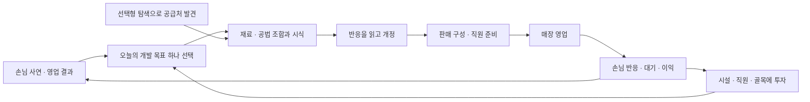

# 라멘과 골목 경영: 플레이 설계 기준

2026-10-17 · 검토 가능한 기획 초안. 사용자 확정 요구와 현재 코드를 바탕으로 Codex가 권장안을 정리했다. **권장안은 구현 완료나 사용자 승인으로 간주하지 않는다.** 수치 조정과 시스템 변경은 후속 작업 계약에서 다룬다.

> 후속 구현 상태: 사용자의 다음 작업 진행 요청으로4-A의 노트 분리를 로컬v10에서 구현했다. 등록 메뉴6/12/30종·별도 이력300개·20개씩 표시·최고 시식 증빙 보존이다. 실제 그래픽 확인/공개는 아직 하지 않았다. 아래 문제점·수치 감사는 기준 커밋d7863f6 당시 관찰이며 나머지 권장안은 계속 제안이다. [후속 계약](../../tasks/recipe-notebook-v1.md).

## 1. 무엇을 재미있게 만들 것인가

**손님의 사정을 이해하고 나만의 라멘을 만들어, 직원과 가게가 달라지는 모습을 보는 게임.** 메뉴 개발이 중심이고 영업·육성·탐색·골목은 새로운 메뉴를 만들 이유와 그 결과를 제공한다.

사용자가 확정한 방향은 라멘, 깊은 메뉴 개발, 도전적인 직원 육성, 손님 이야기, 성장하는 가게, 선택형 식재료 탐색, iPhone 우선이다. 재벌도시스토리·회전초밥스토리·라멘가게스토리는 사용자 취향의 출발점이다. 이 문서는 그 작품들의 정확한 시스템을 분석한 자료가 아니며 유사도 백분율을 제시하지 않는다.

| 핵심 경험 | 플레이어의 판단 | 화면에서 확인할 결과 |
| --- | --- | --- |
| 메뉴 연구 | 누구에게 어떤 한 끼를 만들까? 어떤 부분을 바꿀까? | 그릇 변화, 구체적인 시식 이유, 이전 조합과 비교 |
| 영업 개선 | 비싸게 적게 팔까, 빠르게 여러 손님을 받을까? | 실제 주문·대기·퇴장, 메뉴별 이익과 놓친 손님 |
| 직원 육성 | 오늘 병목을 해결할 역할과 전문성은 무엇일까? | 동선·작업 변화와 줄어든 대기, 성장한 직원의 모습 |
| 사람과 골목 | 누구의 사연을 돕고 어떤 이웃과 관계를 맺을까? | 대화 후의 작은 장면 변화, 새로운 손님·재료·목표 |

조합 수나 탭 수가 늘어나는 것만으로 개발의 깊이를 평가하지 않는다. **상황에 따라 다른 해답이 있고, 플레이어가 결과의 이유를 이해할 수 있어야 한다.**

## 2. 기준 빌드와 아직 검증하지 않은 것

2026-10-20 후속: 단골v9/노트v10/투자 안내513888a의 실제 Mac OpenGL17,612확인·206장과 새40장 직접 검토를 완료하고 동일 PCK의 새 플레이 앱을 준비했다. [수락 증거](../../evidence/investment-native-v2-20261020.json). 노트는 메뉴 종류6/12/30과 이력300개로 분리됐으며, 아래 표와 문제 설명은 최초 기획 점검 당시의 기준으로 보존한다. iPhone·재미·최종 아트 검증은 아직 별도다.

기획 점검의 코드 기준은 로컬 `d7863f6`이다. 공개 main/기존 플레이 앱은 v8 제조 공법 버전 `f99877e`이고, v9 단골 분기 이야기는 로컬 기능·배치 검사 후 실제 렌더링 검증을 기다린다. 아래 표의 v9를 현재 공개 앱에서 플레이할 수 있다고 해석하지 않는다.

| 영역 | 현재 구현 | 아직 필요한 경험 |
| --- | --- | --- |
| 라멘 | 맛 5축, 재료 궁합, 토핑 1~3개, 육수·면 공법 9조합 | 반복 실험이 편하고 여러 판매 전략이 의미 있다는 플레이 검증 |
| 성장 | 랭크 3단계, 시설 구매, 직원 2~4명, 증축 8→12석/판매 1→2종 | 투자 우선순위와 성장 속도의 조율 |
| 직원 | 고정 기본 직원 2명, 고용 보조 2명만 경험/훈련/전문화 | 주역 직원에게 애착이 생기는 육성과 도전 과제 |
| 탐색 | 3지역, 두 번의 선택, 영구 공급처 재료 6개 | 발견 이후의 방문 이유와 반복 사건의 변주 |
| 목표 | 연구 6개, 대회 3종, 수상 메뉴 잡지 소개 3편 | 반복 가능한 장기 목표와 자연스러운 작은 사건 |
| 단골 v9 | 3명 × 선택지 2개 × 2장, 실제 메뉴 대접 후 답례 | 대화의 매력, 목표 이해도, 선택 후 만족도 |
| 플랫폼 | Mac 프로토타입, 가로/세로 배치 검사 | iPhone 빌드·터치·안전 영역·중단 복귀·성능 검증 |

자동 검사 수는 재미나 아트 완성도의 지표로 사용하지 않는다. 현재 그림은 독자적인 등각 도트 프로토타입이다. 실제 기기, 장기 밸런스와 사용자의 최종 시각 평가는 미검증이다.

## 3. 핵심 순환과 하루의 역할



준비 → 영업 → 정산이 한 게임일이다. 한 준비 단계에서 재시식은 가능하며, 달력은 영업 완료 때만 진행한다. 실제 시간의 며칠 대기와 혼동하지 않도록 게임 시간/연출 시간을 따로 표시한다. 현재 영업은 진행 중 상태를 저장하지 않고 재실행 시 영업 전으로 돌아가므로, iPhone의 앱 중단·복귀 처리 정책은 실기기 작업 전에 결정해야 한다.

다음 행동은 “고객 요구를 하나 해결한다”처럼 짧은 목표로 안내한다. 매일 연구·탐색·대회·이야기를 모두 해야 보상을 놓치지 않는 일과표를 만들지 않는다. 몇 초의 제조 진행에는 실제 작업 변화와 완료 피드백을 주고, 의미 없는 반복 대기를 늘리지 않는다.

## 4. 늦기 전에 정리할 결정

### A. 실험 기록과 판매 가능한 메뉴는 별개다

**현재 문제:** 개정 하나마다 노트 6/12/30칸 중 한 칸을 쓰고, 꽉 차면 다음 시식이 막힌다. 승급 신청도 현재 남은 기록의 점수를 보므로, 옛 기록 삭제가 승급 조건을 잃게 할 수 있다. 메뉴 개발을 많이 하는 행동에 정리 비용이 따라붙는다.

**권장안:** 시설이 늘리는 용량의 중심은 등록 가능한 메뉴 계열/판매 목록으로 삼고, 개정·실험 이력은 별도 보관 정책으로 분리한다. 같은 메뉴의 실패 실험을 했다고 새 판매 메뉴 자리를 빼앗지 않는다. 즐겨찾기·현재 판매본·의뢰 증빙은 보호하고 저장 용량의 실제 상한은 별도 설계한다. 무제한 기록 보존을 약속하지 않는다.

기존 `lineage_id`는 메뉴 계열, `record_id`는 불변 개정본으로 유지할 수 있다. 기존 기록을 전부 보존해 이행하고, 판매/비교/의뢰가 가리키는 개정본과 과거 보상 스냅샷을 깨뜨리지 않는 계약을 먼저 작성한다. 승급 성취는 달성 이력을 보관하는 방향을 권장하며, 기존 저장에 근거 없는 과거 성취를 지급하지 않는다.

### B. 메뉴 개발의 깊이는 목표·해석·상충 관계에서 나온다

기본 재료 선택 → 목적에 맞는 공법 → 손님 반응 해석 → 개정 → 판매 결과 확인이 한 연구다. 초반부터 품질·신선도·온도·산지·숙성·재고를 한꺼번에 추가하지 않는다. 새 변수를 넣을 때는 기존 변수로 표현할 수 없는 판단과 화면 피드백을 먼저 설명해야 한다.

세 가지 대표 전략을 검증한다: 빠르고 부담 없는 점심 / 진하고 단가 높은 대표 메뉴 / 특정 손님에게 맞춘 특화 메뉴. 모두를 항상 최고점으로 만드는 단일 조합보다 조건에 맞춰 고르는 조합이 필요하다. 두 메뉴 판매는 동일 손님을 두 번 세지 않고, 선택권과 주방 부담이 함께 늘어야 한다.

v9는 구성 차이에 가격도 포함한다. **가격만 바꿔도 두 번째 장의 새 구성으로 인정될 수 있다.** 후속 사연은 요구를 `맛의 개선`, `가격·원가 개선`, `영업 도전`으로 구분하고 각 장에서 무엇이 달라져야 하는지 표시하는 안을 권장한다. 예산 사연의 가격 개선은 유효하지만 맛 사연을 가격 변경만으로 해결하게 하지는 않는다. 현행 규칙은 이번 문서 작업에서 바꾸지 않는다.

### C. 직원 육성은 주역과 역할을 중심으로 확장한다

2026-10-19 후속: [35일 직원 전문화 점검](STAFF_GROWTH_AUDIT.md)에서18개 새 게임의 실제 영업630회·매일 재시작을 확인했다. 전문화는19~24일에 열렸고, 느린 메뉴의 속도/절약 전문은 판매량이 같아도 대기·별점·일당이 달랐다. 현행 자격·효과는 바꾸지 않았으며, 다음 개선은 경험치 요구량 상향보다 역할별 도전 하나의 달성 가능성부터 검증하는 안을 권장한다. 아래 권장안의 구현이나 실제 기기/재미 검증 완료를 뜻하지 않는다.

현재는 보조 직원 두 명만 성장하며 기본 요리사·서버는 고정이다. 보조의 현재 훈련 조건은 완료 40그릇/실무 2일/랭크 2, 이후 160그릇/5일/랭크 3이다. 이것을 단순히 더 큰 숫자로 늘려 사용자가 원하는 난이도로 대체하지 않는다.

권장 순서는 기본 직원의 정체성·영구 ID와 성장 표현 정리 → 역할별 도전 → 전문화다. 조리 쪽은 특정 메뉴의 대기 문제 해결, 홀 쪽은 붐비는 날 이탈 줄이기처럼 실제 영업 결과를 사용하는 안이다. 구체적인 목표 수치는 런타임에서 달성 가능함을 확인한 뒤 확정한다. 맛 점수 전체를 올리는 만능 직원을 만들기보다 속도·운영비·서비스의 선택을 만든다. 초반 피로·공복 관리와 실수 시 영구 능력 손실은 우선 도입하지 않는 안을 권장한다.

### D. 탐색은 기본 공급처 개방을 유지하고 반복 가치를 따로 설계한다

사용자가 고른 `지역 선택 → 선택형 사건 → 재료 획득`을 유지한다. 현재는 공급처를 영구 발견하며 한 지역의 두 재료를 모두 찾으면 출발이 닫힌다. 반복 수급이나 유한 재고 시스템이 아니다.

권장안은 기본 재료를 계속 사용할 수 있게 두고, 공급자 관계·새 사건·특별 주문처럼 재방문 이유를 추가하는 것이다. 희귀 한정 재료는 이후 별도 검증 후보로 두며 기존 모든 재료를 갑자기 소모품으로 바꾸지 않는다. 유한 재고를 채택하면 구매 단위·원가·품절 대체·판매 예약·저장 이행이 함께 바뀌므로 콘텐츠를 늘리기 전에 결정해야 한다. 탐색 전투는 현재 목표에 포함하지 않는다.

### E. 골목은 라멘집에 영향을 주는 작은 생활권부터 권장한다

최초 완성 범위는 라멘집 한 곳과 주변의 정해진 부지 몇 곳을 권장한다. 이 범위는 아직 사용자 확정 사항이 아니며, 자유 도시 건설을 삭제한 결정도 아니다. 큰 지도·자유 도로·여러 직영점은 핵심 재미 검증 이후 별도 범위로 판단한다.

부지 예시: 장터와 연결하면 공급자 사건, 사무실 이웃과 연결하면 빠른 점심 수요, 작은 공연 공간과 연결하면 저녁의 특별 방문. 시설마다 영향을 주는 고객층/시간/요구 메뉴와 대가를 사전에 보여준다. 첫 검증에서는 부지 두 종류만 비교하고 하나의 수요 변화가 메뉴 선택에 영향을 주는지 본다. 새 시설마다 모든 매출에 배수를 곱하지 않는다. 이웃의 짧은 사건과 기존 단골을 재사용해 도시와 식당이 서로 동떨어지지 않게 한다.

## 5. 경제 점검: 현재 돈은 얼마나 빨리 쌓이는가

2026-10-19 후속: [14일 연속 캠페인 점검](CAMPAIGN_AUDIT.md)으로 두 고정 메뉴×여섯 투자 정책의 실제 영업168회·매일 디스크 저장/재시작을 확인했다. 느린 메뉴의 조리 보조와 빠른 메뉴의 효과가 달랐고, 두 경우 모두 첫 승급 시점 주요 투자 자금이 충분했다. 아래 기존21개 독립 날짜 표본과 구분한다. 사람의 재미/실기기 검증이나 밸런스 변경은 아니다.

[진단 결과](../../evidence/design-balance-v1.json) · [재실행 도구](../tools/audit_design_balance.gd)

기본 재료·토핑 하나의 972구성에 가격 5개(6,000/7,500/9,000/10,500/12,000원), 게임일 1~7을 적용한 **예측 34,020건**을 계산했다. 별도로 각 구성의 공법 9조합 **8,748건**을 평가했다. 아래 세 표본만 실제 완료 주문 런타임으로 7일씩 계산했다.

| 표본 | 단골별 맛 점수(도윤/하영/마루) | 1일차 영업 이익 | 7일 합계 |
| --- | --- | --- | --- |
| 시작 레시피, 9,000원 | 87 / 86 / 65 | 58,200원 | 509,400원 |
| 조사한 가격·기본 구성 중 예측 합계가 가장 큰 표본, 9,000원 | 82 / 74 / 86 | 72,700원 | 577,030원 |
| 기본 공법에서 세 손님 중 최저 맛 점수를 최대화한 표본, 9,000원 | 77 / 78 / 87 | 62,880원 | 557,280원 |

여기서 영업 이익은 매출 − 판매 재료비 − 하루 운영비다. 시제품 비용, 탐색·시설·훈련 지출, 연구·이야기 상금은 제외했다. 같은 단일 메뉴/보조 직원 없음/8석으로 각 날짜를 독립 실행했고, 기록 ID는 항상 1이다. 연속 캠페인이나 초보자 플레이, 전체 게임의 최적 전략을 구한 것은 아니다. 추가 공법·발견 재료·복수 토핑·복수 메뉴의 최적화도 아니다. 해당 세 표본의 예측과 완료 주문 이익은 일치했지만 일반적인 일치를 보장하지 않는다.

**해석:** 시작 자금 30,000원, 증축 60,000원, 조리대 I 12,000원인 현재 값에서 돈 자체는 오래 저축해야 하는 자원이 아닐 가능성이 크다. 증축에는 랭크 2 등 별도 조건이 있으므로 첫날 바로 모든 기능이 열리는 뜻은 아니다. 초기 맛 점수도 이미 높아, “왜 더 개발해야 하나”를 사연·수요·운영 문제로 보여줄 필요가 있다.

공법 점검에서는 같은 기본 조합 대비 세 점수가 모두 같으면서 더 비싸고 더 느리거나 같은 사례가 나오지 않았다. 따라서 공법이 전부 무의미하다고 결론 내릴 근거도 없다. 이 검사는 서로 다른 조합 간의 지배 전략이나 대회·사연 적합성은 판정하지 않는다.

### 경제의 권장 역할

| 흐름 | 현재 요소 | 후속 설계 기준 |
| --- | --- | --- |
| 반복 수입 | 실제 완료 주문의 영업 이익 | 투자 후 얼마가 남는지 쉽게 이해하고 서로 다른 메뉴 전략 비교 |
| 일회성 수입 | 연구·잡지·메달 개선·단골 답례 | 반복 영업과 분리해 표시; 다음 지출이 보상금에 필수 의존하지 않게 검증 |
| 반복 지출 | 시식 재료비, 운영비·일당, 허용된 탐색·출품 | 실험을 시도하지 못할 정도로 벌하지 않기; 중복 시식 강요 방지 |
| 성장 지출 | 시설·고용·훈련·증축 | 좌석/조리/메뉴 중 어디부터 투자할지 판단이 바뀌는 상황 제공 |

새 화폐는 당장 추가하지 않는다. 먼저 목표 투자까지의 순영업 횟수, 투자 회수 기간과 실제 대기 감소를 측정한다. 단순히 모든 비용을 10배로 올리거나 매출을 일괄 낮추는 수정은 보류한다. 이후 밸런스 변경 시 이전 저장의 자금·메뉴 성능·진행 조건에 미치는 영향을 명시한다.

## 6. 첫 30분과 초기 10게임일: 검증용 목표 흐름

시간과 날짜는 목표 가설이며 현재 플레이로 측정한 결과나 강제 일정이 아니다. 모든 시스템을 30분에 끝내겠다는 약속도 아니다.

| 구간 | 플레이어가 경험할 일 | 통과 판단 |
| --- | --- | --- |
| 첫 0~5분 | 가게를 보고 한 사람의 요구에 맞춰 첫 조합·시식 | 어떤 가게인지, 누구를 위해 무엇을 바꾸는지 설명 가능 |
| 5~12분 | 반응을 읽고 한 번 개정, 실제 영업과 정산 | 변경 이유를 말하고 손님/이익의 변화를 확인 |
| 12~20분 | 탐색 또는 단골 목표 중 하나 선택 | 안내 없이 자기 목표를 고르고 보상을 예상 |
| 20~30분 | 다음 시설·직원 투자 중 하나를 계획 | 남은 목표를 알고 다시 플레이하고 싶음 |
| 초기 1~3게임일 | 한 메뉴를 이해하고 첫 단골·연구/탐색과 연결 | 실험이 기록 정리보다 자주 일어남 |
| 4~6게임일 | 첫 투자와 두 번째 메뉴의 필요성 경험 | 돈만 늘어나는 대신 가게 운영 판단이 하나 바뀜 |
| 7~10게임일 | 전문화/대회/사연 중 목표 선택 | 같은 메뉴로 영업 버튼만 반복해야 진행되는 구간 확인·줄이기 |

즉시 증축을 강제하지 않는다. 준비가 더 필요한 투자라면 미리 보이되 왜 필요한지 설명한다. 같은 날에 새 창 여러 개를 연속 강제하는 해금은 피한다.

## 7. iPhone에서 되돌리기 비싼 결정

세로 매장이 주 화면이다. 현재 8개 탭은 기능 수용을 위한 프로토타입 구조이므로 탭을 계속 추가하는 것을 기본 해법으로 삼지 않는다. 가게의 주방·직원·손님을 누르는 진입점과 소수의 일관된 관리 화면을 검토하되 기존 기능을 찾을 수 있어야 한다. 단순 탭 수 축소를 위해 깊은 메뉴 탐색을 강요하지 않는다.

실기기 단계에서 엄지 조작, 글자 크기, 터치 대상, 안전 영역, 키보드가 열린 메뉴 이름 입력, 긴 한국어, 앱 중단 복귀와 저장을 확인한다. 영업 도중 중단은 현재 영업 전으로 복귀한다는 점을 명확히 안내하거나 진행 스냅샷을 도입하는 정책을 먼저 선택한다. 저장 실패를 성공처럼 처리하지 않고, 동일 거래/보상을 두 번 지급하지 않아야 한다. 도트 간판에는 한글을 직접 그리지 않고 실제 텍스트는 읽을 수 있는 UI로 제공한다.

## 8. 무엇을 먼저 하고 무엇을 미룰 것인가

| 우선순위 | 다음 작업 | 시작/완료 기준 |
| --- | --- | --- |
| P0 | 기존 v9 실제 화면 검증 마무리 | 실행 환경 복구 후 새 캡처·오류·사용자 저장 격리를 확인; 그 전 공개 완료로 표시하지 않음 |
| P1 | 실험 노트/메뉴 용량과 승급 증빙 설계 계약 | 기존 개정본·판매·의뢰 보존 및 이행 기준 합의 후 작은 변경으로 구현 |
| P1 | 30분 플레이와 10게임일 경제 점검 | 플레이테스트 계획으로 막힘·반복·투자 이유를 기록; 근거 없이 수치 일괄 변경하지 않음 |
| P1 | iPhone 최초 실행과 저장 중단 정책 | 콘텐츠 대량 추가 전에 실제 화면/터치/복귀를 검증 |
| P2 | 기본 직원까지 이어지는 육성과 역할별 도전 | 현행 영업으로 달성 가능한 도전 한 종류부터; 육성 중 선택이 달라지는지 검증 |
| P2 | 골목 부지 두 종류의 작은 실험 | 각 부지가 다른 메뉴 판단을 만드는지 확인 후 지도 확대 |
| P3 | 공급자 후속 사건·계절 대회·더 긴 사연 | 핵심 순환과 데이터 형식이 안정된 뒤 내용 확장 |

P1 세 항목은 서로의 결과를 반영한다. 네이티브 환경이 막힌 동안에는 계약·밸런스 분석·문서 작업을 진행할 수 있으나 실제 기기/재미 검증을 완료로 대체하지 않는다. 자유 도시 건설·여러 점포·전투·온라인 운영·전체 식재료 유한 재고는 별도 범위 결정 전 착수하지 않는 권장안이다.

## 9. 사용자와 나중에 확인할 선택

지금 답변을 요구하지 않는다. 비용이 큰 방향을 실제 구현하기 전에만 짧게 확인한다.

| 선택 | 현재 권장 기본안 | 다른 선택의 영향 |
| --- | --- | --- |
| 도시의 비중 | 라멘집 중심 + 주변 고정 부지로 작은 골목 | 자유 도시 건설을 중심에 두면 지도·길찾기·다점포 운영 범위부터 재설계 |
| 탐색의 반복 보상 | 기본 재료는 영구 공급처, 공급자 사건 확장 | 모든 재료 유한 재고는 조달·품절·생산·저장 구조 변경 |
| 도전의 성격 | 메뉴/인력 배치/목표 해결이 어렵게 | 운영비 압박·부도 중심을 원하면 실패 회복과 난이도 정책 추가 |

이 세 권장안은 사용자 선택을 대신 확정하지 않는다. 현재 확정된 요구는 유지하고, 다음 큰 구현 전에 검토 가능한 계약으로 제시한다.

## 10. 근거와 재실행

| 확인한 규칙 | 코드 근거 |
| --- | --- |
| 개정 기록의 용량 차감, 시식 비용, 자금·게임일, 증축 가격 | [game_state.gd](../scripts/domain/game_state.gd) |
| 랭크 조건, 남아 있는 기록의 점수, 토핑·노트 용량 | [shop_growth.gd](../scripts/domain/shop_growth.gd) |
| 보조 두 명의 고용과 훈련 조건·효과 | [shop_staffing.gd](../scripts/domain/shop_staffing.gd), [staff_training.gd](../scripts/domain/staff_training.gd) |
| 영구 공급처 발견과 지역 완료 후 출발 중단 | [ingredient_exploration.gd](../scripts/domain/ingredient_exploration.gd) |
| 맛·가격·수요 예측과 완료 주문의 실제 정산 | [recipe_evaluator.gd](../scripts/domain/recipe_evaluator.gd), [sales_simulator.gd](../scripts/domain/sales_simulator.gd), [service_session.gd](../scripts/domain/service_session.gd) |
| v9의 새 구성 비교와 실제 손님 대접 조건 | [regular_stories.gd](../scripts/domain/regular_stories.gd) |

개발자가 저장소 루트에서 재실행할 명령이다. `RAMEN_GODOT`에는 사용하는 엔진의 절대 경로를 설정하고, 결과 경로는 존재하지 않는 시험용 파일로 지정한다. 도구는 저장 서비스를 호출하지 않는다.

```sh
"$RAMEN_GODOT" --headless --path game --script res://tools/audit_design_balance.gd -- --out=/private/tmp/ramen-design-audit-new.json
```

진단은 종료 0/스크립트 오류 0/계산 실패 0으로 끝났고, 별도 Python 검사 83개로 합계·단가 계산·두 실행의 표본 일치를 확인했다. 현재 도구 환경의 macOS 시스템 CA 조회 오류는 로그에 별도 존재하며 엔진 전체 오류 0으로 주장하지 않는다. 이 실행은 네이티브 화면·서명·실기기 검증을 대체하지 않는다. 증거 JSON에는 실제 게임 코드/진단 도구/엔진 해시와 기준 커밋을 보관한다.
