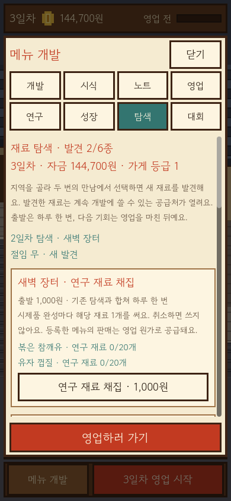
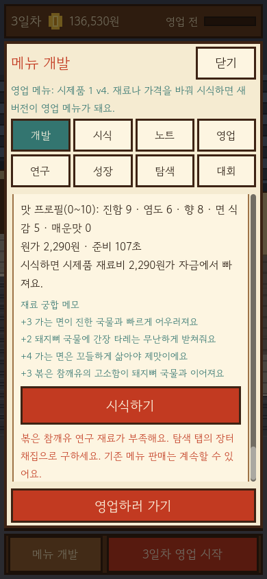
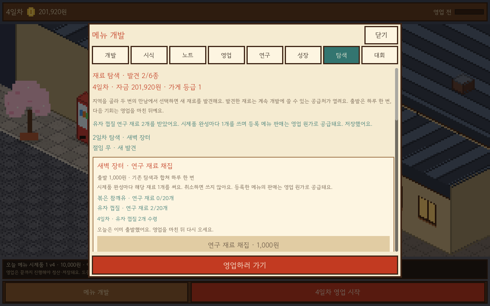

# 장터 채집 실제 화면

2026-10-20, 승인된 QA 앱의 새 OpenGL 캡처다. 가로1280×800/세로390×844 각114장, 전체228장 중 새22장을 원본 그대로 보관한다. 전체 크기·SHA256은 [manifest.json](manifest.json), 실행·기존 저장/영업 검증은 [선별 증거](../../../evidence/market-foraging-v1.json)에 있다.

새22장을 직접 읽고 채집 선택·수령·준비/취소·시식·부족·실제 판매·재방문·재시작과 저장 경고를 확인했다. 스크롤 카드는 일부가 화면 밖에 있을 수 있으며 버튼 도달/전체 카드 넘침은 자동 검사로도 확인했다. 실제 iPhone·터치·사람의 재미·최종 아트 승인은 별도다.

| 장면 | 가로 | 세로 |
| --- | --- | --- |
| 반복 채집 해금과 재고 안내 | [보기](desktop_103_foraging_unlocked.png) | [보기](portrait_103_foraging_unlocked.png) |
| 연구 재료 노점 선택 | [보기](desktop_104_foraging_choice.png) | [보기](portrait_104_foraging_choice.png) |
| 수령 전 결과 | [보기](desktop_105_foraging_result.png) | [보기](portrait_105_foraging_result.png) |
| 중복 수령 거부와 저장 실패 안내 | [보기](desktop_106_foraging_save_failed.png) | [보기](portrait_106_foraging_save_failed.png) |
| 시제품 준비와 취소 | [보기](desktop_107_foraging_preparation.png) | [보기](portrait_107_foraging_preparation.png) |
| 참깨유 메뉴 시식 | [보기](desktop_108_foraging_sesame_feedback.png) | [보기](portrait_108_foraging_sesame_feedback.png) |
| 샘플 부족과 판매 유지 안내 | [보기](desktop_109_foraging_stock_empty.png) | [보기](portrait_109_foraging_stock_empty.png) |
| 재고0에서 실제 영업 결과 | [보기](desktop_110_foraging_sale.png) | [보기](portrait_110_foraging_sale.png) |
| 다음 날 유자 재방문 | [보기](desktop_111_foraging_revisit.png) | [보기](portrait_111_foraging_revisit.png) |
| 유자 메뉴 시식 | [보기](desktop_112_foraging_citrus_feedback.png) | [보기](portrait_112_foraging_citrus_feedback.png) |
| 저장 복귀 후 재고 | [보기](desktop_113_foraging_reloaded.png) | [보기](portrait_113_foraging_reloaded.png) |

