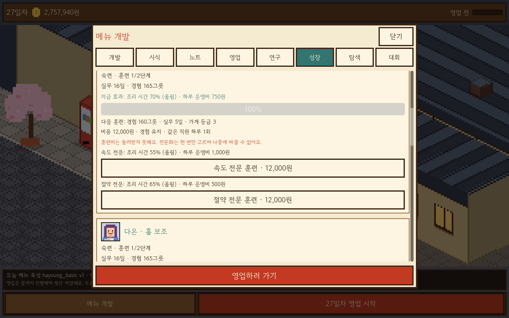
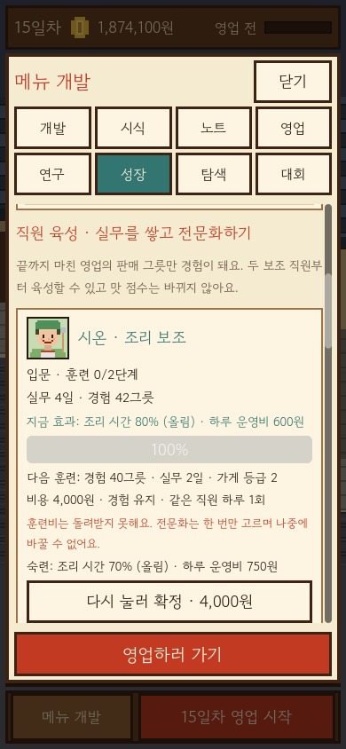

# 직원 육성 실제 화면 (2026-10-15)

새 자체 포함 QA 앱의 OpenGL 렌더링 결과입니다. 데스크톱1280×800/세로390×844에서 각각62장, 전체124장을 생성하고12,344개 확인/실패0/종료0/엔진오류0을 확인했습니다. 새 육성 화면20장만 이 폴더에 공개합니다. `manifest.json`은 전체124장의 크기/해시와 공개 여부를 기록합니다. 기존 기능 화면은 이전 단계 갤러리에도 보존합니다.

52 미고용,53 경험 부족,54 비용 확인,55 반복 연습 연출,56 연출 중 재시작,57 전문화 선택,58 전문화 완료,59 실제 영업 경험 증가,60 실제 파일 저장 실패,61 수동 저장 회복입니다. 모두 합성 시험 저장을 사용하며 실제 플레이 저장은 열지 않았습니다. 세로 화면은 iPhone 크기 시뮬레이션이고 iOS 실기기 검증은 아닙니다.

