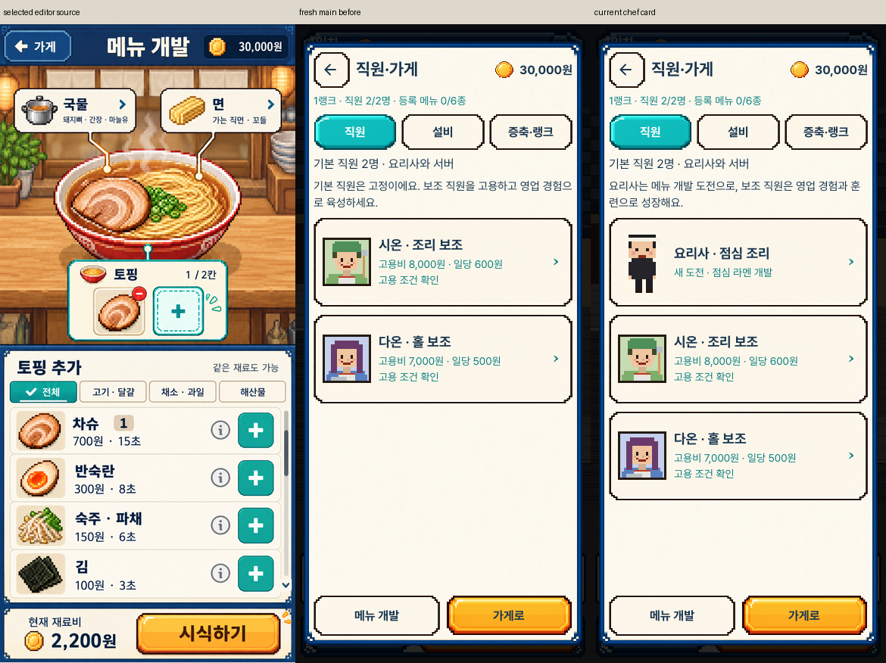
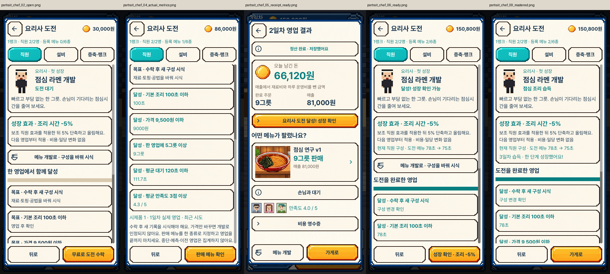
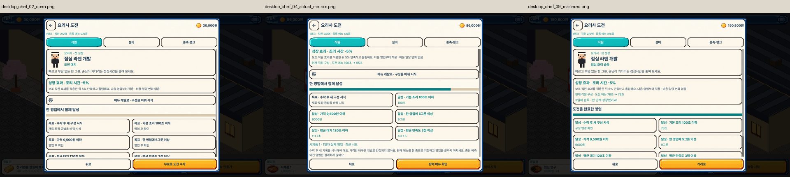
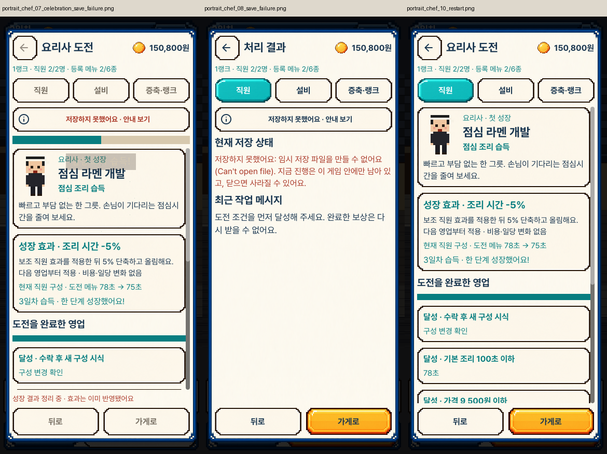
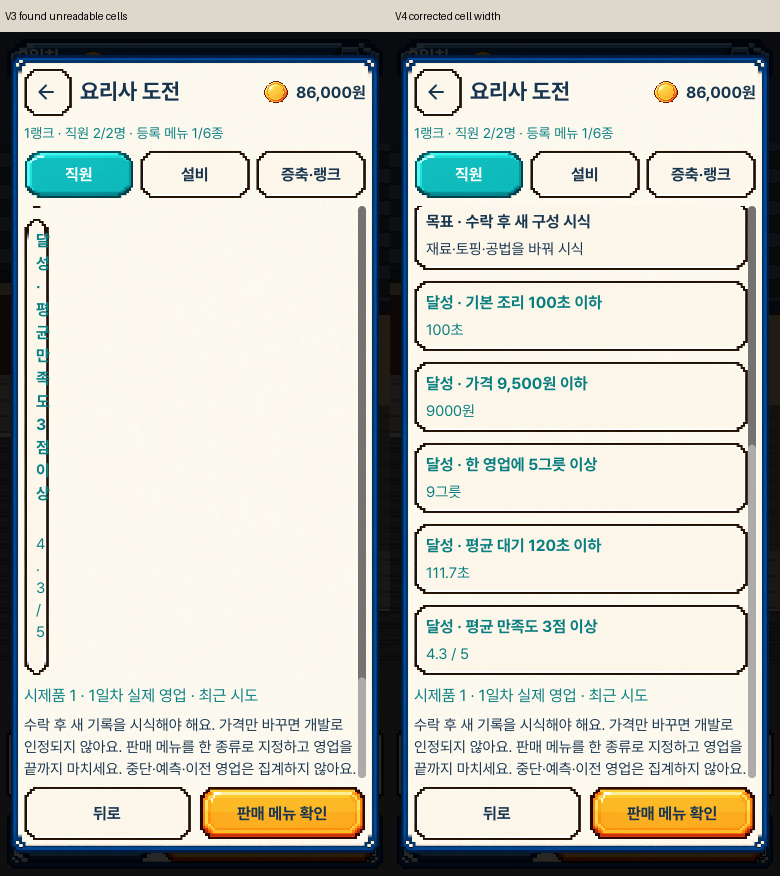

# 요리사의 첫 성장 · 실제 화면

current/는 최종 V4 패키지에서 생성한 세로390×844·가로1280×800 원본20장입니다.
before/는 변경 전 main1ca27f3 패키지에서 새로 캡처한 직원 목록입니다.
comparisons/는 원본 시안·변경 전·최종 화면, 흐름과 저장·재시작, 조건 폭 수정 비교입니다.
regressions/는 같은 최종 패키지에서 재검사한 기존 기능의 선택 원본입니다.

시안은 개발 화면이며 요리사 상세의 원본 목업은 없습니다. 원본 자산·글꼴을 유지해
현재 직원 화면을 확장했으며 존재하지 않는 상세 화면과 픽셀 단위 일치는 주장하지 않습니다.
수치·조건·실적은 실제 거래와 주문 상태로 준비했습니다. 자동 검사와 캡처는
플레이 재미, 본편 분량, 아이폰 실기기 검증을 의미하지 않습니다.

[조작·규칙](../../CHEF_LUNCH_CHALLENGE_V1.md) · [검증 기록](../../../../evidence/chef-lunch-challenge-v1.json)
