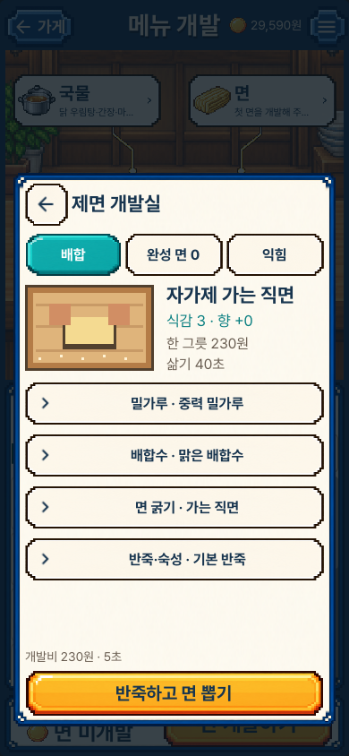
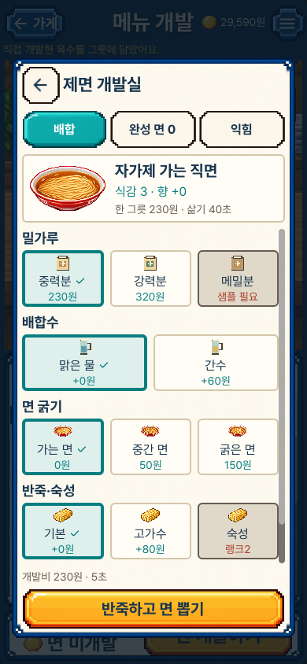

# 한 그릇 개발 흐름 · 실제 화면

기존 선택 시안의 음식·목재·크림색 프레임·글꼴을 유지하면서 첫 메뉴를 만드는 경로를 정리했다. 이미지는 실제 Mac Godot 렌더러의 원본이다. 세로390×844, 작은 세로390×750, 가로1280×800을 확인했다. 시안 이미지나 iPhone 화면으로 표시하지 않는다.

## 면 선택의 깊이 줄이기

이전 화면은 밀가루·물·굵기·반죽마다 들어갔다 나왔다. 현재는 네 항목을 같은 배합 화면에서 고른다. 고른 면의 그림·실제 수치와 제조 버튼은 고정하고 선택 카드만 스크롤한다. 긴 특징·현재 샘플·잠금 조건은 아래의 펼치기로 남겼다.

| 수정 전 main11dc898 | 현재 |
| --- | --- |
|  |  |

위 비교는 같은 초기 면 배합이다. 이전 원본은 작업 시작 전의 main 패키지로 새로 실행했다. 창 뒤의 진행 상태는 달라질 수 있다. 390×844에서는 네 항목이 함께 보이며, 작은 세로·가로에서는 아래 행을 스크롤한다. ‘화면 하나’는 모든 기기에서 모든 내용을 접지 않고 동시에 표시한다는 뜻이 아니다.

[작은 화면 첫 위치](short_noodle_01_formula.png) · [작은 화면 아래 선택과 고정 미리보기](short_noodle_05_ready.png) · [가로 제면](desktop_cycle_02_noodle_choices.png)

## 제조 완료와 다음 행동

실제 작업 후 방금 만든 육수·면의 이름·음식·원가·준비 시간을 보여 준다. 담기는 별도 행동이고, 다음에 없는 재료를 만드는 화면으로 이어진다. 완성창을 닫아도 실제 개발품으로 돌아올 수 있다. 개발 취소와 저장 실패·재시도는 그대로 검사했다.

[육수 완성](portrait_cycle_01_broth_complete.png) · [실제 제면 중](portrait_cycle_04_noodle_work.png) · [저장 실패를 숨기지 않는 완성창](portrait_cycle_05_unsaved_complete.png) · [저장 후 면 완성](portrait_cycle_06_noodle_complete.png) · [가로 완성](desktop_cycle_06_noodle_complete.png) · [담은 뒤 실제 그릇](portrait_cycle_07_bowl.png)

초기 캡처에서 떠오르는 ‘완성’ 문구가 새 창의 제목과 겹쳤다. 불꽃 효과를 유지하고 중복 문구를 제거한 현재 소스·패키지로 다시 검사했다. 실패한 초기 진단은 최종 화면으로 사용하지 않는다.

## 시식 반응과 재개발

| 이전 시식 화면 | 현재 반응 카드 |
| --- | --- |
|  |  |

이 시식 비교는 서로 다른 실제 조합이다. 이전에는 토핑1개, 현재는2개이며 지갑·원가·점수가 다르다. 같은 레시피의 성능 개선을 주장하지 않는다. 비교 대상은 얼굴·핵심 반응·다음 행동의 정보 구조다.

반응 카드는 전체가 눌리며, 누르는 동안 글자·화살표가 흰색으로 바뀐다. 손님별로 이미 맛본 수치와 취향을 표시한다. 자세한 설명은 한 단계 안으로 옮겼다. 아래 버튼은 관련 배합 화면만 열며 초안을 자동 변경하거나 다시 결제하지 않는다. 미시도 궁합·미래 점수는 공개하지 않는다.

[다른 손님의 반응](portrait_cycle_09_customer.png) · [누르는 상태](portrait_cycle_09b_pressed.png) · [전체 시식평](portrait_cycle_10_reaction_details.png) · [연결된 향미유 선택](portrait_cycle_11_next_experiment.png) · [가로 시식](desktop_cycle_08_tasted.png)

## 검토 범위

공개한 현재16장과 수정 전2장을 원본 크기로 직접 열었다. 모든 캡처를 수동으로 확인했다는 뜻은 아니다. [크기·해시·수동 검토 범위](review.json), [행동·검증·남은 범위](../../DEVELOPMENT_CYCLE_V1.md), [실행 증거](../../../../evidence/development-cycle-v1.json)를 함께 기록한다.

이번 작업은 첫 개발 경로의 개선이다. 면 배합마다 완전히 다른 그림을 그린 것은 아니며 기존 굵기별 음식 그림을 재사용한다. 레퍼런스 수준의 매장 연출, 결과물의 더 많은 시각적 차이, 장기 재미·경제 밸런스, 물리 iPhone 조작 수용은 남아 있다.
