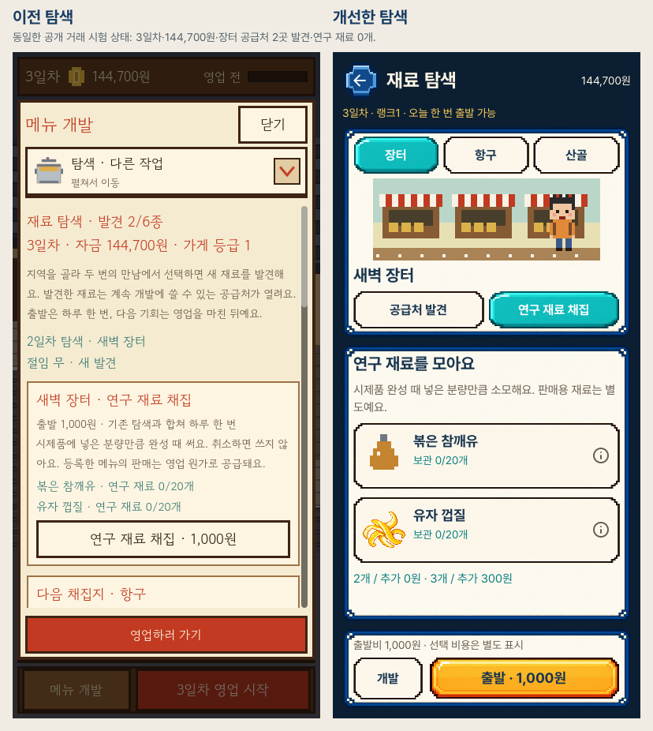
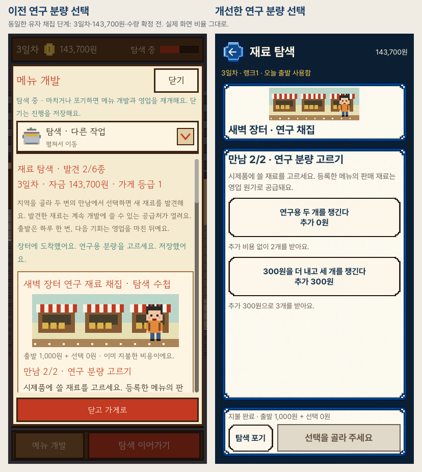
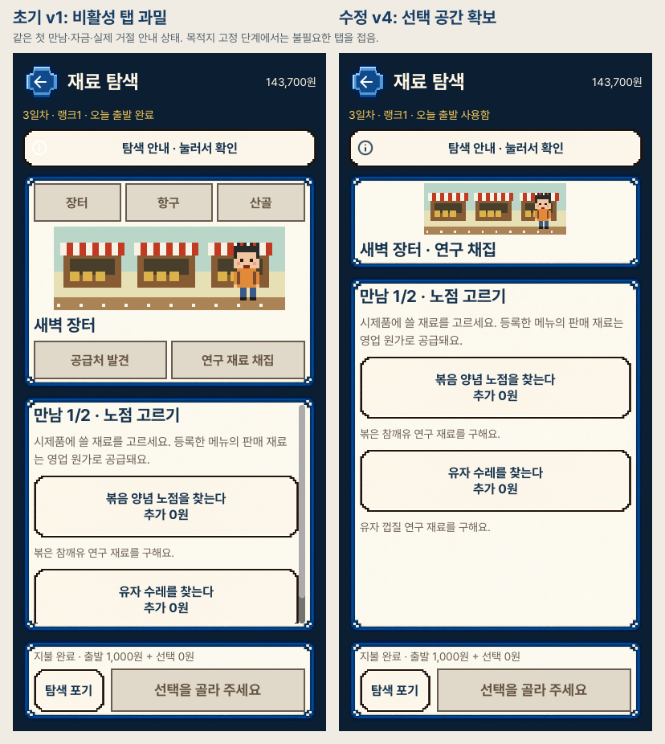
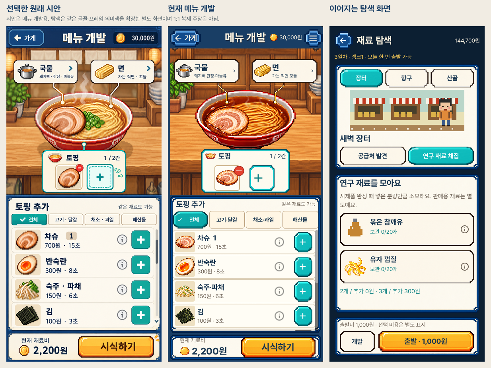

# 실제 재료 탐색 화면

2026-10-25. 실제 Godot OpenGL/Metal 렌더링이며 iPhone 캡처나 시안이 아닙니다.
세로390×844, 가로1280×800입니다. [전체 검토·해시·수동 범위](review.json),
[플레이 규칙](../../EXPLORATION_WORKBENCH_V1.md), [디자인 QA](../../../../design-qa.md).

## 단계와 관찰

1. [공급처 선택](portrait_explore_01_supplier.png): 정상. 출발비와 영구 개방을 구분합니다.
2. [잠긴 항구](portrait_explore_02_locked.png): 정상. 실제 조건과 비활성 출발을 표시합니다.
3. [반복 채집](portrait_explore_03_sample.png): 정상. 보관량과 수량별 비용을 먼저 보여 줍니다.
4. [재료 상세](portrait_explore_04_detail.png): 정상. 맛·원가·시간을 읽고 목록 위치로 돌아옵니다.
5. [이동](portrait_explore_05_travel.png): 정상. 연출 시계50%이며 비용·사건·보상은 변하지 않습니다.
6. [첫 만남](portrait_explore_06_target.png): 정상. 별도 확정 버튼을 씁니다. 중복 출발 거절 안내도 이 캡처에 포함됩니다.
7. [분량 선택](portrait_explore_07_quantity.png)과 [강조 상태](portrait_explore_07b_selected.png): 정상. 고르기만 하면 지불하지 않으며 확정 버튼에 추가300원이 나옵니다.
8. [수령 대기](portrait_explore_08_pending.png): 정상. 아직 재고0이며 직접 수령합니다.
9. [수령 완료](portrait_explore_09_received.png): 정상. 정확히3개, 실제 획득 효과와 개발 이동을 표시합니다.
10. [실제 개발 연결](portrait_explore_10_native_handoff.png): 정상. 초안과 돈을 바꾸지 않고 해당 재료 상세를 엽니다.
11. [항구 채집](portrait_explore_11_harbor.png): 정상. 별도 기존 공급처·재고·비용을 읽습니다.
12. [포기 확인](portrait_explore_12_retire.png): 정상. 취소는 유지, 확정은 실제 비용·하루 기회 소진을 유지합니다.
13. [저장 실패](portrait_explore_13_save_warning.png): 정상. 격리된 실패로 전체 안내에 도달 가능한지 확인합니다.

## 전후와 디자인 체계

기존/신규 화면은 동일 공개 거래 시험 상태를 사용합니다. 시안은 메뉴 개발용이며
탐색 화면의1:1 원본이 아닙니다. 디자인 체계 비교는 이 차이를 명시합니다.
지역 그림과 일부 향미유 아이콘은 기존 거친 도트를 유지합니다. 새 원본이나 원본
그림 수정은 없습니다. 수령 캡처에는 실제 클릭·획득 순간 효과가 남아 있습니다.

현재58장 중 탐색28장과 기존 회귀8장을 공개합니다. 이전 기준10장과 비교5장도
포함합니다.20탐색·8회귀·4기준 원본 및5비교를 직접 열었으며 전부 수동 검토했다는
주장은 하지 않습니다. 실물 iPhone·접근성·사용자 재미 수용은 별도입니다.
