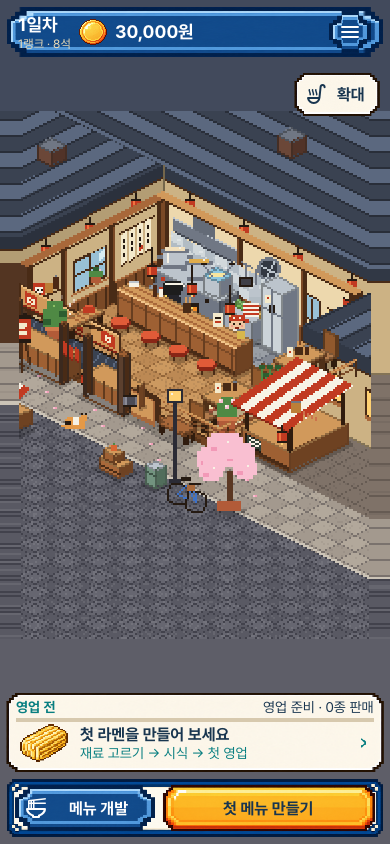
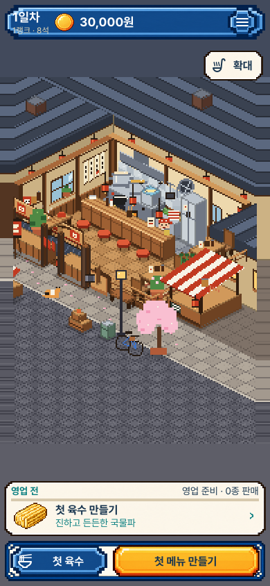
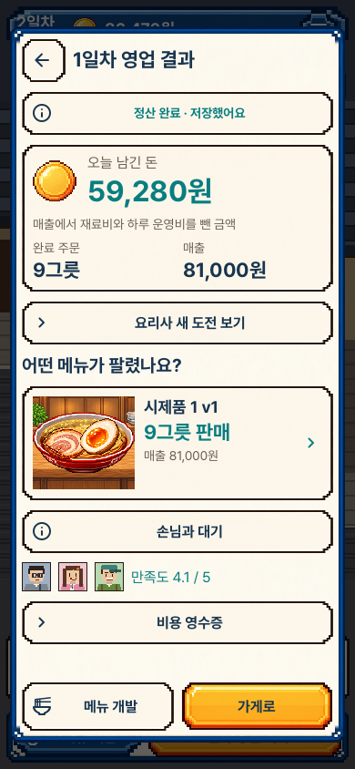
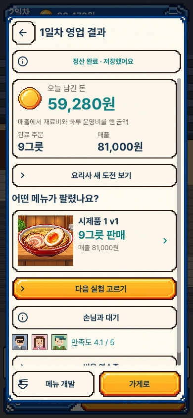
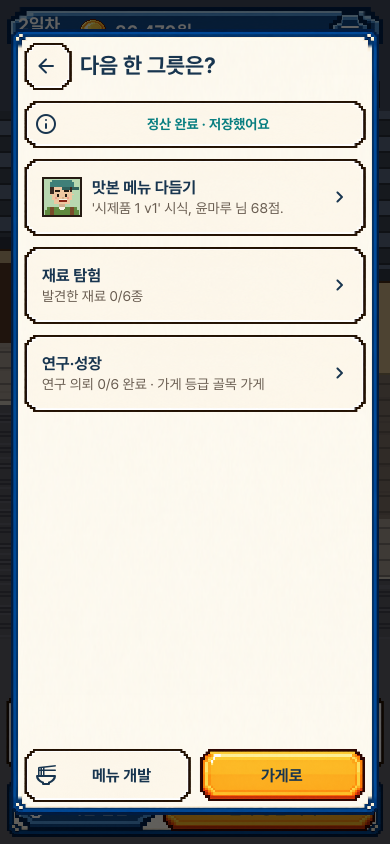
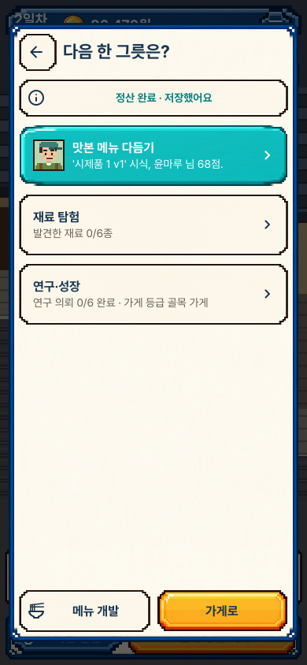
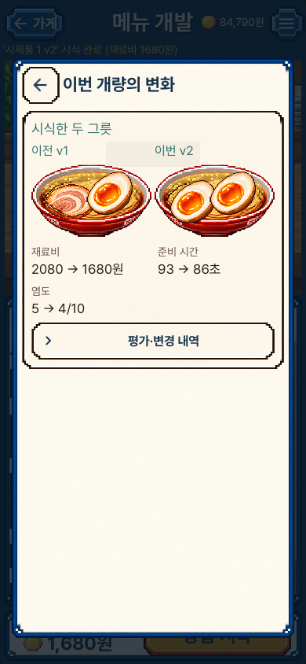
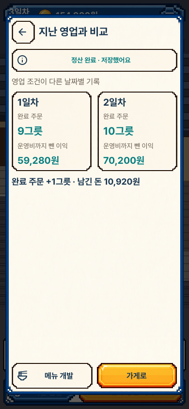

# 첫 메뉴에서 다음 실험으로 · 실제 화면

선택한 음식·목재·종이·프레임·글꼴을 이어 쓴다. 아래 이미지는 실제 Mac
렌더러의 수정하지 않은 원본이다. 세로390×844, 작은 세로390×750,
가로1280×800이며 iPhone 화면이나 새 디자인 시안이 아니다.

## 같은 출발점과 첫 영업

이전 main47099bf의 고정 패키지와 현재 패키지를 각각 새로 실행했다.
동일 원재료·제면·토핑의 첫 레시피임을 저장 기록으로 비교했다. 이전 화면은
공개 제조 API의 시험 시계를 앞당겨 준비한 정적 비교이며, 제조 애니메이션의
검증 근거로 쓰지 않는다. 현재 흐름은 실제 프레임을 기다려 제조·시식을 마친다.

| 이전 | 현재 |
| --- | --- |
|  |  |
|  |  |

매장 영역은 그대로 두고 기존 하단 버튼이 지금 필요한 제조·담기·판매 준비로
바뀐다. 결과에서는 음식과 완료 주문·남긴 돈을 먼저 보고 금색 버튼으로 다음
선택을 연다. 카드만 누르는 것은 출발·결제·레시피 적용·연구 제출이 아니다.

## 세 가지 다음 행동

| 선택 | 누르고 있는 상태 |
| --- | --- |
|  |  |

개량은 카드에 적힌 손님의 실제 시식평으로 연결한다. 탐색은 기존 지역 선택,
연구·성장은 기존 의뢰를 연다. 드래그는 선택과 성공 효과를 취소한다.

[홈에서 다시 고르기](portrait_journey_06_next_goals.png) ·
[작은 세로 화면](compact_journey_04b_choices.png) ·
[직접 출발하는 탐색](portrait_journey_07_explore.png) ·
[판매 메뉴 확인](portrait_journey_03_selling.png) ·
[첫 시식](portrait_journey_02_first_tasting.png)

## 관찰한 개량과 정산

| 실제 시식한 두 그릇 | 실제 두 영업일 |
| --- | --- |
|  |  |

시식 기록에 남긴 이전·이번 음식, 원가·시간과 달라진 맛을 먼저 보여 준다.
긴 점수·변경 내역은 한 단계 펼쳐 읽는다. 정산 비교는 실제 영수증이 있을 때만
나타난다. 날짜별 조건이 다르므로 숫자의 차이를 개량만의 효과로 해석하지 않는다.
재시작 후 없는 과거 비교 자료를 현재 초안에서 추측하지 않는다.

[가로 비교 화면](desktop_journey_05_revision.png)

## 검토 범위

현재12장과 수정 전2장을 모두 원본 크기로 열어 검토했다. 전체130장을 사람이
하나씩 검토했다는 뜻은 아니다. [원본 크기·해시](review.json),
[동작과 한계](../../FIRST_MENU_JOURNEY_V1.md),
[검증 기록](../../../../evidence/first-menu-journey-v1.json)을 함께 남긴다.

초기 시험에서 토핑이 꽉 찬 상태의 잘못된 추가 순서를 바로잡았고, 개량 카드의
이전 글꼴·프레임도 실제 화면을 보고 보정했다. 미선언 상수로 오류가 난 v3는
반려했으며, 종료0이어도 엔진 오류를 보고하면 QA 앱 생성을 거부하도록 고쳤다.
현재 수락본은 v4다. 자동 검사 수는 사람의 재미나 본편 완성도를 뜻하지 않는다.
