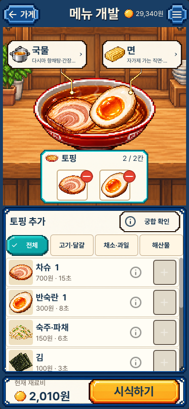
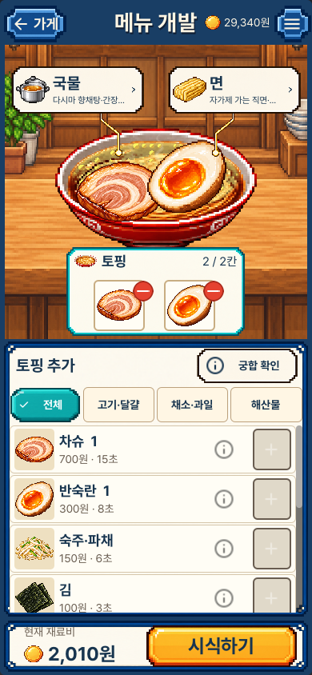
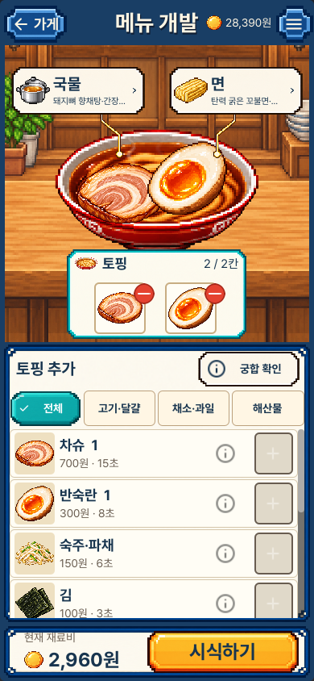
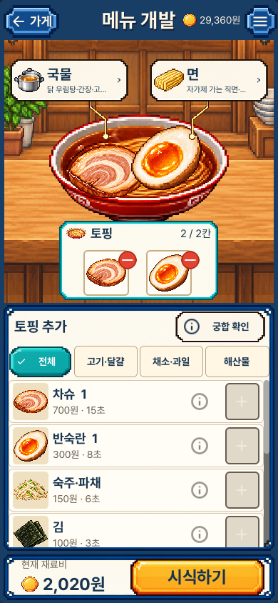
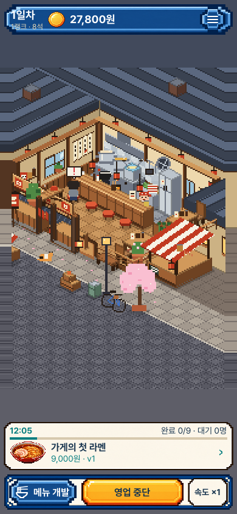
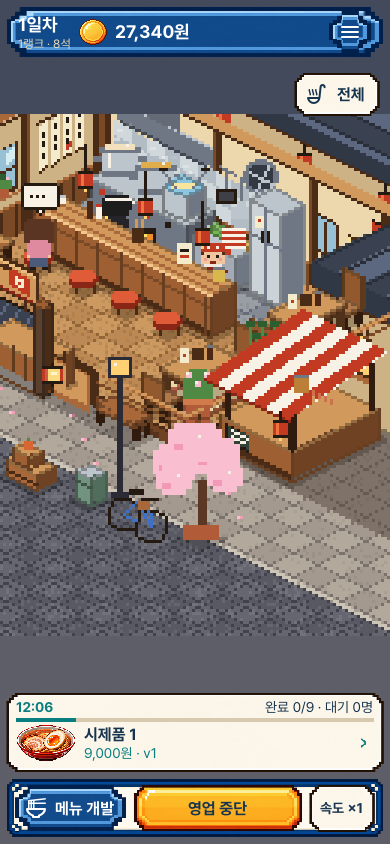

# 음식의 개성과 매장 반응 · 실제 화면

기존 시안의 음식·그릇·목재·프레임·글꼴을 유지한다. 현재 이미지는 검증한 동일 소스·패키지에서 새로 실행한 Mac 렌더러 원본이다. 세로390×844, 작은 세로390×750, 가로1280×800이며 iPhone 실기기 캡처나 합성 시안이 아니다.

## 같은 배합의 수정 전후

실제 공개 API로 육수와 면을 만들고 같은 토핑을 담았다. 왼쪽은 이전 mainb517337의 고정 패키지를 새로 실행한 원본이다. 각 행은 같은 배합·그릇·화면 크기이며 시간에 따른 김의 위치는 다를 수 있다.

| 배합 | 이전 | 현재 |
| --- | --- | --- |
| 다시마·생강 / 약불 우림 |  |  |
| 돼지뼈 두 분량·마늘 / 굵은 면 |  |  |
| 닭뼈·양파 / 고추기름 |  |  |

[파기름 표면](portrait_food_herb.png) · [가로 음식](desktop_food_chili.png)

국물의 실제 원재료 비중·우림·타레·향미유와 면의 가루·간수·반죽을 읽는다. 기름의 점·막은 고른 기름의 표현이며 새 고명을 획득했다는 뜻은 아니다. 모든 배합이 고유한 원본 그림이나 별도의 요리 종류가 되는 것은 아니다. 궁합·미래 점수는 드러내지 않는다.

## 매장과 확대 보기

| 이전 전체 매장 | 현재 주방·카운터 확대 |
| --- | --- |
|  |  |

이 매장 비교는 구도의 차이를 보여 준다. 이전 홈 검사는 옛 메뉴, 현재 검사는 직접 만든 메뉴로 영업하므로 지갑·레시피·시각은 다르다. 매출 성능의 전후 비교로 해석하지 않는다. ‘전체’로 돌아가 거리·줄·외곽을 다시 확인한다. 확대는 주방 중심의 부분 화면이며 모든 좌석과 줄 끝을 동시에 담지 않는다.

[조리 중 전체 보기](portrait_service_cook.png) · [손님 반응](portrait_service_reaction.png) · [작은 화면 확대](portrait_service_compact_close.png) · [가로 반응](desktop_service_reaction.png)

실제 조리·준비·운반·식사 시작에 짧은 효과가 생긴다. 손님이 실제 평가 말풍선을 낼 때 강조하며, 같은 상태를 반복해서 그려도 효과를 새로 발급하지 않는다. 기존 세션을 다시 연결할 때 과거 반응을 재생하지 않는다. 확대·그리기는 게임 시간·주문·재화·저장을 바꾸지 않는다.

## 검토 범위

공개한 현재10장과 수정 전4장을 원본 크기로 열었다. [크기·해시·수동 검토 범위](review.json)에 기록하며 전체122장을 수동 검토했다는 뜻은 아니다. [동작·분담·한계](../../FOOD_SERVICE_EXPRESSION_V1.md), [최종 소스와 실행 증거](../../../../evidence/food-and-service-expression-v1.json)를 함께 남긴다.

초기 주황색 잔류와 잘못된 불투명 토핑 측정은 반려한 진단이다. 실제 GPU에서 그린 최상위 토핑의 알파 범위로 다시 검사했다. 옛 그림 비교는 노드 준비 후 시계를 고정하고 김을 숨긴 상태로 비교했으며, 시계가 달라 김 위치가 바뀐 앞선 이미지를 동일성 증거로 쓰지 않았다. 검사 숫자는 재미나 레퍼런스 수준의 완성도를 뜻하지 않는다.
