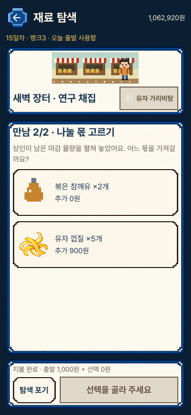
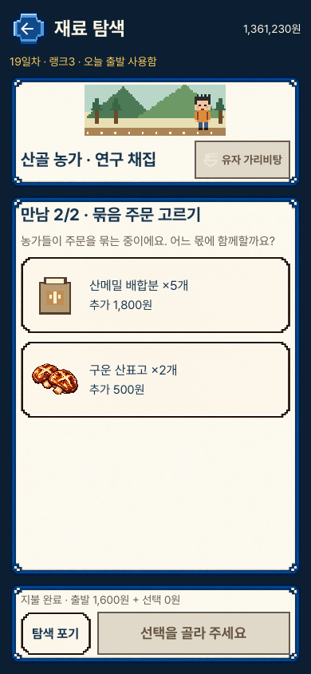
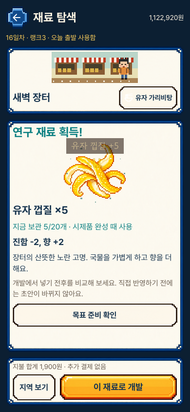
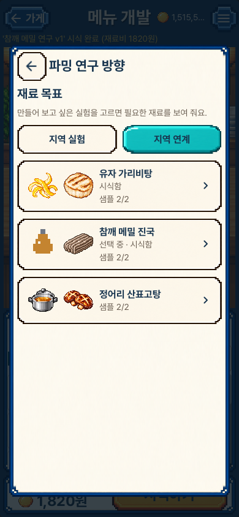
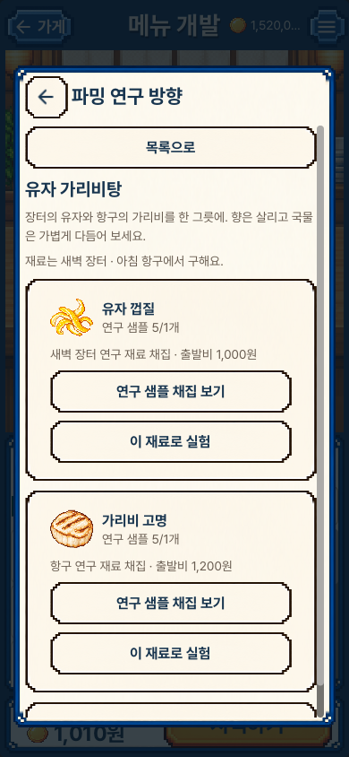

# 재료의 몫을 고르고, 두 지역을 한 그릇으로

실제 Mac 렌더러의 원본 캡처다. 장터·항구·산골에 고정 만남을 하나씩 더하고,
연구 재료의 두 몫 중 하나를 고르는 흐름을 확인했다. 새로운 재료 종류나
무작위 사건 시스템을 추가한 것은 아니다.

## 1. 재료 그림·수량·추가 비용

두 장의 수정 전 화면도 이번 기능의 첫 실제 실행에서 얻었다. 같은 기능 묶음의
문자형 선택지를 재료 그림 카드로 바꾼 전후이며, 이전 main과의 비교는 아니다.
세 화면 크기의 전체 최종 저장 값이 이 표현 수정 전후에 같다.

| 장면 | 문자형 첫 구현 | 현재 |
|---|---|---|
| 장터의 두 몫 |  |  |
| 산골의 두 몫 |  |  |

[기존 두 채집과 새 만남](portrait_event_0_routes.png) ·
[항구의 정어리 / 가리비](portrait_event_2_offer.png) ·
[누르는 동안의 색 변화](portrait_event_0_held.png) ·
[짧은 세로 화면](compact_event_4_offer.png)

정어리 연구 샘플은 생선으로, 산메밀 연구 샘플은 배합분으로 표시한다. 재료를
받는 것이 완성 육수·면 지급으로 보이지 않도록 구별했다. 카드 전체로 선택하고
고정된 아래 버튼으로 결제를 따로 확정한다. 드래그 취소에는 선택·결제가 없다.

## 2. 실제 수령과 다음 실험

추가 비용은 분량 확정 때 한 번, 재고는 마지막 수령 때 한 번 반영한다.
위 그림은 선택한 유자 5개가 실제 재고에 들어온 결과다. 일회성 화면 효과를
다시 보거나 화면을 열어도 재료를 더 주지 않는다.

| 지역 연계 목록 | 두 지역의 재료 준비 |
|---|---|
|  |  |

원래 지역 실험5개와 지역 연계3개를 탭으로 나눴다. 그림 두 개가 필요한 재료를
보여 주고 목록에는 짧은 준비 비율을 표시한다. 공급처·샘플·완성품 상태와 비용은
카드 안쪽 상세에서 읽는다. 준비 비율은 실제 샘플 보유 여부이며 시식 점수나
라멘 전체의 성공 가능성이 아니다.

## 3. 실제 제조와 유료 시식을 거친 세 그릇

| 유자와 가리비 | 참깨유와 메밀 | 정어리와 산표고 |
|---|---|---|
|  |  |  |

시험에서 직접 붙인 이름과 배합이다. 공급되는 정답 레시피가 아니다. 원재료로
제조한 육수·면을 담고, 받은 연구 재료를 실제 시식에서 소비했다. 조건에 맞는
방향은 하나의 시식에서 여러 개가 확인될 수 있으며, 맛이 맞아도 손님별 점수가
모두 높다는 뜻은 아니다. 이미 있던 음식 그림·평가기를 그대로 사용한다.

[짧은 세로의 시식 결과](compact_tasted_sardine_shiitake.png) ·
[가로 시식 결과](desktop_tasted_sesame_buckwheat.png)

## 검토 범위

공개한 현재14장과 문자형 첫 구현2장의 원본을 열어 재료 구별, 여백·줄바꿈,
고정 결제 버튼, 눌림 색과 서로 다른 세 그릇을 확인했다. 전체 자동 생성 캡처를
하나씩 수동 검토했다는 뜻은 아니다. 자동 준비에서 일부 제조·영업 시간을
앞당겼으며 iPhone 설치·실기기 입력·성능·음향·사람의 재미는 이번 검증에 없다.

[원본 크기·해시·검토 기록](review.json) · [조작과 저장 범위](../../FORAGING_ENCOUNTERS_V1.md) ·
[실행 증거](../../../../evidence/foraging-encounters-v1.json)
