# 재료 목표와 실제 탐색 경로

실제 Mac 실행의 원본 캡처다. 기존 음식 그림·글꼴·크림색 종이·남색 프레임을
유지하고 목표 목록 → 재료 상세 → 실제 탐험으로 연결했다. 새 페이지의 별도
확정 시안은 없으며, 사용자가 선택한 기존 시각 체계를 확장한 것이다.

## 1. 숫자 조건보다 재료와 준비 상태

수정 전 같은 새 게임에서는 조합의 숫자 조건을 나열했다. 현재는 다섯 실험을
재료 그림으로 구분하고 카드 전체를 눌러 필요한 재료와 경로를 읽는다.

| 수정 전 | 현재 목록 | 현재 상세 |
|---|---|---|
| 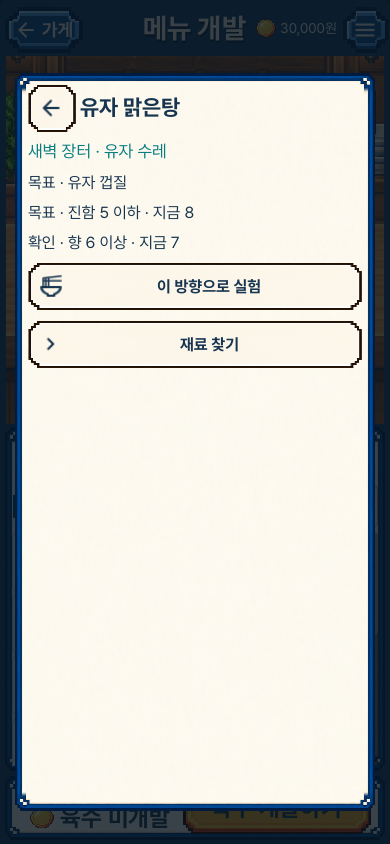 | 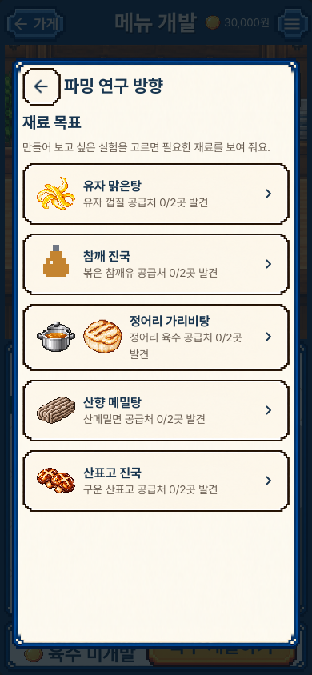 | 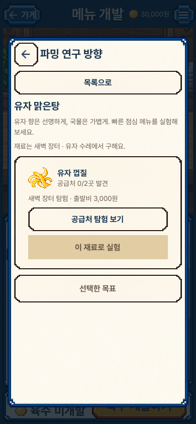 |

## 2. 공급처를 먼저 찾고 연구 재료를 채집

수정 전의 ‘재료 찾기’는 공급처가 없는 새 게임에서도 막힌 샘플 채집 화면을
열었다. 현재는 두 공급처를 모두 찾기 전에는 공급처 탐험으로, 그 뒤에는
샘플 채집으로 이동한다. 이동만으로 출발비를 결제하지 않는다.

| 수정 전 막힌 경로 | 현재 공급처 경로 | 공급처 발견 후 채집 |
|---|---|---|
| 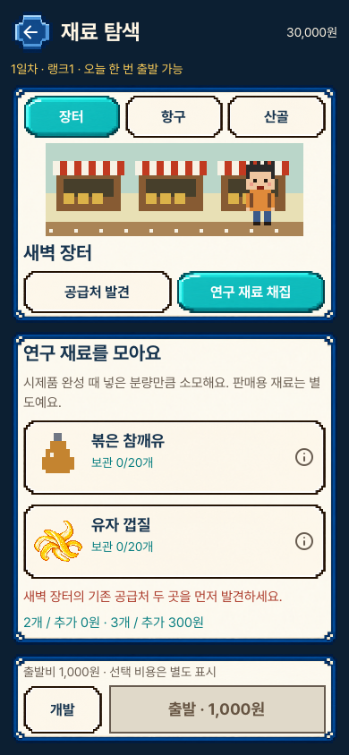 | 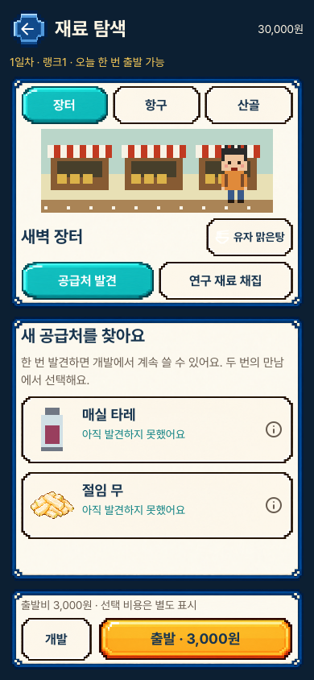 | 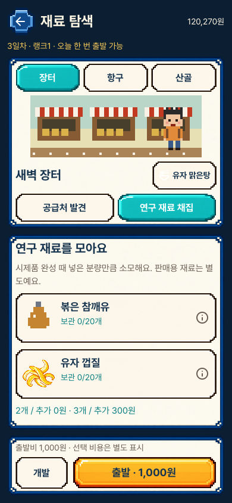 |

## 3. 받은 재료와 목표 재료를 구분

유자를 목표로 골랐어도 참깨를 받았다면 실제 받은 참깨만 표시한다. 목표를
자동 달성하지 않으며 수령 뒤 ‘목표 준비 확인’은 스크롤 아래에서 연다.

| 다른 재료 수령 | 목표 재료 수령 | 실제 시식으로 발견 |
|---|---|---|
| 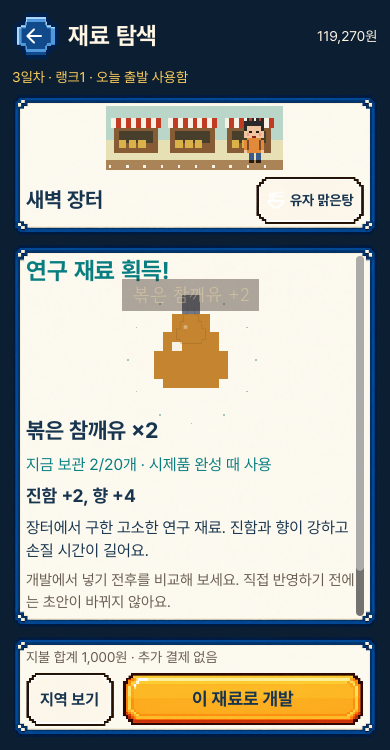 | 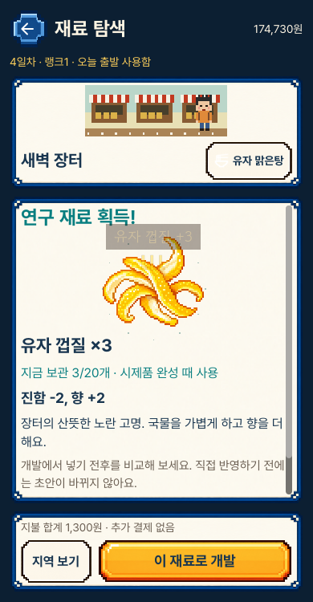 |  |

## 4. 샘플 재고와 개발품을 따로 표시

저장 복원 후에도 실제 시식 기록과 남은 샘플을 읽는다. 개발한 육수가 있어도
새 시식용 샘플이 0개라면 부족하다고 표시하고, 완성한 육수 자체는 열어본다.
정어리 가리비탕의 두 재료 모두 같은 상세에 있다.

| 저장 복원 후 상태 | 샘플 0개·완성품 존재 | 실제 개발품 열기 |
|---|---|---|
| 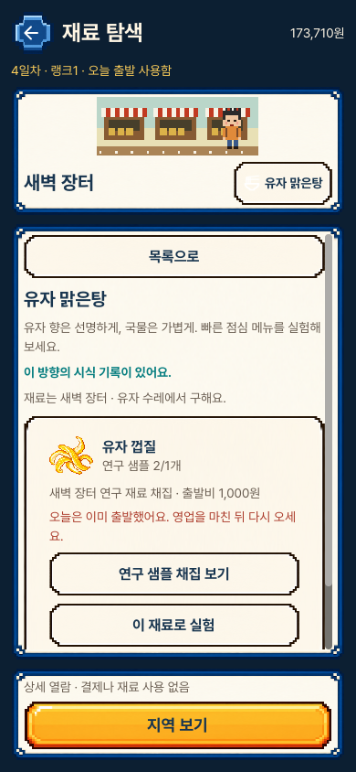 | 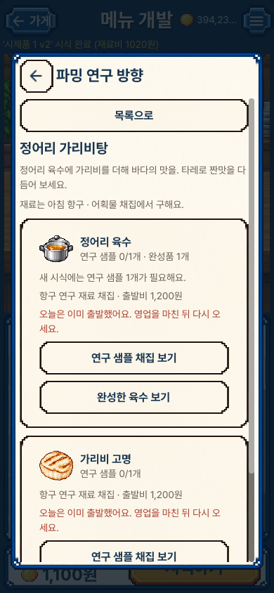 | 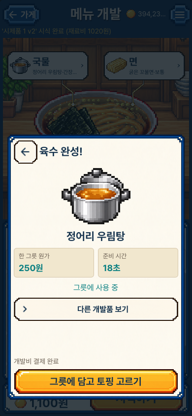 |

[가로 상세](desktop_goal_02_detail.png) ·
[짧은 세로 화면의 실제 눌림](compact_goal_01b_pressed.png)

## 디자인 검토와 한계

현재 12장과 이번에 새로 실행한 수정 전 2장을 모두 원본 크기로 열었다.
글자·프레임 사이 여백과 줄바꿈, 그림 비율, 목록의 전체 클릭 영역과 눌림 색을
확인했다. 드래그 취소에는 이동·성공 효과가 없다. 상세는 필요한 경우 안에서
스크롤한다. 큰 잔액의 개발 상단 줄임표, 오래된 채집 보상의 긴 설명은 이번
작업에서 바꾸지 않았다.

자동 생성한 모든 회귀 화면을 하나씩 직접 검토했다는 뜻은 아니다. 물리적인
iPhone 터치·텍스트 확대·보조 기술 수용이나 재미 검증도 아니다.
[원본 크기와 해시](review.json) · [조작과 범위](../../FORAGING_GOALS_V1.md) ·
[검증 증거](../../../../evidence/foraging-goals-v1.json)
