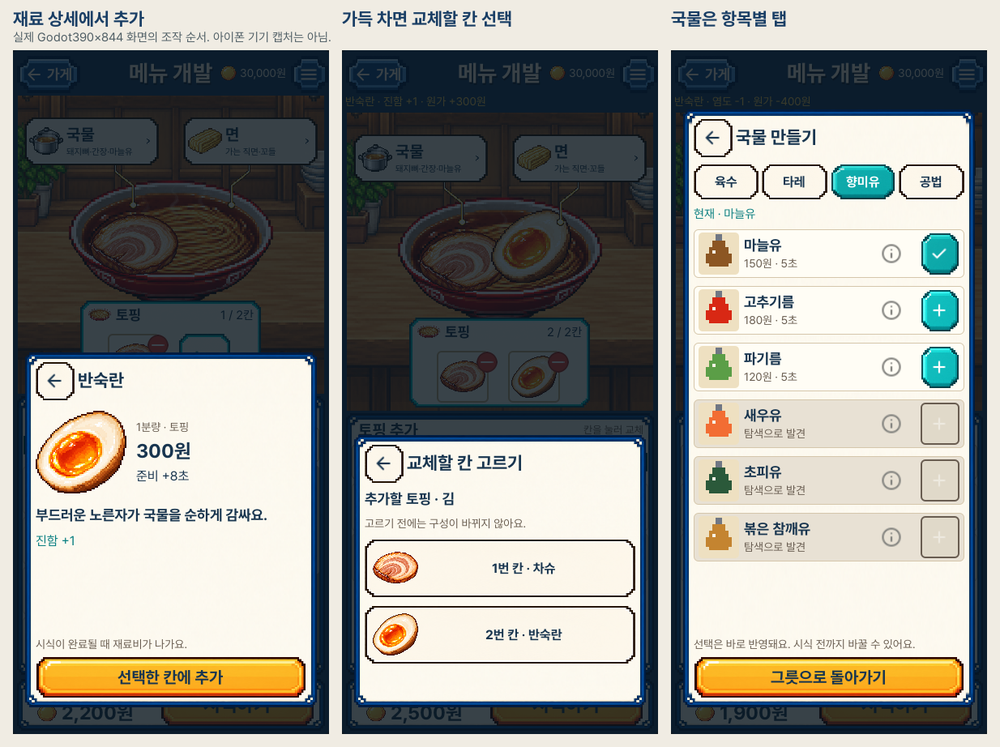

# 재료 상세·선택 흐름 · 실제 화면

2026-10-24. 선택한3번 시안의 첫 화면을 유지하며 상세·교체·국물/면 선택을
정리했습니다. 다음은 실제 Godot 실행 화면입니다.

- [재료 상세 전후](comparisons/portrait-detail-before-after.png): 작은 하단 패널에서 비용·시간·특성을 보고 바로 추가합니다.
- [향미유 선택 전후](comparisons/portrait-selector-before-after.png): 육수·타레·향미유·공법을 고정 탭에서 고릅니다.
- [첫 화면 시안 비교](comparisons/portrait-initial-source-current.png), [목록·버튼 확대](comparisons/portrait-source-controls-current.png).
- [가득 찼을 때 교체](portrait_flow_03_replacement.png), [실제 교체 결과](portrait_flow_04_replaced.png), [잠긴 재료](portrait_flow_01_locked.png).
- [익힘](portrait_flow_08_firmness.png), [실험 단서에서 맞는 탭으로 복귀](portrait_flow_09_clue_target.png), [가로 상세](desktop_flow_02_ingredient.png).

새 실제 흐름567확인·기존 편집/시식524확인, 모두 실패0·정상 종료·엔진 오류0.
같은 패키지의 짧은390x750 배치 검사는 새 흐름261/0·기존219/0이며 실제
이미지 검증과 구분합니다. 열린 패널의390x640 크기 변경과 탭별 실제 스크롤
복원도 검사했습니다. 이 크기의 전체 게임 화면을 수락한 것은 아닙니다.

새 화면18장·기존 회귀30장을 생성했고 새14장과 회귀8장을 직접 열었습니다.
현재 원본26장과 이전 기준8장, 비교5장을 공개합니다. 나머지 원본과 격리된
시험 저장을 포함한 전체 실행 결과는 작업 공간에 바이트 그대로 보존했습니다.
[전체 해시·정확한 검토 범위](review.json), [디자인 QA](../../../../design-qa.md),
[플레이 규칙](../../INGREDIENT_EDITOR_FLOW_V1.md).

실물 iPhone 검증·설치는 제외했습니다. 그림/글꼴 원본·게임 규칙·저장 형식은
그대로이며, 일부 중간 사진에는 실제 클릭 효과 안내가 잠시 남아 있습니다.
