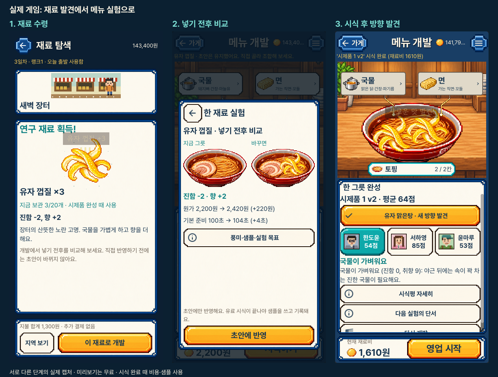
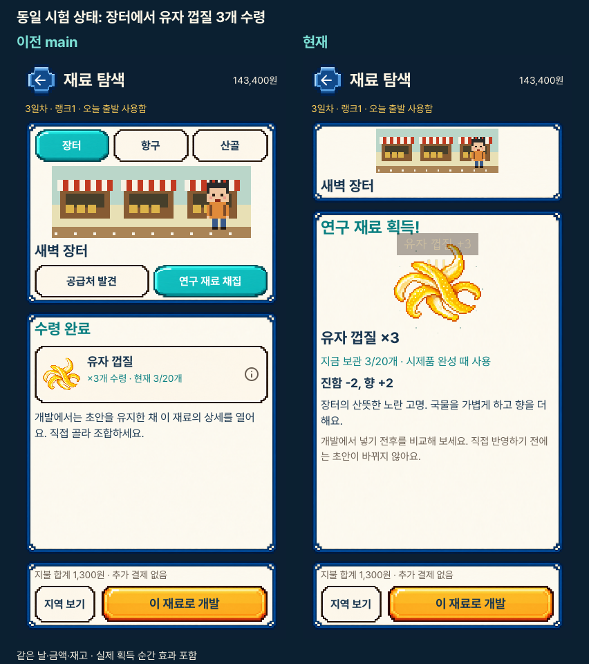
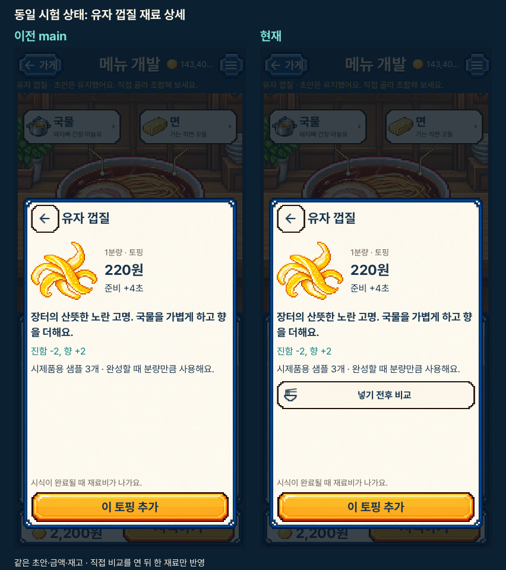
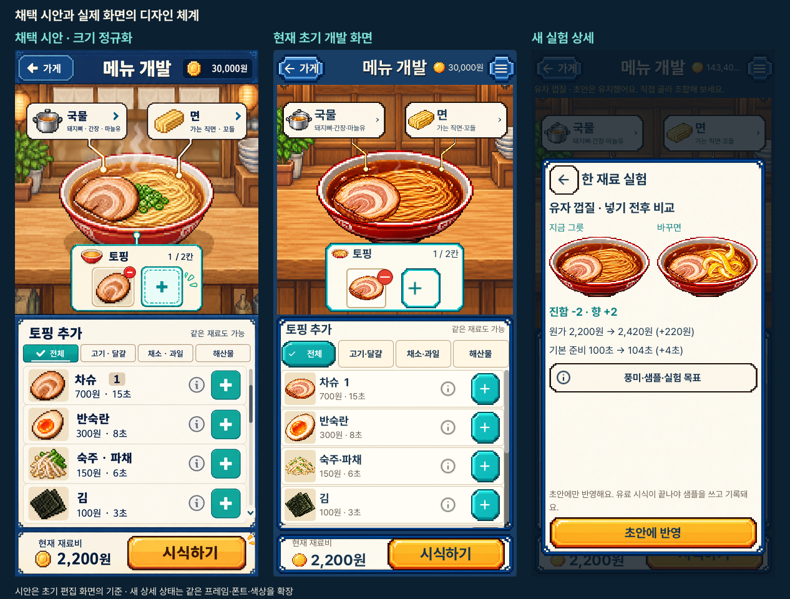

# 실제 재료 발견·실험 화면

2026-10-25. Godot OpenGL/Metal의 실제 화면입니다. 세로390×844, 가로1280×800이며
아이폰 캡처나 새 시안이 아닙니다. [조작](../../INGREDIENT_PAYOFF_V1.md),
[검증·정확한 해시·수동 검토 범위](review.json), [디자인 QA](../../../../design-qa.md).

## 단계와 관찰

1. [재료 수령](portrait_payoff_01_reward.png): 실제3개·보관량·풍미·한 번의 획득 효과.
2. [재료 상세](portrait_payoff_02_material.png): 바로 추가하거나 비교를 직접 엽니다.
3. [넣기 전후 비교](portrait_payoff_03_preview.png): 두 그릇·풍미·원가·시간, 고정 반영 버튼.
4. [자세한 변화](portrait_payoff_04_facts.png): 전체 풍미·분량별 샘플·궁합·남은 연구 조건.
5. [가득 찬 칸 교체](portrait_payoff_05_replacement.png): 교체할 실제 칸을 먼저 고릅니다.
   아래 상세 버튼은 이 상태에서 본문을 스크롤해 볼 수 있습니다.
6. [시식 완료](portrait_payoff_06_discovery.png): 실제 비용과 샘플2개 사용 후 새 방향 표시.
7. [발견 상세](portrait_payoff_07_discovery_facts.png): 실제 새 기록과 완성 조건, 보관 노트1/3.
8. [같은 방향 재시식](portrait_payoff_08_repeat.png): 남은1개 사용, 새 발견을 중복 표시하지 않습니다.
9. [샘플 부족](portrait_payoff_09_shortage.png): 편집과 유료 시식 가능 여부를 구분합니다.
10. [오래된 미리보기](portrait_payoff_10_stale.png): 중간 변경을 덮어쓰지 않고 새 비교를 요구합니다.
11. [잠긴 재료](portrait_payoff_11_locked.png): 비교는 가능하지만 반영은 비활성입니다.
12. [기존 저장 실패 회귀](regression/portrait_editor_11_failed_save.png): 실제 실패 안내를 유지합니다.

각 단계의 가로 원본도 같은 폴더에 있습니다. 추가 `explore_07b_selected` 캡처는
수령 전 수량을 고르기만 한 상태입니다. 획득·완성 캡처에는 실제 순간 효과가 남아 있습니다.
세로 결과의 `다시 개발`은 스크롤 아래에 있고, 고정 하단의 영업 시작과 분리됩니다.

## 같은 상태의 전후와 시안 연결

보상·상세 전후는 같은 공개 거래 시험 상태입니다. 기준 결과는 유자1개, 새 여정의
결과는 유자2개라 동일 레시피 결과의 전후라고 비교하지 않습니다. 시안은 초기
편집 화면의 기준이며, 새 보상·상세 상태는 기존 디자인 체계를 확장한 것입니다.
원본 캡처는 수정하지 않았고 비교 그림은 바깥에 제목만 붙였습니다. 시안만390×844로
정규화했습니다. 원본 음식·프레임·글꼴·게임 규칙은 그대로입니다.

현재54개 원본 중 새 흐름24개와 기존 회귀8개를 공개합니다. 기준6개와 비교4개도
포함합니다. 새 흐름18개·기존 회귀8개·기준4개 및 비교4개를 직접 열었습니다.
모든 원본을 수동 검토했거나 실물 터치·접근성·사람의 재미까지 확인했다는 주장은 하지 않습니다.
