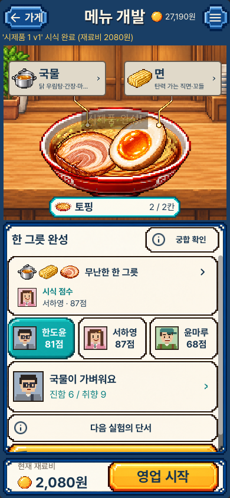
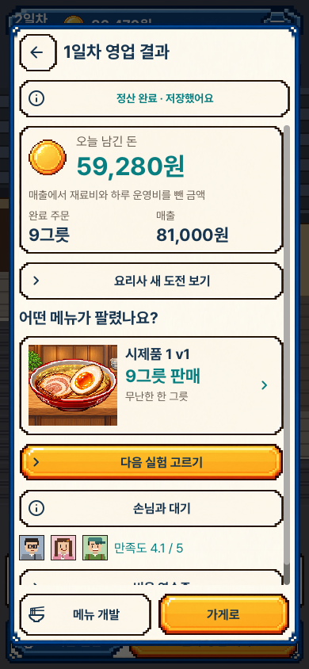
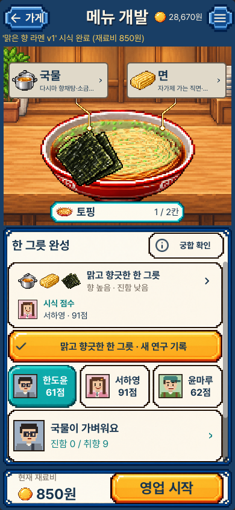
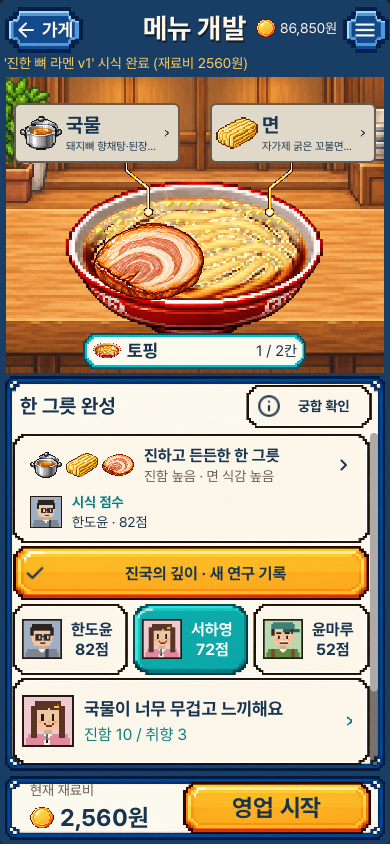
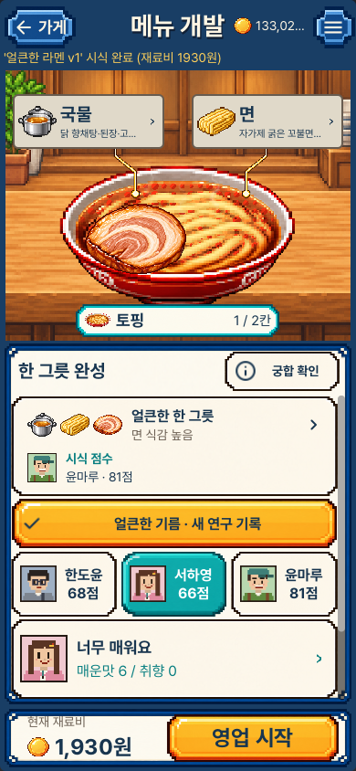
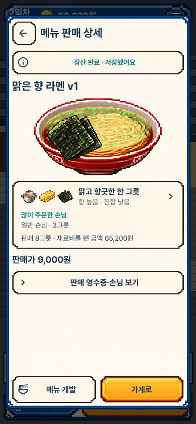
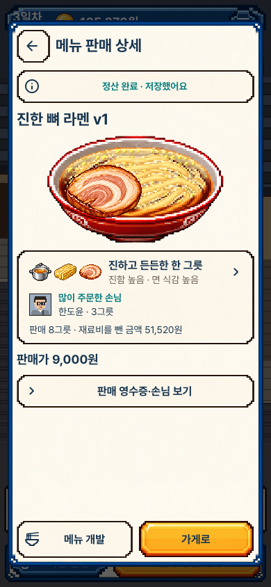
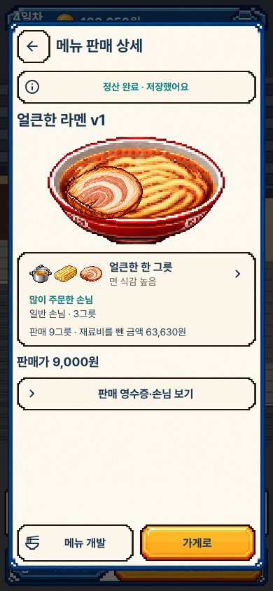

# 시식한 그릇을 판매에서도 알아보기

실제 Mac 실행의 원본이다. 기존 음식·글꼴·목재·종이·프레임을 유지하고,
시식한 그릇의 짧은 특징을 실제 판매 결과로 이어 붙였다. 새 배합이나 원본
그림을 추가한 것이 아니며, 세 예시는 시험에서 직접 개발한 서로 다른 그릇이다.

## 1. 같은 그릇의 수정 전후

두 실행 모두 같은 새 게임의 실제 원재료 제조와 첫 시식·첫 영업을 거쳤다.
시식 평균을 반복하던 줄에 그릇의 특징과 높은 시식 점수의 손님을 모았다.
판매 메뉴는 실제 음식·이름·판매량과 같은 특징을 함께 보여 준다.

| 장면 | 수정 전 | 현재 |
|---|---|---|
| 첫 시식 |  |  |
| 첫 영업 |  |  |

## 2. 서로 다른 그릇과 시식 반응

재료를 직접 배합해 제조하고, 실제 시식 버튼으로 완료한 결과다. 이름은 시험에서
붙인 이름이며 새로 제공하는 정답 레시피나 획득 보상이 아니다. 그림과 특징,
높은 점수를 준 손님을 함께 읽는다. 선택한 다른 손님의 상세 평도 유지했다.

| 맑은 다시마·생강 | 진한 뼈 육수 | 얼큰한 닭 육수 |
|---|---|---|
|  |  |  |

[그릇을 눌러 실제 원가·준비 시간 읽기](portrait_0_taste_detail.png) ·
[짧은 세로 화면](compact_2_taste.png)

## 3. 시식 점수와 실제 주문은 별개의 사실

같은 특징을 판매에도 표시하되, 여기의 손님은 실제 완료 주문이 가장 많은
손님이다. 시식 점수를 판매 만족도로 바꾸거나 일반 손님에게 단골 얼굴을
붙이지 않는다. 날짜도 다르므로 판매량 차이를 재료 하나의 효과라고 단정하지 않는다.

| 맑은 그릇 판매 | 진한 그릇 판매 | 얼큰한 그릇 판매 |
|---|---|---|
|  |  |  |

판매 카드의 화살표는 실제 음식의 특징을, 아래 버튼은 전체 판매 영수증과
손님별 주문을 연다. 공통 하루 운영비는 전체 정산에서 한 번만 차감한다.

[가로 메뉴 상세](desktop_1_sales_menu.png) ·
[재시작 후 구성이 없는 옛 단일 메뉴 영수증](portrait_restored_unknown.png)

## 검토 범위

공개한 현재12장과 새로 실행한 수정 전2장을 원본 크기로 열었다. 글자와 테두리
사이 여백, 줄바꿈, 재료 그림의 선명도, 시식/주문 문구를 확인했다. 처음의 작은
노란 점 모양 면 아이콘은 기존 원본 면 다발 그림으로 바꾸고 다시 캡처했다.
스크롤 취소 시험 뒤 카드가 화면 밖에 있던 캡처도 카드를 다시 보여준 상태로 고쳤다.

전체 자동 생성 화면을 하나씩 수동 검토했다는 뜻은 아니다. iPhone 설치·실제
손가락·텍스트 확대·보조 기술·음향·발열·사람의 재미 수용도 별도다.
[원본 크기·해시·검토 기록](review.json) · [동작과 한계](../../MENU_IDENTITY_V1.md) ·
[실행 증거](../../../../evidence/menu-identity-v1.json)
