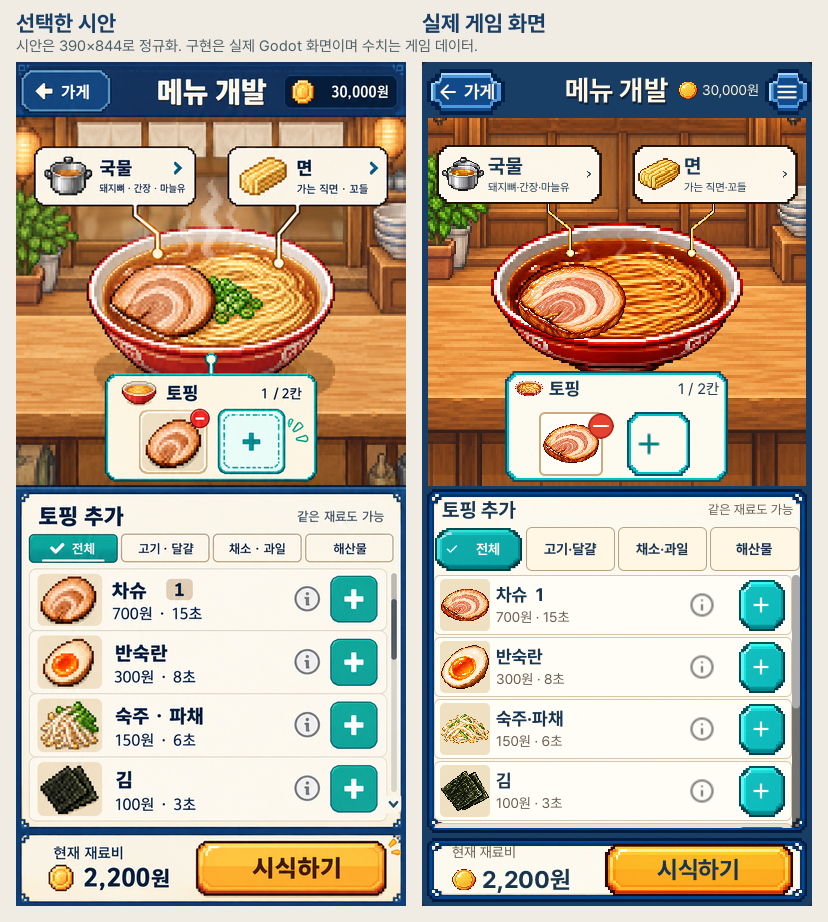

# 선택한 시안 기반 재구현 · 실제 화면

2026-10-24. 사용자가 고른 [3번 시안](../refinements/concept-03-categories-v1.png)을
다시 기준으로 삼아 네이티브 편집 화면을 재구현했습니다. 왼쪽은 시안,
오른쪽은 실제 Godot 실행 캡처입니다. 배치와 자산 스타일 비교이며 완전 복제나
사용자 디자인 승인을 뜻하지 않습니다.

[이전 구현까지 포함한 비교](comparisons/portrait-full-source-before-after.png),
[그릇·토핑 확대](comparisons/portrait-stage-source-current.png),
[목록·버튼 확대](comparisons/portrait-controls-source-current.png).

## 실제 조작 상태

- [토핑 중복](portrait_editor_04_duplicate.png), [교체](portrait_editor_05_replace.png)
- [잠긴 재료 상세](portrait_editor_03_details.png), [국물 선택](portrait_editor_06_broth_edit.png)
- [조리 진행](portrait_editor_07_cooking.png), [시식 결과](portrait_editor_08_result.png)
- [손님 전체 평가](portrait_editor_09b_comparison.png), [저장 실패 안내](portrait_editor_11_failed_save.png)
- [4칸 배치 투영](portrait_editor_10_rank3_layout_projection.png), [가로 화면](desktop_editor_01_initial.png)

실제 OpenGL 검사524개/실패0/정상 종료/엔진 오류0, 두 크기 PNG30장입니다.
짧은390x750의 같은 패키지 배치 검사219개/실패0은 이미지 검증과 구분합니다.
현재275소스와 실제 패키지, 원본 엔진의 실행 후 서명까지 확인했습니다.
13장과 비교4장을 직접 열어 확인했으며 전30장을 개별 정독했다고 주장하지 않습니다.
[검토 범위·전체 해시](review.json), [자산·글꼴](ASSETS.md),
[발견한 문제와 수정 기록](../../../../design-qa.md).

분류 버튼은44px 터치 영역을 위해 시안보다 높고, 실제 데이터와 선택한 토핑만
표시합니다.4칸은 게임 진행을 저장하지 않는 화면 시험입니다. 일부 중간 캡처에
실제 클릭 효과 안내가 남아 있습니다. 아이폰 설치·실기기 검증은 이번에 제외했습니다.
