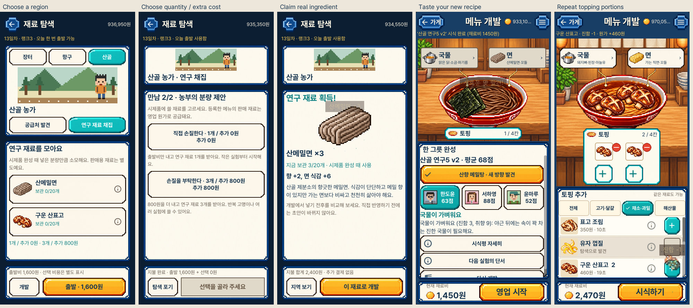

# 산골 연구 채집 · 실제 화면

1. [잠금·출발 조건](current/portrait_mountain_01_locked.png) → [산골 채집](current/portrait_mountain_02_preview.png)
2. [수량과 비용](current/portrait_mountain_05_quantity.png) → [수령 전](current/portrait_mountain_06_pending.png) → [직접 수령](current/portrait_mountain_07_received.png)
3. [재료 상세](current/portrait_mountain_08_noodle_detail.png) → [산메밀면 개발](current/portrait_mountain_09_buckwheat_bowl.png) → [시식 결과](current/portrait_mountain_11_noodle_result.png)
4. [산표고 획득](current/portrait_mountain_12_shiitake_received.png) → [같은 토핑 두 칸](current/portrait_mountain_14_shiitake_bowl.png)

[시안과 새 그릇](comparisons/source-and-new-dishes.png) · [메밀면 그림 수정](comparisons/noodle-refinement.png) · [가로 조리 잘림 수정](comparisons/cooking-before-after.png)

`current/`의 30장은 최종 V5 실제 Godot 캡처 원본입니다. `regression/`의 6장은
같은 V5 패키지의 기존 화면, `before/`는 변경 전 main의 새 캡처입니다.
`iterations/`는 문제 수정 전 기록이며 최종 화면이 아닙니다.
`review.json`에 원본·비교 그림의 크기와 SHA-256을 기록했습니다.

시안 853×1844는 비교 그림에서만 390×844로 정규화했습니다. 원본 캡처는
390×844·1280×800입니다. 390×750은 별도 배치 검사이며 실기기 검증이 아닙니다.

[재료·저장 규칙](../../MOUNTAIN_FORAGING_V1.md) · [전체 검토](../../../../design-qa.md)
