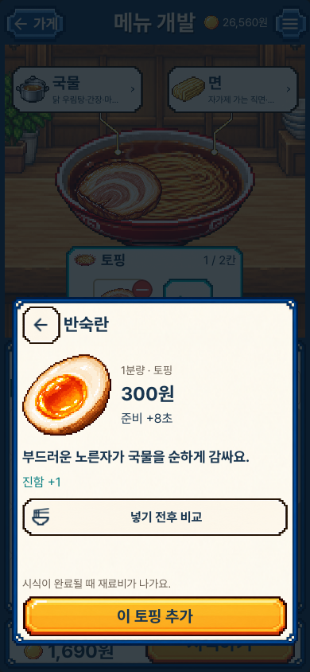
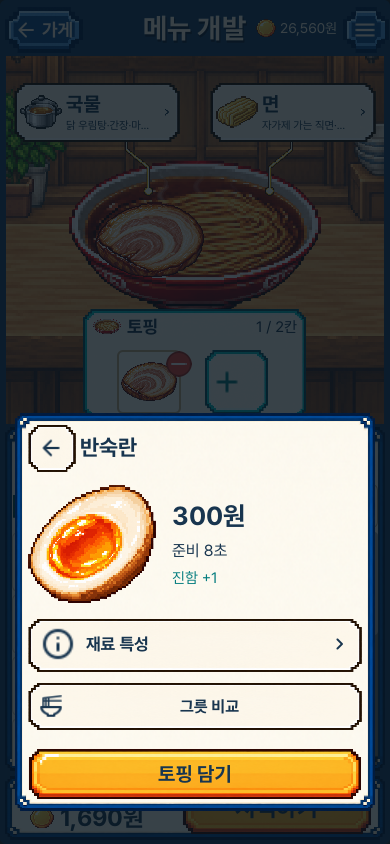
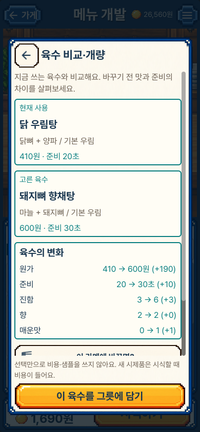
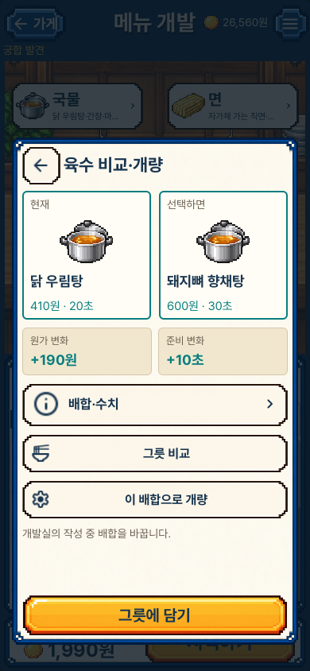
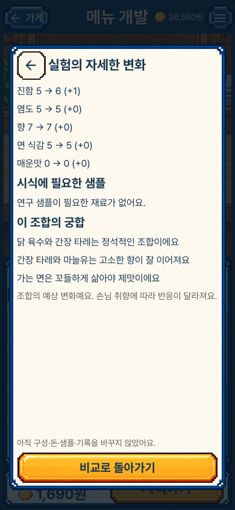
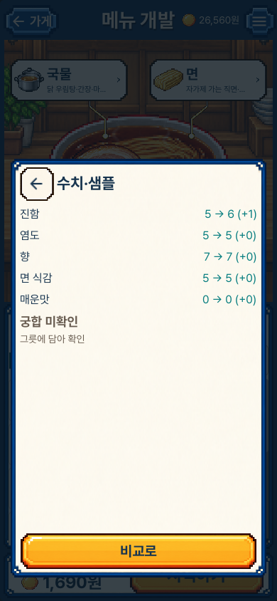

# 메뉴 개발 화면 점검 · 2026-10-27

사용자의 목표는 긴 설명을 읽고 정답을 고르는 화면 대신 직접 재료를 담아 궁합을 발견하는 것이다. 기존 선택 시안의 음식 그림·색·프레임·글꼴을 유지했다. Product Design의 단계별 화면 점검과 정보 우선순위 기준을 사용했고, 별도 웹 시안이나 다른 디자인으로 바꾸지 않았다.

수정 전은 작업 시작 시 main45de9e7을 고정한 복사본에서 새로 렌더링했다. 수정 후 이미지는 현재 게임의 실제 Mac 렌더러 원본이며, 합성 시안이나 예전 캡처를 현재 화면으로 재사용한 것이 아니다. 세로390×844와 가로1280×800을 각각 실행했다.

## 단계별 확인

1. **메뉴 개발 진입 — 확인:** 기존 큰 그릇과 국물·면 선택, 토핑 분류를 유지했다. 궁합 버튼은 ‘미확인/확인’을 짧게 표시한다. [현재 화면](portrait_knowledge_01_editor.png).
2. **재료 확인 — 개선 확인:** 그림·가격·준비 시간·재료 특성을 먼저 본다. 서술형 설명은 펼치는 버튼으로 옮겼다. 버튼을 누르는 동안 배경과 글자·아이콘 색이 바뀐다. 밀면 펼치지 않고 스크롤로 취소한다. [펼친 특성](portrait_knowledge_03_properties.png), [누르는 상태](portrait_knowledge_02b_pressed.png).
3. **미시도 조합 비교 — 노출 차단 확인:** 기존 상세는 실제 적용 전부터 궁합 문장을 공개했다. 현재는 음식·원가·시간·풍미 수치만 비교하고 궁합 문장·부호·개수·단골 점수는 제공하지 않는다. [미시도 비교](portrait_knowledge_04_unknown.png), [깊은 상세](portrait_knowledge_05_unknown_facts.png), [가로 화면](desktop_knowledge_09_unknown_component.png).
4. **선택과 발견 — 확인:** 실제로 담기 버튼을 누르면 조합을 기억하고 좋은/아쉬운 궁합의 이유를 볼 수 있다. 비교·펼치기만으로는 기억하거나 결제하지 않는다. [선택 후 궁합](portrait_knowledge_06_discovered.png).
5. **개량·저장 — 개선 확인:** 완성품을 두 열로 비교하고 원가·시간 차이를 먼저 보여 준다. 배합·수치는 펼친다. 기존 배합을 덮어쓰는 범위, 부족한 샘플·잠금·저장 실패 안내는 숨기지 않는다. 저장 재시도 성공 후 현재 화면의 실패 문구도 지워진다. [저장 거절](portrait_knowledge_11_unsaved.png), [회복 후 제면](portrait_knowledge_12_noodle.png), [완성 목록](portrait_knowledge_16_library.png).

## 같은 화면의 수정 전후

육수 비교는 동일한 현재/후보 완성품으로 비교했다. 수정 후 캡처의 배경 그릇에는 앞선 시험 단계에서 추가한 토핑이 보일 수 있다. 배합·원가·시간 비교 자체의 대상은 같다.

| 재료 상세: 기본 설명을 펼치기로 이동 | 현재 |
| --- | --- |
|  |  |

| 완성 육수 비교: 도입문과 기본 배합 설명을 줄임 | 현재 |
| --- | --- |
|  |  |

| 미시도 상세: 적용 전 궁합 문장을 숨김 | 현재 |
| --- | --- |
|  |  |

실제 UI 입력으로 상세·그릇 그림·버튼 위 스크롤, 클릭 취소, 저장 거절/재시도와 재시작을 확인했다. 글과 아이콘의 대비는 실제 캡처에서 보완했고, 모든 보이는 행동 버튼은 최소44px을 검사했다. 작은390×750 배치도 별도로 검사했다. 확대·VoiceOver·색각·물리 iPhone 조작의 완전한 접근성 수락을 뜻하지 않는다. 장기 재미와 경제 검증도 별도다.

검증 수치와 최종 소스·패키지 식별값은 저장소 루트 `evidence/recipe-knowledge-ui-v1.json`에 기록한다. 실패한 초기 진단과 과거 캡처는 현재 결과로 취급하지 않는다.
