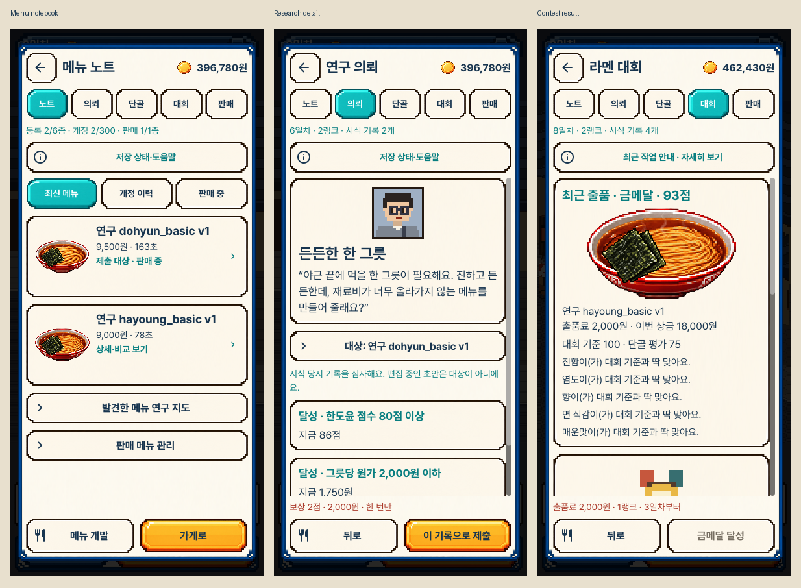
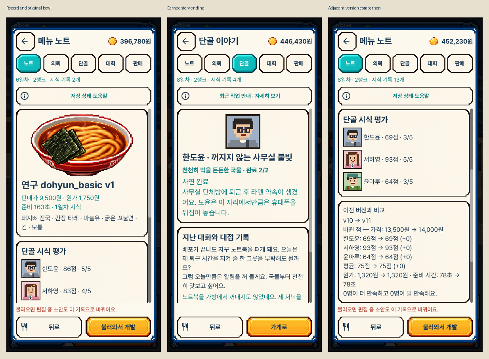

# 남은 운영 화면의 네이티브 구현

`current/`는 최종 V5 패키지에서 추출한 원본 43장, `regressions/`는 같은 패키지의
기존 기능 원본 4장입니다. `before/`는 작업 전 main의 새 실행에서 고른 7장입니다.
`comparisons/`의 6장은 원본과 시안을 함께 배치한 비교 자료입니다. 원본 이미지는
수정하지 않았고, 비교 시안은 853×1844에서 390×844로 Lanczos 정규화했습니다.
확대 비교에는 실제 크롭·정규화만 사용했습니다.

노트·의뢰 전후 비교는 같은 6일차·2랭크·396,780원·시식 기록 2개의 준비 상태와
목록 맨 위를 맞췄습니다. 사용자 선택 시안은 개발 화면이므로 다른 기능에는
프레임·글꼴·자산·색상·정보 단계의 기준으로 사용합니다. 다른 상태의 기사·결말을
원본 시안과 같은 상태라고 취급하지 않습니다.

- [같은 상태의 노트 전후와 선택 시안](comparisons/notebook-source-before-after.png)
- [같은 상태의 의뢰 전후와 선택 시안](comparisons/research-source-before-after.png)
- [폰트·패딩·원본 자산 확대 비교](comparisons/focused-source-and-current.png)
- [실제 저장 실패·수동 복구·재시작](comparisons/portrait-save-states.png)
- [작은 세로 화면의 의뢰](current/compact_research_overview.png)
- [작은 세로 화면의 실제 비교 상세](current/compact_comparison_detail.png)
- [넓은 화면의 의뢰](current/desktop_research_overview.png)

총 147장의 최종 원본과 작업 전 14장을 로컬에 보존했습니다. 모든 원본을 사람이
일일이 검토했다고 주장하지 않습니다. 직접 열어 비교한 범위와 자동 검사의 범위는
[review.json](review.json)과 [design-qa.md](../../../../design-qa.md)에 기록합니다.

[조작과 기존 규칙](../../OPERATIONS_WORKBENCH_V1.md)
