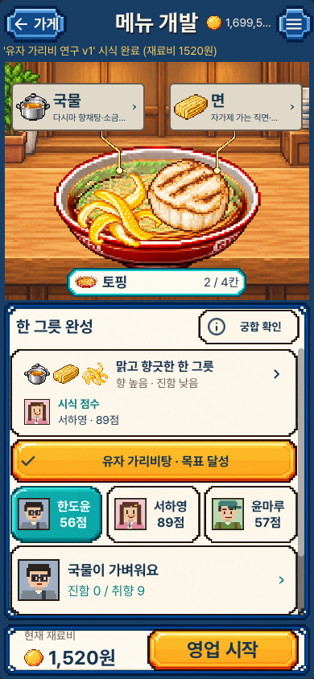
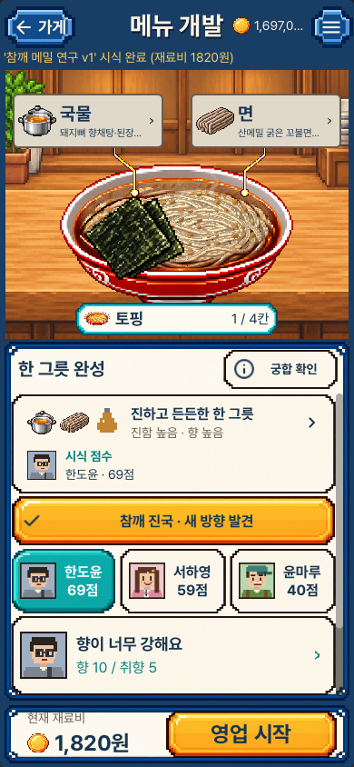
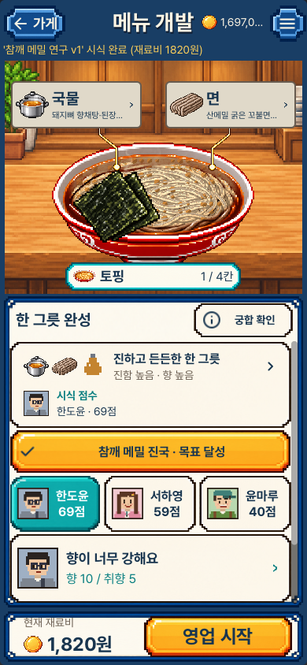
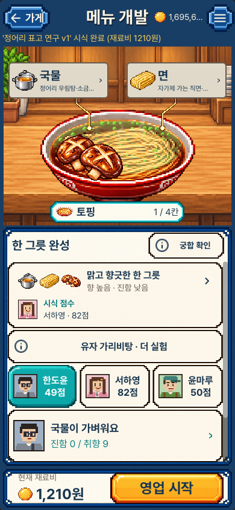
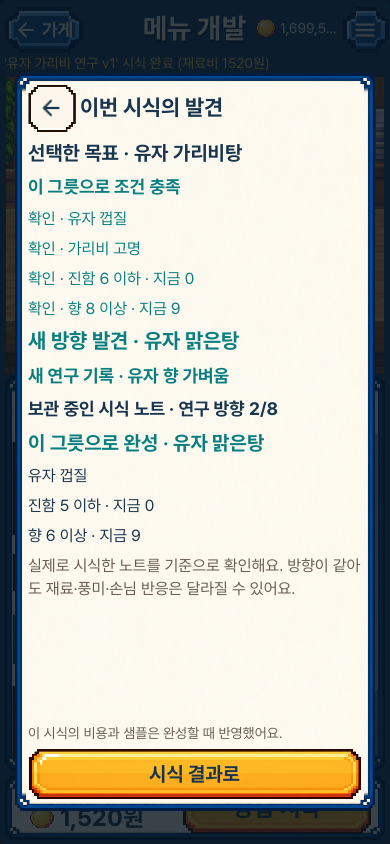

# 시식한 그릇과 선택한 목표를 함께 읽기

현재8장과 새로 실행한 이전 main2장의 원본이다. 같은 실제 새 게임의 진행
저장으로 시작해 같은 원재료 제조·유료 시식3회를 거쳤고 전체 최종 저장 값이
같다. 음식·손님 점수·원가를 올린 비교가 아니다.

## 선택한 방향을 먼저 표시

| 시식 목표 | 이전 main | 현재 |
|---|---|---|
| 유자 가리비탕 |  |  |
| 참깨 메밀 진국 |  |  |

서로 함께 맞는 방향이 있어도 선택 목표를 먼저 확인한다.
[정어리 산표고탕의 실제 결과](portrait_focus_sardine_shiitake.png) ·
[가로 화면](desktop_focus_sesame_buckwheat.png)

## 다른 그릇의 성공과 이번 결과를 구별

| 이번 그릇이 목표와 다를 때 | 선택 목표의 상세 조건 |
|---|---|
|  |  |

왼쪽은 유자 가리비탕의 성공 기록이 이미 노트에 있지만, 지금 보고 있는 그릇은
정어리 산표고탕인 상태다. 과거 기록을 현재 그릇의 성공으로 바꾸지 않는다.
목표를 바꿔도 시식·샘플·돈은 변하지 않으며 ‘더 실험’은 중립색이다. 부족하거나
맞는 조건은 카드를 눌러서 읽는다. 아직 시식하지 않은 초안의 정답을 보여주지 않는다.

[짧은 세로의 미충족 표시](compact_focus_unmet_citrus_scallop.png) ·
[재시작 뒤 실제 보관 기록의 목표 충족](portrait_focus_restored.png)

## 검토 범위

공개한10장을 원본 크기로 열어 제목 우선순위, 금색/중립색, 글자·테두리 여백,
누를 수 있는 영역과 가로·세로 배치를 확인했다. 자동 캡처 전체를 수동 검토한
뜻은 아니다. 시험에서 작업 시간을 앞당겼고 실제 iPhone 입력·성능·음향·
사람의 재미 수용은 검증하지 않았다.

[원본 크기·해시·검토 기록](review.json) · [동작과 한계](../../SELECTED_GOAL_FEEDBACK_V1.md) ·
[실행 증거](../../../../evidence/selected-goal-feedback-v1.json)
