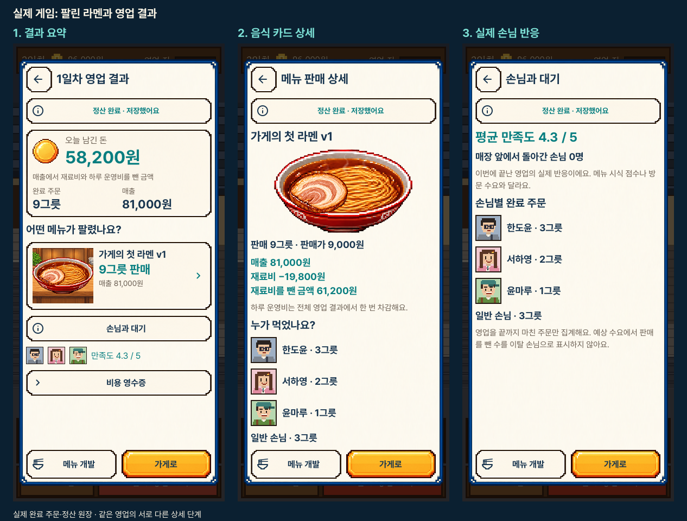
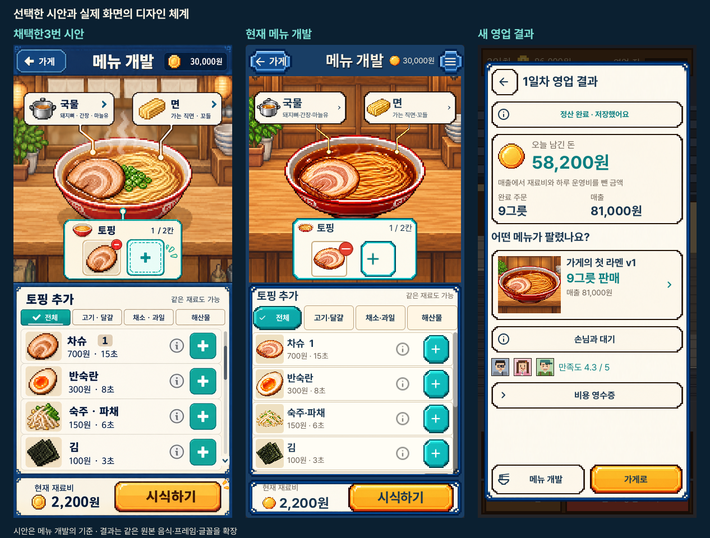
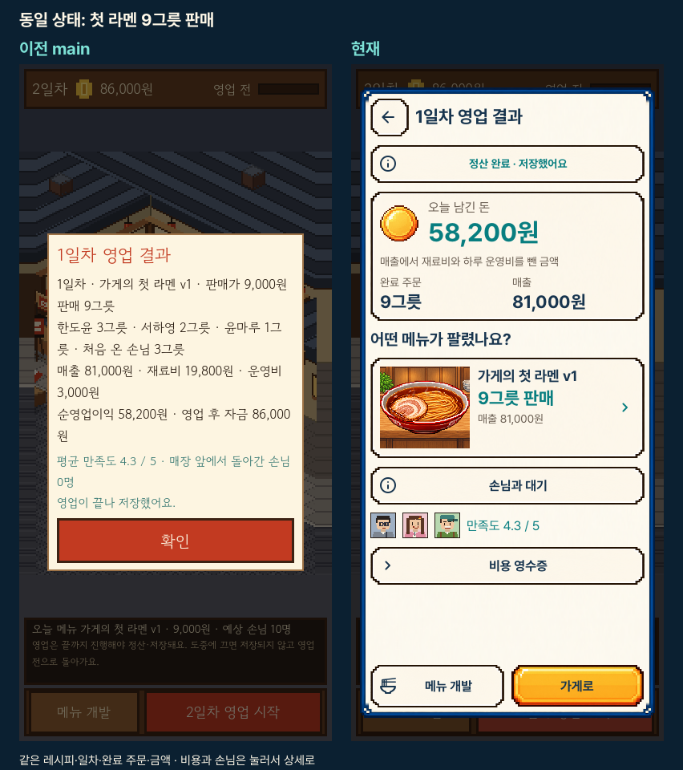
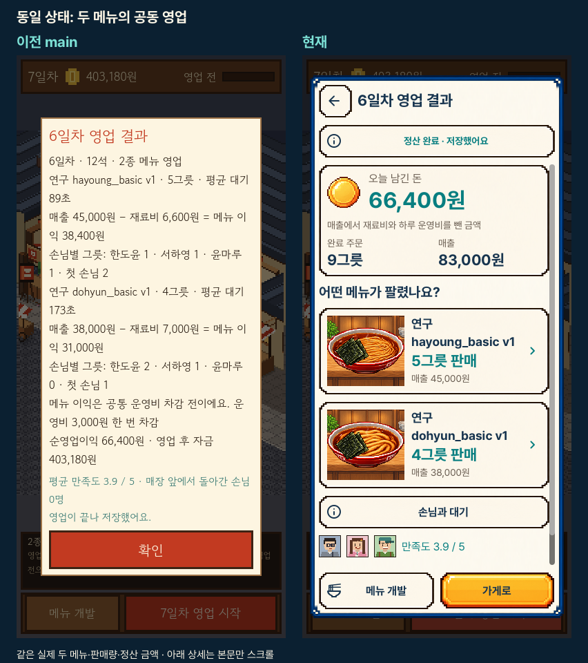
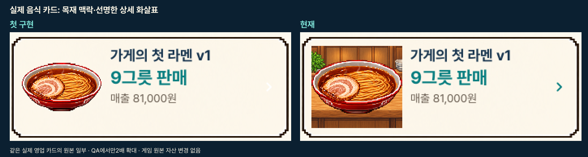
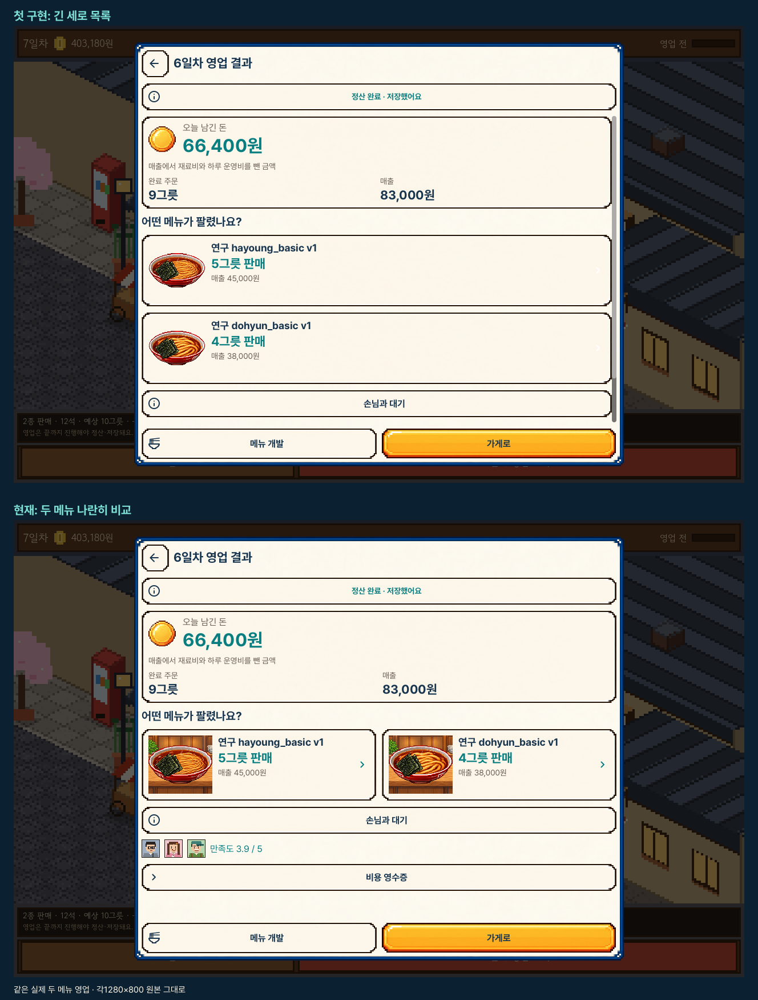

# 실제 영업 결과 UI

2026-10-25. Godot OpenGL/Metal의 실제390×844·1280×800 화면입니다.
[조작과 기록 범위](../../SERVICE_RESULT_WORKBENCH_V1.md),
[정확한 해시·수동 검토 범위](review.json), [디자인 QA](../../../../design-qa.md).
아이폰 화면이나 새 시안이 아닙니다.

## 단계와 관찰

1. [결과 요약](portrait_sales_01_single.png): 실제 순이익58,200원·9그릇·매출81,000원.
   동전·목재 배경의 실제 음식·손님 얼굴·청록 상세 화살표·금색 복귀 버튼을 씁니다.
2. [메뉴 상세](portrait_sales_02_menu.png): 당시 팔린 그릇과 재료비 차감 금액61,200원.
   공통 운영비3,000원은 전체 결과에서 한 번 차감합니다.
3. [손님 반응](portrait_sales_03_customers.png): 이번 실제 만족도·이탈·완료 주문.
4. [비용 영수증](portrait_sales_04_costs.png): 매출·비용·순이익·당시 자금을 나눕니다.
5. [재시작한 단일 기록](portrait_sales_05_restored_single.png): 없는 그릇 구성을 현재
   초안으로 대신하지 않습니다. 저장에 남은 판매·금액·손님만 보여 줍니다.
6. [두 메뉴 요약](portrait_sales_06_pair.png): 음식 카드로 메뉴별 판매를 구분합니다.
7. [두 번째 메뉴 상세](portrait_sales_07_pair_detail.png): 실제 구성과 평균 대기173초.
8. [두 메뉴 손님](portrait_sales_08_pair_customers.png): 실제 완료 주문 기준 대기·반응.
9. [재시작한 확장 기록](portrait_sales_09_restored_pair.png): 저장된 그릇·완료 주문·대기 유지.
10. [판매 없음·손실](portrait_sales_10_loss.png): 실제0그릇·−3,000원. 만족도는 집계 없음.
11. [저장 실패](portrait_sales_11_save_failure.png): 고정 상태 버튼에서 전체 경고·영수증에 도달.

각 단계의 가로 원본도 같은 폴더에 있습니다. 음식 카드를 민 동작은 상세로 열리지
않으며 고정 하단 버튼은 본문과 겹치지 않습니다. 지난 결과를 다시 열어도 정산하지
않습니다. `메뉴 개발`은 현재 초안을 유지합니다. 비교용 두 메뉴의 연구 이름은
기존 공개 거래 시험에서 실제로 만든 이름이며 제품에 새로 넣은 고정 문구가 아닙니다.

## 시안과 같은 상태 전후

단일·두 메뉴 전후는 같은 공개 거래 시험 상태와 실제 주문·금액입니다. 기준의
`history` 원본은 이전 영업 탭 초기 모습이며 지난 영수증 자체의 비교라고 하지 않습니다.
선택 시안은 메뉴 개발용입니다. 영업 결과는 그 원본 자산·프레임·서체·팔레트를
확장하며 새 상태를1:1로 복제했다는 주장은 하지 않습니다. 시안만390×844로 정규화,
음식 카드 비교만 실제 원본 일부를2배 확대했고 게임 원본은 수정하지 않았습니다.

현재52원본 중 결과22개·개발 회귀4개, 기준6개·비교6개를 공개합니다. 결과17개·
개발4개·기준4개 및 비교6개를 직접 열었습니다. 모든 원본을 수동 검토하거나 실물
터치·전체 접근성·사람의 재미를 검증했다는 주장은 하지 않습니다. 다른 구형 화면의
디자인 변경과 전체 게임 UI 완성은 이번 범위가 아닙니다.
