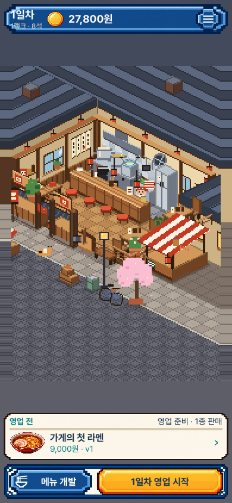
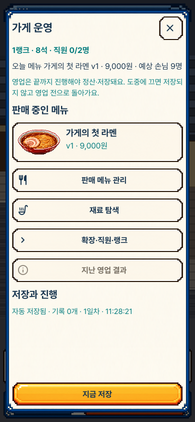
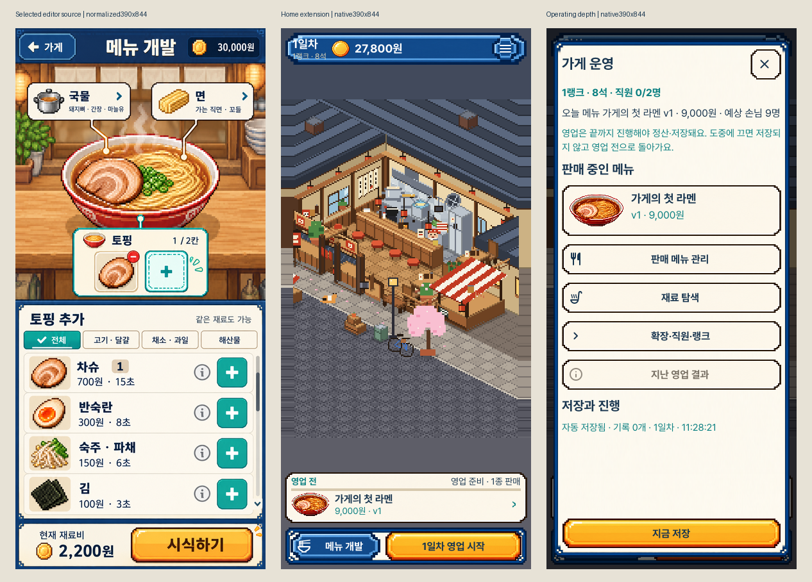
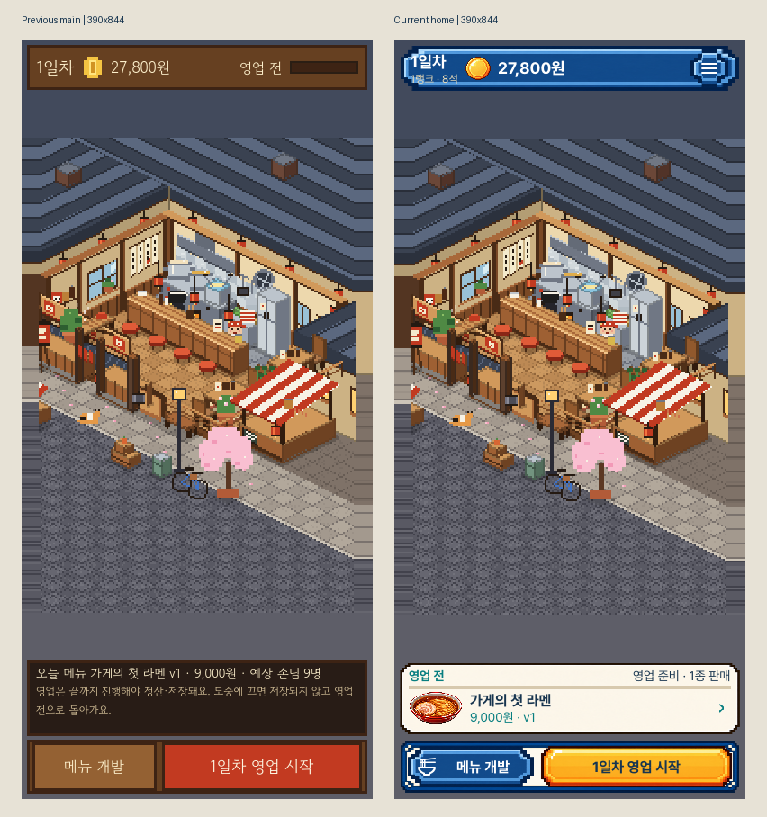
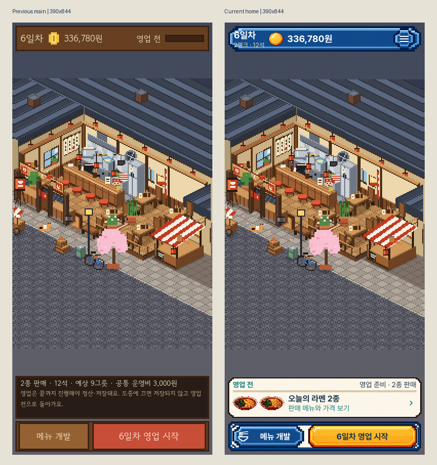
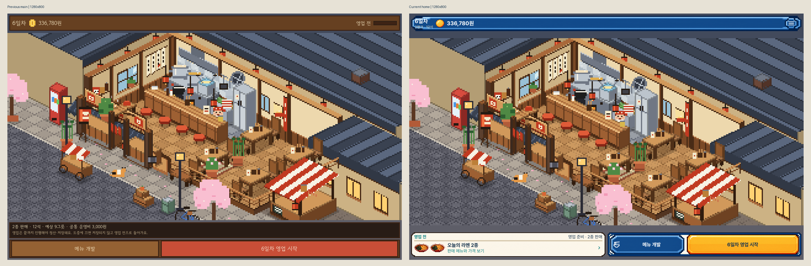
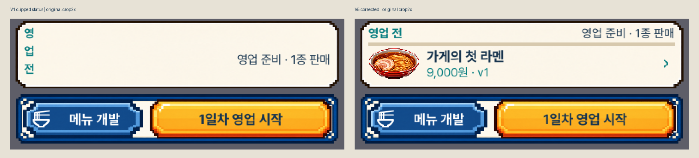

# 매장 메인 · 판매 메뉴 · 운영 상세

매장 도트 장면을 유지하면서 선택한 메뉴 개발 시안의 원본 프레임·동전·라멘·서체를
메인 화면으로 이어 썼습니다. 매장 전용으로 선택한 별도 시안의1:1 재현이라는 뜻은 아닙니다.

- 상단: 일차·랭크·좌석·자금과44px 이상 작업 메뉴.
- 하단: 실제 판매 중인 라멘·가격·버전과 영업 진행. 개발 중인 초안으로 대신하지 않습니다.
- 판매 카드를 누르면 전체 운영 정보·판매 메뉴·확장·탐색·지난 정산으로 이동합니다.
- 영업 중에는 판매 변경이 잠기고, 중단은 기존처럼 두 번 확인합니다.
- 저장 실패는 상단과 판매 카드에 표시합니다. 전체 경고·기존 파일 보호·복구는 실제 상세 창에 있습니다.
- 직접 저장의 거부·실패·성공은 고정 버튼 바로 위에 표시해 스크롤 아래에 숨지 않습니다.

## 실제 상태

[눌린 상태](portrait_home_00_pressed.png), [빈 가게](portrait_home_01_empty.png),
[영업 중](portrait_home_04_active.png), [영업 중 저장 거부](portrait_home_05_live_details.png),
[확장·두 메뉴](portrait_home_06_expanded.png), [두 메뉴 상세](portrait_home_07_pair_details.png),
[저장 실패 표시](portrait_home_08_save_warning.png), [전체 경고](portrait_home_09_save_details.png),
[손상 파일 보호](portrait_home_10_protected_home.png), [보관 후 새로 시작](portrait_home_11_protected_detail.png).
각 단계의1280×800 원본도 이 폴더에 있습니다. 두 메뉴 연구 이름은 기존 공개 거래 시험에서
실제로 만든 레시피 이름이며 제품에 추가한 고정 문구가 아닙니다.

## 시안과 전후 비교

동일 상태 비교는 빈 가게·단일 판매 메뉴·확장된 두 메뉴의 영업 전 상태입니다.
영업 중 기준은60초, 현재는300초이므로 같은 시점 전후라고 비교하지 않습니다.
시안853×1844만390×844로 정규화했고 게임 원본은 그대로입니다. 확대 비교만 원본 일부를2배로 표시합니다.

## 검증 범위

최종 동일 패키지에서 실제 매장780개·개발524개·정산466개 검사, 짧은390×750 화면에서
매장356개·정산202개 배치 검사가 모두 실패0·종료0입니다. 짧은 화면 검사는 렌더링 증거가 아닙니다.
289개 파일이 이전 main과 일치하는 패키지로 변경 전116개 검사·8장 캡처를 먼저 수행했습니다.
현재293개 소스와 PCK 일치, 실행 후 공식 엔진의 엄격한 서명을 확인했습니다.

최종76장 중 매장24장과[개발·정산 회귀6장](regression/portrait_editor_01_initial.png)을 공개합니다.
매장16장·회귀6장·기준4장·조합 비교7개를 직접 열었습니다. 전체 원본을 수동 확인하거나
실물 아이폰 터치·사람의 재미·전체 접근성을 검증했다는 주장은 아닙니다.
원본·격리 시험 저장·소스·패키지·로그는 작업의 비공개 출력 폴더에도 그대로 보존했습니다.
수치·해시·수동 검토 목록은 [review.json](review.json)에 있습니다.

이번 변경은 메인과 운영 상세입니다. 기존 직원·확장·스토리 화면 전체의 디자인 교체는 포함하지 않습니다.
