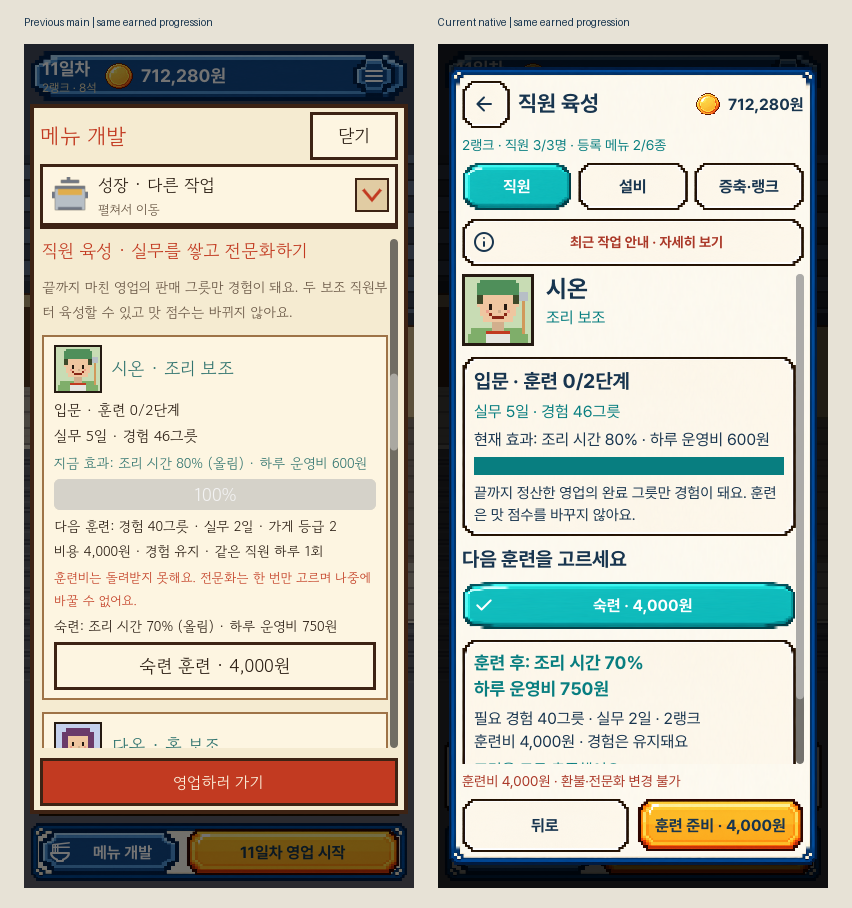
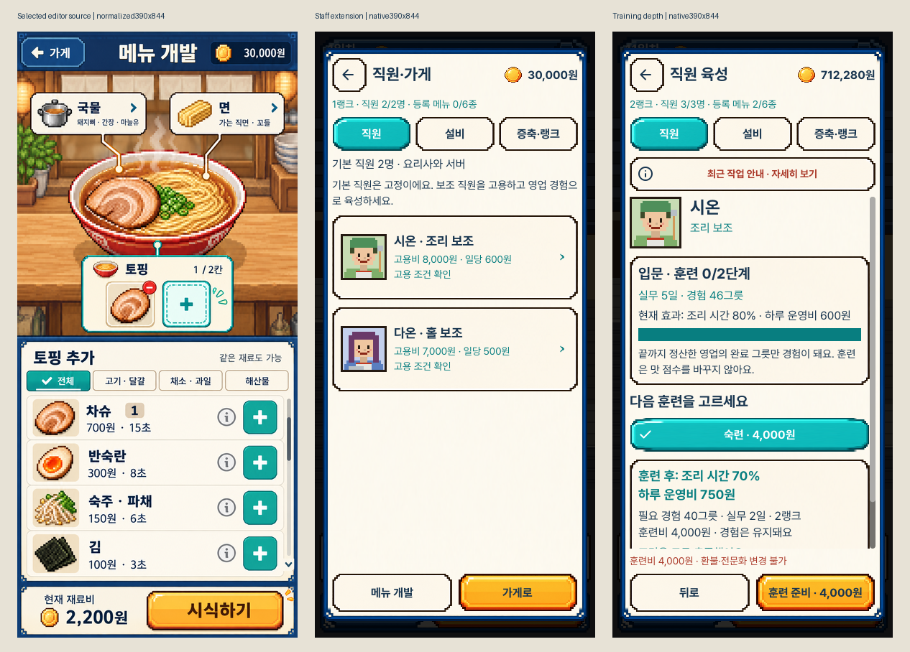
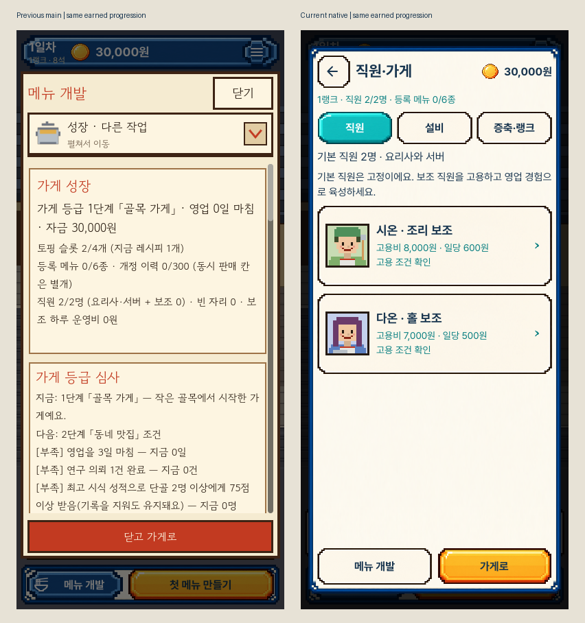
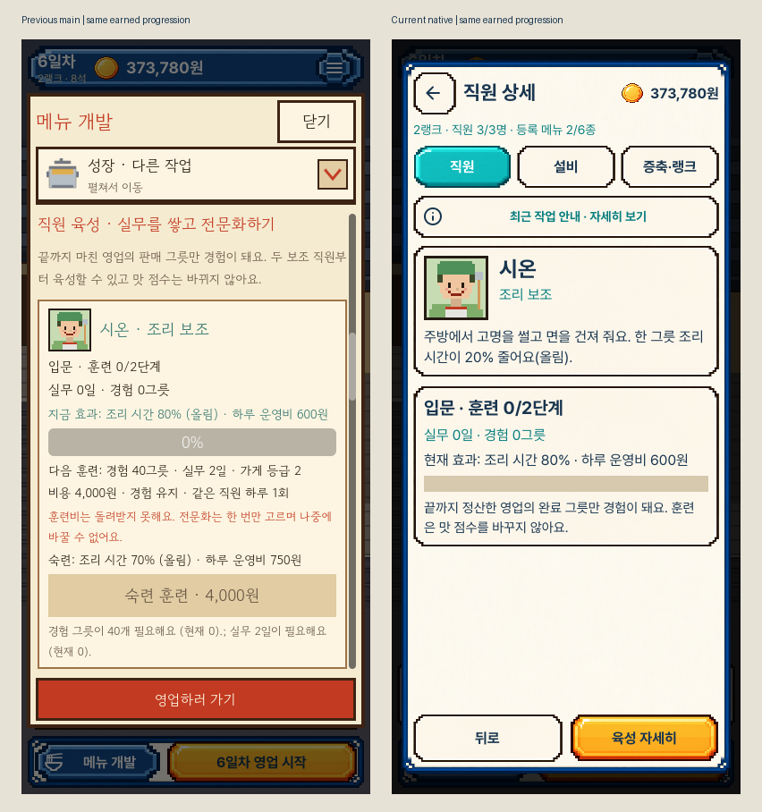
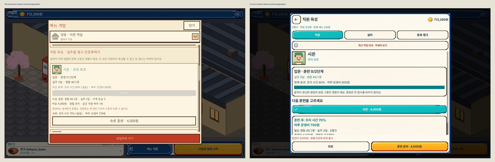
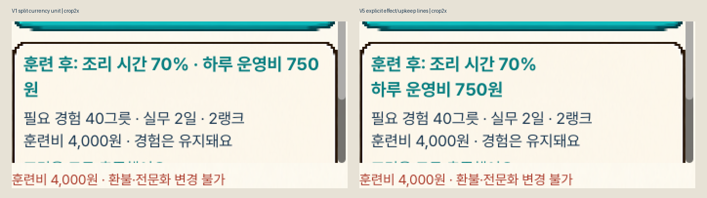

# 직원·육성·가게 성장 화면

선택한 메뉴 개발 시안의 원본 프레임·동전·서체·아이콘과 기존 직원 초상을 활용했습니다.
직원 전용으로 선택한 새 시안의1:1 복제가 아니라 기존 디자인을 이어 쓰는 변경입니다.

- 직원 카드 전체를 눌러 초상·역할·고용 전 예상·고용비·일당을 확인합니다.
- 고용한 직원은 경험·실무·현재 효과를 보고 훈련 방식을 고릅니다.
- 훈련비와 환불·전문화 변경 제한은 고정 행동 버튼 위에 보입니다.
- 설비, 증축, 등급 심사를 분리했습니다. 현재 용량·투자 후 변화·조건·가격을 나눠 읽습니다.
- 확인·취소·시간 만료와 기존 거래 검증을 유지합니다. 버튼·초상 위를 밀어도 스크롤되고 동작은 실행되지 않습니다.
- 최근 작업 메시지와 현재 저장 상태를 구분합니다. 메인 직원 수에는 기본 요리사·서버2명도 포함합니다.

## 실제 화면

[직원 목록](portrait_growth_01_initial.png), [설비 상세](portrait_growth_03_facility.png),
[고용 전 비교](portrait_growth_04_hiring.png), [고용 후](portrait_growth_05_staff.png),
[경험 부족](portrait_growth_06_training_locked.png), [훈련 가능](portrait_growth_07_training.png),
[확정 전](portrait_growth_08_confirm.png), [훈련 진행](portrait_growth_09_progress.png),
[등급 심사](portrait_growth_10_rank.png), [전문화 선택](portrait_growth_11_specialization.png),
[전문화 완료](portrait_growth_12_specialist.png), [증축 확정 전](portrait_growth_13_expansion_confirm.png),
[저장 실패](portrait_growth_14_save_failure.png), [재시작 복원](portrait_growth_15_restart.png).
각 단계의 가로 원본도 같은 폴더에 있습니다.

## 시안·전후·확대 비교

전후는 동일한 실제 가게 진행 상태입니다. 첫 방문은30,000원, 고용 직후는6일차373,780원,
훈련 전은11일차712,280원·경험46그릇·실무5일입니다. 화면 구성은 의도적으로 목록과 상세로
나눴습니다. 시안853×1844만390×844로 정규화했고 게임 원본은 그대로 보존했습니다.

## 검증 범위

실제 렌더링 직원772개·메인780개·개발524개 검사,390×750 배치 검사348개,
기존 훈련 규칙96개 모두 실패0·종료0입니다. 배치 검사는 렌더링 증거가 아닙니다.
기준 패키지293개 파일이 변경 전 main과 일치하며 새 기준118개 검사·8장 캡처를 먼저 수행했습니다.
실제 영업·연구·구매로 등급과 훈련 경험을 준비했고 자금·등급·경험을 임의 주입하지 않았습니다.

직원 최종 V5는297개 소스·포함된 PCK·공식 엔진 엄격 서명 일치를 확인했습니다.
메인·개발 회귀는 닫기 문제 수정 후 V4에서 실제 실행했습니다. V4와 V5의 차이는 직원 QA의
추가 드래그 검사뿐이며, 앱 실행 소스·도메인·서비스·자원은 모두 바이트가 같습니다.

현재 승인된 원본84장 중 직원30장과[메인·개발 회귀4장](regression/portrait_home_03_details.png),
기준8장을 공개합니다. 직원11장·회귀4장·기준4장과 비교6개를 직접 열었습니다.
전체 수동 검토, 실물 아이폰, 전체 접근성이나 사람의 재미를 검증했다고 주장하지 않습니다.
전체 원본·격리 시험 저장·소스·패키지·로그는 비공개 작업 출력에도 바이트 그대로 보존했습니다.
정확한 검토 목록·수치·해시는 [review.json](review.json)에 있습니다.

고용비·일당·경험·훈련·랭크·용량·저장 규칙은 유지합니다. 새 직원·성장 콘텐츠나
노트·연구·콘테스트·스토리 화면 전체의 디자인 교체는 이번 범위에 포함하지 않습니다.
